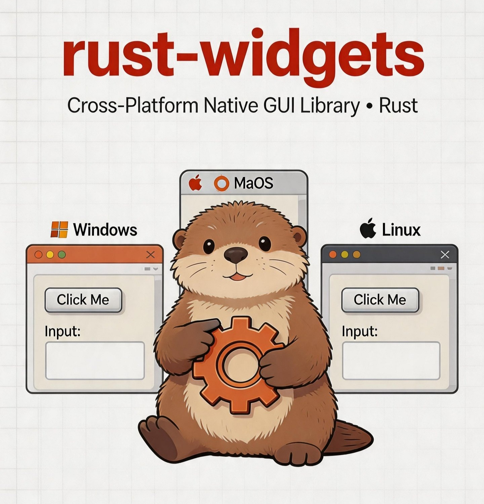

# rust_widgets — Pure Rust GUI Library

<p align="center">
  
</p>

`rust_widgets` is a cross-platform GUI library written in pure Rust. It paints **every control
itself** — there is no `NSButton`, no `gtk_button_new`, no `android.widget.Button`. The OS backend
keeps only what only the OS can provide: a window, the event loop, input translation, IME,
clipboard, file dialogs and DPI. Everything above that is the same code on every target, so the
same widget tree looks and behaves the same everywhere.

It renders into a live window, a PNG, or SVG, and the `mini` / `embedded` profiles run with no OS
services at all.

## Highlights

- **231 widget kinds / 242 core controls** — inputs, tables, trees, docks, dialogs, media, charts,
  editors and more, with one implementation shared by every platform. The optional suites add
  **40 more controls in 7 groups**, installed into the same `WidgetFactory`.
- **Cascading menus and real session state** — dropdowns, menu buttons and menus open up to four
  nested submenu levels, and controls opt in to `SaveState` so a host can restore their user state
  with explicit, restart-stable keys.
- **Reproducible output** — SVG and pixel snapshots are committed per control and per appearance,
  so a visual change is a reviewable diff rather than a screenshot in a chat.
- **Honest capabilities** — a service the host cannot provide returns `false` / `None`; it is
  never simulated and then reported as success.
- **Extensible at runtime** — register your own icons and font faces, or drive the whole library
  from C, C++, Python, Java or Node through the stable C ABI.
- **Small profiles** — the same widgets compile for a full desktop, a phone, a browser tab, or a
  no-OS target with a software rasteriser.

## Install

> **4.2.0** is the current release: the completeness round on top of **4.1.0** (the closed-loop round),
> which itself followed **4.0.1** (the upstream-feedback patch on **4.0.0**, the companion release
> for the **rustage** refactor). This round works through `docs/issues/issue-20261108.md` — hot paths,
> the box-layout cache, container damage, IME preedit on every text surface, and the companion
> controls — makes every constructible control paint an allocation-free steady-state frame, and moves
> the icon catalogue into `crates/rust-widgets-icons`. Existing signatures are preserved; see the
> [changelog](CHANGELOG.md).

```toml
[dependencies]
rust_widgets = "4.2.0"
```

Choose **exactly one** device profile. They are mutually exclusive: `mini` and `embedded` compile
parts of the crate *out*, so pairing one with `desktop` is not a lowest common denominator — it is
a build that cannot work.

```toml
rust_widgets = "4.2.0"                                                             # default set
rust_widgets = { version = "4.2.0", features = ["desktop"] }                       # desktop profile only
rust_widgets = { version = "4.2.0", default-features = false, features = ["tablet"] }
rust_widgets = { version = "4.2.0", default-features = false, features = ["mobile"] }
rust_widgets = { version = "4.2.0", default-features = false, features = ["embedded"] }
rust_widgets = { version = "4.2.0", default-features = false, features = ["mini"] }
```

| Profile | Intended for |
|---|---|
| `desktop` | Windows, macOS, Linux/BSD — native surface, wgpu, charts, accessibility, bundled text (print/PDF are opt-in) |
| `tablet` | Touch-first devices — wgpu, native controls, bundled text, no desktop extras |
| `mobile` | iOS, Android, HarmonyOS — touch, wgpu, mobile platform services |
| `embedded` | Software rasteriser only, no OS services |
| `mini` | The smallest core, `no_std`-oriented |

The two editor controls and the lexer they share are **independent features**, and the default
feature set enables all three:

| Feature | Compiles | In `default` |
|---|---|---|
| `code-editor` | `CodeEditor` — gutter, minimap, folds, completion, diagnostics | yes |
| `markdown-editor` | `MarkdownEditor` plus its toolbar and outline panel | yes |
| `builtin-languages` | the real lexer behind `BuiltinHighlighter` (21 language families) | yes |

A **profile-only** build (`--no-default-features --features desktop`) compiles neither editor, so a
`default-features = false` caller that wants one must name it — and add `builtin-languages` when it
wants syntax highlighting (without it the lexer is an honest stub that produces no tokens). Both
widgets keep every historical import path; `editor` is the shared lower layer they build on, not a
third editor control. See cookbook → Getting Started → *Axis 4*.

> `cargo check --features embedded` is **wrong**, and quietly so: `desktop` is a default feature, so
> that command switches on two mutually exclusive profiles at once. Pass `--no-default-features`
> whenever you select anything other than `desktop`.

## Hello, control

```rust
use rust_widgets::core::{Color, Rect};
use rust_widgets::style::WidgetStyle;
use rust_widgets::widget::base_widgets::button::Button;
use rust_widgets::widget::Widget;   // brings `set_style` into scope

fn main() {
    // A control is a value placed in a `Rect`. Rendering it to SVG is the shortest way to see
    // it; a backend only changes where the pixels go, not how the control draws.
    let mut button = Button::new("Click me".to_string(), Rect::new(0, 0, 160, 36));

    // Style is a struct of optional values, so an unset field inherits rather than overwriting
    // what the theme resolved for this control.
    let style = WidgetStyle {
        background_color: Some(Color::rgb(33, 150, 243)),
        text_color: Some(Color::WHITE),
        border_radius: Some(6),
        ..WidgetStyle::default()
    };
    button.set_style(style);

    println!("{}", rust_widgets::widget::svg::render_to_svg(&mut button));
}
```

Window creation, the event loop, layout, theming, i18n and the C ABI each have their own chapter —
start at [`cookbook/en/src/README.md`](cookbook/en/src/README.md).

## Development paradigms: touch scaffold or desktop workbench

The library ships two composition paradigms, and an application picks one from a **runtime** fact
(the primary display's width), never from the operating system:

| Viewport | Paradigm | Control |
|---|---|---|
| narrower than 840 logical px | AppBar + bottom navigation + FAB + body/drawer | `AdaptiveScaffold` (built with `AdaptiveScaffoldBuilder`) |
| 840 px or wider | independent top-level windows with cascade/tile | `SdiWorkbench`, or `MdiArea` for panes inside one window |

[`examples/paradigm_selection.rs`](examples/paradigm_selection.rs) is the complete decision —
one `match`, no `cfg(target_os)` — and the control demo shows both paradigms side by side. The
scaffold's own breakpoints (bottom bar / rail / drawer) use the same width, so the outer choice and
the scaffold's internal adaptation cannot disagree. Both paradigms are ordinary controls: mount
them on a surface like any other control.


## How it fits together

A control is handed a rectangle by whatever placed it, and that rectangle is the area it **may**
occupy, not how big it should draw. Its preferred size is a floor (a minimum tappable area), a
content size, and a ceiling; layout asks each child for those three answers instead of guessing.
`ControlMetrics` exposes the formula and `widget::metrics::dimensions` holds every dimension, so a
fact has one definition.

Colours resolve through one ladder: the control's explicit style, then the theme's resolved style
for that control, then a literal as the last resort. An untouched control follows an appearance
switch; a caller's deliberate colour always wins.

Behaviour is explicit rather than incidental: `clicked` requires the release to land inside the
control, `pressed` is continuous while a drag stays on it, and a focus ring is drawn only when the
user is actually on the keyboard.

Optional packages sit beside the library rather than inside it, and they are **groups**, not forks:
[`rust-widgets-suites`](crates/rust-widgets-suites) carries the control groups that are not
universal (forms, web, finance, maps, project, devtools and media playback). Each group installs
into the same `WidgetFactory` and owns its names, schemas and constructors.

## What lives under `crates/`

Five packages sit beside the library. None of them is compiled into the core `rust_widgets`
package; a host opts in explicitly.

| Crate | What it is | How a host uses it |
|---|---|---|
| `rust-widgets-font` | The OFL font payloads behind the `fonts-*` features, split out so the core package stays under crates.io's 10 MiB ceiling. | Implicitly, by enabling a `fonts-*` feature. Do not depend on it directly. |
| `rust-widgets-icons` | The Material Symbols outlined icon payloads and the `IconName` table behind the `icons-*` features, split out for the same size reason. `IconName` and the `register_icon` family are re-exported by the core package, so existing call sites are unchanged. | Implicitly, by enabling an `icons-*` feature; runtime icons go through `register_icon` / `register_icon_on_grid`. |
| `rust-widgets-suites` | Seven optional control groups — `form`, `webview`, `finance`, `maps`, `project`, `devtools`, `media-playback` — **40 controls** with the same property, event, layout, wiring and accessibility surfaces as a core control. The web family that used to be the separate `rust-widgets-webview` crate is now the `webview` group. | `rust_widgets_suites::install(&mut factory)`, or one group's `install_*_group`. |
| `mobile-services` | Mobile application-shell services for Android, iOS and HarmonyOS: keep-awake, haptics, permissions, notifications, share, deep links, safe-area insets and orientation lock. Not GUI core. | `rust_widgets_mobile_services::*` on a mobile target; a desktop build never links it. |
| `rust-widgets-cli` | The designer CLI, binary `rwui`: validate a project bundle (`check`), generate committed Rust from it (`json2rust`, with `--check` for drift), normalise a document (`fmt`), and scaffold a runnable project for one device profile (`create`). It drives the library's own generator, so it cannot disagree with it. CSS cascade and reverse parsing are later BLUE31 stages, not part of this binary yet. | `cargo run --manifest-path crates/rust-widgets-cli/Cargo.toml -- check <bundle-or-json>`. |

The suites crate is not a workspace member: it depends on `rust_widgets`, never the reverse, and
the parent package's `include` list excludes `crates/**`, so `cargo package` at the root neither
ships nor compiles it. The CLI is packaged the same way.

## Text, fonts and icons

- The `desktop`, `tablet` and `mobile` profiles include OFL subsets for Latin, complex scripts and
  CJK; `desktop` additionally includes colour emoji. `mini` and `embedded` carry no font data and
  draw a built-in 8x8 bitmap face covering ASCII.
- Text quality is feature-driven: `fonts-vector-latin`, `fonts-complex`, `fonts-cjk`,
  `fonts-cjk-bitmap` and `fonts-emoji-color` can be enabled independently. The font payloads'
  licence record is [`crates/rust-widgets-font/NOTICE`](crates/rust-widgets-font/NOTICE); the root
  `NOTICE` records the non-font material.
- Fonts can be supplied at runtime with `render::text::register_face` (feature `runtime-fonts`).
  Installed system fonts are enumerated through CoreText on Apple targets, DirectWrite on Windows,
  fontconfig on Linux/BSD and `/system/fonts` on Android. `FontDialog` and
  `FontComboBox::load_system_fonts` use one process-wide snapshot, and a chosen family is
  registered from its backend file when one is available.
- The compiled `fonts-cjk` face is a **subset**: ASCII, CJK punctuation, kana, fullwidth forms and
  the first 1000 Han codepoints. A host whose UI text goes past that subset calls
  `render::text::register_system_cjk_font()` (feature `runtime-fonts`) once at startup: it tries
  the common Chinese families in order, registers the file backing the first one installed, and
  returns its name. `None` means no CJK face was found, and the missing glyphs will be tofu —
  the choice is the host's, because which family answers is a typography decision.
- `CodeEditor` lays text out from the **measured** advances of the face that paints it, not from
  a fixed cell width: the compiled Latin face is proportional (Open Sans), so `column × cell` was
  never where a glyph landed. Row height is `font_size × line_height_ratio` (default `1.5`, Zed's
  `Standard` is `1.3` and `Comfortable` `1.618`); `line_advance(0.0)` means "derive it". Its
  pointer is an I-beam over the buffer and an arrow over the gutter, minimap and scrollbar, and a
  click on the minimap scrolls the viewport. An IME composition is drawn at the caret until it is
  committed; tab widths are measured, tabs carry a close affordance and a hover wash; a press on a
  line number selects that line; `Ctrl`+click adds a caret; soft-wrapped continuation rows keep the
  line's indentation; and `relative_line_numbers` switches the gutter to caret-relative numbering.
- `Icon` ships **4,323** `IconName` tokens: the 75 this crate names itself, plus the whole Material
  Symbols catalogue. The three capable profiles draw the real **Material Symbols** outlines by
  default; `mini` / `embedded` draw geometry derived from the same outlines for the 75 named
  tokens, and a catalogue token in such a build reports that it has no fallback rather than
  drawing a wrong picture. Hosts can add icons with `register_icon` or `register_icon_on_grid`.

## Rendering backends

| Backend | Use | Notes |
|---|---|---|
| Software rasteriser | Always available | Anti-aliased, no GPU, runs headless |
| SVG | Snapshots, printing, vector output | Byte-reproducible; this is what `snapshots/svg/` holds |
| wgpu | GPU acceleration | Vulkan / Metal / DX12 / WebGPU → GL → CPU ladder |

The text origin is the glyph box's **top-left**, not a baseline, and both raster and SVG honour
that one contract. That is why a committed SVG is usable as review material instead of being a
second renderer that quietly disagrees.

## Platforms

| Target | Backend | Notes |
|---|---|---|
| Windows | Win32 | Real surface and event loop; DirectWrite font enumeration; printing |
| macOS | AppKit (`cocoa` / `objc2`) | CoreText fonts; accessibility bridge; native file dialogs |
| Linux / BSD | GTK (default) or Wayland native | fontconfig; portal appearance settings on Wayland |
| iOS / Mac Catalyst | UIKit | CoreText fonts; scene lifecycle and safe areas |
| Android | JNI | `/system/fonts`, `PrintManager`, lifecycle forwarding |
| HarmonyOS | Native C + ArkTS bridge | Window, vibrator, permissions and notification services |
| Web (wasm32) | WebGL / WebGPU surface | Visibility, DPR and safe areas |
| Redox | Orbital | Software surface |
| `embedded` / `mini` | None | In-memory buffer; SVG output stays available |

A backend that genuinely cannot provide a service reports it through `Platform::capabilities` and
the matching method, rather than returning a plausible-looking lie.

## C ABI

The C ABI in `src/bindings/` exposes every control through **152 `rw_*` functions** with a
capability-based property and event model. C, C++, Python, Java (JNI) and Node bindings are
exercised in CI, and the generated header is checked for drift by `tools/check_abi.sh`. Start with
[`cookbook/en/src/chapters/language-bindings.md`](cookbook/en/src/chapters/language-bindings.md).

## Documentation

| Document | Contents |
|---|---|
| [`cookbook/`](cookbook/) | The handbook — English, 简体中文, 繁體中文 |
| [`docs/ARCHITECTURE.md`](docs/ARCHITECTURE.md) | Module layout and layering rules |
| [`docs/MIGRATION_GUIDE.md`](docs/MIGRATION_GUIDE.md) | Migrating from 1.x (native controls were removed in 2.0) |
| [`CHANGELOG.md`](CHANGELOG.md) | Release notes, with the evidence for each fix |
| [`docs/plans/`](docs/plans/) | Design plans and the engineering principles behind them |
| [`docs/log/`](docs/log/) | Per-round engineering logs |
| [`docs/reports/`](docs/reports/) | Audit and quality reports |
| [`control.md`](control.md) | The widget gallery, generated from the registry |
| [`crates/rust-widgets-cli`](crates/rust-widgets-cli) | `rwui` — check a project bundle, generate Rust from it, normalise a document, scaffold a project |

## Agent skills (DSH)

[`dsh-plugin/`](dsh-plugin/) packages the `rust-widgets-maintainer` skill for
[DeepSeek Harness](https://github.com/deepseek-ai/deepseek-harness) — the repository
rules, the control/capability checklist and the validation gates as one bundle.
Installing the bundle is the whole setup:

```sh
dsh plugin --profile web add "git+https://github.com/mikewolfli/rust-widgets.git#main&path:/dsh-plugin"
```

The same bundle is listed in a format-1 index for **Plugins → Discover**:
<https://raw.githubusercontent.com/mikewolfli/rust-widgets/main/dsh-plugin/market-index.json>.

## Verifying a change

```bash
cargo fmt --all -- --check
cargo check --all-targets --no-default-features --features "desktop,code-editor,markdown-editor,builtin-languages"
cargo clippy --all-targets --no-default-features --features "desktop,code-editor,markdown-editor,builtin-languages" -- -D warnings
cargo test  --no-default-features --features "desktop,code-editor,markdown-editor,builtin-languages" -q

for profile in embedded mini tablet mobile; do
  cargo test --no-default-features --features "$profile" -q
done

bash tools/run_all_gates.sh
```

Do not reach for `--all-features`: `desktop` and `mini` are mutually exclusive and `mini` switches
the crate to `no_std`, so it is not a substitute for the matrix. Host-limited checks report as
skipped; native GTK, Apple and Android tests run in platform-specific CI jobs.

## Requirements

Rust **1.88+**. Drawing controls needs no GUI toolkit. On Linux the `desktop` profile enables GTK
for host integration, and a Wayland-native build is available with the `wayland-native` feature.
Image codecs are pure Rust, so cross-compiling to Android, iOS or wasm needs no `pkg-config`
sysroot.

## License

MIT — see [LICENSE](LICENSE). Third-party font, icon and codec data is recorded with its licence in
[`NOTICE`](NOTICE) and [`crates/rust-widgets-font/NOTICE`](crates/rust-widgets-font/NOTICE).

## Links

- [简体中文 README](README.zh-CN.md)
- [Cookbook](cookbook/)
- [Issues](https://github.com/mikewolfli/rust-widgets/issues)
