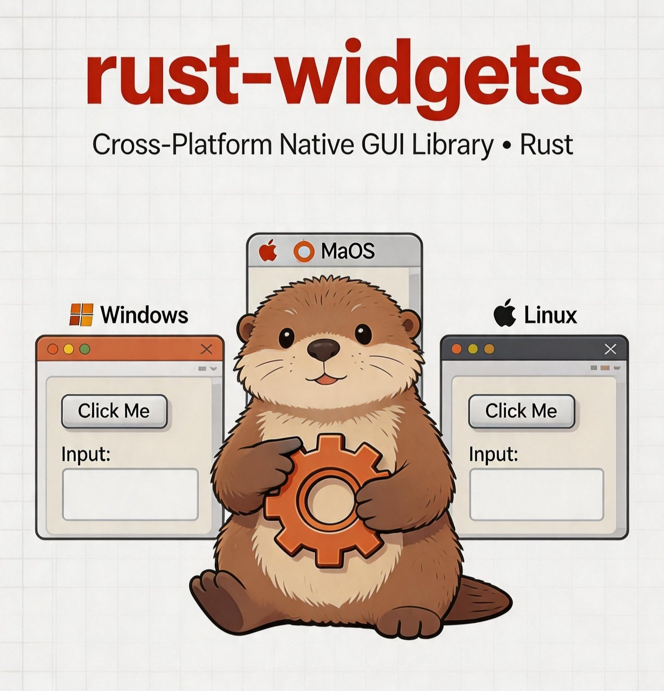

# rust_widgets — 纯 Rust GUI 库

<p align="center">
  
</p>

`rust_widgets` 是一个用纯 Rust 写的跨平台 GUI 库。**每一个控件都由它自己绘制**——没有 `NSButton`、
没有 `gtk_button_new`、没有 `android.widget.Button`。平台后端只保留只有操作系统才能提供的东西：
窗口、事件循环、输入转换、IME、剪贴板、文件对话框与 DPI。除此之外的全部逻辑在所有目标上都是同一份
代码，因此同一棵控件树在每个平台上的外观与行为都一致。

它可以把控件渲染到真实窗口、PNG 或 SVG；`mini` 与 `embedded` 配置完全不依赖操作系统服务。

## 特点

- **221 种控件**——输入、表格、树、停靠面板、对话框、媒体、图表、编辑器等，所有平台共用同一套实现。
- **输出可复现**——每个控件、每种外观都有提交到仓库的 SVG 与像素快照，视觉变化因此是可审阅的 diff，
  而不是聊天窗口里的一张截图。
- **能力诚实**——宿主提供不了的服务返回 `false` / `None`；不会先假装成功再报告“已完成”。
- **运行时可扩展**——可以注册自己的图标与字体，也可以通过稳定的 C ABI 从 C、C++、Python、Java 或 Node
  驱动整个库。
- **配置可裁剪**——同一套控件既能编译进完整桌面，也能编译进手机、浏览器标签页，或没有操作系统的
  软件光栅目标。

## 安装

```toml
[dependencies]
rust_widgets = "2.9.0"
```

**必须且只能选择一个设备配置**。它们互斥：`mini` 与 `embedded` 会把 crate 的一部分*编译掉*，
与 `desktop` 叠加不是“取最小公共集”，而是一个无法工作的构建。

```toml
rust_widgets = { version = "2.9.0", features = ["desktop"] }                       # 默认
rust_widgets = { version = "2.9.0", default-features = false, features = ["tablet"] }
rust_widgets = { version = "2.9.0", default-features = false, features = ["mobile"] }
rust_widgets = { version = "2.9.0", default-features = false, features = ["embedded"] }
rust_widgets = { version = "2.9.0", default-features = false, features = ["mini"] }
```

| 配置 | 适用场景 |
|---|---|
| `desktop` | Windows、macOS、Linux/BSD——原生表面、wgpu、打印/PDF、图表、无障碍、内置文本数据 |
| `tablet` | 触屏优先设备——wgpu、原生控件、内置文本数据，不含桌面附加项 |
| `mobile` | iOS、Android、HarmonyOS——触摸、wgpu、移动平台服务 |
| `embedded` | 只有软件光栅，不依赖操作系统服务 |
| `mini` | 最小核心，面向 `no_std` |

> `cargo check --features embedded` 是**错误**的，而且错得很安静：`desktop` 是默认特性，这条命令会同时
> 打开两个互斥配置。选择 `desktop` 以外的配置时，必须加 `--no-default-features`。

## 你好，控件

```rust
use rust_widgets::core::{Color, Rect};
use rust_widgets::style::WidgetStyle;
use rust_widgets::widget::base_widgets::button::Button;
use rust_widgets::widget::Widget;   // 让 `set_style` 进入作用域

fn main() {
    // 控件就是放进 `Rect` 里的一个值。渲染成 SVG 是看到它的最短路径；
    // 后端只改变像素去哪里，不改变控件怎么画。
    let mut button = Button::new("点我".to_string(), Rect::new(0, 0, 160, 36));

    // Style 是一组可选值：未设置的字段会继承主题解析结果，而不是覆盖它。
    let style = WidgetStyle {
        background_color: Some(Color::rgb(33, 150, 243)),
        text_color: Some(Color::WHITE),
        border_radius: Some(6),
        ..WidgetStyle::default()
    };
    button.set_style(style);

    println!("{}", rust_widgets::widget::svg::render_to_svg(&mut button));
}
```

窗口创建、事件循环、布局、主题、i18n 与 C ABI 各有独立章节——从
[`cookbook/zh-CN/src/README.md`](cookbook/zh-CN/src/README.md) 开始。

## 组成方式

控件拿到的是一个矩形，这个矩形是它**可以占用**的区域，而不是它应该画多大。控件的期望尺寸由三部分
组成：下限（最小可点击区域）、内容尺寸、上限；布局逐个子控件询问这三个答案，而不是提前猜一个数。
`ControlMetrics` 暴露这条公式，`widget::metrics::dimensions` 保存每一个控件尺寸，因此同一个事实只有
一处定义。

颜色按一条阶梯解析：控件显式样式 → 主题为该控件解析出的样式 → 最后的字面默认值。未显式设置的控件
会跟随外观切换；调用方明确指定的颜色永远优先。

行为是明确的，而不是碰巧如此：`clicked` 要求释放落在控件内部；按住后连续拖动时 `pressed` 保持；
焦点环只在用户确实使用键盘时绘制。

## 文本、字体与图标

- `desktop`、`tablet`、`mobile` 配置内置 Latin、复杂脚本与 CJK 的 OFL 子集；`desktop` 还内置彩色
  emoji。`mini` 与 `embedded` 不携带字体数据，使用内置 8x8 位图字体覆盖 ASCII 字符。
- 文本质量按特性选择：`fonts-vector-latin`、`fonts-complex`、`fonts-cjk`、`fonts-cjk-bitmap`、
  `fonts-emoji-color` 可以独立开启。`NOTICE` 记录上游作品与许可证。
- 运行时可注册字体：`render::text::register_face`（特性 `runtime-fonts`）。系统字体在 Apple 平台
  通过 CoreText、Windows 通过 DirectWrite、Linux/BSD 通过 fontconfig、Android 通过 `/system/fonts`
  枚举。`FontDialog` 与 `FontComboBox::load_system_fonts` 共用一份进程级快照；选择某个家族时，如果
  后端给出了对应文件，就通过 `register_face` 真正加载它。
- 内置的 `fonts-cjk` 字体是**子集**：ASCII、CJK 标点、假名、全角形式与 U+4E00 起的前 1000 个汉字。
  界面文字超出该子集时，宿主在启动时调用一次 `render::text::register_system_cjk_font()`
  （特性 `runtime-fonts`）：它按顺序尝试常见中文字体，为第一个已安装的家族注册其文件并返回家族名。
  返回 `None` 表示本机没有可用的 CJK 字体，缺失的字会画成方框——选择由宿主决定，因为用哪个
  家族属于排版决策。
- `CodeEditor` 按**实际字体度量**排版，而不是固定字符格：内置拉丁字体是比例字体（Open Sans），
  `column × cell` 从来就不是字形真正落下的位置。行高为 `font_size × line_height_ratio`（默认 `1.5`，
  Zed 的 `Standard` 是 `1.3`、`Comfortable` 是 `1.618`），`line_advance(0.0)` 表示“由字号推导”。
  指针在正文上是 I 型光标，在行号槽、缩略图和滚动条上恢复箭头；点击缩略图会按比例滚动视口。
  输入法的预编辑串在提交前绘制在光标处；标签页宽度按字体度量，带关闭按钮与悬停底色；
  点击行号选中整行；`Ctrl`+点击增加光标；软换行的续行沿用该行的缩进；
  `relative_line_numbers` 把行号槽切换为相对光标的编号。
- `Icon` 提供 **69** 个 `IconName` 令牌。三个完整配置默认绘制真实的 **Material Symbols** 轮廓；
  `mini` / `embedded` 绘制由同一份轮廓生成的几何图形，因此两条路径不会给出不同形状。宿主可以用
  `register_icon` 或 `register_icon_on_grid` 添加自己的图标。

## 渲染后端

| 后端 | 用途 | 说明 |
|---|---|---|
| 软件光栅 | 所有配置可用 | 抗锯齿、不需要 GPU、可无界面运行 |
| SVG | 快照、打印、矢量输出 | 字节可复现；`snapshots/svg/` 保存的就是它 |
| wgpu | GPU 加速 | Vulkan / Metal / DX12 / WebGPU → GL → CPU 阶梯 |

文本原点是字形盒的**左上角**，不是基线；软件光栅与 SVG 都遵守这一条契约。正因如此，提交到仓库的
SVG 才能作为评审材料，而不是一个会悄悄给出不同结果的第二渲染器。

## 平台

| 目标 | 后端 | 说明 |
|---|---|---|
| Windows | Win32 | 真实表面与事件循环；DirectWrite 字体枚举；打印 |
| macOS | AppKit（`cocoa` / `objc2`） | CoreText 字体；无障碍桥；原生文件对话框 |
| Linux / BSD | GTK（默认）或 Wayland 原生 | fontconfig；Wayland 支持 portal 外观设置 |
| iOS / Mac Catalyst | UIKit | CoreText 字体；场景生命周期与安全区 |
| Android | JNI | `/system/fonts`、`PrintManager`、生命周期转发 |
| HarmonyOS | 原生 C + ArkTS 桥 | 窗口、震动、权限与通知服务 |
| Web（wasm32） | WebGL / WebGPU 表面 | 可见性、DPR 与安全区 |
| Redox | Orbital | 软件表面 |
| `embedded` / `mini` | 无 | 内存缓冲；仍可输出 SVG |

后端确实提供不了某项服务时，会通过 `Platform::capabilities` 与对应方法如实报告，而不是返回一个
看起来合理的假结果。

## C ABI

`src/bindings/` 里的 C ABI 用 **152 个 `rw_*` 函数**把每个控件暴露出去，配一套基于能力（capability）
的属性与事件模型。C、C++、Python、Java（JNI）与 Node 绑定都在 CI 里跑过；生成的头文件由
`tools/check_abi.sh` 检查漂移。从
[`cookbook/zh-CN/src/chapters/language-bindings.md`](cookbook/zh-CN/src/chapters/language-bindings.md)
开始。

## 文档

| 文档 | 内容 |
|---|---|
| [`cookbook/`](cookbook/) | 手册——English、简体中文、繁體中文 |
| [`docs/ARCHITECTURE.md`](docs/ARCHITECTURE.md) | 模块划分与分层规则 |
| [`docs/MIGRATION_GUIDE.md`](docs/MIGRATION_GUIDE.md) | 从 1.x 迁移（原生控件已在 2.0 移除） |
| [`CHANGELOG.md`](CHANGELOG.md) | 版本说明，以及每个修复的证据 |
| [`docs/plans/`](docs/plans/) | 设计计划与背后的工程原则 |
| [`docs/log/`](docs/log/) | 每一轮的工程记录 |
| [`docs/reports/`](docs/reports/) | 审计与质量报告 |
| [`control.md`](control.md) | 由注册表生成的控件画廊 |

## 验证改动

```bash
cargo fmt --all -- --check
cargo check --all-targets --no-default-features --features desktop
cargo clippy --all-targets --no-default-features --features desktop -- -D warnings
cargo test  --no-default-features --features desktop -q

for profile in embedded mini tablet mobile; do
  cargo test --no-default-features --features "$profile" -q
done

bash tools/run_all_gates.sh
```

不要用 `--all-features` 代替矩阵：`desktop` 与 `mini` 互斥，而且 `mini` 会把 crate 切到 `no_std`。
宿主条件不满足的检查会显示为跳过；GTK、Apple 与 Android 的原生测试在对应平台的 CI 任务中运行。

## 环境要求

Rust **1.88+**。绘制控件不需要任何 GUI 工具链。Linux 上的 `desktop` 配置会启用 GTK 做宿主集成，
也可以选择 `wayland-native` 特性构建纯 Wayland 版本。图像编解码是纯 Rust，因此交叉编译到 Android、
iOS 或 wasm 不需要 `pkg-config` sysroot。

## 许可证

MIT——见 [LICENSE](LICENSE)。第三方字体、图标与编解码数据的许可证记录在 [`NOTICE`](NOTICE)。

## 链接

- [English README](README.md)
- [手册](cookbook/)
- [问题反馈](https://github.com/mikewolfli/rust-widgets/issues)
