<!-- Generated by tools/generate_control_index.py — do not hand-edit. -->

# 控件图像总览 / Control gallery

本页共 **247** 张控件快照名（每个两种外观，共 **494** 张 SVG）。
这些名字来自控件注册表（`factory.widget_names()`），其中包含少量**别名**
（如 `wizard_dialog` 同时以 `wizard` 注册），因此快照名数多于 `WidgetKind` 的枚举数（**228**）。

此外还有 **10** 张**状态快照**（下表），它们不是额外的控件，而是某个控件在用户可切换到的状态下的样子。

| 状态快照 | 控件 | 说明 |
|---|---|---|
| `snapshots/svg/frame_panel.svg` | `frame` | `frame` 的 `panel` 态（默认外观） |
| `snapshots/svg/frame_styled_panel.svg` | `frame` | `frame` 的 `styled_panel` 态（默认外观） |
| `snapshots/svg/frame_win_panel.svg` | `frame` | `frame` 的 `win_panel` 态（默认外观） |
| `snapshots/svg/group_box_checked.svg` | `group_box` | `group_box` 的 `checked` 态（默认外观） |
| `snapshots/svg/icon_info.svg` | `icon` | `icon` 的 `info` 态（默认外观） |
| `snapshots/svg/radio_button_checked.svg` | `radio_button` | `radio_button` 的 `checked` 态（默认外观） |
| `snapshots/svg/skeleton_loader_circle.svg` | `skeleton_loader` | `skeleton_loader` 的 `circle` 态（默认外观） |
| `snapshots/svg/skeleton_loader_textline.svg` | `skeleton_loader` | `skeleton_loader` 的 `textline` 态（默认外观） |
| `snapshots/svg/toggle_button_checked.svg` | `toggle_button` | `toggle_button` 的 `checked` 态（默认外观） |
| `snapshots/svg/tooltip_shown.svg` | `tooltip` | `tooltip` 的 `shown` 态（默认外观） |

这些图片由 `examples/export_control_svgs.rs` 从**控件注册表**导出，并由 `tools/check_svg_snapshots.sh` 门禁保证「重新生成的结果与提交的字节完全一致」。因此它们是**产物**而不是手绘插图：任何控件的绘制改动都会在这里以 diff 的形式出现。

`snapshots/svg/icon_sheet.svg` 与 `icon_sheet.light.svg` 是**图标雪碧图**（整套 `IconName` 排成网格），不是控件快照：它由 `examples/export_icon_sheet.rs` 生成，并由同一个 `tools/check_svg_snapshots.sh` 门禁校验字节一致，因此不列入上表。

| | |
|---|---|
| 画布 | 240 x 120（与渲染普查的 `CENSUS_RECT` 相同，因此控件之间可横向对比） |
| 深色 | `snapshots/svg/<name>.svg` |
| 浅色 | `snapshots/svg/<name>.light.svg` |
| 重新生成 | `cargo run --no-default-features --features desktop --example export_control_svgs` |
| 分组依据 | 控件实现所在的模块目录（`src/widget/<family>/`），由本脚本自动推导 |

每个分组下面是一张**多列表格**，每行一个控件，深色与浅色并排，便于横向对比；控件名即快照文件名（去掉 `.svg` / `.light.svg`）。

## 分组统计 / Families

| 分组 | 控件数 | 本节 |
|---|---|---|
| Base controls (`base_widgets`) | 6 | [跳转](#base-controls) |
| Input controls (`input_widgets`) | 29 | [跳转](#input-controls) |
| Display controls (`display_widgets`) | 27 | [跳转](#display-controls) |
| Containers (`container_widgets`) | 27 | [跳转](#containers) |
| Navigation (`nav_widgets`) | 7 | [跳转](#navigation) |
| Menus and toolbars (`menu_toolbar`) | 9 | [跳转](#menus-and-toolbars) |
| Dialogs (`dialog`) | 17 | [跳转](#dialogs) |
| Overlays (`overlay_widgets`) | 5 | [跳转](#overlays) |
| Views (`view_widgets`) | 15 | [跳转](#views) |
| Charts (`chart_widgets`) | 5 | [跳转](#charts) |
| Specialised controls (`special_widgets`) | 44 | [跳转](#specialised-controls) |
| Advanced controls (`advanced_widgets`) | 10 | [跳转](#advanced-controls) |
| Media and web (`media_widgets`) | 7 | [跳转](#media-and-web) |
| Miscellaneous (`misc_widgets`) | 9 | [跳转](#miscellaneous) |
| Cupertino (iOS-style) (`cupertino`) | 8 | [跳转](#cupertino-ios-style) |
| Web (`web_widgets`) | 2 | [跳转](#web) |
| companions (`companions`) | 13 | [跳转](#companions) |
| macos (`macos`) | 5 | [跳转](#macos) |
| Core controls (`root`) | 2 | [跳转](#core-controls) |
| **合计** | **247** | |

## Base controls

`base_widgets` — 6 个控件。

| 控件 | 深色 | 浅色 |
|---|---|---|
| `button` | 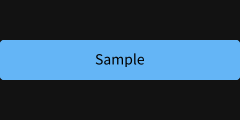 | 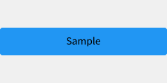 |
| `check_box` |  |  |
| `frame` |  |  |
| `label` |  |  |
| `radio_button` |  |  |
| `toggle_button` |  |  |

## Input controls

`input_widgets` — 29 个控件。

| 控件 | 深色 | 浅色 |
|---|---|---|
| `auto_complete_edit` |  |  |
| `cascader` |  |  |
| `combo_box` |  | 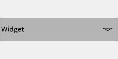 |
| `command_link` |  |  |
| `dropdown` |  | 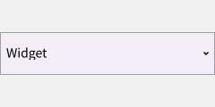 |
| `editable_combo_box` | 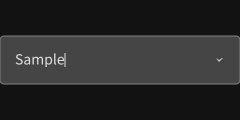 |  |
| `email_input` |  | 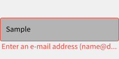 |
| `font_combo_box` | 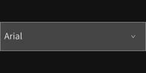 | 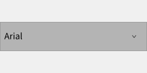 |
| `ime_preedit` |  |  |
| `inplace_editor` | 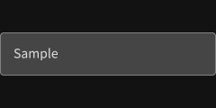 | 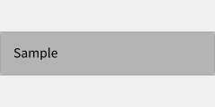 |
| `keyboard` | 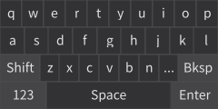 | 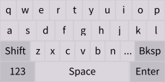 |
| `line_edit` | 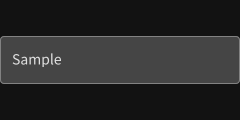 | 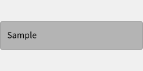 |
| `list_box` | 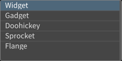 | 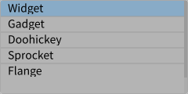 |
| `masked_edit` | 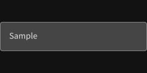 | 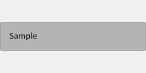 |
| `mention` |  |  |
| `multi_select_combo_box` |  |  |
| `number_picker` | 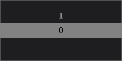 |  |
| `otp_input` | 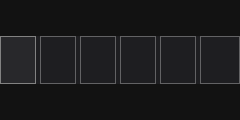 | 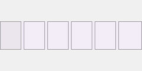 |
| `password_edit` |  |  |
| `phone_input` |  |  |
| `range_slider` | 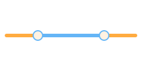 |  |
| `rich_edit` | 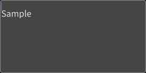 |  |
| `search_bar` |  | 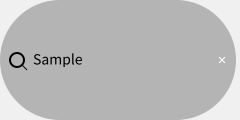 |
| `search_box` | 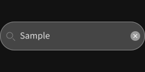 | 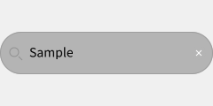 |
| `shortcut_editor` | 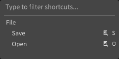 | 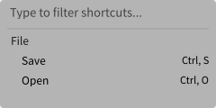 |
| `spin_box` | 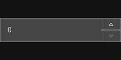 | 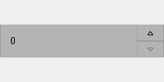 |
| `tag_input` |  |  |
| `text_area` | 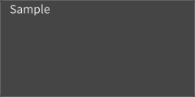 |  |
| `text_edit` | 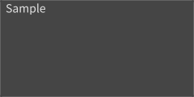 |  |

## Display controls

`display_widgets` — 27 个控件。

| 控件 | 深色 | 浅色 |
|---|---|---|
| `arc` | 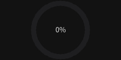 |  |
| `badge` |  |  |
| `clock` | 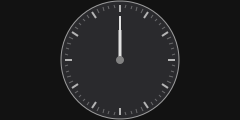 | 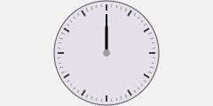 |
| `color_history` |  |  |
| `color_well` |  | 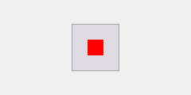 |
| `divider` |  |  |
| `emoji_picker` | 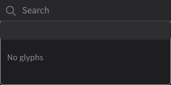 |  |
| `empty_state` | 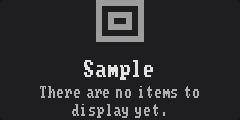 |  |
| `floating_label` |  |  |
| `font_preview` |  |  |
| `icon` |  |  |
| `image_view` |  |  |
| `lcd_number` |  |  |
| `line` |  |  |
| `meter` | 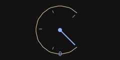 | 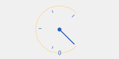 |
| `mini_canvas` |  |  |
| `mini_chart` |  |  |
| `progress_bar` | 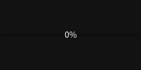 | 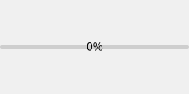 |
| `progress_circle` |  |  |
| `rating` |  |  |
| `roller` | 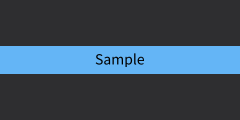 | 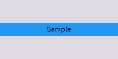 |
| `scroll_bar` | 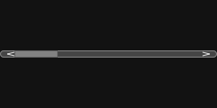 | 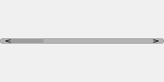 |
| `skeleton_loader` |  |  |
| `slider` | 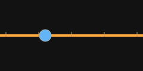 |  |
| `spinner` |  |  |
| `switch` |  |  |
| `tag` |  | 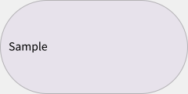 |

## Containers

`container_widgets` — 27 个控件。

| 控件 | 深色 | 浅色 |
|---|---|---|
| `accordion` | 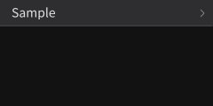 | 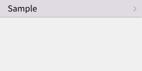 |
| `align` |  |  |
| `aspect_ratio` |  |  |
| `carousel` |  |  |
| `center` |  |  |
| `collapsible_pane` |  |  |
| `dock_widget` |  |  |
| `expanded` |  |  |
| `flex` |  |  |
| `flexible` |  |  |
| `flow_layout` |  |  |
| `group_box` |  |  |
| `intrinsic_width` |  |  |
| `masonry_layout` |  |  |
| `mdi_area` |  |  |
| `padding` |  |  |
| `panel` |  |  |
| `safe_area` |  |  |
| `scroll_area` |  |  |
| `sized_box` |  |  |
| `spacer` |  |  |
| `split_layout` |  |  |
| `splitter` |  |  |
| `stacked_widget` |  |  |
| `stepper` |  |  |
| `tab_widget` |  |  |
| `wrap_layout` |  |  |

## Navigation

`nav_widgets` — 7 个控件。

| 控件 | 深色 | 浅色 |
|---|---|---|
| `adaptive_scaffold` |  |  |
| `app_bar` |  |  |
| `bottom_navigation_bar` |  |  |
| `navigation_drawer` |  |  |
| `navigation_stack` |  |  |
| `pagination` |  |  |
| `tab_view` |  |  |

## Menus and toolbars

`menu_toolbar` — 9 个控件。

| 控件 | 深色 | 浅色 |
|---|---|---|
| `action` |  |  |
| `context_menu` |  |  |
| `dropdown_menu` |  |  |
| `menu` |  |  |
| `menu_bar` |  |  |
| `menu_button` |  |  |
| `status_bar` |  |  |
| `tool_bar` |  |  |
| `tool_button` |  |  |

## Dialogs

`dialog` — 17 个控件。

| 控件 | 深色 | 浅色 |
|---|---|---|
| `about_dialog` |  |  |
| `alert_dialog` |  |  |
| `bottom_sheet` |  |  |
| `color_dialog` |  |  |
| `confirm_dialog` |  |  |
| `dialog` |  |  |
| `file_dialog` |  |  |
| `find_replace_dialog` |  |  |
| `font_dialog` |  |  |
| `input_dialog` |  |  |
| `message_box` |  |  |
| `modal_bottom_sheet` |  |  |
| `popover` |  |  |
| `popup_window` |  |  |
| `progress_dialog` |  |  |
| `tooltip` |  |  |
| `wizard_dialog` |  |  |

## Overlays

`overlay_widgets` — 5 个控件。

| 控件 | 深色 | 浅色 |
|---|---|---|
| `banner` |  |  |
| `fab` |  |  |
| `refresh_control` |  |  |
| `splash_screen` |  |  |
| `swipe_to_dismiss` |  |  |

## Views

`view_widgets` — 15 个控件。

| 控件 | 深色 | 浅色 |
|---|---|---|
| `data_grid` |  |  |
| `data_view` |  |  |
| `grid_table` |  |  |
| `grid_view_header` |  |  |
| `image_gallery` |  |  |
| `list_view` |  |  |
| `properties_panel` |  |  |
| `property_grid` |  |  |
| `query_builder` |  |  |
| `table` |  |  |
| `table_widget` |  |  |
| `tree_table` |  |  |
| `tree_view` |  |  |
| `virtual_list` |  |  |
| `virtual_table` |  |  |

## Charts

`chart_widgets` — 5 个控件。

| 控件 | 深色 | 浅色 |
|---|---|---|
| `bar_chart` |  |  |
| `gauge` |  |  |
| `line_chart` |  |  |
| `pie_chart` |  |  |
| `sparkline` |  |  |

## Specialised controls

`special_widgets` — 44 个控件。

| 控件 | 深色 | 浅色 |
|---|---|---|
| `breadcrumb` |  |  |
| `candlestick_chart` |  |  |
| `canvas` |  |  |
| `chart` |  |  |
| `chip` |  |  |
| `code_editor` |  |  |
| `color_picker` |  |  |
| `command_palette` |  |  |
| `compass` |  |  |
| `dependency_editor` |  |  |
| `depth_chart` |  |  |
| `diff_file_list` |  |  |
| `diff_viewer` |  |  |
| `find_bar` |  |  |
| `freeform_shape` |  |  |
| `gantt_widget` |  |  |
| `grid` |  |  |
| `heatmap` |  |  |
| `indicator_chart` |  |  |
| `kanban_board` |  |  |
| `kanban_card_view` |  |  |
| `kanban_column_header` |  |  |
| `map_view` |  |  |
| `markdown_editor` |  |  |
| `markdown_outline_panel` |  |  |
| `media_player` |  |  |
| `notification_center` |  |  |
| `order_book` |  |  |
| `quote_board` |  |  |
| `radar_chart` |  |  |
| `scale_bar` |  |  |
| `segmented_control` |  |  |
| `shape_canvas` |  |  |
| `signature_pad` |  |  |
| `snackbar` |  |  |
| `split_button` |  |  |
| `terminal_view` |  |  |
| `tile_loader` |  |  |
| `timeline_axis` |  |  |
| `timeline_widget` |  |  |
| `toast` |  |  |
| `toast_stack` |  |  |
| `volume_chart` |  |  |
| `zoom_control` |  |  |

## Advanced controls

`advanced_widgets` — 10 个控件。

| 控件 | 深色 | 浅色 |
|---|---|---|
| `calendar` |  |  |
| `date_edit` |  |  |
| `date_time_edit` |  |  |
| `dial` |  |  |
| `key_sequence_editor` |  |  |
| `pie_menu` |  |  |
| `ribbon_bar` |  |  |
| `tab_bar` |  |  |
| `time_edit` |  |  |
| `time_picker` |  |  |

## Media and web

`media_widgets` — 7 个控件。

| 控件 | 深色 | 浅色 |
|---|---|---|
| `animated_image` |  |  |
| `audio_visualizer` |  |  |
| `camera_preview` |  |  |
| `hero_animation` |  |  |
| `lottie_widget` |  |  |
| `rive_widget` |  |  |
| `video_player` |  |  |

## Miscellaneous

`misc_widgets` — 9 个控件。

| 控件 | 深色 | 浅色 |
|---|---|---|
| `avatar` |  |  |
| `barcode_scanner` |  |  |
| `bezier_curve_editor` |  |  |
| `date_range_picker` |  |  |
| `drop_zone` |  |  |
| `mobile_date_picker` |  |  |
| `qr_code` |  |  |
| `range_preset_bar` |  |  |
| `segmented_button` |  |  |

## Cupertino (iOS-style)

`cupertino` — 8 个控件。

| 控件 | 深色 | 浅色 |
|---|---|---|
| `cupertino_alert_dialog` |  |  |
| `cupertino_date_picker` |  |  |
| `cupertino_navigation_bar` |  |  |
| `cupertino_segmented_control` |  |  |
| `cupertino_slider` |  |  |
| `cupertino_switch` |  |  |
| `material_navigation_rail` |  |  |
| `material_snackbar` |  |  |

## Web

`web_widgets` — 2 个控件。

| 控件 | 深色 | 浅色 |
|---|---|---|
| `web_engine_view` |  |  |
| `web_find_bar` |  |  |

## companions

`companions` — 13 个控件。

| 控件 | 深色 | 浅色 |
|---|---|---|
| `chart_tooltip` |  |  |
| `drawer_section_header` |  |  |
| `filter_row` |  |  |
| `layer_panel` |  |  |
| `legend` |  |  |
| `menu_panel` |  |  |
| `playlist_panel` |  |  |
| `speed_dial` |  |  |
| `swatch` |  |  |
| `swipe_actions` |  |  |
| `toast_host` |  |  |
| `tooltip_manager` |  |  |
| `zoom_pan_controller` |  |  |

## macos

`macos` — 5 个控件。

| 控件 | 深色 | 浅色 |
|---|---|---|
| `mac_segmented_control` |  |  |
| `mac_source_list` |  |  |
| `mac_stepper` |  |  |
| `mac_toolbar` |  |  |
| `mac_window_chrome` |  |  |

## Core controls

`root` — 2 个控件。

| 控件 | 深色 | 浅色 |
|---|---|---|
| `tool_box` |  |  |
| `window` |  |  |

## Companion pairings (21)

每张 `pair_<name>.svg`（深色）与 `pair_<name>.light.svg`（浅色）都是**一个主控件**与**它的伴随控件**画在同一张 240 x 120 画布上的合影。`<name>` 是主控件的注册名，因此从控件本身就能找到它的配对图。

| 配对 | 主控件 | 伴随控件 | 深色 | 浅色 |
|---|---|---|---|---|
| `pair_combo_box` | `combo_box` | `SuggestionPopup` |  |  |
| `pair_line_edit` | `line_edit` | `ValidationBubble` |  |  |
| `pair_auto_complete_edit` | `auto_complete_edit` | `RecentValuesPopup` |  |  |
| `pair_fab` | `fab` | `SpeedDial` |  |  |
| `pair_swipe_to_dismiss` | `swipe_to_dismiss` | `SwipeActions` |  |  |
| `pair_navigation_drawer` | `navigation_drawer` | `DrawerSectionHeader` |  |  |
| `pair_line_chart` | `line_chart` | `ChartCrosshair` |  |  |
| `pair_data_grid` | `data_grid` | `GridFindBar` |  |  |
| `pair_menu_button` | `menu_button` | `MenuPanel` |  |  |
| `pair_canvas` | `canvas` | `LayerPanel` |  |  |
| `pair_media_player` | `media_player` | `MediaTransportBar` |  |  |
| `pair_video_player` | `video_player` | `SubtitleBar` |  |  |
| `pair_list_box` | `list_box` | `Scrollbar` |  |  |
| `pair_number_picker` | `number_picker` | `StepButtons` |  |  |
| `pair_date_range_picker` | `date_range_picker` | `PresetChipBar` |  |  |
| `pair_mobile_date_picker` | `mobile_date_picker` | `DrumColumn` |  |  |
| `pair_ribbon_bar` | `ribbon_bar` | `KeyTipBadge` |  |  |
| `pair_tag_input` | `tag_input` | `Chip` |  |  |
| `pair_dialog` | `dialog` | `ModalHost` |  |  |
| `pair_tag` | `tag` | `TagGroup` |  |  |
| `pair_image_gallery` | `image_gallery` | `ColumnChooser` |  |  |

