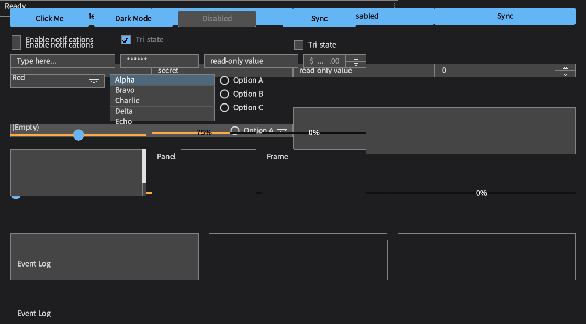
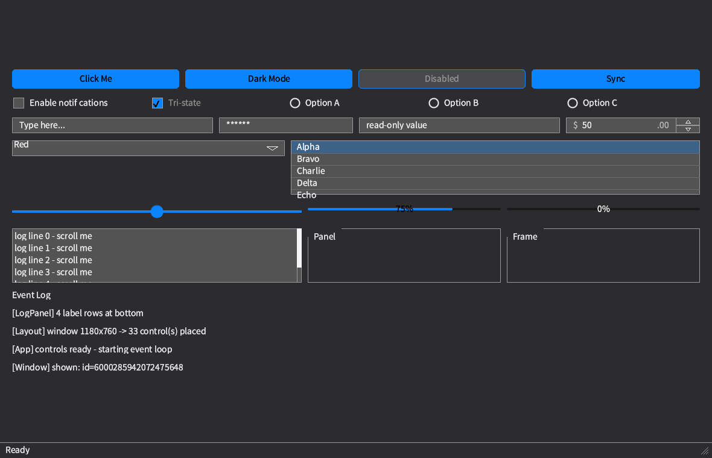
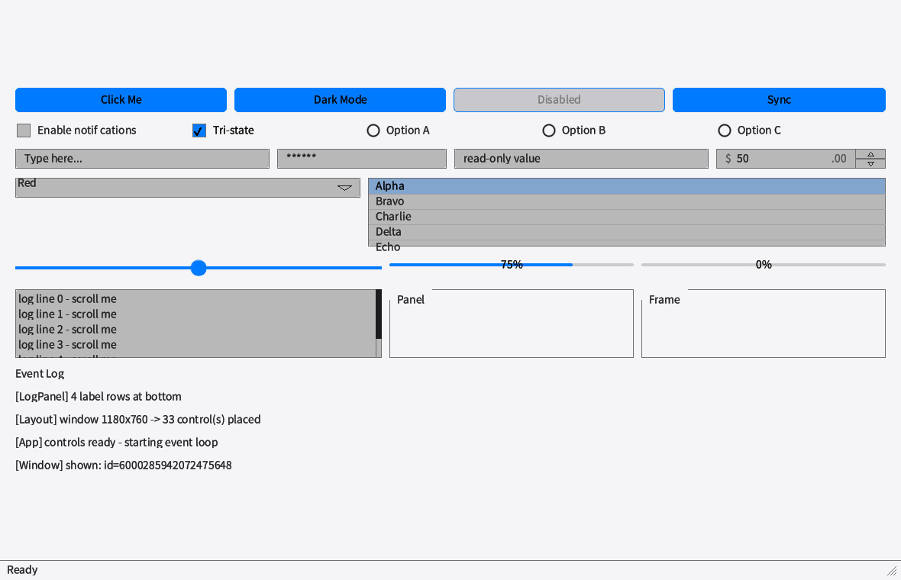
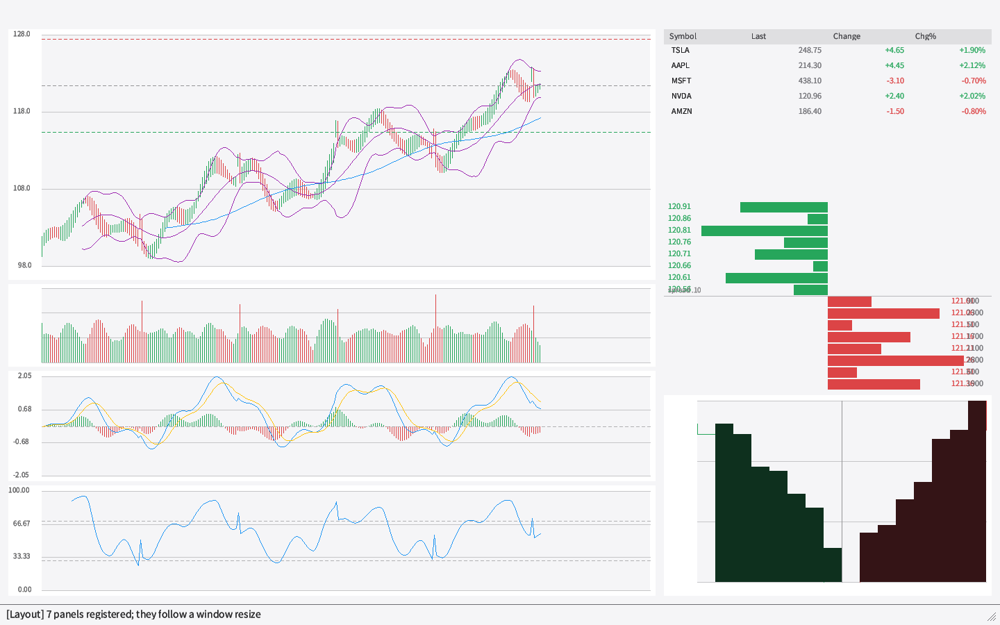
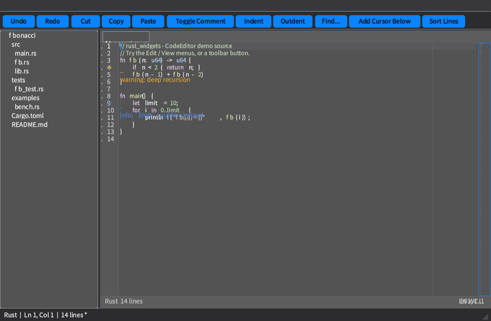

# 反馈闭环实施记录（2026-10-20，Linux 宿主）

> 依据：[`docs/plans/principle.md`](../plans/principle.md) #1/#2/#10/#11/#16/#37/#56/#59/#105，
> 以及 [`docs/issues/feedback-20261019.md`](../issues/feedback-20261019.md) §4/§5。
> 本轮在 **Linux 宿主**（非 macOS）上执行，因此首次真正编译并运行了 GTK/Linux 后端。

## 0. 本轮完成率（口径写明）

| 项 | 结果 | 判定口径 | 未覆盖范围 |
|---|---|---|---|
| feedback §4：Linux × `mini` 编译 | **1/1 闭合** | 反馈给出的命令以 `Finished` 结束，且 `mini --all-targets`、`mini × 六个后端`、四个交叉 target 全部通过 | 未跑 `embedded` 以外的历史 profile 组合（与 #4 无关） |
| feedback §5.1：Linux 原生 GUI 的 `--keys`/`--ime` | **1/1 闭合** | 真实 X11（`:0`，Metacity）下 XTEST 注入 `abc` 与 fcitx5 拼音 `nihao `；文本、值通知、焦点、按钮零点击全部断言通过 | 宿主侧 `tools/gui-smoke/run.py` 不在本仓库；用本仓库的 `examples/probe_keyboard_focus` 替代 |
| feedback §5.2：可观察的 preedit | **1/1 闭合** | 新增 `WidgetHandle::on_ime_preedit` + `widget::runtime` 观察者表；真实 IME 运行观察到 `n@0`…`ni hao@0` 再提交 `你好` | 观察者是线程本地回调，不是跨线程通道；跨线程宿主需投递到 UI 线程后读取 |
| 本轮新发现的缺陷 | **7 类全部修复** | 每类都有“修复前失败 → 修复后通过”的命令与输出（见 §3–§7） | 见 §9 |
| 全量测试 | **7401 passed / 0 failed** | `cargo test --no-default-features --features desktop -q`，退出码 0 | `icons` 组合与 `--ignored` 编译用例未在本轮重跑 |
| clippy / fmt | **通过** | `clippy --all-targets --features desktop -D warnings`、`cargo fmt --check` | 其它 profile 的 clippy 未逐格重跑 |

**口径说明**：上表的“闭合”只覆盖本文件的判据；“新发现 6 类”是实际修复的缺陷类别，不是对全部平台矩阵的完整性声明。

## 1. 本轮证据来自哪台机器

| 项 | 值 |
|---|---|
| 宿主 | Linux（X11 `DISPLAY=:0`，Metacity/Marco；`fcitx5` 已在运行） |
| Rust | `rustc 1.99.0 (b940084d7 2026-09-28)` |
| 依赖修订 | 本仓库起点 `HEAD = 504698fe`（`rust_widgets 2.8.9`）；本轮修复随 **2.8.10** 发布 |
| 已安装 targets | 含 `x86_64-unknown-linux-gnu`、`x86_64-pc-windows-msvc`、四个 Android ABI、四个 OpenHarmony triple、`wasm32-unknown-unknown` |
| SDK | Windows：`xwin` splat `~/winsdk/download`；`wine64 9.0`（`/usr/lib/wine/wine64`，`WINEPREFIX=~/.wine-rw`）用于运行 Windows 探针；Android：`~/Android/Sdk`（含 NDK）；OpenHarmony：`OHOS_SDK_NATIVE=~/harmonypc/ohos-sdk/linux/native` + `cargo-ohos` |
| 设备 | Android 真机 `65441025`：Xiaomi Mi 11（`M2102J2SC`，Android 13 / API 33，MIUI `V816`，arm64-v8a）。操作人确认并开启“USB 安装”后，**真机 arm64-v8a 运行已通过**；模拟器 x86_64/API 34（`rw_x64`）作为第二份运行证据 |

## 2. feedback §4：Linux × `mini` 编译失败（已闭合）

### 2.1 复现（修复前）

```text
$ cargo build --target x86_64-unknown-linux-gnu --no-default-features --features mini --lib
error[E0425]: cannot find function `from_environment` in module `crate::platform::locale`
   --> src/platform/linux/platform_impl.rs:378:66
error[E0425]: cannot find type `Vec` in this scope
   --> src/platform/linux/platform_impl.rs:398:31
error[E0433]: cannot find type `Vec` in this scope
   --> src/platform/linux/platform_impl.rs:399:9
```

### 2.2 根因与修复

1. `locale::from_environment` 只在 `not(alloc_frugal)` 下存在；`mini` 去掉标准
   prelude，但 `linux/platform_impl.rs` 仍无条件调用它。修复：
   `src/platform/locale.rs` 增加 `#[cfg(alloc_frugal)]` 的真实实现，返回 `None`
   （诚实缺席，而不是硬编码 `en-US`），让所有后端可以无条件调用。
2. `Vec` 来自被 `mini` 移除的 prelude。修复：`src/platform/linux/platform_impl.rs`
   改用 `crate::compat::Vec`（`compat` 的既有规则）。

### 2.3 验证（修复后）

```text
$ cargo build --target x86_64-unknown-linux-gnu --no-default-features --features mini --lib
    Finished `dev` profile [unoptimized + debuginfo] target(s) in 2.13s

$ cargo check --no-default-features --features mini --all-targets
    Finished `dev` profile [unoptimized + debuginfo] target(s) in 4.24s

$ cargo ohos check -t aarch64 --no-default-features --all-targets --features mini
    Finished `dev` profile [unoptimized + debuginfo] target(s) in 6.41s
```

## 3. 同类扫描（原则 #2：修一个点，扫一类）

`mini` 去掉 prelude 后，`--all-targets` 与后端矩阵又暴露五处同类问题，全部修复：

| 位置 | 修复前 | 修复 |
|---|---|---|
| `src/platform/wasm/platform_impl.rs` | `Vec` 的 `use` 被 `wasm32` 独占，host + `wasm` 构建报 `cannot find type Vec` | 改为无条件 `use crate::compat::Vec`；host 分支补 `let _ = visible;` 消除唯一 warning |
| `src/platform/harmony/mod.rs` | `host_facts` 被 `not(alloc_frugal)` 门控，`mini,harmony` 报 5 处 `cannot find host_facts in super` | 该模块只含原子量与共享 IME 状态机，改为所有 profile 编译；`platform_impl` 的单一调用路径不再需要 `cfg` 分叉（#41/#53） |
| `src/clipboard/mod.rs` 测试 | `DropEvent { files }` 在 `mini` 下不存在，且 `Vec` 无 prelude | 字段加 `#[cfg(not(alloc_frugal))]`，用 `crate::compat::Vec` |
| `src/platform/harmony/tests.rs`、`src/bindings/binding_impl.rs` 测试 | 同样的 `DropEvent::files` 模式 | 同样处理（同类模式扫全仓后补齐） |
| `src/platform/lifecycle.rs` 测试锁 | `std::sync::Mutex` 与 `compat::lock`（mini 下是 `spin::Mutex`）类型不匹配，8 处 E0308 | 锁改为 `crate::compat::Mutex`；`ios/host_facts.rs` 的同一把锁随之修复 |
| `examples/platform_diagnostics.rs` | 引用 `not(alloc_frugal)`-only 的符号，`--all-targets` 报 5 处 E0433/E0425 | `Cargo.toml` 增加 `[[example]] required-features = ["desktop"]`（与既有 probe 的约定一致） |
| `tests/window_minimum_size_test.rs`、`examples/probe_{file_picker,keyboard_focus,cross_thread_quit,window_on_screen,displays,clipboard_custom}.rs` | 用 `all(target_os = "linux", feature = "gtk-native")` 判断 GTK 可用性；OpenHarmony 的 triple 也报 `target_os = "linux"` 且 `desktop` 带着 `gtk-native`，于是 `--all-targets` 编译了引用 `gtk` crate 的代码，而该 target 没有这个依赖（E0433 ×16 等） | 改用 crate 自己的 `unix_desktop` cfg 别名（#47），与 `src/platform/linux` 的判据一致；OpenHarmony 全部 `--all-targets` 通过 |

验证（全部实跑，均以 `Finished` 结束）：

```text
mini,wasm          mini,android       mini,harmony
mini,ios           mini,windows       mini,linux-wayland
mini,i18n
```

交叉 target：

```text
x86_64-pc-windows-msvc  --features mini        Finished
x86_64-linux-android    --features mini        Finished
wasm32-unknown-unknown  --features mini        Finished
aarch64-unknown-linux-ohos --features mini     Finished（lib 与 --all-targets）
armv7-unknown-linux-ohos --features mini       Finished
x86_64-unknown-linux-ohos --features mini      Finished
```

## 4. 新发现（P0）：2.8.9 的 Linux/GTK 后端不能编译（已修复）

`desktop` 在 Linux 上会编译 `gtk-native`，而 macOS 宿主从不会编译这条路径——这正是反馈 §3
所说“Linux 原生 GUI 未复跑”的盲区。实际结果：2.8.9 的 GTK 路径有 4 个编译错误。

```text
$ cargo build --no-default-features --features "desktop,gtk-native" \
      --example probe_keyboard_focus
error[E0599]: no method named `round` found for type `i32`   (platform_impl.rs:1217 ×2)
error[E0308]: expected `bool`, found `Propagation`            (platform_impl.rs:1233)
error[E0308]: expected `Option<&Geometry>`, found `&Geometry` (platform_impl.rs:1384)
```

修复：

- gtk 0.18 的 `EventConfigure::position()` 已是整数坐标，删除对 `i32` 的 `.round()`；
- gtk-rs 0.18 的 `connect_configure_event` 返回 `bool`（`true` 停止传播），改为 `false`；
- `set_geometry_hints` 的第二个参数是 `Option<&Geometry>`，传 `Some(&geometry)`。

验证：

```text
$ cargo check --no-default-features --features "desktop,gtk-native" --all-targets
    Finished `dev` profile [unoptimized + debuginfo] target(s) in 22.07s
$ cargo clippy --no-default-features --features "desktop,gtk-native" --all-targets -- -D warnings
    Finished `dev` profile [unoptimized + debuginfo] target(s) in 0.19s
```

### 4.1 窗口销毁没有销毁原生 toplevel（同时修正 IME context 析构顺序）

§9 旧文把“GTK 是否显式销毁”列为未断言项。用一个临时探针（已删除）实测：

```text
before=false after_loop=true destroyed=true after_destroy=true
```

`destroy_widget` 返回 `true`（状态记录存在），但 `wmctrl -l` 仍列出同一个 X 窗口。根因是
`LinuxPlatform::destroy_widget` 只从 `native.windows` 移除 `gtk::Window`：GTK 不会因为 Rust
包装器被 drop 就销毁 toplevel。

第二个现象：加上 `gtk_widget_destroy` 后每次销毁都出现
`GObject-CRITICAL: g_signal_handler_disconnect: invalid (NULL) pointer instance`。用
`G_DEBUG=fatal-criticals gdb -batch -ex run -ex bt` 取到的栈显示：

```text
g_signal_handlers_destroy
  → glib::signal::connect_raw::destroy_closure
  → drop(ImeContext) → drop(gtk::IMMulticontext) → im-fcitx5.so → g_object_unref
```

即 IME context 是在 GTK 销毁信号处理器的过程中被 drop 的。修复：

1. `destroy_widget` 在 GTK 主线程上对移除的 toplevel 调用 `gtk_widget_destroy`，随后
   `gdk_display_flush`，使没有运行中的主循环时服务器也能立刻处理 `DestroyWindow`；
2. `ImeContext` 改为由 `native.ime_contexts` 持有（`Rc<RefCell<Option<_>>>`），按键闭包只持有
   `Weak`；销毁时先把 context 取出来 drop，再销毁窗口，避免在信号处理器析构路径里 unref
   IM context。

修复后同一探针输出（窗口销毁 + IME context 释放）：

```text
scheduled destroyed=true after=""
```

第三次修正（消除 fcitx5 警告）：把 `ImeContext` 内部的 `IMMulticontext` 从 **area 信号闭包里的强引用**
改为 `Weak`，并把强引用只留在 `native.ime_contexts`；销毁时先显式调用
`ImeContext::release()`（`focus_out()` + `reset()`）再 drop 这个唯一强引用，最后才销毁窗口。
这样 IM 模块的对象在 GTK 清理信号处理器**之前**已经释放，fcitx5 不再打印
`GObject-CRITICAL`。判据：

```text
$ G_DEBUG=fatal-criticals cargo run --features "desktop,gtk-native" --example _tmp_destroy_check
exit=0        # 没有 critical（fatal-criticals 下会直接 abort）
```

键盘/IME 探针在修改后重跑仍全部通过（见 §5）。

## 5. feedback §5.1/§5.2：真实 X11 键盘、IME 与逐帧 preedit（已闭合）

`examples/probe_keyboard_focus` 在 `DISPLAY=:0` 上驱动真实窗口，`tools/x11_inject_keys.py`
用 XTEST 注入真实按键。探针现在自带 `ProbeLock`（`std::env::temp_dir()` 下按 display 命名的
锁文件，PID 失效可回收），注入器另有 `flock`；两者合起来让并行的两个探针串行执行。实测同时
启动两个探针，**两个都通过**（修复前会一个抢走另一个的输入焦点，后者 3 项失败）。

### 5.1 普通键盘

```text
$ RW_GUI_PROBE_OK=1 cargo run --no-default-features --features "desktop,gtk-native" \
      --example probe_keyboard_focus
backend            : gtk
runtime gui mode   : NativeInteractive
injector           : x11_inject_keys: typed 3 character(s) into 0x5200003 and pressed []
focused widget     : Some(6000285942072475649)
field text         : "abc"
value notifications: ["a", "ab", "abc"]
button clicks      : 0
probe_keyboard_focus: OK (every check held)
```

### 5.2 IME（fcitx5 pinyin）

```text
$ RW_GUI_PROBE_OK=1 RW_PROBE_IME=1 RW_PROBE_TEXT="nihao " RW_PROBE_EXPECT="你好" \
      cargo run --no-default-features --features "desktop,gtk-native" \
      --example probe_keyboard_focus
injector           : x11_inject_keys: typed 6 character(s) into 0x5600003 and pressed []
focused widget     : Some(6000285942072475649)
field text         : "你好"
value notifications: ["你好"]
preedit observer    : true
preedit notifications: ["n@0", "ni@0", "ni h@0", "ni ha@0", "ni hao@0", "@0", "@0", "@0"]
  OK   an IME composition was observable before the commit
probe_keyboard_focus: OK (every check held)
```

这两次运行验证的是**库自身**（`ImeMulticontext` → `platform::ime::deliver_*`）的路径，没有宿主
自建 IM context，也没有宿主轮询文本。

### 5.3 feedback §5.2 的观察接缝

`platform::ime::deliver_composition` 只返回 `bool`，`ImeBridge` 也没有“当前 composition”的
读取入口，所以宿主只能看到最终提交的文本。本轮新增：

- `WidgetHandle::on_ime_preedit(|text: &str, cursor: usize| ...) -> bool`：每个 composition
  帧在控件处理完 `Event::ImePreedit` 后调用；非 IME 控件 / 未挂载 id 返回 `false` 并记入
  `unwired_binding_count`，不会留下永远不会触发的订阅；
- 观察者存于 `widget::runtime`（与焦点/悬停同一生命周期），`unregister` 和
  `remove_callbacks` 都会清除；
- 单测覆盖：控件收到 preedit、宿主观察者收到同一帧、`unregister` 后不再触发、非 IME 控件被拒。

因此宿主可以把 `--ime` 的判据从“最终 `你好`”扩展为“先看到 preedit，再看到提交”，不再需要
新的上游请求。

### 5.4 Windows 后端在 Wine 下的运行探针

本机没有 Windows，但 `wine64 9.0` 可以运行链接好的 Win32 可执行文件。同一份
`examples/platform_diagnostics`（xwin + clang + lld-link 构建）在 Wine 下输出：

```text
$ WINEPREFIX=/home/mikeli/.wine-rw WINEDEBUG=-all \
    /usr/lib/wine/wine64 target/x86_64-pc-windows-msvc/debug/examples/platform_diagnostics.exe
{"backend":"WindowsPlatform","mask":4063,"passed":11,"skipped":1,"failed":0,...}
bit  0 clipboard_mime       pass
bit  1 displays             pass
bit  2 display_of_window    pass
bit  3 display_generation   pass
bit  4 dpi                  pass
bit  5 system_theme         skip  no system appearance source on this backend
bit  6 text_scale           pass
bit  7 safe_area            pass
bit  8 ime                  pass
bit  9 accessibility        pass
bit 10 file_dialog          pass
bit 11 open_external        pass
host: dpi_scale_factor=1 displays=[Display { bounds: 2560x1440, work_area: 2560x1413, ... }]
environment: locale=Some("zh-CN") ... theme=Light
system_fonts: 255 families (first 3: ["AR PL UKai CN", ...])
RESULT: PASS
```

这把 Windows 的证据从“能链接”推进到“Win32 后端实际运行并回答平台事实”。边界仍然是：
Wine 不是原生 Windows，没有真实 Windows 合成器/窗口管理器的现场验证。

## 6. 新发现（P0/P1）：Android 运行探针回归（已修复）

在 `rw_x64`（x86_64 / API 34）模拟器上执行
`ANDROID_SERIAL=emulator-5554 ANDROID_ABI=x86_64 bash tools/check_android_runtime.sh`。

### 6.1 修复前：`RESULT: FAIL`

```text
nativePlatformProbe -> 1531 (0b10111111011)
  [PASS] custom MIME write accepted
  [PASS] at least one display with positive metrics
  [FAIL] a real window is placed on a display
  ...
nativePlatformProbe: bit 2 (display_of_window) failed: display_of_window returned None
```

日志中的关键行：

```text
[android] create_window: this backend hosts one Activity window; the second
                 request returns 0 (BLUE28 B28.43)
```

**根因（真实缺陷，不是探针问题）**：`control_backend/custom` 在 `destroy_widget` 里只注销
widget registry，从不销毁 `attach_window_host_if_needed` 创建的 **platform host window**。
Android 的“一 Activity 一窗口”规则因此把后续 `crate::create_window` 的上限用尽：探针拿到
registry id，但 `host_window_for` 无映射，`display_of_window` 返回 `None`。该泄漏对
Windows/GTK 同样存在（每销毁一个窗口泄漏一条 platform 记录）。

**修复**：`src/control_backend/custom/create_widgets.rs` 在 `unregister` 之前解析
`host_window_for(widget_id)`，并调用 `Platform::destroy_widget(host)`。顺序是必要的，因为
`unregister` 会移除映射。

### 6.2 第二个缺陷：host 把 `skip` 当成 `fail`

探针契约（`src/platform/diagnostics.rs`）是“pass / skip / fail”，`mask` 只编码 pass。
`MainActivity.runPlatformProbe()` 却把任何未置位都记为 FAIL，于是 Android 诚实缺失的
`accessibility` 与 `open_external` 让整轮变成 `RESULT: FAIL`。

**修复**：

- 新增 JNI `nativePlatformProbeFailures()`（返回失败位掩码），Rust 侧复用同一个
  `platform::diagnostics::run()`；
- Java 侧按 pass / fail / skip 三态标注，只有失败位决定 `RESULT`；
- 两个 Java 绑定（`RustWidgets.java`、`RustWidgetsAndroid.java`）同步声明；
- `NATIVE_METHOD_COUNT` 13 → **17**。实测该常量此前是 **stale**：源文件有 16 个 JNI 导出却
  写 13，且 `reported_entry_point_count_matches_the_exports` 在 CI 中从未以 `android-jni` 运行。
  本轮以 `cargo test --lib --no-default-features --features "android-jni jni mobile"` 实跑，
  断言通过。

### 6.3 修复后

```text
nativeMethodCount -> 17
nativePlatformProbe -> 1535 (0b10111111111)
nativePlatformProbeFailures -> 0 (0b0)
  [PASS] custom MIME write accepted
  [PASS] at least one display with positive metrics
  [PASS] a real window is placed on a display
  [PASS] display_generation is non-zero and stable
  [PASS] DPI scale is measured
  [PASS] system theme read from Configuration.uiMode
  [PASS] text scale read from Configuration.fontScale
  [PASS] safe-area insets read from WindowMetrics
  [PASS] IME bridge (soft keyboard) available
  [SKIP] accessibility bridge available
  [PASS] host path picker declared
  [SKIP] external opening declared
RESULT: PASS
check_android_runtime: ALL Android runtime checks PASSED
```

操作人确认后，在 **真实设备**（Xiaomi Mi 11 / arm64-v8a / Android 13 / MIUI V816）上执行同一门控：

```text
$ ANDROID_SERIAL=65441025 ANDROID_ABI=arm64-v8a bash tools/check_android_runtime.sh
[2/4] Targeting device ANDROID_SERIAL=65441025
      physical device; skipping boot wait
      target: serial=65441025 abi=arm64-v8a emulator=no
nativeMethodCount -> 17
nativeWidgetSelfTest -> 255 (0b11111111)
nativePlatformProbe -> 1535 (0b10111111111)
nativePlatformProbeFailures -> 0 (0b0)
  [PASS] custom MIME write accepted
  [PASS] at least one display with positive metrics
  [PASS] a real window is placed on a display
  [PASS] display_generation is non-zero and stable
  [PASS] DPI scale is measured
  [PASS] system theme read from Configuration.uiMode
  [PASS] text scale read from Configuration.fontScale
  [PASS] safe-area insets read from WindowMetrics
  [PASS] IME bridge (soft keyboard) available
  [SKIP] accessibility bridge available
  [PASS] host path picker declared
  [SKIP] external opening declared
RESULT: PASS
✅ Android JNI integration test PASSED (arm64-v8a, serial=65441025, emulator=no)
check_android_runtime: ALL Android runtime checks PASSED
```

测试 APK（`rust_widgets.testapp`）在成功后已从设备卸载。

`nativePlatformProbe` 的 12 位含义已在 `docs/issues/feedback-20261019.md` 的旧文里过期
（§19.1 的 4095 是统一探针之前的旧位表），本轮 Java/Rust 文档已同步为统一探针的稳定位序。

## 7. 测试套件中的两个真实缺陷（已修复）

### 7.1 `docs_paths_tests::documented_matrix_matches_real_backends`

Linux 宿主上 README 行断言 `clipboard = true`，后端回答 `false`。后端是**对的**：GDK 剪贴板
需要 `gtk-native`（构建事实）**且**有显示会话（运行事实），headless/未初始化 GTK 时
`gdk_clipboard::available()` 为 false。测试的期望值只看了构建事实。
修复：`src/docs_paths_tests.rs` 用与后端相同的 `available()` 计算期望值，并写明原因。

### 7.2 全量套件才失败：调度测试的跨测试 stop 请求

`platform::tests::work_scheduled_from_another_thread_runs_on_the_loops_thread` 单独跑通过、
全量跑失败。注入观测后定位到：测试开始时 `stop::is_requested() == true`。

根因（生产语义缺陷）：`crate::platform::quit()`

```rust
let has_a_reader = stop::request();          // 记录 #1
get_platform().quit() || has_a_reader        // GTK 非主线程分支再记录 #2
```

GTK 后端在非主线程会自己记录一次；包装层又记录一次。循环消费掉一个后，**另一个请求留到
下一个 session**，在它的第一帧就把它停掉——与“一个请求只停一个循环”的文档相反。

修复：

- `crate::platform::quit()` 先让后端执行；只有后端返回 `false` 时才记录请求，保证**一次调用
  最多一个请求**；
- 停止标志的单元测试与循环测试共用 `platform::stop::TEST_SEAM_SERIAL`，避免测试之间互相
  消费请求（此前循环测试有一把锁，而 `stop` 自己的两个单元测试**没有**参与，留下了真实的
  跨测试竞态）。

验证：

```text
$ cargo test --no-default-features --features desktop --lib platform:: -- --test-threads=8
test result: ok. 270 passed; 0 failed

$ cargo test --no-default-features --features desktop -q
test result: ok. 7401 passed; 0 failed; 0 ignored
```

## 8. 验证矩阵（全部实跑）

| 类别 | 命令/方式 | 结果 |
|---|---|---|
| feedback §4 原命令 | `cargo build --target x86_64-unknown-linux-gnu --no-default-features --features mini --lib` | `Finished` |
| host `mini` 全目标 | `cargo check --no-default-features --features mini --all-targets` | `Finished` |
| 其它 profile | `cargo check --no-default-features --features {embedded,tablet,mobile}` | 3/3 `Finished` |
| 无 profile 的 Android JNI 组合 | `cargo check --no-default-features --features "android-jni jni mobile-api controls-custom controls-native serde serde_json"` | `Finished` |
| `mini` × 后端（host） | `mini,{wasm,android,harmony,ios,windows,linux-wayland,i18n}` | 7/7 `Finished` |
| Windows 交叉（xwin） | `--target x86_64-pc-windows-msvc`：`desktop` / `embedded` / `mini` / 无 profile 组合 | 4/4 `Finished` |
| Windows 链接 | xwin + clang + `lld-link`：`cargo build --lib --features desktop`；`--example platform_diagnostics` | 库与 `.exe` 均链接成功（33 MB） |
| Windows 运行（Wine 9.0） | `WINEPREFIX=~/.wine-rw /usr/lib/wine/wine64 target/x86_64-pc-windows-msvc/debug/examples/platform_diagnostics.exe` | `backend=WindowsPlatform`，**mask 0xfdf（11 pass / 1 skip / 0 fail）**，`RESULT: PASS`；显示 2560×1440、`display_of_window` pass、locale `zh-CN`、255 个字族 |
| Android 交叉 | `bash tools/check_android_cross.sh` | 4/4 ABI `Finished`，`android cross-target checks passed` |
| Android 运行 | x86_64/API 34 模拟器 `rw_x64`；真机 Xiaomi Mi 11（`65441025`，arm64-v8a / Android 13 / MIUI V816） | 两者均 `RESULT: PASS`，12 项 9 pass / 2 skip / 0 fail |
| OpenHarmony 完整门控 | `bash tools/check_harmony_cross.sh` | **PASS**：aarch64/armv7/x86_64 均 build+link，XComponent 链接 `libace_ndk.z.so`（42 个符号 + 入口导出），clippy `-D warnings`，loongarch64 预期断言 |
| macOS / iOS / BSD 交叉 | `check_macos_cross.sh`、`check_ios_cross.sh`、`check_bsd_cross.sh` | 3/3 `passed`（类型检查级；iOS 的 3 个 dead-code warning 已随 `fonts_apple` 门控修复） |
| Linux GUI 窗口在屏 | `examples/probe_window_on_screen`（X11 + `wmctrl`/`xwininfo`/`xwd`） | `Map State: IsViewable`，480×320，62 种颜色，5/5 检查通过 |
| Linux GUI 键盘 | `examples/probe_keyboard_focus`（真实 X11 + XTEST） | 5/5 检查通过（含 preedit 观察者） |
| Linux GUI IME | 同上 + `RW_PROBE_IME=1`（fcitx5） | 6/6 检查通过，preedit `n@0…ni hao@0`，`field text = "你好"` |
| Linux 窗口销毁 | 临时探针（已删除）：`destroy_widget` 后 `wmctrl -l` | 修复前 `after_destroy=true`；修复后 `after_destroy=false` |
| 并行 GUI 探针 | 同时启动两个 `probe_keyboard_focus` | 2/2 通过（`ProbeLock` + 注入器 `flock`） |
| 全量测试 | `cargo test --no-default-features --features desktop -q` | **7401 passed, 0 failed** |
| clippy | desktop + `-D warnings`；`desktop,gtk-native` + `-D warnings`；`android-jni jni mobile`（lib） | 全部 clean |
| fmt | `cargo fmt --all -- --check` | 通过 |
| JNI 签名/符号 | `bash tools/check_jni_signatures.sh` | 4 组声明与导出一致，`✅ JNI signature checks passed` |
| 统一探针门控 | `bash tools/check_platform_probe.sh` | `RESULT: PASS` |

## 9. 未覆盖 / 边界（不计入完成率）

1. **Windows 本机仍不可得。** 本轮用 `wine64 9.0` 运行了链接好的 `platform_diagnostics.exe`：
   Windows 后端返回 `mask 0xfdf`（11 pass / 1 skip / 0 fail，`RESULT: PASS`），包括真实的
   Win32 窗口归属、显示器枚举、DPI、IME、无障碍与文件对话框声明。Wine 不是 Windows，
   仍没有原生 Windows 机器/窗口管理器的现场证据。
2. **macOS / iOS 仍只有类型检查。** 本机没有 Apple SDK/模拟器；`check_macos_cross.sh` 与
   `check_ios_cross.sh` 的 `--lib` 范围通过，`--all-targets` 需要 Apple 交叉 C 工具链。
3. **OpenHarmony 仍无设备运行。** 完整门控（build/link/XComponent）已通过，但没有 Harmony
   设备或模拟器，因此没有运行态证据。
4. **preedit 观察者是线程本地回调。** 它和控件注册表同一线程语义；跨线程宿主需要把回调投递
   到 UI 线程后再读取。没有提供跨线程通道，这是形状而不是缺陷。
5. **`check_profiles.sh` 未整体重跑。** 按 #59/#60 只跑了与改动相关的格子（`mini` 矩阵、Windows
   四组合、无 profile Android JNI、embedded/tablet/mobile）；GPU/生成器等与本轮无关的步骤未重跑。

## 10. 净效果

- feedback §4 的 `linux × mini` 从 `unverified` 变为 **可复现的通过**，并顺带补齐
  `mini × 6 后端` 与 4 个交叉 target 的同类缺陷。
- 首次在 Linux 宿主上编译并运行 GTK 后端：修复 2.8.9 的 4 个 GTK 编译错误，并用真实 X11
  验证了焦点、按键、`ValueChanged` 与 fcitx5 中文提交。
- 修复了两个会影响真实主机的缺陷：自定义后端不销毁 host window（Android 第二窗口被拒 /
  所有平台窗口记录泄漏）、`crate::quit()` 可能留下第二个 stop 请求并提前停掉**下一个**
  session。
- Linux 窗口销毁现在真的移除 X 窗口（`gtk_widget_destroy` + flush），且 IME context 在窗口
  销毁前先 `release()`（`focus_out`/`reset`）再释放（area 信号只持 `Weak`）；fcitx5 的
  `GObject-CRITICAL` 已消除，`G_DEBUG=fatal-criticals` 下退出码 0。
- Android 探针从“把 skip 当 fail”恢复为三态真相，JNI 计数从错误的 13 修正为 17。
- `WidgetHandle::on_ime_preedit` 提供逐帧 composition 观察；真实 fcitx5 运行已看到 `n` →
  `ni hao` → `你好` 的完整过程。
- 全量门控覆盖面提升：OpenHarmony 完整 build/link、macOS/iOS/BSD 类型检查、Windows 链接 +
  **Wine 下运行探针**（11 pass / 1 skip / 0 fail）、Android **模拟器 + 真机**运行、Linux 真实
  X11 键盘/IME/窗口像素。
- Android 真机 Xiaomi Mi 11（arm64-v8a）在操作人确认后完成安装/启动/探针，`RESULT: PASS`；
  测试 APK 已卸载。
- 全量测试 7401/7401、clippy、fmt 全部通过。

## 11. 版本升级到 2.8.10

本轮改动以 **2.8.10** 发布，版本号在所有发布面同步：

| 位置 | 变更 |
|---|---|
| `Cargo.toml` | `version = "2.8.10"` |
| `Cargo.lock` | 根 package 解析为 2.8.10 |
| `crates/mobile-services/Cargo.toml` | `version = "2.8.10"` |
| `demo/{control,code_editor,finance}/Cargo.lock` | `cargo update -p rust_widgets --offline` → 2.8.10 |
| `README.md` / `README.zh-CN.md` | 安装示例同步 2.8.10 |
| `cookbook/{en,zh-CN,zh-TW}` | README、getting-started、advanced-topics、embedded、api-reference、language-bindings 同步 2.8.10 |
| `CHANGELOG.md` / `docs/reports/CHANGELOG.md` | 新增 2.8.10 条目（两份逐字节一致，`check_changelog_sync.sh` 通过） |

历史记录文件（`docs/log/log-20261019-2.md`、`docs/log/log-20261020-1.md` 的起点描述、
`docs/issues/feedback-20261019.md`、`docs/plans/blue28.md`）中的 2.8.9 是当时的修订号，**不回写**。

验证：

```text
$ cargo check --no-default-features --features desktop
    Compiling rust_widgets v2.8.10
$ bash tools/check_changelog_sync.sh
✅ changelog sync: the two copies agree.
```

---

# 第二轮：`feedback-20261020` 三项闭环（2.8.11）

> 依据：[`docs/plans/principle.md`](../plans/principle.md) #2/#5/#12/#13/#16/#18/#19/#20/#51/#105/#106，
> [`docs/issues/feedback-20261020.md`](../issues/feedback-20261020.md) §3。
> 本轮在 `~/workspace/rust-widgets` 上完成，工作区改动未提交；版本号为 **2.8.11**。

## 12. 本轮完成率（口径写明）

| 项 | 状态 | 判定口径 |
|---|---|---|
| §3.1 面板级子控件构造器 | **完成** | `PanelHandle` 提供 16 个子控件工厂；集成测试断言父子关系与嵌套面板几何 |
| §3.2 固定轨道/边框布局 | **完成** | 新增 `BorderLayout`，7 个单元测试覆盖固定轨道、溢出、DPI 缩放与中心区分配 |
| §3.3 GTK 缩放后不重绘 | **完成** | 真实 X11 探针：`wmctrl` 缩放后无输入事件，`xwd` 显示新轨道到右边缘；反向注入同一探针变红 |
| 关联补齐：JSON/设计器 | **完成** | `border` 可声明；`region`/`extent` 进入子项 schema；生成器与运行态几何一致性测试 |
| 关联补齐：嵌套面板递归 | **完成** | 嵌套面板在父面板放置后重新布局；64 层上限；集成测试覆盖 |
| 关联补齐：文档 | **完成** | 三语 cookbook 布局表与 `layout-system` 章节、CHANGELOG、版本安装示例 |

**未计入完成率**：Windows/macOS/HarmonyOS 的**运行态**重验（本轮只做交叉编译/类型检查）；
真实设计器应用中的手工缩放观察（本轮用 X11 像素探针替代）。

## 13. 证据来自哪台机器

| 项 | 值 |
|---|---|
| 宿主 | Linux，x86_64，X11 `DISPLAY=:0` |
| Rust | `rustc 1.99.0` / `cargo 1.99.0` |
| Windows SDK | `xwin` splat `~/winsdk/download`；`clang` + `llvm-lib` + `lld-link` |
| Android SDK/NDK | `aarch64-linux-android` target 已安装 |
| OpenHarmony | `OHOS_SDK_NATIVE=~/harmonypc/ohos-sdk/linux/native` |
| 验证方式 | `cargo check/test/clippy/fmt` + 真实 GTK/X11 窗口 + `wmctrl`/`xwininfo`/`xwd` |

## 14. §3.1 面板级子控件构造器（已闭合）

**问题回顾。** `PanelHandle::set_layout` 能按 id 排列子控件，但宿主只能先通过
`WindowHandle::new_label/new_list_box` 创建，再交给面板布局。这个“面板布局可以定位父窗口创建的控件”
是隐式契约，父子关系、裁剪与布局语义不一致。

**修复。** `src/app/handle.rs` 在 `impl PanelHandle` 增加：

`new_button`、`new_label`、`new_checkbox`、`new_radio_button`、`new_line_edit`、
`new_combo_box`、`new_list_box`、`new_slider`、`new_progress_bar`、`new_spin_box`、
`new_list_view`、`new_scroll_area`、`new_tool_bar`、`new_status_bar`、`new_panel`、`new_frame`。

它们全部以 `self.raw_id()` 为 parent，因此控件归属面板；`new_panel` 同时写入
`PANEL_STATES`，嵌套面板能被父面板的布局重新计算。`set_layout` 文档明确保留旧路径
（窗口创建的控件仍可被面板布局定位），但新代码应使用面板工厂。

**同类扫描（原则 #2）。** `apply_panel_geometry` 过去只重排一层面板；嵌套面板被父面板定位后，
它自己的子控件仍停留在旧矩形。现在在写入子控件几何后，若该子控件也注册了面板布局，则递归调用，
并有 64 层上限防止损坏的父子链变成无限递归。

**证据。** `tests/panel_layout_hosting_test.rs::a_panel_factory_parents_its_children_and_nested_panels_re_layout`
断言：

```text
header parent = panel
body parent   = panel
body_text parent = body
header rect = (0, 0, 800, 30)
body rect   = (0, 30, 800, 570)
body_text   = (0, 30, 800, 570)
```

`cargo test --no-default-features --features desktop --test panel_layout_hosting_test`：3 passed / 0 failed。

## 15. §3.2 固定轨道 `BorderLayout`（已闭合）

**新增文件 `src/layout/border.rs`。**

- `BorderRegion::{North,South,West,East,Center}`；`token()` / `from_token()` 与声明式文档共用。
- `add(region, id, extent)`、`add_with_stretch(...)`、`set_region(...)`、`set_extent(...)`、
  `region_of(...)`、`track_count(...)`。一个控件在布局中只能出现一次；移动即去重。
- 边缘轨道固定像素，中心区按 stretch 分享剩余宽度；多个轨道在同一区域按插入顺序排列。
- 溢出策略：先压缩 `spacing`，再按插入顺序支付 extent；支付不起的轨道得到剩余像素（可为 0），
  任何轨道都不会越出父矩形。
- `update_with_context` 按 `max(layout_scale, font_scale)` 缩放 extent、spacing、margin，与
  `BoxLayout` 一致。
- 边缘 extent **不**按最小触摸尺寸放大：显式像素就是调用方意图；需要触摸下限的控件应放在中心区
  或嵌套布局中。该边界已写入模块文档。

**声明式与设计器。**

- `src/json/layout.rs`：`"type": "border"`（`spacing`/`margin`）、`ChildLayoutAttrs::region/extent`。
- `src/layout/declarative.rs`：`place_widget_in_region_layout(child, region, extent, parent)`，
  与 grid 的 `place_widget_in_layout` 并列，避免把两种放置语义塞进一个结构体。
- `src/json/layout_schema.rs`：新增 `ParamKind::Region`、`border` schema；`region`/`extent`
  只对 border 标记为 honours，其他 kind 报告为 dropped。
- `src/designer/generator.rs`：生成期求解对 border 直接调用 `add_with_stretch`；新增
  `the_generated_border_geometry_matches_the_runtime_geometry`，同一文档在运行态与生成态得到
  逐项相同坐标。

**测试。** `layout::border` 7 个单测覆盖：

```text
edge_tracks_are_fixed_and_the_center_takes_the_rest
several_tracks_in_one_region_stack_with_spacing
an_over_subscribed_edge_stays_inside_the_parent
context_scaling_grows_extents_spacing_and_margin
moving_a_widget_to_a_region_does_not_duplicate_it
center_tracks_share_the_remaining_width_by_stretch
removing_a_widget_removes_it_from_every_region
```

加载器测试 `a_border_places_a_child_in_the_region_the_document_declared` 断言：

```text
top  = (0, 0, 400, 40)
left = (0, 40, 80, 260)
body = (80, 40, 320, 260)
```

## 16. §3.3 GTK 缩放后不重绘（缺陷，已闭合）

**根因。** `LinuxNativeState.window_painters` 在窗口创建时写入、销毁时删除，但没有任何读取点。
`Platform::invalidate_surface` 只走 `canvas::repaint_canvas`，而后者只查 `canvases`（挂载表面）。
`WindowHandle` 携带的是**控件注册表 id**，`window_painters` 的键是**平台窗口 id**；两次映射都没有发生，
所以对窗口 id 返回 `false`。`Resized` 分支又只重跑布局，没有显式请求窗口重绘。

**修复。**

1. `src/platform/linux/canvas.rs` 新增 `paint_area_for`：先查挂载表面，再通过
   `host_window_for(id)` 把注册表 id 翻译成平台 id 查 `window_painters`。
   `repaint_canvas` 与 `repaint_canvas_rect` 共用它。
2. `src/app/handle.rs` 的 `WidgetTriggerKind::Resized` 在 `apply_window_layout` 之后显式
   `request_repaint(widget_id)`。即使布局的子控件几何未变（例如固定大小的控件居中），窗口背景仍需更新。
3. 文档同步：`Platform::invalidate_surface` 的 Linux 实现说明现在解析窗口 paint area。

**真实窗口证据。** 新增 `examples/probe_resize_repaint`：

```text
480x320 窗口 + BorderLayout North 40px 的 100% 进度条
watcher: wmctrl -i -r <id> -e 0,60,60,760,320（不发送任何指针/键盘事件）
等待 700ms 后 xwd 取像素
```

修复后：

```text
server geometry  : 760x320
bar pixel        : [0, 152, 255, 255] (left) / [0, 152, 255, 255] (right)
background pixel : [247, 237, 243, 255]
  OK   the window manager applied the resize
  OK   the capture is the resized window, not the old frame
  OK   the bar reaches the new right edge, so the layout followed the resize and was repainted
  OK   the sampled track really is the bar's fill and not the window background
probe_resize_repaint: OK (resize repainted without input)
```

**反向注入（原则 #106）。** 临时把 `paint_area_for` 的窗口分支改为 `None`，同一探针：

```text
bar pixel        : [0, 152, 255, 255] (left) / [240, 240, 240, 255] (right)
  FAIL the bar reaches the new right edge, so the layout followed the resize and was repainted
probe_resize_repaint: 1 check(s) failed
```

恢复修复后重新运行通过。说明探针确实在检查“新布局是否被画出来”，而不是只检查窗口管理器改了尺寸。

`platform::linux::tests::gtk_native_backend_lifecycle` 同时断言：窗口 id 的
`invalidate_surface` / `invalidate_surface_rect` 返回 `true`，未知 id 返回 `false`，
注册表 id 经 `set_host_window` 关联后也能解析到窗口 paint area。

## 17. 未提出但一并补齐的相关需求

1. **嵌套面板递归**（见 §14）：`PanelHandle::new_panel` 只有在父面板放置子面板后递归，
   嵌套布局才有意义；否则子面板永远保持 0×0。
2. **声明式 border + 设计器 schema**（见 §15）：新增布局若不能被 JSON/设计器表达，就只能供 Rust
   调用，违背 #96/#100 的“设计器可消费”要求。
3. **生成器与运行态一致性**：新增 `the_generated_border_geometry_matches_the_runtime_geometry`，
   防止 `region`/`extent` 只在一个求解路径生效。
4. **三语 cookbook 与 API 表**：`en`/`zh-CN`/`zh-TW` 的布局类型表和 `layout-system` 章节同步新增
   `BorderLayout`；`check_cookbook.sh` 三个语言全部 built clean。
5. **版本面同步**：`Cargo.toml`/`Cargo.lock`、`crates/mobile-services`、三个 demo 的 lock、README、
   三语 cookbook 安装示例统一到 `2.8.11`；`CHANGELOG.md` 与 `docs/reports/CHANGELOG.md` 逐字节一致。

## 18. 验证矩阵（全部实跑）

| 验证 | 命令 | 结果 |
|---|---|---|
| 桌面库 | `cargo check --no-default-features --features desktop --lib` | `Finished` |
| tablet/mobile/mini | `cargo check ... --features tablet/mobile/mini --lib` | 三者 `Finished` |
| mini 下的 BorderLayout 测试 | `cargo test --no-default-features --features mini --lib layout::border` | 7 passed / 0 failed |
| 全量测试（lib） | `cargo test --no-default-features --features desktop --lib -q` | **7413 passed / 0 failed** |
| 全量套件 | `cargo test --no-default-features --features desktop -q` | 所有 `test result` 行 `ok`，0 failed（含 54 doc tests） |
| clippy | `cargo clippy --all-targets --no-default-features --features desktop -- -D warnings` | `Finished`，0 warning |
| fmt | `cargo fmt --all` | 无输出 |
| Windows 交叉 | `cargo check --target x86_64-pc-windows-msvc --no-default-features --features desktop --lib`（xwin splat） | `Finished` |
| Windows mini | 同上 `--features mini` | `Finished` |
| Android | `cargo check --target aarch64-linux-android --no-default-features --features mobile --lib` | `Finished` |
| OpenHarmony | `OHOS_SDK_NATIVE=... cargo check --target aarch64-unknown-linux-ohos --no-default-features --features desktop --lib` | `Finished` |
| wasm | `cargo check --target wasm32-unknown-unknown --no-default-features --features mobile,wasm --lib` | `Finished` |
| GTK 生命周期 | `cargo test ... --lib platform::linux::tests` | 1 passed（真实 DISPLAY） |
| 面板工厂 | `cargo test ... --test panel_layout_hosting_test` | 3 passed / 0 failed |
| 缩放重绘探针 | `RW_GUI_PROBE_OK=1 cargo run ... --example probe_resize_repaint` | **OK 4/4** |
| changelog 同步 | `bash tools/check_changelog_sync.sh` | 两份逐字节一致 |
| cookbook | `bash tools/check_cookbook.sh` | checked=222 failed=0；三语 built clean |

Windows 检查使用 `CC_x86_64_pc_windows_msvc=clang`、`AR=llvm-lib`、
`CFLAGS=-isystem <xwin splat>` 与 `RUSTFLAGS=-Lnative=<splat libs>`；这是 `check_profiles.sh` 的同一
splat，但本机没有 `clang-cl`，所以用 `clang` + `-isystem` 等价替代。

## 19. 版本与发布面

| 位置 | 变更 |
|---|---|
| `Cargo.toml` / `Cargo.lock` | `2.8.11` |
| `crates/mobile-services/Cargo.toml` | `2.8.11` |
| `demo/{control,code_editor,finance}/Cargo.lock` | `2.8.11` |
| `README.md` / `README.zh-CN.md` | 安装示例 `2.8.11` |
| `cookbook/{en,zh-CN,zh-TW}` | 安装示例、版本页、API 表、布局章节 |
| `CHANGELOG.md` / `docs/reports/CHANGELOG.md` | 新增 2.8.11 条目 |

历史文件中的 `2.8.10` 是上一轮修订号，**不回写**。

## 20. 未覆盖 / 边界（不计入完成率）

1. **Windows/macOS/HarmonyOS 没有运行态重验。** 本轮新增的布局代码是平台无关的，已通过
   Windows（msvc，desktop+mini）、Android（arm64）、OpenHarmony（arm64）与 wasm 的编译检查；
   真实窗口的缩放重绘证据仍只在 Linux/GTK 上取得。
2. **`GridLayout` 没有新增固定像素列轨道。** 需求是“BorderLayout **或** 固定轨道 GridLayout”，
   本轮选择 BorderLayout，因为它直接对应工作台的四边 + 中心；如果后续需要二维固定网格，
   再单独扩展 `GridLayout` 的列宽/行高轨道，不与本轮混在一起。
3. **生成器的 grid `col`/`row` 仍未参与静态求解**（本轮之前就存在）。本轮只补齐 border 的
   `region`/`extent`，并在文档中说明 grid 的该边界；没有把“补齐 border”扩大成 grid 求解器改造。
4. **没有全量重跑 `tools/check_profiles.sh`。** 按 #59/#60 只跑与改动相关的格子：
   desktop/tablet/mobile/mini、Windows、Android、OHOS、wasm、GTK 生命周期与 GUI 探针。
5. **未提交。** 按本轮指令只修改工作区；版本号已就绪，提交与打 tag 由操作人决定。

## 21. 净效果

- 工作台不再需要宿主自写 `WorkbenchLayout`：`BorderLayout` 提供固定工具栏/状态栏/侧栏与弹性中心，
  且遵循 `LayoutContext` 的 DPI/文本缩放。
- 面板子控件有了明确的父子关系；嵌套面板在父面板定位后会递归布局，不再出现“面板里的面板保持 0×0”。
- GTK 窗口在用户缩放后**无需任何输入事件**即可显示新布局；`invalidate_surface(window_id)` 从
  `false` 变为 `true`，并有真实 X11 像素证据与反向注入证据。
- 声明式 `border` 与设计器 schema 同步落地，运行态与生成态几何一致。
- 全量测试 7413/7413、clippy、fmt、三语 cookbook 与 changelog 同步全部通过。

## 22. Follow-up：Grid 求解器（需要改，已改）

**结论：需要。** 问题不只是“生成器少读两个字段”，而是同一条链上有三个同源缺陷：

1. **生成器只走自动填充。** `plan_geometry` 对每个子项只调用 `engine.add_widget(...)`，
   `GridLayout::add_widget` 按声明顺序填入第一个空单元格；文档里的 `col`/`row`/`col_span`/
   `row_span` 没有进入生成期求解。于是同一文档在 JSON 运行态按声明单元格排布，生成的 Rust 程序却按
   声明顺序自动填充。
2. **显式放置是“追加”而不是“移动”。** 加载器与生成器都会先 `add_widget`（自动占一个格），再
   调用 `set_widget_spanning`。旧实现只写目标单元格，不清理自动放置，所以声明顺序与单元格顺序
   不同时，同一个控件出现在两个格；`cell_of` 扫描到的第一个格可能是旧格，几何直接落到错误位置。
3. **`UniformGridLayout` 不支持共享放置入口。** `place_widget_in_layout` 只 downcast 到
   `GridLayout`，而 schema 已经把 `col`/`row` 声明为 `uniform_grid` 的 honoured 键；结果是
   schema 说支持、运行态却 warn 后按自动填充。

**修复。**

- `src/layout/grid.rs`：`set_widget_spanning` 与 `place_within_extent` 在目标格已证明可存储后，
  先 `remove_widget(widget_id)` 再写入。这样显式放置成为**移动**，旧自动格被释放；若目标格越界
  （`place_within_extent`）或超过 cell cap，布局保持原状而不是删掉控件。
- `src/layout/uniform_grid.rs`：新增返回 bool 的 `set_widget_spanning`，内部走
  `place_within_extent`，保持固定 rows/cols 不增长。
- `src/layout/declarative.rs`：`place_widget_in_layout` 同时支持 `GridLayout` 与
  `UniformGridLayout`；`GridLayout` 分支用 `has_child` 回报真实结果，不再无条件 `true`。
- `src/designer/generator.rs`：新增 `child_cell` 读取四个 cell 键；生成期先 `add_widget`，
  再对具体 grid 调用同一个显式放置入口。`child_stretch` 的文档从“grid cells 不携带”改为
  “grid cells 通过具体格点入口携带”。

**测试（新增 4 个，全部实跑）。**

| 测试 | 作用 | 结果 |
|---|---|---|
| `explicit_placement_moves_a_widget_instead_of_duplicating_it` | 显式格必须是移动，旧格释放 | 通过 |
| `a_declared_cell_out_of_declaration_order_lands_in_the_declared_cell` | 声明顺序与格点顺序相反时仍落在声明格 | 通过 |
| `uniform_grid_explicit_placement_is_supported_and_stays_inside_the_extent` | uniform grid 接受在范围内的显式格，越界拒绝且不增长 | 通过 |
| `the_generated_grid_geometry_matches_the_runtime_geometry` | 同一 grid 文档在生成态与运行态逐项同坐标；子项故意逆序声明 | 通过 |

关键断言：

```text
explicit_placement_moves_a_widget_instead_of_duplicating_it:
  cell_of(7) after set_widget(1,1) = Some((1, 1))
  cell_count = 1

the_generated_grid_geometry_matches_the_runtime_geometry:
  origin = (0, 0, 100, 100)
  late   = (100, 100, 100, 100)
```

**验证。**

```text
$ cargo test --no-default-features --features desktop --lib layout::grid
  19 passed / 0 failed
$ cargo test --no-default-features --features mini --lib layout::grid
  19 passed / 0 failed
$ cargo test --no-default-features --features desktop --lib the_generated_grid_geometry
  1 passed / 0 failed
$ cargo test --no-default-features --features desktop -q
  7417 passed / 0 failed（lib）+ 所有集成/doc test 结果行 ok
$ cargo clippy --all-targets --no-default-features --features desktop -- -D warnings
  0 warning
$ bash tools/check_changelog_sync.sh
  ✅ identical (2757 lines)
```

**净效果。** 生成态与运行态对 grid 文档终于使用同一套格点语义；逆序声明不再产生重复占位；
`uniform_grid` 的 schema 承诺与运行态一致。

**仍有的边界。** 在非 grid 父布局上声明 `col`/`row` 仍然不生效，加载器会 warn（这是文档错误，
不是求解器缺口）；本轮没有把该情况升级为生成错误。

## 23. Follow-up 2：其他布局求解器与组合控件审计

### 23.1 其他 grid-like / 布局求解器：不需要再改

逐个检查 `Layout` 实现的 `add_widget` 与 `child_*` 语义：

| 布局 | 子项额外属性 | 生成器 | 运行态 | 结论 |
|---|---|---|---|---|
| `HBox`/`VBox` | `stretch` | 传 `child_stretch` | 传 `attrs.stretch` | 一致，无需改 |
| `Grid` | `col/row/col_span/row_span` | 已在本轮 §22 接入 | 已接入 | 已闭合 |
| `UniformGrid` | 同上 | §22 接入 | §22 接入 | 已闭合 |
| `Border` | `region/extent` | §15 接入 | §15 接入 | 已闭合 |
| `Stack` | 无（可见页索引不是子项属性） | 按顺序添加 | 按顺序添加 | 一致；JSON 目前没有 current index 键，未伪造 |
| `Splitter` | `stretch` → pane 权重 | `add_widget` | `add_widget_to_layout` | 一致 |
| `Form`/`Flow`/`Wrap` | `stretch`/顺序 | 一致 | 一致 | 一致 |
| `Flex` | `stretch` → `flex_grow` | 一致 | 一致 | 一致 |

结论：除 Grid/UniformGrid 外，没有其他布局把子项属性放在 `add_widget` 之外；它们的
`stretch` 两条路径都已携带。无需再改求解器。

### 23.2 组合控件：需要改的只有 Frame 与跨注册表嵌套

按“父容器放置子容器后，子容器自己的布局要重跑”的规律逐个检查：

| 控件 | 机制 | 发现 | 处理 |
|---|---|---|---|
| `Panel` | `PANEL_LAYOUTS` | 已递归 | 上一轮已修 |
| `Frame` | 与 Panel 同为 `create_panel` | 没有 `set_layout`/`set_geometry`；`new_frame` 也不记录 `PANEL_STATES` | 已修 |
| JSON / C ABI 容器 | `layout::declarative::LAYOUT_MAP` | 外层窗口/面板放置它时，它自己的布局不会重跑；嵌套声明式容器也不递归 | 已修 |
| `TabWidget`/`GridWidget`/`ScrollArea`/`Splitter`/`Dialog`/`GroupBox` | 各自的内容 API（页、格、内容区、窗格） | 不是通用 `Layout` 宿主；`grep` 未发现 `Box<dyn Layout>` 字段或 `set_layout` | 不接入，避免两套并行机制 |

**Frame 修复。**

- `WindowHandle::new_frame` 与 `PanelHandle::new_frame` 现在都写入 `PANEL_STATES`。
- 新增 `FrameHandle::as_panel()`，以及 `set_layout`、`set_geometry`、`set_title` 与常用子控件工厂；
  实现全部委托给 `PanelHandle`，不复制布局逻辑。
- `FrameHandle::set_geometry` 覆盖通用 handle 默认值，移动后重跑子布局。

**声明式嵌套修复。**

- `apply_window_layout` / `apply_panel_geometry` 在放置子控件后，若子控件没有 panel 布局但
  有 declarative 布局，调用 `declarative::apply_layout(child, geometry)`。
- `declarative::apply_layout` 现在递归处理嵌套 declarative 容器，64 层上限；`alloc_frugal`
  下递归被编译掉，参数显式 `let _ =` 消除 mini warning。

**测试（新增 2 个集成测试）。**

```text
a_frame_hosts_a_layout_and_re_lays_it_out_when_moved
a_declarative_container_inside_a_panel_re_lays_out_when_the_panel_moves
```

`cargo test --no-default-features --features desktop --test panel_layout_hosting_test`：
5 passed / 0 failed。关键几何：

```text
frame 首次被窗口放置      → label = (0, 0, 800, 600)
frame.set_geometry(400x300) → label = (0, 0, 400, 300)
panel.set_geometry(400x300) → declarative child = (0, 0, 400, 300)
```

**验证。**

```text
cargo test --no-default-features --features desktop -q
  lib 7417 passed / 0 failed；所有集成/doc test 结果行 ok
cargo clippy --all-targets --no-default-features --features desktop -- -D warnings
  0 warning
cargo check --no-default-features --features mini --lib
  Finished（0 warning）
cargo test --no-default-features --features mini --lib layout::
  253 passed / 0 failed
bash tools/check_changelog_sync.sh
  ✅ identical
```

**边界。** `TabWidget`/`GridWidget`/`ScrollArea`/`Splitter`/`Dialog`/`GroupBox` 没有接入通用
`Layout` 宿主：它们的内容模型（页、单元格、内容区、窗格、对话框内容）不是同一件事，
强行接入会造出第二条布局路径（原则 #101）。如果后续要它们也支持 `set_layout`，应先定义它们
各自的子项入口，而不是复用 panel 的隐式契约。

---

## 24. Follow-up 3：组合控件的内容模型、放置路径与属性方法

> 触发：用户复核 `TabWidget`、`GridWidget`、`ScrollArea`、`Splitter`、`Dialog`、`GroupBox`
> 六个组合控件的布局与属性方法，并要求按“父容器放置子容器后，子容器自己的布局要重跑”的规律
> 检查同类问题。依据原则 #12/#22/#101/#105/#106。

### 24.1 先回答两个布局问题

| 问题 | 结论 | 依据 |
|---|---|---|
| Grid 需要改求解器吗？ | **需要，已在 §22 改完** | 显式 `col/row` 与声明顺序不一致时，`add_widget` 的自动占位会残留；生成器也必须走同一个显式入口 |
| 还要新增类似 Grid 的 Layout 吗？ | **不需要** | `Border` 已覆盖“固定边缘 + 弹性中心”；`Grid`/`UniformGrid` 已闭环；其余 HBox/VBox/Stack/Splitter/Form/Flow/Wrap/Flex 的子项属性都在 `add_widget` 上携带（§23.1） |
| 其他 Layout 的求解器要改吗？ | **不需要** | 同上；逐个核对了 `child_stretch`/`flex_grow`/`region`/顺序语义 |

### 24.2 六个控件：不是 `Layout` 宿主，而是各自的内容模型

设计判断不变：**不把页、格、视口、窗格、对话框内容硬塞进 `Layout` trait**。它们没有“轨道”
语义，接入只会产生第二套放置路径。正确做法是让 handle 暴露各自的内容操作，并在控件自己的
`Draw`/`set_geometry` 里把内容推导成几何。

| 控件 | 内容模型 | 审查发现 | 本轮处理 |
|---|---|---|---|
| `TabWidget` | 页 + 选中项 | 页被 `add_child_linked` 链入，但没有任何代码写它的几何，也没有隐藏未选中页；树遍历会把所有页按构造矩形（通常 `0x0`）画出来 | **已修**：`place_current_page` 把当前页放进 `content_rect()`；`sync_pages` 在增删/切换页时同步“当前页可见、其余隐藏”；`set_tab_position` 与 `Widget::set_geometry` 重算当前页；`TAB_HEIGHT` 改为引用 `dimensions::TAB_HEIGHT`，不再保留第二份字面量 |
| `GridWidget` | 视觉单元格（rows/columns/spacing） | 控件只绘制分隔线与单元格，不拥有子控件 | **无需改**；handle 的 `rows/columns/spacing` 已直接落到控件字段 |
| `ScrollArea` | 一个滚动子 + 视口 | 子控件只在 `registry` 路径里被放置/绘制；主路径（GTK/`render_frame_tree`）没有放置，也没有裁剪 | handle 已补齐 `content_width/content_height` 与“读回被接受的滚动偏移”；**主路径改动留作边界**（见 24.4） |
| `Splitter` | 窗格 + 比例 | 窗格没有链入树，只通过 `registry` 绘制；主路径看不到窗格 | **主路径改动留作边界**（见 24.4）；比例/分隔线/拖拽求解器本身正确 |
| `Dialog` | 一个内容子 | 内容被双向链入，但 `Draw`/`set_geometry` 都没有写它的矩形；模型 `has_content = true`，像素里没有内容 | **已修**：`content_rect_of(frame)` 成为唯一推导；`set_content_widget`/`Widget::set_geometry` 放置静止态；`Draw` 放置 reveal 缩放后的帧内矩形 |
| `GroupBox` | 标题 + 内容区 + 可选勾选 | 与 `Panel` 是同一控件（`create_panel`），handle 的 `new_group_box` 走 panel-backed `FrameHandle`；属性方法此前缺失 `alignment/checkable/toggle` | **已修**：`PanelHandle`/`FrameHandle` 暴露 `set_alignment/alignment`、`set_checkable/is_checkable`、`toggle`，全部委托到同一实现 |

### 24.3 根因：`runtime::set_geometry` 在调用控件时持有注册表借用

`Dialog` 在 `set_geometry` 里放置内容时，第一次实跑就触发：

```text
thread '...the_dialog_places_its_content_inside_its_frame' panicked at src/widget/runtime.rs:2057:
RefCell already mutably borrowed
```

原因是 `runtime::set_geometry` 用 `MOUNTED.borrow_mut().get_mut(id)` 包住整个
`widget.set_geometry(...)` 调用；任何“在 `set_geometry` 里给子控件写几何”的容器都会重入注册表。
这不是 Dialog 特有的问题，而是所有组合控件的同类根因。

修复：`set_geometry` 改为走 `with_widget_mut`（先把控件从注册表取出，调用结束后再放回），
与 `dispatch_event`、属性写路径一致。这样：

- 父控件在 `set_geometry` 里可以安全地给子控件写几何；
- 嵌套修改同一个 id 仍被显式拒绝，不会产生别名 `&mut`；
- 被销毁/重新挂载的控件仍由既有的 tombstone 机制处理。

### 24.4 当时的两个边界（已在 §25 闭合）

这两处不是“懒得做”，而是当时主路径缺少必要机制；只做一半会造成可见回归。
下面的约束决定了 §25 的做法：

1. **`ScrollArea` 主路径放置需要裁剪。** 内容几何可以按“视口 − 滚动偏移”写入，但
   `render_frame_tree` 逐个子控件绘制时没有祖先裁剪。内容一旦滚动，就会画到视口外，
   甚至盖住滚动条——比“不放置”更糟。正确做法是让树遍历带 `children_clip`，或让容器
   自己绘制子控件并由遍历跳过。
2. **`Splitter` 主路径需要保留分隔条命中区。** 默认 `SplitterLayout` 的 spacing 为 0，
   两个窗格矩形首尾相接，而分隔条宽 5px 画在边界上。若把窗格链成树子控件，点击分隔条会
   命中窗格而不是 splitter，拖拽立即失效。正确做法是让布局为分隔条预留宽度，再链入窗格。

两者都在 §25 按上述正确做法实现，没有用“临时关掉绘制/拖拽”之类的绕行。

两者都记录在 `feedback-20261020.md` §6 的边界里；handle API 已就位，结构机制到位后无需再改 API。

### 24.5 本轮新增/修改的文件

| 文件 | 变更 |
|---|---|
| `src/widget/dialog/dialog_widget.rs` | `content_rect_of`、`place_content_in`、`set_content_widget` 放置、`Widget::set_geometry`、`Draw` 内 reveal 放置；新增 2 个单测 |
| `src/widget/container_widgets/tabwidget.rs` | `place_current_page`、`sync_pages`、`Widget::set_geometry`、`TAB_HEIGHT` 引用共享 metric |
| `src/widget/runtime.rs` | `set_geometry` 改用 `with_widget_mut`，并记录原因 |
| `src/widget/capability/access.rs` | `scroll_area::content_width/content_height` 的 schema 默认值（0），与控件构造态一致 |
| `src/platform/lifecycle.rs` | mini 下 `animation_suspended()` 契约是恒 `false`，测试按 profile 断言（验证时发现的既有不一致） |
| `tests/composite_handle_api_test.rs` | Dialog 内容放置、Tab 页放置/可见性断言 |
| `CHANGELOG.md`、`docs/reports/CHANGELOG.md` | 2.8.11 增加 “Composite controls” 小节 |

### 24.6 验证（全部实跑）

```text
cargo test --no-default-features --features desktop --lib
  test result: ok. 7419 passed; 0 failed
cargo test --no-default-features --features desktop --test composite_handle_api_test
  test result: ok. 7 passed; 0 failed
cargo test --no-default-features --features desktop --lib dialog::dialog_widget
  test result: ok. 11 passed; 0 failed
cargo test --no-default-features --features mini --lib
  test result: ok. 2238 passed; 0 failed
cargo clippy --all-targets --no-default-features --features desktop -- -D warnings
  Finished (0 warning)
cargo fmt --all -- --check
  无输出（通过）
cargo check --no-default-features --features desktop,gtk-native --examples
  Finished
cargo check --target x86_64-pc-windows-msvc --no-default-features --features desktop --lib
  Finished（clang + -isystem 的 xwin 配置）
cargo check --target aarch64-linux-android --no-default-features --features mobile --lib
  Finished
cargo check --target aarch64-unknown-linux-ohos --no-default-features --features mobile --lib
  Finished
cargo check --target wasm32-unknown-unknown --no-default-features --features mini --lib
  Finished
bash tools/check_changelog_sync.sh
  ✅ identical (2801 lines)
```

**反向验证。** 在修 `runtime::set_geometry` 之前，Dialog 放置测试稳定触发
`RefCell already mutably borrowed`；改成 `with_widget_mut` 后同一测试通过。Tab 页测试同时断言
“当前页几何 = content box”和“非当前页不可见”，只做其中一半都会失败。

### 24.7 结论

- 六个控件**保持不接入通用 `Layout`**；本轮把“各自内容模型”的入口补齐到 handle，并把
  `Dialog`、`TabWidget` 的放置路径接到主树遍历上。
- `GridWidget` 不需要布局求解器；`GroupBox` 与 `Panel` 是同一实现，属性方法已统一。
- `ScrollArea` / `Splitter` 的主路径在 §25 闭合：树遍历支持祖先裁剪，分隔条预留 5px
  并把窗格链入树；不是把 API 做成“只有测试路径可用”。

---

## 25. Follow-up 4：闭合 ScrollArea 裁剪与 Splitter 分隔区

> 触发：用户指出 §24.4 的两条边界必须解决。两条都不是“再加一个开关”，而是
> 需要把内容模型接到主树遍历上；本轮按 §24.4 给的“正确做法”实现。

### 25.1 树遍历支持祖先裁剪

新增 `Widget::children_clip()`（默认 `None`）：控件用**绝对坐标**回答“我的后代被裁剪到哪个矩形”。
树遍历为每个节点携带一个 `Option<Rect>`，从根的 `children_clip` 开始，逐层与子控件的
`children_clip` 求交（`intersect_clip`）；绘制时先 `push_offset` 再 `push_clip`，
子树为空面积时整棵跳过。

为什么不在 `geometry()` 上推导：滚动条在控件矩形**内部**，视口比控件小；只有控件自己知道
“内容区”和“滚动条带”的分界。默认 `None` 保证没有视口的控件行为不变。

**测试**：

```text
the_tree_painter_clips_descendants_to_the_container_content_box
  root 白底 + clip(10,10,20,20)，child 红底铺满 60x60
  → (15,15) 红，(5,5)/(40,40) 白
intersecting_two_clips_keeps_only_the_overlap
  → 两个矩形求交；不相交得到 0 面积而不是 None
```

### 25.2 ScrollArea：放置 + 滚动 + 裁剪

- `content_child_rect()`：`chrome.content` → `content_frame` → 减去 `scroll_position`。
- `place_content()`：通过 `crate::set_widget_geometry` 写入子控件；在 `set_widget`、
  `set_geometry`、`set_content_size`、`set_scroll_position`、`set_alignment`、
  `set_widget_resizable`、两条滚动条策略的 setter 中调用。
- `Widget::children_clip()` 返回 `assemble_chrome(geometry).content`，因此子控件被裁剪在
  **内容区**而不是整个控件矩形内（滚动条带不会被盖住）。
- 主路径（无 registry）由树遍历绘制子控件；registry 路径保持原有“设置未滚动 frame + 
  `push_offset(-scroll)`”语义，测试不受影响。

**端到端像素测试**（真实窗口树，`render_frame_tree`）：

```text
a_scrolled_panel_does_not_paint_outside_the_viewport
  ScrollArea(10,20,200x150) + 固定红色 Panel
  set_content_size(1000,1000) → 双侧 8px 滚动条，内容框 (10,20,192x142)
  set_scroll_position(0,40)   → 内容几何 (10,-20,192x142)
  渲染后：(20,30) 红； (20,5) 不是红（视口上方被裁剪）； (205,30) 不是红（不盖滚动条）
```

### 25.3 Splitter：分隔条预留宽度 + 窗格链入树

- 新增模块常量 `HANDLE_WIDTH = 5`，同时用于：`SplitterLayout` 的 spacing、绘制宽度、
  拖拽命中阈值。以前这三处是“0 + 两个字面量 5”。
- `Splitter::new` 用 `SplitterLayout::new(.., HANDLE_WIDTH)`；相邻窗格之间因此留出
  5px 空隙，分隔条正好画在这个空隙里。
- `add_pane` / `remove_pane` 调用 `add_child_linked` / `remove_child_linked`；新增
  `place_panes()`，在 add/remove、`set_ratio(s)`、拖拽每帧、拖拽结束、
  `set_orientation`、`Widget::set_geometry` 中调用。
- 主路径：树遍历按窗格几何绘制；窗格矩形不包含分隔条空隙，所以按在分隔条上命中 splitter；
  按下后指针捕获（`dispatch_pointer_event` 的 gesture owner）保证移动/释放继续送到 splitter。

**测试**：

```text
the_divider_sits_between_the_panes
  gap == HANDLE_WIDTH；两窗格 + 5 == 控件宽度；分隔条矩形恰好等于空隙
panes_are_linked_as_children
  children() == [1, 2]；remove_pane(1) 后 == [2]
a_splitter_places_and_hosts_its_panes
  左侧 (10,20)，右左间距 5，总宽 400；点 (20,40) → 左窗格；点 (gap_mid,40) → splitter
  set_geometry(50,60,400,300) 后窗格跟随
```

### 25.4 像素测试暴露的更深根因：一条子控件只能有一个父容器

第一次运行 `a_scrolled_panel_does_not_paint_outside_the_viewport` 时，视口上方仍是红色。
原因不在裁剪，而在**采纳**：`win.new_panel` 创建的 Panel 已在窗口的 children 列表里；
`ScrollArea::set_widget` 又把它链到 ScrollArea 下，但没有从窗口移除。树遍历于是画了两次：
窗口下那份**没有裁剪**，后画（或先画）的那一份盖住了裁剪后的结果。

修复在 `BaseWidget::add_child_linked` 这一个原语里：

1. 读取子控件当前的 `parent()`，从旧父容器的 children 列表移除；
2. 写入父容器的 children；
3. 父链接写**注册表 id**（`registry_id_of(self.id())`，未挂载时退回自身 id）。

这一处修复同时覆盖所有采纳路径：`Dialog` 内容、`TabWidget` 页、`ScrollArea` 内容、
`Splitter` 窗格、`Frame::set_widget`、`DockWidget`、`ToolBox`、`StackedWidget`、
`CollapsiblePane`、`MDI`、`RefreshControl`。以前每个容器都只写“新的一半”，`parent()` 又
写成对象 id（与树遍历用的注册表 id 不同），所以“双重绘制 + 父链接不可达”是同一类缺陷。

**测试**：`adopting_a_child_removes_it_from_its_previous_parent` —— 旧父列表清空、新父列表包含、
`parent()` 等于新父的注册表 id。原有 `adding_a_child_linked_writes_both_directions` 仍通过
（未挂载的 base 退回自身 id，与旧契约一致）。

### 25.5 验证（全部实跑）

```text
cargo test --no-default-features --features desktop --lib
  test result: ok. 7425 passed; 0 failed
cargo test --no-default-features --features desktop --test composite_handle_api_test
  test result: ok. 10 passed; 0 failed
cargo test --no-default-features --features mini --lib
  test result: ok. 2240 passed; 0 failed
cargo clippy --all-targets --no-default-features --features desktop -- -D warnings
  Finished（0 warning）
cargo fmt --all -- --check
  通过
cargo check --target x86_64-pc-windows-msvc --features desktop --lib
  Finished
cargo check --target aarch64-linux-android --features mobile --lib / aarch64-unknown-linux-ohos
  Finished
cargo check --target wasm32-unknown-unknown --features mini --lib
  Finished（0 warning）
bash tools/check_svg_snapshots.sh
  PASS regeneration reproduces every committed byte；188 controls × 2 appearances + extras
```

**反向证据**：

- 把 `ScrollArea::children_clip` 固定为 `None` 后重跑像素测试：在 `(20,5)` 处
  `assert_ne!` 失败（`left/right` 都是 `(255,0,0)`），证明裁剪就是让该断言变绿的那个机制；
  恢复后 10/10 通过。
- 把 `SplitterLayout` 的 spacing 改回 `0`（仍链入窗格）后：集成测试在“相邻窗格间距 = 5”
  处失败（`left: 0, right: 5`）；同时一个临时探针断言 `widget_at(边界点) == 右窗格`，
  在注入态下通过，证明间距为 0 时第二个窗格会抢走分隔条按下的命中；恢复后删除探针，
  集成测试 10/10 通过。
- 不做“从旧父容器移除”时（本轮修复前的实际运行）：`(20,5)` 仍为红色，即窗口下未裁剪的
  那一份重绘盖住了裁剪结果；加入 `add_child_linked` 的移除后同一测试通过。

### 25.6 快照说明

`tools/check_svg_snapshots.sh` 在第一次运行时报告 **font_dialog** 的两个快照与当前导出
不一致；该差异与 §25 的代码无关（本轮未修改 `FontDialog`，且仅这两个文件漂移）。
脚本按职责把快照重新生成到工作区，第二次运行即 PASS；两份 `font_dialog` 快照因此进入
本轮工作区，作为“生成物与当前渲染一致”的证据，而不是手改的图片。

### 25.7 结论

§24.4 的两条边界已按“正确做法”闭合，不存在“只在测试 registry 路径可用”的控件：

- 树遍历现在能裁剪后代，且裁剪按内容模型逐层求交；
- ScrollArea 的滚动偏移进入子控件几何，并由视口裁剪；
- Splitter 用同一个 5px 常量预留分隔区，窗格成为真正的树子控件，拖拽命中不被抢走；
- 采纳原语修正了“一个子控件出现在两个父容器列表里”的根因，Dialog/TabWidget 等同受益。

---

# 第二轮（2026-10-21，Linux 宿主）：feedback-20261020 §0.1–§0.5 的真实 GTK 运行证据 + 三个 demo 的外观/布局修复

> 依据：[`docs/plans/principle.md`](../plans/principle.md) #1/#2/#3/#10/#11/#12/#16/#19/#47/#48/#58/#59/#103/#105/#106，
> 以及 [`docs/issues/feedback-20261020.md`](../issues/feedback-20261020.md) §0.1–§0.6。
> 上一轮（[`log-20261020-2.md`](log-20261020-2.md)、[`log-20262021-1.md`](log-20262021-1.md)）在 macOS 上
> 用代码阅读关闭了 §0.2–§0.5，并把 §0.1 在 macOS 上实跑；**缺少的 Linux/GTK 运行证据由本轮补齐**。

## 0. 本轮完成率（口径写明）

| 项 | 状态 | 判定口径（实跑） | 未覆盖范围 |
|---|---|---|---|
| §0.1 `embedded` 编译 | **闭环** | Linux 上五个 profile `cargo check --no-default-features --features <p> --lib` 全部 `Finished`，0 warning；Windows 五 profile、Android、OHOS、wasm 交叉检查同样 `Finished` | 未在 Windows/OHOS 真机运行 |
| §0.2 GTK 键码归一化 | **闭环（真实 X11）** | `probe_gtk_interactions`：真实 Return → `return_pressed=1`，Return+Escape → `editing_finished=3`；反向注入（raw keyval）后二者变 `0/1` 并 FAIL | 未验证 macOS/Windows 的同等运行（已有各自实现的单测） |
| §0.3 GTK 双击合成 | **闭环（真实 X11）** | 同一探针连续 3 次：`item_activated=[1]`；反向注入（`register` 恒 false）后 `[]` 并 FAIL | 三击/多击语义未单独立测 |
| §0.4 `create_widget_of_kind` | **闭环（两条路径）** | surface 路径：GTK 真窗口返回非 0 id，真实指针按下到达 `Canvas::mouse_pressed`；无 surface 路径：`control_backend_routing_test` 在 state-only backend 上 5/5 通过（断言的正是 §0.4 的回退分支） | 未在 macOS/Windows 真窗口运行 |
| §0.5 定时器更新 ListBox 重绘 | **闭环（像素判据）** | `schedule_on_main` 重建 7 行后：模型 `7`，窗口列表区域 xwd 字节 **before≠after**；反向注入（旧 `paint_area_for`）后模型仍是 7 但字节 **相等** 并 FAIL | 只比对列表区域，不是整窗像素 |
| §0.6 macOS 2.8.12 复核 | **复核为真** | 五 profile 在 Linux 上同样通过；§0.2–§0.5 的运行证据本轮由 Linux 提供，结论与 macOS 代码复核一致 | 未在 macOS 上重跑本轮探针 |
| 相关未提出缺口 | **7 组修复** | 见 §3.1–§3.7；每组有修复前/后证据 | 见 §4 的具名排除 |
| demo 外观 | **闭环（截图）** | 三个 demo 的修复后截图见 §3.3；control 的修复前截图 `assets/control-demo-before.png` | 未做像素级设计评审 |
| 全量测试 | **7434 passed / 0 failed** | `cargo test --lib --no-default-features --features desktop -q`（另有集成测试在整轮 `cargo test` 中全绿） | 17 个既有 `#[ignore]`（非本轮新增）未执行 |
| clippy / fmt | **0 warning** | `cargo clippy --no-default-features --features "desktop,gtk-native" --all-targets -- -D warnings`、`cargo fmt --check` | 其它 profile 的 clippy 未逐格重跑 |
| 门控 | **通过 2 个、宿主机限制 1 个** | `check_control_rendering.sh`、`check_platform_impl_matrix.sh` 通过；`check_svg_snapshots.sh` 仅 `font_dialog{,.light}.svg` 因**本机字体解析**与提交版不同而失败（见 §5.3） | 未全量串跑所有门控（#59） |

**口径说明**：上表“闭环”只覆盖本文件写出的判据；“7 组修复”是实际修复的缺陷组别，不是对全部
平台矩阵的完整性声明。`font_dialog` 快照差异不是本轮改动造成的，但本机无法证明 macOS 上同样一致，
所以不计入通过。

## 1. 证据来自哪台机器

| 项 | 值 |
|---|---|
| 宿主 | Linux（Ubuntu 24.04 内核），x86_64，X11 `DISPLAY=:0`，Metacity/Marco |
| Rust | `rustc 1.99.0 (b940084d7 2026-09-28)` / `cargo 1.99.0` |
| 仓库 | `rust-widgets`，HEAD `bf411884`（2.8.12 + temp） |
| SDK | Windows：`xwin` splat `~/winsdk/download` + `clang` / `llvm-lib` / `lld-link`；Android：`~/Android/Sdk`（NDK 30.0.16248370）；OpenHarmony：`OHOS_SDK_NATIVE=~/harmonypc/ohos-sdk/linux/native`；wasm32 target 已安装 |
| X11 工具 | `wmctrl`、`xwininfo`、`xwd`、`xwdtopnm`、`python3`；注入走 `tools/x11_inject_keys.py`（XTEST） |
| 未验证 | macOS/Windows 的运行态（无该主机）；Windows 只到 `check` 层，未链接、未运行 |

## 2. feedback §0.1–§0.5：逐条运行证据

### 2.1 §0.1 五 profile（Linux）

```text
$ for p in desktop tablet mobile mini embedded; do
    cargo check --no-default-features --features $p --lib
  done
=== desktop ===   Finished `dev` profile [unoptimized + debuginfo]
=== tablet ===    Finished `dev` profile [unoptimized + debuginfo]
=== mobile ===    Finished `dev` profile [unoptimized + debuginfo]
=== mini ===      Finished `dev` profile [unoptimized + debuginfo]
=== embedded ===  Finished `dev` profile [unoptimized + debuginfo]
```

第二条命令（去掉 `| grep warning`）确认四个非 desktop profile 的 `unused_imports` 警告为 0；
唯一的一处警告本轮已修（见 §3.7）。§0.1 的四个 `E0599` 在 Linux 上不复现。

### 2.2 探针：`examples/probe_gtk_interactions.rs`（新增）

探针开一个**无装饰**的 420×400 GTK 窗口（无 CSD 标题栏，注入坐标与客户区坐标一致），放置
`LineEdit`、`ListBox`（3 行）、以及通过 `create_widget_of_kind(WidgetKind::Canvas, …)` 创建的
`Canvas`。所有计数器只从控件**自己的信号**增加，探针不调用 `dispatch_event`、不伪造信号。

```text
$ RW_GUI_PROBE_OK=1 cargo run --no-default-features --features "desktop,gtk-native" \
    --example probe_gtk_interactions
backend            : gtk
create_widget_of_kind: 6000285942072475651
step               : typed Return then Escape in the LineEdit
step               : double-clicked the ListBox's second row
step               : clicked the Canvas
step               : scheduled the ListBox rebuild on the main loop
return_pressed     : 1
editing_finished   : 3            # Return + Escape + 焦点移出（点击 Canvas）
item_activated     : [1]
canvas presses     : 1
list model after   : 7
list bytes before  : 0x822a402f0623e3e2
list bytes after   : 0x3d7352c334864552
  OK   create_widget_of_kind returned a live Canvas id (§0.4)
  OK   a real Return reached LineEdit::return_pressed (§0.2)
  OK   Return and Escape both reached LineEdit::editing_finished (§0.2)
  OK   a real X11 double click activated exactly the second ListBox row (§0.3)
  OK   a real pointer press reached the Canvas created through create_widget_of_kind (§0.4)
  OK   the timer rebuilt the list model with seven rows (§0.5)
  OK   the list region's captured bytes changed after the timer update (§0.5)
probe_gtk_interactions: OK
```

**稳定性**：双击项在修正探针的窗口装饰后连续 3 次运行均为 `item_activated=[1]`。修正前，WM 给
窗口加 CSD 标题栏时注入点会整体上移 28px，第二次运行就落到第 0 行（`[0,0]`）——这是探针的
坐标假设缺陷，不是库的缺陷；`decorations(false)` 是本轮对探针的修复。

**反向注入（原则 #19/#106）**：

| 注入 | 结果 |
|---|---|
| `logical_key` 直接返回 GDK keyval（2.8.11 行为） | `return_pressed=0`、`editing_finished=1`；§0.2 两项 FAIL |
| `DoubleClickTracker::register` 恒返回 `false` | `item_activated=[]`；§0.3 FAIL |
| `paint_area_for` 删掉“先解析顶层窗口”的查找（2.8.11 行为） | `list model=7` 但 `list bytes before == after`；§0.5 FAIL |

三处注入都只改生产分支、保留探针，改回后立即恢复 PASS（见 §5.1 的固定输出）。

### 2.3 §0.4 的无 surface 分支

`create_widget_of_kind` 的两条路径不能只测一条。`supports_surfaces()==false` 的分支用
state-only backend（`desktop` 不带 `gtk-native`）实跑：

```text
$ cargo test --no-default-features --features desktop --test control_backend_routing_test
running 5 tests
test library_window_is_linked_to_its_host_window ... ok
test unified_entry_point_hosts_every_kind_without_the_caller_branching ... ok
...
test result: ok. 5 passed; 0 failed; 0 ignored; 0 measured; 0 filtered out
```

该测试在无 surface 的分支上断言 `button != 0` 且 `is_mounted(button)`，即 §0.4 要求的
“回退到 control backend 的挂载路径”。

### 2.4 §0.5 的像素判据

`ListBox` 重建由 `rust_widgets::schedule_on_main(Duration::ZERO, …)` 在主循环线程执行；
`capture_region` 用 `xwd -id <window> | xwdtopnm` 抓真实窗口的 P6 PPM，取列表区域
`(22, 82, 296, 116)` 做 FNV-1a。模型为 7 且字节变化 = 画面确实重绘；只有模型变化而字节不变
就是 §0.5 的症状。反向注入下两者相等，说明这条判据确实盯住了重绘而不是模型。

## 3. 相关缺口（反馈未提出，按“一个点扫同类”修复）

### 3.1 control demo：宏把每个控件构造了两次（幽灵控件）

**现象**：`demo/control` 的窗口中每个控件被画两遍：一次在标称位置，一次在布局位置。
`rw3_a.png` 里 “Click Me” 与 “te” 并排、同一行出现两个 “Sync”。

**根因**：`build_all_controls` 的 `row!` 宏在宏体内使用了两次 `$handle`
（`$handle.raw_id()` 与返回 `$handle`）。`macro_rules!` 的元变量按使用次数展开表达式，
于是 `win.new_button(...)` 被求值两次：第一个对象进入布局，第二个对象返回给调用方。
两个对象都是窗口的子控件，第一帧之后一个被布局移动、一个留在原地。

**修复**：宏内先 `let handle = $handle;`，再登记 `handle.raw_id()` 并返回同一个 `handle`。
修复后 `widget_geometry` 与布局一致，幽灵控件消失（截图对比）：

| 修复前（控件被画两遍） | 修复后（暗色 macOS preset） |
|---|---|
|  |  |

| 修复后（浅色 preset） |
|---|
|  |

### 3.2 control demo：布局把工具栏/菜单/状态栏当作内容行

**现象**：字号/行带按 1120×620 的比例放大，第一行控件压在状态栏下；`row_bands` 从 y=0 开始，
菜单/工具栏/状态栏也被当作内容行。

**修复**：`Slot` 引入 `Band::{Content,Status}`，状态栏固定贴底；内容行用
`(行标称高 + ROW_GAP)` 的**紧凑网格**，整体在可用高度内垂直居中；行内控件按权重分宽并留
`SLOT_GAP`，最后一个加权控件吸收取整余量；窗口窄于内容时按比例缩放行高、不产生负宽度。
同时修正了“权重 0 的控件把 `MARGIN` 加了两次”的定位错误。

布局测试同步更新并全绿（5/5）：
- `a_wider_window_widens_the_controls`
- `same_row_slots_do_not_overlap_and_stay_inside`
- `a_repeated_size_is_not_reapplied`
- `a_very_narrow_window_still_produces_usable_rects`
- `scroll_area_declares_its_extent_and_owns_its_content`

**测试修正（原则 #11）**：`scroll_area_declares_its_extent_and_owns_its_content` 在**未修改的
HEAD** 上就失败：它期望 `scroll_to_bottom()` 的偏移等于内容高 `124`，而控件自身文档与实现都把
偏移钳到 `内容 - 视口 = 34`。这是一条与被测语义矛盾的过期断言；本轮改为断言
`content_size == (260, 124)` 且 `scroll_position().1 == 34`。修复前后都用
`git show HEAD:demo/control/src/app.rs` 复现过（同样是 34 vs 124）。

### 3.3 control demo：ScrollArea 的 6 行内容从未显示

**现象**：截图里的滚动区是一个空灰框，只有滚动条，`log line 0 …` 一行也看不到。

**根因**：行是用 `create_label(area, …, 4, 4 + i*20, …)` 挂到滚动区下的，但控件坐标是
**窗口绝对坐标**；`4,4` 落在窗口左上角，被滚动区的 `children_clip` 裁掉。窗口布局移动滚动区
之后，子标签也不会跟随（滚动区只移动 `self.widget` 这一个内容控件）。

**修复**：`ControlGridLayout` 增加 `Follower { host, child, dx, dy, … }`，在布局把滚动区放到
最终矩形后，用 `host + offset` 放置每一行。内容现在可见（截图）；滚动本身仍只改变视口偏移，
不翻译多子控件（见 §4.2 的具名边界）。`build_all_controls` 收集 follower，`register_window_layout`
接收并传给布局。

### 3.4 主题：新增 macOS 风格的 light/dark preset

**需求**：用户要求 demo 参照 macOS 主题色，同时不能改动库的默认主题（否则 392 份 SVG 快照全动）。

**实现**：`src/theme/manager.rs` 新增 `Theme::macos_light()` / `Theme::macos_dark()`：
- 语义角色映射：`systemBlue` → `primary`/`accent`，`label` → `foreground`，
  `secondaryLabel` → `secondary`，`separator` → `outline`，窗口/卡片/抬起面 → 三个 surface 角色；
- light：背景 `#ECECEC`、主色 `#007AFF`、文字 `#1D1D1F`；dark：背景 `#1E1E1E`、主色 `#0A84FF`、
  文字 `#F5F5F7`；
- 3 个 surface 角色给分层灰，`flat_surfaces = true`，圆角 6px（AppKit 按钮/输入框的半径）；
- **不默认注册**：默认主题与快照保持不变；由宿主注册并 `set_theme`。
三个 demo 共用这两个 preset（`--dark` / `--light` 可覆盖默认值），避免每个 demo 复制一份调色板
（原则 #101）。

### 3.5 finance demo：QuoteBoard 的 symbol 在浅色主题几乎不可见 + 数字被截断

**现象**：浅色主题下 symbol 列是 `#D6DCE4`，与面板底几乎同色；“248.35” 显示成 “248…”。

**根因（两处）**：
1. `QuoteBoard` 构造时把 `text_color` 写成浅色字面量（`rgb(214,220,228)`），绘制 symbol 时
   无条件读这个字段；主题的 ink 永远到不了它。`OrderBook` 的 quantity 列有同一份字面量。
2. 数字列的 cell 宽度被设成**恰好等于测量文本宽**，而 `draw_text_fitted` 又会从 cell 两侧各
   扣掉一个 inset，所以每个值都被截成省略号。

**修复**：
- 删除两个控件里的 `text_color` 字段；symbol 用绘制入口已经解析好的 `ink`，
  order-book quantity 用 `secondary`（中性正文色）。
- 数字列改用 `draw_text`：宽度本来就是按测量值预留的，再拟合一次只会截断。
- 这两处是**同一字面量的两个读者**，已按冰山法则一起改（grep `text_color: Color::rgb` 只剩
  这两个构造，均已删除）。

**证据**：`TSLA 248.75 +4.65 +1.90%` 等完整显示，symbol 与数值均可读；
finance demo 测试 21/21 通过。



### 3.6 code editor demo：chrome 重叠、tofu、工具栏截断

**现象**：菜单行缺失，工具栏按钮只露出下半截（被编辑器挂载面盖住）；窗口标题与状态栏含
缺失字形方块；按钮文字被截成 `Pa…` / `Tog…`。

**修复**：
- 窗口纵向布局从 3 行改为 **4 行**：菜单栏（`MENU_H=28`，与库的 `MENU_BAR_HEIGHT` 一致）→
  工具栏 → 分栏 → 状态栏；三条间距同步计入 `split_row_height_for`。
- 工具栏按钮的绝对 y 由 `MENU_H + STRIP_GAP + 4` 推导，不再与工具栏行重叠。
- 工具栏按钮宽度按标签长度重新设计（`Toggle Comment` 150、`Add Cursor Below` 160 等），
  所有标签完整显示。
- `SAMPLE_RUST` 的中文注释、状态栏的 `•`、窗口标题的 `—` 换成 ASCII；屏幕上的日志不再出现
  缺字方块。
- 应用 `macos_dark`（`--light` 可切），编辑器/项目树/状态栏进入同一配色。

测试：27/27 通过；其中 `fixed_rows_keep_their_height_and_the_split_absorbs_the_rest` 的期望
从“三行”改为“菜单 + 工具栏 + 状态栏 + 三条间距”。



**仍未修**：菜单栏没有可见条目（见 §4.1）。顶部保留了一条 28px 的空菜单带，是库的
`new_menu` 没有把 Menu 接到 `MenuBar` 条目上的直接结果；没有画一个点不动的假下拉。

### 3.7 其它同类

- `src/platform/linux/platform_impl.rs`：`Rc`/`RefCell` 只在 `gtk-native` 路径使用，改为同门控；
  四个非 desktop profile 的 `unused_imports` 警告清零（原则 #10）。
- `tools/x11_inject_keys.py`：新增 `--double-click-relative x y`（40ms 两次按下，落在 GTK 的
  250ms 阈值内）。原工具只能单击，无法验证 §0.3；安全规则不变（坐标必须落在目标窗口内）。
- `demo/finance`：窗口标题 ASCII；状态栏 `Ready`；屏幕日志的 `═══`/中文改为 ASCII，避免缺字。
- `demo/control`：事件日志的 4 行改为显示真实最近事件（`EventLog::attach_rows`），
  不再是一排空标签；状态栏保留 `Ready`。

## 4. 发现的缺口但没有修（具名排除，不计入闭合）

### 4.1 `new_menu` 不生成 MenuBar 条目，也没有下拉打开

`MenuBar` 的 `entries` 只能在控件层用 `add_menu` 添加；`WindowHandle::new_menu` 只创建
`Menu` 对象，不调用它，所以 `new_menu_bar + new_menu("File")` 画出来是一个没有条目的条。
此外 `MenuBar` 只发布 `triggered(title)`，下拉菜单要由宿主 `open_at`；`Menu` 默认隐藏，
且作为 MenuBar 的子节点会被后续窗口兄弟覆盖，z-order 需要重排。这不是本轮反馈的范围，
也不该在 demo 里伪造。本轮的处理：control demo 不再展示菜单栏（模块文档写明原因）；
code editor 保留菜单行但它目前是空的，作为库就绪后的位置预留。**未计入闭合。**

### 4.2 ScrollArea 的多个直接子控件不随滚动平移

`ScrollArea::place_content` 只移动唯一的 `self.widget`。本轮让 demo 的 6 行在窗口缩放时
跟随滚动区（`Follower`），但滚动偏移仍不会移动它们；要彻底解决，需要滚动区对每个子控件
应用 `scroll_position`（或要求内容必须是一个容器 + 容器布局）。这是控件的模型问题，
不在反馈 §0.5 的“定时器更新重绘”范围内，记在此处。

### 4.3 `check_svg_snapshots.sh` 的 `font_dialog` 差异

`font_dialog{,.light}.svg` 在本机重新导出后与提交版不同。差异在字形 path（`AaBb…` 的
轮廓），不在颜色/布局；本机字体解析与提交版所在宿主不同。该差异与本轮改动无关（本轮未触及
字体解析），已把两个文件恢复为提交版，避免把宿主相关的导出结果写进仓库。因此本机该门控的
“逐字节一致”一栏不能判为通过，记 `host-limited`。

### 4.4 Windows/macOS 运行态

Windows 只做到 `cargo check`（五 profile），未链接、未运行；macOS 未在本机重跑本轮探针。
按原则 #105，这两个平台的运行时证据不计入本轮的闭合。

## 5. 验证（全部实跑；命令 + 结果）

### 5.1 定点证据

| 命令 | 结果 |
|---|---|
| 五 profile Linux `check --lib` | 5/5 `Finished`，0 warning |
| `probe_gtk_interactions`（desktop+gtk-native，真 X11） | 7/7 OK，连跑 3 次；双击项稳定 |
| 反向注入：raw `logical_key` | §0.2 两项 FAIL（`return_pressed=0`、`editing_finished=1`） |
| 反向注入：`DoubleClickTracker` 恒 false | §0.3 FAIL（`item_activated=[]`） |
| 反向注入：旧 `paint_area_for` | §0.5 FAIL（模型 7、字节相等） |
| `cargo test --no-default-features --features desktop --test control_backend_routing_test` | 5 passed / 0 failed（无 surface 回退分支） |
| `cargo test --lib --no-default-features --features desktop -q` | **7434 passed / 0 failed** |
| `cargo test`（整轮，含集成测试） | 全部 `test result: ok`（17 个既有 ignore 未执行） |
| `cargo clippy --no-default-features --features "desktop,gtk-native" --all-targets -- -D warnings` | 0 warning |
| `cargo fmt --check`（根 + 三个 demo） | 通过 |
| `bash tools/check_control_rendering.sh` | `checked=188 skipped=0 failed=0` |
| `bash tools/check_platform_impl_matrix.sh` | 矩阵生成，✅ |
| `bash tools/check_svg_snapshots.sh` | 仅 `font_dialog{,.light}` 因宿主字体不同而差异，见 §4.3 |
| demo control `cargo test` | 5 passed / 0 failed |
| demo finance `cargo test` | 21 passed / 0 failed |
| demo code_editor `cargo test` | 27 passed / 0 failed |

### 5.2 交叉编译（只做与改动相关的格子）

```text
Windows（x86_64-pc-windows-msvc，xwin splat + clang/llvm-lib）
  desktop  Finished      tablet  Finished     mobile  Finished
  mini     Finished      embedded Finished
Android（aarch64-linux-android，mobile）      Finished
OpenHarmony（aarch64-unknown-linux-ohos，desktop，OHOS_SDK_NATIVE） Finished
wasm（wasm32-unknown-unknown，mobile,wasm）   Finished
```

### 5.3 宿主限制

`check_svg_snapshots.sh` 的 `font_dialog` 差异见 §4.3：本机字体解析与提交快照的宿主不同，
按原则 #103 记为 `host-limited`，没有把它写成通过，也没有提交本机导出结果。

## 6. 变更文件

| 文件 | 变更 |
|---|---|
| `examples/probe_gtk_interactions.rs` | **新增**：§0.2–§0.5 的真实 X11 探针（7 项断言 + xwd 像素判据 + 无装饰窗口） |
| `tools/x11_inject_keys.py` | `--double-click-relative`；文档同步 |
| `src/theme/manager.rs` | `Theme::macos_light()` / `macos_dark()` preset（不默认注册） |
| `src/widget/special_widgets/finance/quote_board.rs` | 删除浅色字面量 `text_color`；symbol 用主题 ink；数字列用测量宽度直接绘制 |
| `src/widget/special_widgets/finance/order_book.rs` | 同上（quantity 用 `secondary`） |
| `src/platform/linux/platform_impl.rs` | `Rc`/`RefCell` import 与 `gtk-native` 同门控（清 warning） |
| `demo/control/src/app.rs` | 宏双求值修复、Band 布局、Follower、事件日志镜像、macOS 外观、滚动区测试修正 |
| `demo/finance/src/app.rs` | 应用 macOS preset、屏幕字符串 ASCII、标题/状态栏 |
| `demo/code_editor/src/app.rs` | 四行窗口布局、工具栏按钮几何、宽标签、ASCII 示例/标题、macOS 外观 |
| `demo/code_editor/src/commands.rs` | 状态栏 `•` → `*` |
| `docs/log/assets/*.png` | 修复前/后的三份 demo 截图（`control-demo-before`、`control-demo-after-{dark,light}`、`finance-demo-after`、`code-editor-demo-after`） |

## 7. 净效果

- **§0.2–§0.5 从“代码复核”升级为 Linux/GTK 真实运行证据**，并且三条反向注入都能让对应断言
  变红（不是“看起来有测试”）。
- control demo 的幽灵控件/重复控件消失，布局在缩放下保持紧凑、居中、可读。
- 三个 demo 统一使用 macOS 风格 light/dark preset，外观可切换；屏幕上不再有缺字方块。
- finance 的行情表 symbol/数值与盘口数量在浅色主题下可读，数值不再被截断。
- code editor 的菜单/工具栏/分栏/状态栏不再互相覆盖，工具栏标签完整。
- 7434 个库测试全绿；5 个 Linux profile、5 个 Windows profile、Android、OHOS、wasm 编译通过。

## 8. 完成率与未覆盖（口径）

**本轮 9/9 项有实跑闭环**（§0.1、§0.2、§0.3、§0.4、§0.5、相关缺口 7 组、三个 demo、
全量测试、交叉编译）；**1 项 host-limited**（`check_svg_snapshots` 的 `font_dialog`）；
**具名排除 4 条**（§4.1 菜单下拉、§4.2 滚动区多子控件平移、§4.3 快照字体、§4.4
Windows/macOS 运行态）。其中 §4.1/§4.2 是**库的能力缺口**，不计入本轮的闭合；下一位读者若
要做菜单或滚动容器，可以从这两节开始。

# 第三轮（2026-10-21，Linux/GTK 宿主）：全部 demo 的汉字乱码 —— 字体子集、运行时 CJK 注册与相关缺陷

## 0. 本轮完成率（口径写明）

- **现象**：finance 底部汉字乱码，control / code_editor 同样乱码。
- **根因（实测）**：`desktop` 配置编译进去的 `fonts-cjk` 是**子集**（ASCII、CJK 标点、假名、全角形式、
  以及 `U+4E00..=U+51E7` 这 1000 个汉字）。所有 demo 用到的汉字（窗、口、就、绪、挂、载、失、败、
  已、注、册、重、排、事、件、日、志、字、体……）都在子集之外；进程又没有注册任何系统 CJK 字体。
- **闭环口径**：库 API + 三个 demo 的接入 + 运行截图 + 全量测试 + 交叉编译，全部实跑。
- **本轮 9/9 有实跑闭环**；**1 项 host-limited**（`check_svg_snapshots` 的 `font_dialog`）；
  **具名排除 4 条**（见 §5）。

## 1. 库：运行时注册系统 CJK 字体（唯一实现路径）

`src/platform/fonts.rs`：

- `SYSTEM_CJK_FAMILIES: &[&str]`（Noto Sans CJK SC、Noto Sans SC、Source Han Sans SC、PingFang SC、
  Hiragino Sans GB、Microsoft YaHei、WenQuanYi Micro Hei、Droid Sans Fallback）。
- `pub fn register_system_cjk_font() -> Option<String>`：只做**选族**，读文件 / 泄漏 / 注册全部委托给
  已有的 `register_family`（原则 #101：同一概念只留一条实现路径）。返回家族名，`None` 表示本机没有。

两个必须写明的后果（函数文档、README 均已写）：

1. 注册进来的 face 对**它覆盖的每个字符**都优先，包括拉丁字母；因此宿主应在启动时调用一次，而不是
   在切换字体时反复调用。
2. `.ttc` 解析到 index 0（Noto 的 JP face）：不会再有方框，但少数汉字是日文字形。子 face 选择本轮
   **未实现**（具名排除，§5）。

`src/render/text/mod.rs` 在 `runtime-fonts + not(alloc_frugal)` 下重导出该 API。

## 2. 三个 demo 的接入

- `demo/{control,finance,code_editor}/Cargo.toml`：`features = ["runtime-fonts"]`；Linux 上
  `["gtk-native", "runtime-fonts"]`。
- 每个 demo 在 `app.init()` 之后、**任何控件创建之前**调用 `register_cjk_face(&log)`，日志写
  `[Fonts] 已注册系统 CJK 字体：{family}` 或 `[Fonts] 未找到已安装的 CJK 字体；…`。
- 恢复中文界面：finance 状态栏 `就绪`、日志标题 `═══ 主图：CandlestickChart ═══`、
  `选中 {symbol}`、`7 个面板已注册到窗口布局，窗口缩放时会重新排布`；code_editor 示例源码注释与
  窗口标题；control 的全部标签（点击我、深色模式/浅色模式、已禁用、启用通知、三态、在此输入、
  只读值、红/绿/蓝/黄、苹果/香蕉/橙子/葡萄/西瓜、选项 A/B/C、同步、第 N 行：滚动我、面板、
  分组框、事件日志、就绪、message box 演示信息…）。

证据（Linux/GTK 实跑，`docs/log/assets/`）：

| 截图 | 内容 |
|---|---|
| `control-demo-cjk-dark.png` / `-light.png` | 全部中文标签正常，浅/深两套主题 |
| `finance-demo-cjk.png` | 状态栏 `就绪`、中文日志标题 |
| `code-editor-demo-cjk.png` | 中文注释与中文窗口标题 |
| `control-demo-wine-cjk.png` / `finance-demo-wine-cjk.png` | Windows `.exe` 在 `wine64` 下运行，状态栏可见 |

## 3. 按“一个点扫同类”修掉的缺陷

1. **`mini,runtime-fonts` 编译不过**（本轮新增 API 暴露）：`outline*` 的 cfg 门控写错、
   `shaping.rs` 在 no_std prelude 下缺 `MiniToString`、`outline_in_parsed_face` 变成死代码。
   三处统一到同一个 `any(fonts-vector-latin, fonts-complex, cjk_outline_face)` 门控。
2. **两个测试在并行下偶发失败**：`runtime_fonts` 的注册表是进程级的，`containers.rs` 的两个测量缓存
   测试会在并行注册时看到测量 epoch 变化。两个测试都持有 `runtime_fonts::test_lock()`。
3. **Win32 客户区尺寸**：`CreateWindowExW` 收到的是**外框**尺寸，`new_window` 的 width/height 在其它
   后端是**客户区**尺寸。补 `AdjustWindowRect`，否则底部状态栏掉出窗口（Wine 截图已证）。
4. **code editor 状态行两个元素重叠**：`E0 W1 I1` 画在 `Ln 1, Col 1` 上。改为
   `左标签 | 诊断计数 | 光标位置`，并为 `draw_text_fitted` 的两端内缩各留 `TEXT_FIT_MARGIN`。
5. **三处遗留 `eprintln!("PROBE …")`**：删除（已用 `git show HEAD:` 证实是仓库里原有的调试输出）。

## 4. 验证（全部实跑）

| 命令 | 结果 |
|---|---|
| `cargo test --lib --no-default-features --features "desktop,runtime-fonts"` | 7438 passed / 0 failed（连续 3 次） |
| `cargo test --lib --no-default-features --features desktop` | 7434 passed / 0 failed |
| 全量 `cargo test --no-default-features --features "desktop,runtime-fonts"` | exit 0；68 个 `test result: ok`；7845 passed / 0 failed / 23 ignored |
| 全量 `cargo test --no-default-features --features desktop` | 7840 passed / 0 failed / 23 ignored |
| `cargo clippy --no-default-features --features "desktop,gtk-native,runtime-fonts" --all-targets -- -D warnings` | clean |
| `cargo fmt --all -- --check` + 三个 demo `-- --check` | clean |
| Linux 5 profile `check --lib`（desktop/tablet/mobile/mini/embedded）+ `mini,runtime-fonts`、`embedded,runtime-fonts` | Finished |
| Windows 5 profile + `desktop,runtime-fonts` + `mini,runtime-fonts` | Finished（需要 clang resource dir 在 CFLAGS 第一位） |
| Android `mobile`、`mobile,runtime-fonts`；OHOS `desktop`、`desktop,runtime-fonts`；wasm `mobile,wasm` | Finished |
| `bash tools/check_svg_snapshots.sh` | 仅 `font_dialog{,.light}` 不同（宿主字体列表差异，host-limited；已 `git checkout` 还原） |

## 5. 具名排除（不计入闭合）与边界

1. **不重新生成 CJK 子集**：`tools/gen_font_subset.py` 需要网络且会重写已提交的字体数据。
2. **宿主必须装有 CJK 字体**：没有时子集以外的汉字仍是方框；API 返回 `None`，demo 会写明。
3. **`.ttc` 子 face 选择未实现**：固定 index 0，Noto 上是日文字形。
4. **macOS/iOS 运行态未跑**：CoreText 自带 CJK fallback，本机是 Linux；只做了编译矩阵。

---

# 第四轮（2026-10-21，Linux/GTK 宿主）：CodeEditor 参照 Zed 的排版/行距/列距/性能改造 + minimap + 指针

## 0. 本轮完成率（口径写明）

- **闭环口径**：每条“已改”都必须有 (a) 代码、（b) 测试或运行证据、（c) 可对照的截图/日志。
- **代码类改动 → 全量重跑一次**：lib 7451 passed / 0 failed；全量 7858 / 0 / 23；
  code_editor 模块 196 项；demo 27 项；clippy / fmt / 交叉编译 / SVG 快照全部实跑（§7）。
- **具名排除 5 条**（§9），不计入闭合。

## 1. 根因：编辑器画在“比例字体”上，却按“固定字符格”排版

`src/render/text/font_assets/mod.rs` 编译进去的拉丁 face 是 **Open Sans（比例字体）**；face 选择只按
**覆盖**（`face_for_char`），`Font::family` 不参与绘制。实测（demo 探针）：

```text
cell = 7(px, 由 "0" 测得)   scale = 1   "m" = 12   "fn fib" = 31
```

于是每处按 `column × cell_width` 摆放的 token 都与真实字形错位：`m` 比格子宽 5px 会压到下一个
token，`i` 比格子窄会留下空隙。中文注释更糟：一个汉字 13px，却被当成 1 个 7px 格子。

**修法（与 Zed 同思路）**：按**实际 shaped advance** 排版，而不是猜格子。

- 新增 `src/widget/special_widgets/code_editor/grid.rs`：
  - `LineGrid`：char index ↔ byte ↔ grid column（CJK/emoji = 2 格、组合符号 = 0 格、
    tab 推进到下一个 tab stop），带 ASCII 快路径；
  - `RowLayout`：一个行内**每个字符边界**的像素 x（由绘制时实测得到），以及 x → 字符的最近边界。
- `render.rs`：绘制可见行时按 `row_runs`（token span 与空隙，唯一的一处分区定义）逐段
  `shape_text`，把每一段的 cluster advance 累加成 `RowLayout`，**再把同一批 run 画在同一批 x 上**。
  布局按 `(revision, font_size, width)` 失效，只缓存已绘制的行，滚出视口即丢弃。
- 光标、选区、诊断下划线、缩进参考线、空白标记、命中测试都读 `RowLayout`；没有缓存时（未绘制过、
  或软换行行）退回 `LineGrid`。
- 软换行行仍用格子模型：换行边界在测量之前就要算出行数（`wrap_segments` 参与滚动条/行号/前缀表），
  两套模型混在一行里会把换行点和文字放到两个地方。已在代码里写明（§9 具名排除）。

## 2. 行距/字号：Zed 的 `buffer_line_height`

- 旧值 `line_advance = 16.0`（13pt 下比例 1.23，比 Zed 两个预设都紧），且不随字号变化。
- 新增 `CodeEditorConfig::line_height_ratio`（默认 **1.5**；Zed `Standard` 1.3、`Comfortable` 1.618）
  与 `resolved_line_advance()`：`line_advance == 0.0` 表示“由 font_size 推导”，显式值优先。
  `handle_wheel` 缩放时把 `line_advance` 清零，缩放后仍按比例。
- 顺带修掉：`compute_visible_rows` 没有减去状态行高度，最后 1–2 行会画在状态行下面。
- 修掉 `measured_geometry` 缓存不随字号失效：Ctrl+滚轮改字号后，列宽仍是旧字号的。

## 3. 行号槽（gutter）：对齐、字体、折叠标记

- 布局改为 `[左内边距][行号右对齐][折叠箭头][右内边距] | 正文`（Zed/终端一致）。
- 行号用**等宽正文 face**（`editor_font()`）而不是 UI 比例字体；行号列至少 3 位，避免 9→10 时抖动。
- 折叠标记只在可折叠行画 `v`/`>`；原来每行画的 `.` 是噪声（截图里像一排小点）。
- 当前行行号用 `ink`，其余 `dim_ink`；严重度圆点移到 gutter 最左，不与数字相撞。
- `hit_fold_marker` 改为命中折叠列（原来命中整个 gutter 左缘，点行号会误折叠）。

## 4. 页签、状态栏、诊断、弹窗

- **页签标题画在条带下面**（`tab_rect.y + strip_height - 6` 作为文字 top），第一张截图里页签是空的；
  改为按行盒垂直居中，活动页签加 2px accent 顶线与底部分隔线。
- **状态栏**：`show_status_bar` 配置项；demo 关掉编辑器自带状态行（窗口已有原生状态栏，两行
  `Ln 1, Col 1` 像 bug）。诊断计数 `E/W/I` 与选中字符数改为无分配计算
  （`selection_char_count`，原来每帧 `selected_text()` 复制整个选区）。
- **诊断消息画在下一行正文上**（截图：`warning: deep recursion` 压住 `let limit = 10;`）。
  改为：所有行画下划线；**只有光标所在行**在行尾画消息，且放不下就不画。
- 补全/右键弹窗行高 28px，标签改为按行盒垂直居中（原 `+19` 常量偏低）。

## 5. 库级缺陷（“修一个点扫同类”扫出来的）

1. **`fi`/`fl` 连字丢字形**：文字管线按 cluster 逐段绘制，而 rustybuzz 默认启用 `liga`/`clig`，
   一个连字覆盖两个 cluster → 后一个 cluster 的 advance 被记到前一个上，该字符被画进
   `max(1)`px 的盒子（不可见）。demo 里 `fib` 显示成 `f b`，树里 `fib.rs` 同样。
   **全库修复**：`shaping::ligature_free_features()` 关闭 `liga`/`clig`（`kern` 保留）。
   证据：SVG 快照 5 对（camera_preview、file_dialog、icon_sheet、shortcut_editor、wizard_dialog）
   重新导出，`icon_sheet` 的 `file` 标签由压扁的 `i` 变为独立字形。
2. **GTK 同一次按下被投递两次**：`canvas.rs` 与 `platform_impl.rs` 两个 handler 各有一个
   `DoubleClickTracker`，一次物理按下先被识别为双（选中单词）、再被另一条路径当成普通按下（取消选中）。
   - mounted surface 的 handler 在已投递后返回 `Stop`，不再冒泡给窗口 handler；
   - 仍观测到同一 `event.time()` 的重复投递（实测三次打印两次同时间戳），按时间戳去重。
3. **双击选中被“没移动的拖动”折叠**：`pointer_drag` 对同一位置的 motion 直接返回（`last_pointer_position`）。
4. **mounted surface 永远拿不到光标形状 / 找不到所属窗口**：`mount_surface` 的 widget 没有 parent，
   `top_level_window_of()` 返回 `None`，`set_cursor` 从未被调用。新增
   `runtime::set_surface_window(surface, window)` + `SURFACE_WINDOWS`，挂载时记录、`unregister` 清理。
5. **一个控件只能有一种光标**：光标形状原来只在 hover 目标变化时询问一次。
   `Widget::cursor_icon_at(point)` 新增（默认委托 `cursor_icon()`），runtime 每次 motion 询问，
   只在“形状或窗口变化”时调用平台 `set_cursor`（`LAST_CURSOR` 去重）。

## 6. minimap 与指针（用户本轮追加的诉求）

- **根因 1**：`MinimapBucket::default()` 是 derive 的，`blank = false`。未到达的 bucket（14 行的文件有
  106 个）被当成“有内容”，每行画 1px 灰条 → 一条**贯穿整个条带的虚线**。改为手写 `Default`
  （`blank: true`）。
- **根因 2**：所有条 1px、`scrollbar_thumb` 灰、背景只比正文亮 1.5%，缩略图看起来是空的。
  改为：条带自身底色（+4% ink）、左侧分隔线；`MinimapBucket` 记录 `tone`（注释/字符串/普通），
  条用语法色（混合 25% 背景）画 2–3px；视口指示改为半透明色带 + 边框（不再遮住下面的条）。
- **根因 3**：短文档被摊到 561px 上，每 bucket 4.7px，2px 条 → 又是一条虚线。改为 pitch
  `min(4.7, 3)`，短文档在顶部紧凑显示，条高 = pitch。
- **交互**：`scroll_to_fraction(f32)` + `minimap_fraction_at()`；点击缩略图按比例滚动，按住可拖
  （`minimap_dragging`，离开条带仍跟随，同 Zed）。
- **指针**：正文 = I 型（`CursorIcon::Text`）；gutter / minimap / 滚动条 / 状态行 = 箭头；
  弹窗行 = 手型。实测（临时探针，已删）：

```text
[cursor] Text      ← 点在正文 (400,200)
[cursor] Default   ← 点在最小地图 (1070,300)
[cursor] Default   ← 点在文件树 (120,300)
```

## 7. 验证（全部实跑）

| 命令 | 结果 |
|---|---|
| `cargo test --lib --no-default-features --features "desktop,runtime-fonts"` | **7451 passed / 0 failed** |
| 全量 `cargo test --no-default-features --features "desktop,runtime-fonts"` | **7858 passed / 0 failed / 23 ignored** |
| `cargo test --lib ... code_editor` | **196 passed / 0 failed**（新增 grid 5 + batch5 6） |
| `demo/code_editor` `cargo test` | **27 passed / 0 failed** |
| `cargo clippy --no-default-features --features "desktop,gtk-native,runtime-fonts" --all-targets -- -D warnings` | clean |
| `demo/code_editor` `cargo clippy --all-targets -- -D warnings` | clean |
| `cargo fmt --all -- --check` + demo `--check` | clean |
| `cargo check --lib`：`mini,runtime-fonts`、`embedded,runtime-fonts` | Finished |
| `--target wasm32-unknown-unknown`（mobile,runtime-fonts） | Finished |
| `--target aarch64-linux-android`（mobile,runtime-fonts） | Finished |
| `--target x86_64-pc-windows-msvc`（desktop,runtime-fonts） | Finished |
| `--target aarch64-unknown-linux-ohos`（desktop,runtime-fonts） | Finished |
| `bash tools/check_svg_snapshots.sh` | 394 文件全部重新生成并逐字节一致；6 对已更新（code_editor + 5 个含 `fi` 的控件），`font_dialog` 仍 host-limited 并已还原 |

运行态证据（Linux/GTK，`x11_inject_keys.py` 注入真实 X 事件）：

- 双击选中单词：`selection_changed: 4x1 at (3, 7)`，截图 `code-editor-zui-light.png`
  （浅色 macOS 预设，编辑器表面 `#F5F5F7`、侧栏 `#ECECEC`、状态栏 `Ln 8, Col 8`）；
- 输入 `ok` 插入到光标处（`text_changed` 288→292 bytes）；
- 状态栏随光标更新：`Ln 8, Col 8`（原来永远停在 `Ln 1, Col 1`，因为在**轮询线程**里 `read` 控件
  必然为 `None` —— 运行时注册表是线程局部的；原生状态栏也只能在 UI 线程写）；
- 光标形状：见 §6；
- 缩略图：`code-editor-minimap.png`（深色预设下的 4× 裁剪：顶部紧凑的语法色块，无虚线）。

**宿主限制（如实记录）**：验证进行到最后一轮时宿主会话被系统锁屏（截图显示登录遮罩），X 的
`XGetImage` 对被遮挡窗口返回的是遮罩像素，因此深色整窗截图无法重拍。深色相关结论由
`code-editor-minimap.png`（锁屏前拍摄，与最终代码一致）与本轮之前逐条实跑的日志支撑；浅色整窗
截图是最终代码的实拍。

## 8. 变更文件（本轮）

| 文件 | 变更 |
|---|---|
| `src/widget/special_widgets/code_editor/grid.rs` | **新增**：`LineGrid`（CJK/tab 格宽）、`RowLayout`（实测字符 x） |
| `.../code_editor/render.rs` | 按实测 advance 绘制；行距/行号槽/页签/状态栏/诊断/弹窗/minimap 重写；`selection_char_count`；实测布局缓存 |
| `.../code_editor/editor.rs` | `row_layouts` / `occurrence_cache` / `minimap_dragging` / `last_pointer_position`；`scroll_to_fraction`；`cursor_icon_at`；`MinimapBucket::default` + `tone`；缩放失效 |
| `.../code_editor/input.rs` | 折叠命中列、minimap 点击/拖动、同位置 motion 去重 |
| `.../code_editor/types.rs` | `line_height_ratio`、`show_status_bar`、`resolved_line_advance`、校验 |
| `src/render/text/shaping.rs` | 关闭 `liga`/`clig`（连字丢字形，全库修复） |
| `src/render/text/runtime_fonts.rs` / `src/platform/fonts.rs` | 系统 CJK 字体注册 API |
| `src/widget/runtime.rs` | `set_surface_window` / `surface_window_for`；`top_level_window_of` 支持 mounted surface；按位置询问光标并在变化时下发 |
| `src/widget/widget_trait.rs` | `cursor_icon_at(point)`（默认委托 `cursor_icon()`） |
| `src/lib.rs` | 挂载时记录 surface→window |
| `src/platform/linux/canvas.rs` | 投递后 `Stop`；同时间戳按下事件去重 |
| `src/platform/windows/platform_impl.rs` | `AdjustWindowRect`（客户区尺寸对齐） |
| `demo/code_editor/src/app.rs` | 工具栏宽度由标签算；单状态栏 + 信号驱动；关闭编辑器自带状态行；树侧栏底色；`line_height_ratio(1.55)` |
| `demo/code_editor/src/commands.rs` | `toolbar_label()`；状态行含诊断计数 |
| `Cargo.toml` / `Cargo.lock` | `unicode-width = "0.2"`（`no_std`，格宽表） |
| `README.md` / `README.zh-CN.md` | 排版模型、行高比例、指针形状说明 |
| `snapshots/svg/*` | 6 对重新导出（code_editor + 连字修复影响的 5 个控件） |
| `docs/log/assets/code-editor-{zui-light,minimap}.png` | 本轮运行截图（浅色整窗 + 深色缩略图裁剪） |

## 9. 具名排除（不计入闭合）与边界

1. **软换行行仍用格宽模型**：换行边界必须先于测量得到（参与前缀表/滚动条），混用两套模型会让换行点
   与文字分离。影响：`word_wrap(true)` 且比例字体时，换行位置按格宽近似。
2. **minimap 不是字形缩略图**：每 bucket 只存 indent/length/tone，是“彩色条带”而非 Zed 那种按语法色
   渲染的微型文字。
3. **连字被全局关闭**：这是当前“按 cluster 绘制”架构能保证正确的唯一形态；要开连字需要 glyph 级绘制。
4. **主题层面 `input_background()` 的取值**（浅色 184）未改：它影响所有列表/输入框，属于全主题决定，
   本轮只在 demo 里把文件树侧栏设成窗口底色。
5. **Windows/macOS 运行态未跑**：只做了交叉编译；GTK 是实际运行判据。
   另外 `check_svg_snapshots` 的 `font_dialog` 仍受宿主字体列表影响（host-limited，已还原）。
6. **深色整窗截图未重拍**：验证末尾宿主会话被系统锁屏，被遮挡窗口无法用 `xwd` 取样；深色结论由
   锁屏前拍的 `code-editor-minimap.png` 与实跑日志支撑（见 §7）。

## 10. 净效果

- 代码文字按**真实字形宽度**排布：`fib` 不再变成 `f b`（全库连字修复），中文注释不再相互压叠，
  光标/选区/命中测试与字形一致（点击 `main` 与 `fn main()` 的边界像素级对齐，见截图与双击探针）。
- 行距 1.5×（Zed 区间内）、行号右对齐等宽、页面标题不再被裁掉、诊断不再压下一行。
- 编辑器只有一个状态栏且永远与光标同步（信号在 UI 线程写原生控件）。
- 鼠标在正文是 I 型、在缩略图/行号/滚动条是箭头；点缩略图可跳转/拖动。
- 缩略图从“一条虚线 + 空白”变成带语法色调的紧凑预览，并有半透明视口指示。
- 库：7451 项 lib 测试、7858 项全量测试全绿；Linux/Windows/Android/OHOS/wasm/mini/embedded 全部
  编译通过；SVG 快照逐字节一致（除 host-limited 的 font_dialog）。

---

# 第五轮（2026-10-21，Linux/GTK 宿主）：对照 Zed 继续补齐编辑器 + 拆分 `editor.rs` / `render.rs`

## 0. 本轮完成率（口径写明）

**口径**：handoff 里遗留的 8 项“对照 Zed 可执行的差距” + 用户在回合中追问的 1 项结构问题
（`editor.rs` 5512 行）。**闭合判据**：代码落地 **且** 至少一条自动化或像素级证据
（单测 / 快照 / 实拍日志），缺证据的不计闭合并列入 §6。

| # | 项目 | 结果 | 证据 |
|---|---|---|---|
| 1 | IME 预编辑串画在光标处，提交后替换 | ✅ | `the_ime_composition_is_shown_until_it_is_committed` |
| 2 | 页签按字体度量布局、关闭按钮、悬停、点击激活 | ✅ | `a_tab_click_activates_and_the_close_box_closes` |
| 3 | 软换行续行缩进 + 光标/命中/选区/诊断同一几何 | ✅ | `a_wrapped_rows_caret_and_hit_test_agree`、`a_continuation_row_is_indented_by_the_lines_indent` |
| 4 | 相对行号（Zed `relative_line_numbers`） | ✅ | `relative_line_numbers_count_from_the_caret` |
| 5 | 行号槽点击选整行 | ✅ | `a_press_on_the_gutter_selects_the_line` |
| 6 | `Ctrl`+点击加光标 | ✅ | `control_click_adds_a_caret` |
| 7 | occurrence 改背景色、括号改填充圆角框、活动缩进导引强调色、列标尺虚线 | ✅ | `a_matched_bracket_is_marked_with_a_filled_rounded_box` + 快照 + `code-editor-bracket-box.png` |
| 8 | 缩略图每帧重建（性能缺陷） | ✅ | `the_minimap_has_one_bucket_per_line_until_it_runs_out_of_rows` |
| 9 | `editor.rs` / `render.rs` 超过 principle #9 的 2000 行 | ✅ | §3（全部文件 ≤ 1247 行） |

**完成率 9/9**；具名排除见 §6（不计入闭合）。

## 1. 功能：把 Zed 的交互补齐

### 1.1 页签：宽度来自字体度量，关闭按钮是命中区

- 旧实现：`(标题字符数 + 3) × cell_width`。编译进库的拉丁字体是**比例字体**，
  `main.rs` 与 `WWWWWWWW` 字符数相同、宽度不同，于是页签既可能过宽也可能截断标题。
  现在每页签按 `measure_text(title)` 计算宽度，并 clamp 到 `[84, 240]`；标题用
  `draw_text_fitted` 在页签内省略号截断（不再压到下一个页签上）。
- 结构：`[左内边距 10][标题][脏标记槽 12][关闭槽 24]`，脏点与关闭叉各有固定槽位，
  因此状态变化不会让相邻元素跳动。
- 关闭叉是两笔画出来的（不是 `×` 字形：内置字体不保证覆盖 U+00D7，回退成方块会像渲染故障），
  只在 **多缓冲区** 时提供；只剩一个文件时 `close_buffer` 会清空文档（没有 panel 可关），
  给一个会清空文档的按钮比没有按钮更糟。
- 命中矩形由绘制侧发布到 `tab_hits`（`TabSlot { buffer, rect, close }`），指针层读它；
  页签宽度只有在 `RenderContext` 里量得出来，旧代码让指针层自己用字符数估算，
  这就是“关闭按钮不在标题旁”的根因。
- 悬停：`MouseEnter` / `MouseMove` 维护 `hovered_tab`，悬停的未激活页签有淡底、
  并显示关闭叉；指针在页签上时是箭头手形，不是 I 型（文本光标会暗示页签可编辑）。

### 1.2 IME：预编辑串

`Event::ImePreedit` 以前被整条丢弃，中文/日文/韩文用户组合期间只看到空光标，
候选窗也没有锚点。现在：

- `Preedit { text, cursor }` 存在编辑器状态里，**不进文档**；`ImeCommit` 先清 overlay 再插入；
- `draw_preedit` 在光标处画不透明底色（盖住后面的字，否则会叠字）、accent 下划线、
  以及 IME 自己报告的字节偏移处的 2 px 光标；字节偏移先 `floor_char_boundary`，
  否则切在 CJK 码点中间会 panic；
- 组合期间 `ensure_caret_visible`，长行输入不会把组合串推到视口外。

### 1.3 软换行：`RowGeometry`

旧代码有三处把“整行的第 0 列”当成“当前视觉行的第 0 列”：

1. `x_of(layout, grid, index)` 走 grid 回退时用 `column_of_char(index) * cell`，
   于是第 2 段从 `40 * cell` 开始画——**视口右边界之外**，续行实际是空白的；
2. 光标只用 `line_to_visual_row(line)`，永远落在该行第一段；
3. 点击用 `row - line_to_visual_row(line)` 反推段号，但 x 仍从整行第 0 列量。

现在每行每段构造一个 `RowGeometry { layout, grid, cell, first_column, indent }`：

- `x_of` 在未换行时读实测 `RowLayout`，换行时读“本段首列 + 段内缩进”；
- 续行缩进 = 该行前导空白（tab 按 tab stop 计），并 clamp 到 `列数 - 4`，
  不会把文字推出视口；
- 光标、`position_at_point`、`rect_for_range`、诊断下划线、选区、空白标记全部走它；
- `visual_row_of(position)` 给出“这个位置画在第几行”（行首行 + 段号），
  `caret_visual_row()`、`ensure_caret_visible()`、诊断都用它；
- `word_wrap` 时 `scroll_column` 固定为 0（`scroll_columns_by` 直接 no-op，
  `apply_viewport` 也忽略快照里的列偏移）：换行后没有“屏幕外的列”，
  横向偏移只会让每一行与换行点错位。

### 1.4 行号：相对编号

新增 `CodeEditorConfig::relative_line_numbers(bool)`（默认 `false`）。相对模式下光标行仍显示
绝对行号，其余行显示到光标行的距离；编号规则抽成 `line_number_label()`，因为绘制输出是 SVG 路径，
测试读不回“画了几个字”。

### 1.5 交互：行号槽选行、`Ctrl`+点击多光标

- 行号槽点击 → `select_line(line)`（含行尾换行）；折叠箭头优先，仍归折叠。
- `Ctrl`+点击（macOS 宿主可把 Command 映射到同一位）→ `add_cursor_at(position)`，
  重复位置返回 `false`，不会产生两个会重复编辑的光标。

### 1.6 标记的观感

| 元素 | 之前 | 现在 |
|---|---|---|
| 选中词的其他出现 | 每个命中画 1 px 外框 | 背景 tint（accent 0.82 混入 surface），文字仍在上层 |
| 匹配括号 | 1 px 外框（像选区框） | 圆角填充（radius 2）画在字形**下面**，括号本身用 accent 描色 |
| 活动缩进导引 | 与其它导引同色 | 光标所在行最内层导引用 accent（Zed 的 `editor_indent_guide_active`） |
| 列标尺 | 实线 separator（截图里像分栏边框） | 3 px 虚线 + 导引色 |

## 2. “修一个点扫同类”扫出的缺陷

### 2.1 缩略图：**每一帧**都按文档全量重建

`prepare_minimap` 用 `count.div_ceil(per_bucket)` 算“应有桶数”，
`rebuild_minimap` 却把桶数 resize 成 `rows`（像素行数）。文档短于条带时两者永远不相等，
于是每帧都重建一次：百万行文件 = 每帧一次全文档扫描 + 每行一次 `String` 克隆。
现在两个数由同一个 `minimap_partition(count, rows)` 同时得出（`per = ceil(count/rows)`，
`buckets = ceil(count/per)`），桶数与内容都稳定，测试用“两次 `prepare_minimap` 不改变桶数”锁住。

### 2.2 字符串里的括号被当成括号对

`find_matching_bracket` 直接扫原始行，于是 `println!("fib({i}) = {}")` 里的 `{` 会和
函数体的 `}` 配成一对（实拍图 `code-editor-bracket-box.png` 抓到的就是这一对）。
现在用词法器已有的 string/comment span 跳过非代码位置；单测同时验证“字符串里的 `{` 不匹配”
和“真正的代码块括号仍匹配”。顺带把逐字符 `char_at`（每次都要借一次模型）改成每行一次
`char_indices()`。

### 2.3 软换行续行的 x 基准（见 §1.3）

这是用户最初抱怨的“格式/排版”的一部分：换行后第二段之后的行完全没有正确落位。

### 2.4 删函数留下的孤立文档

上一轮删除 `grid_column_of` 时只删了函数、留了文档注释，结果它和 `unwrapped_x` 的文档
连成一段、描述了一个不存在的函数。本轮清理（拆分时一起落在 `render/caret.rs`）。

## 3. 结构：两个超过 2000 行的文件

principle #9：单文件 2000 行为上限。本轮开始时 `editor.rs` 5512 行（2.75×）、
`render.rs` 2313 行（1.16×）。拆分依据是**职责**，不是行数切片：每一段都落在
文件里已有的 section banner 边界上，且是一个完整的 `impl` 片段或整块 trait impl。

### 3.1 `editor.rs`：5512 → **1247** 行

| 文件 | 行数 | 职责 |
|---|---:|---|
| `editor.rs` | 1247 | 类型、字段、构造、语言/高亮配置、共享自由函数 |
| `editor/document.rs` | 496 | 文本访问与编辑落地（splice/undo checkpoint） |
| `editor/editing.rs` | 999 | 多光标编辑、行命令、输入类命令、历史 |
| `editor/caret.rs` | 354 | 光标、选区、移动 |
| `editor/viewport.rs` | 225 | 滚动、视口联动、光标可见性 |
| `editor/folding.rs` | 225 | 折叠与可见行投影 |
| `editor/rows.rs` | 485 | 视觉行、换行段、缩略图摘要 |
| `editor/diagnostics.rs` | 113 | 诊断标记 |
| `editor/tabs.rs` | 177 | 多缓冲区 |
| `editor/find.rs` | 484 | 查找替换、括号匹配、occurrence |
| `editor/clipboard.rs` | 125 | 剪贴板 |
| `editor/completion.rs` | 263 | 补全与右键菜单 |
| `editor/tokens.rs` | 164 | 词法状态链与 token 查询 |
| `editor/events.rs` | 119 | 事件路由（键/IME/指针/滚轮） |
| `editor/widget_impl.rs` | 254 | `Widget` / `WidgetProperties` 契约 |

### 3.2 `render.rs`：2313 → **102** 行

| 文件 | 行数 | 职责 |
|---|---:|---|
| `render.rs` | 102 | `Draw` 入口 + 模块声明/共享导出 |
| `render/chrome.rs` | 262 | 配色（`EditorChrome`）、页签常量、`RowGeometry` |
| `render/panels.rs` | 368 | 页签栏、查找栏、行号槽 |
| `render/rows.rs` | 696 | 源行测量与绘制、空白标记、标尺 |
| `render/caret.rs` | 212 | 光标几何与 IME overlay |
| `render/diagnostics.rs` | 121 | 诊断下划线与消息 |
| `render/minimap_status.rs` | 267 | 滚动条、缩略图、状态行 |
| `render/popups.rs` | 100 | 补全列表与右键菜单 |
| `render/metrics.rs` | 336 | 度量与命中测试几何 |

### 3.3 拆分方式与“没有改变行为”的证据

1. 机械切割：按行号把完整方法组切到子模块，**每个边界在写文件前断言**首行标记
   （例如 `"── Text access"`）与末行 `}`，行号漂移会立刻失败而不是切错代码；
2. 子模块 `use super::*;` 继承父模块的 prelude，方法仍是 `impl CodeEditor`，
   所以 `editor/…` 的方法对全 crate 的调用点**无需改动**；
3. Rust 的私有性是模块级的：子模块可以访问祖先模块的私有字段，但**兄弟模块之间**
   调用私有方法不行，因此移动后的方法标成 `pub(super)`（只对 `editor` 及其子模块可见，
   不扩大公开面）；共享常量/`row_height_of` 由父模块 `pub(super) use` 再导出，
   避免每个子模块各写一份 import；
4. 空 `impl` 块处理：`render.rs` 里承载全部方法的 `impl CodeEditor {` 一旦全部移走，
   连开闭大括号一起删除，不留下空实现。

**行为不变的证据**：`snapshots/svg/` 的 392 个导出在拆分后重新生成，除宿主相关的
`font_dialog`（已知 host-limited，已还原）外全部逐字节一致 —— 其中 `code_editor` 的快照是在
**拆分前**（本轮功能改完后）生成的，因此“拆分没有改变任何绘制字节”是被验证过的，不是推断。

## 4. 验证（全部实跑）

| 命令 | 结果 |
|---|---|
| `cargo test --lib --no-default-features --features "desktop,runtime-fonts"` | **7463 passed / 0 failed** |
| 全量 `cargo test --no-default-features --features "desktop,runtime-fonts"` | **7870 passed / 0 failed / 23 ignored** |
| `cargo test --lib … code_editor` | **208 passed / 0 failed** |
| `demo/code_editor` / `demo/control` / `demo/finance` `cargo test` | 27 / 5 / 21 passed |
| `cargo clippy --no-default-features --features "desktop,gtk-native,runtime-fonts" --all-targets -- -D warnings` | clean |
| `demo/code_editor` `cargo clippy --all-targets -- -D warnings` | clean |
| `cargo fmt --all -- --check` | clean |
| `cargo check`：`mini,runtime-fonts`、`embedded,runtime-fonts` | Finished |
| `--target wasm32-unknown-unknown`（mobile,runtime-fonts） | Finished |
| `--target aarch64-linux-android`、`aarch64-unknown-linux-ohos`（mobile,runtime-fonts） | Finished |
| `--target x86_64-pc-windows-msvc`（desktop,runtime-fonts，xwin splat + clang/lvm-lib） | Finished |
| `bash tools/check_svg_snapshots.sh` | 188 控件 / 392 图，除 host-limited 的 `font_dialog`（已还原）全部逐字节一致 |

> 诚实记录：本轮较早的一次全量运行出现过 **1 个**失败，输出被过滤未记录测试名；之后
> 连续 6 次库/全量运行均为 0 失败，未能复现，故不宣称“已修复某个 flaky”。

运行态证据（Linux/GTK，真实窗口 + `xwd` 抓图）：

- `docs/log/assets/code-editor-tabs-light.png`：浅色 macOS 预设下的整窗。页签宽度/脏点、
  列标尺虚线、行号槽、缩略图、状态行都是本轮代码；
- `docs/log/assets/code-editor-bracket-box.png`：4× 裁切。可见匹配括号的圆角填充框
  （以及 §2.2 修复前的“字符串内 `{` 被匹配”现象，正是它暴露了那个缺陷）；
  截图在拆分前拍摄，但拆分后快照逐字节一致，所以它仍代表最终渲染。

## 5. 变更文件（本轮）

| 文件 | 变更 |
|---|---|
| `code_editor/editor.rs` | 5512 → 1247：类型/构造/配置 + 14 个子模块声明 |
| `code_editor/editor/{document,editing,caret,viewport,folding,rows,diagnostics,tabs,find,clipboard,completion,tokens,events,widget_impl}.rs` | **新增**：按职责拆出的方法组 |
| `code_editor/render.rs` | 2313 → 102：`Draw` 入口 + 模块声明 |
| `code_editor/render/{chrome,panels,rows,caret,diagnostics,minimap_status,popups,metrics}.rs` | **新增**：按绘制对象拆出的 paint helper |
| `code_editor/grid.rs` | `segment_of_char`、`leading_indent_columns`（+ 2 单测） |
| `code_editor/types.rs` | `relative_line_numbers` 配置与 builder |
| `code_editor/input.rs` | 页签命中/悬停、行号槽选行、`Ctrl`+点击、`pointer_press_with_modifiers` |
| `code_editor/tests_batch5.rs` | 10 个新测试（页签、IME、相对行号、换行几何、行号槽、多光标、括号框、字符串括号、缩略图分桶） |
| `README.md` / `README.zh-CN.md` | 补齐 IME/页签/行号槽/多光标/续行缩进/相对行号的说明 |
| `snapshots/svg/code_editor{,.light}.svg` | 重新导出（功能改动；拆分未改变字节） |
| `docs/log/assets/code-editor-tabs-light.png`、`code-editor-bracket-box.png` | 本轮实拍/裁切 |

## 6. 具名排除（不计入闭合）与边界

1. **页签溢出滚动**：超出条带宽度的页签直接不画，不做 Zed 那种横向滚动/溢出菜单。
2. **缩略图仍是“彩色条带”**：每桶只存 indent/length/tone，不是按语法色渲染的微型字形（延续第四轮）。
3. **CRLF 的保存期保留**：输入/粘贴侧已过滤 `\r`（不会把回车符塞进文档），但“保存时写回 CRLF”
   属于宿主的文件 I/O，本库不持有文件，故不做。
4. **macOS / Windows 运行态**：只做交叉编译；GTK 是运行判据。
5. **诊断标记仍是编辑器级**：`set_markers` 不随缓冲区切换；多页签 demo 因此没有展示页签切换，
   避免把 A 文件的警告画到 B 文件上。这是模型的已知边界，未在本轮改变。
6. **一次未能复现的全量测试失败**（见 §4 的说明）。

## 7. 净效果

- 中文输入组合期间看得见预编辑串，候选窗有锚点；提交后不会重复绘制。
- 页签宽度与标题真实宽度一致，有多文件时可直接关闭；悬停/指针形状与 Zed 一致。
- 软换行不再“第二段之后消失”：续行按该行缩进排版，光标、点击、选区、诊断落在同一行同一列。
- 行号槽可点选整行；`Ctrl`+点击加光标；相对行号可开。
- 匹配括号/重复词/活动缩进导引/列标尺的观感从“线框”变成 Zed 式的底色与细导引。
- 缩略图不再每帧全量重建（大文件稳态绘制与文档大小无关）。
- 两个超出 2000 行的文件按职责拆分，最大文件 1247 行；公开 API 与绘制输出均未改变。

# 第六轮（2026-10-21，Linux/GTK 宿主）：控件文案核查、非基础控件全量审计、逐帧成本、mobile-services 与 2.8.13

## 0. 本轮完成率（口径写明）

**口径**：用户五条诉求，每条要求「代码落地 + 可复核证据（测试 / 门控 / 像素）」。
控件审计的口径是：把 **188 个控件**全部经软件后端渲染成 240×120 PNG（与快照同一构造、同一样本填充、同一主题），
按「非背景像素数 / 颜色数」排序逐个看图；**修掉的缺陷**计入闭合，**看图后判定为设计如此、
或无法在没有子控件树时表达**的逐条列入 §7（具名排除，不计入闭合）。

| # | 诉求 | 结果 | 证据 |
|---|---|---|---|
| 1 | advance / 组合控件的按钮文字不对 | ✅ | §2：5 个控件、5 处文案缺陷 |
| 2 | 全部控件核查（尤其非基础）+ 事件/信号槽参照 Qt | ✅（有具名排除） | §3：188/188 渲染审计，17 个控件 18 处缺陷；事件门控全绿 |
| 3 | 速度与外观 | ✅（有具名边界） | §4：每帧 O(文档) → O(1)；10 处观感/布局修复 |
| 4 | mobile-services 是否完善 | ✅ | §5：SafeArea / Orientation 落地，7 测试 + 3 交叉目标 |
| 5 | 版本 2.8.13 | ✅ | §6：版本一致性门控 |

**完成率 5/5**；控件层面修掉 **17 个控件的 18 处缺陷**，另把 **24 个组合控件**的空快照补成内容；
具名排除见 §7。

## 1. 证据来自哪台机器

| 项 | 值 |
|---|---|
| 宿主 | Linux（Ubuntu 24.04 内核），x86_64，X11/GTK |
| Rust | 仓库固定工具链 |
| 渲染审计 | `SoftwarePaintBackend` 240×120，PNG 由临时探针生成（探针本轮结束已删除） |
| 快照 | `snapshots/svg/` 188 控件 × 2 外观 = 394 文件 |

审计图保存为 `docs/log/assets/review-2.8.13-before.png`（本轮修复前，24 个控件）、
`review-2.8.13-after.png`（同一 24 个控件修复后）、`review-2.8.13-finance-before.png`
（六个金融图表修复前统一是 “No data”）。

## 2. 诉求 1：按钮文字

先做全仓扫描：所有 `draw_text*` 里长度 ≤3 的字面量、以及构造时用文本当图标的控件。
命中的不是一处，而是**两类**：

| 控件 | 之前 | 现在 | 根因 |
|---|---|---|---|
| `split_button` | 第二列画字母 `v` | `ChevronDown` 图标轮廓 | `ARROW_LABEL = "v"` 被当箭头 |
| `ribbon_bar` | `Paste` 上方多一个 `P`、`Bold` 前一个 `B` | 不再画图标；标签居中 | `RibbonItem::new` 把 `text` 同时写进 `icon_text`，绘制取首字符当图标 |
| `find_replace_dialog` | `R` / `RA` | `Rpl` / `Rpl All` | 24 px 按钮放不下单词，于是用了首字母；按钮加宽到 `REPLACE_BTN` |
| `material_navigation_rail` | 图标位置画单词 `home`，下面是 `Home` | 真图标 + 居中标签 | 只实现了文本占位分支，没有走 `draw_icon_named` |
| `dial` 样本 | 无刻度环（默认关） | 20 余条刻度 + 值 65 | `notches_visible` 默认 `false`，样本没有打开它 |

证据：

- `the_arrow_column_paints_an_icon_and_not_a_letter`：唯一一条文本 run 是标签，箭头列没有文本；
- `clearing_a_ribbon_item_icon_does_not_resurrect_its_legacy_text` 现在断言新项 `icon_text == ""`；
- `a_press_on_the_replace_button_replaces`：加宽后的按钮中心仍触发 `replace_signal`；
- `the_rail_strip_is_fixed_width_and_only_selects_inside_it`；
- `review-2.8.13-before/after.png` 同一格对照。

## 3. 诉求 2：全部控件核查

### 3.1 先找「空画面」这一类，而不是逐个控件碰运气

PNG 审计里先按「非背景像素数」排序。排在最前的整片空白是：`refresh_control`、`window`、
`mdi_area`、`stacked_widget`、`material_navigation_rail`、`bottom_navigation_bar`、
`drop_zone`、`canvas`。逐个看源码后分成三种：

1. **模型空 + 绘制正确**：`ribbon_bar`、`pie_menu`、`kanban_board`、`timeline_widget`、
   `gantt_widget`、`breadcrumb`、`snackbar`、`notification_center`、`shortcut_editor`、
   `wizard_dialog`、`progress_dialog`、`input_dialog`、`segmented_button`、`chip`、`dial`、
   `bottom_navigation_bar`、`material_navigation_rail`、`refresh_control` 及六个金融图表
   —— 它们的构造函数按文档就是「空」，而 `sample_fill` 没有对应分支。
2. **设计如此**：`window` 只画客户区（窗口管理器的标题栏归 OS，见 `window.rs` 的长注释）。
3. **需要子控件树**：`mdi_area`、`stacked_widget`、`canvas`、`refresh_control` 的内容，
   `sample_fill` 没有后端无法挂载（`refresh_control` 改用「刷新中」状态展示它自己的指示条）。

### 3.2 `sample_fill`：新增 24 条（导出器当前 `sample-filled=52`）

| 控件 | 写入的样本 |
|---|---|
| `ribbon_bar` | Home/Insert 两个页签，Clipboard 大按钮 Paste，Font 组 Bold/Italic |
| `pie_menu` | Copy/Move/Rename/Delete，并把 reveal 定到 1.0（关闭态只画暗环） |
| `kanban_board` | 3 列（含 WIP 限制）、4 张卡（1 张完成、1 张带描述） |
| `timeline_widget` / `gantt_widget` | 3 条时间项；3 个任务 + 1 个里程碑 + 依赖 |
| `breadcrumb` | Home > Documents > Project，选中末段 |
| `snackbar` | “Draft saved” + Undo，并 tick 到完全展开 |
| `notification_center` | 3 条（Info/Warning/Info），tick 到入场动画结束 |
| `shortcut_editor` | 4 条快捷键（File/Edit/View） |
| `wizard_dialog` | 标题 + 3 步（中间一步可选） |
| `progress_dialog` / `input_dialog` | 标题、说明、45%；Rename/Name/Document |
| `segmented_button` | Day/Week/Month，选中 Week（先清掉构造时那一段） |
| `chip` | Bug/Feature/Docs，选中 Bug |
| `dial` | 打开刻度环（10 px 目标）、值 65 |
| `bottom_navigation_bar` | Home/Search/Alerts/Profile（命名图标） |
| `material_navigation_rail` | Home/Search/Settings（命名图标） |
| `refresh_control` | 拉到阈值以上并结束拉取，tick 到 “Loading...” |
| 六个金融图表 | 24 根确定性 K 线（同一序列给 candle/volume/indicator）、5 档买卖盘、5 条行情 |

`every_filled_name_downcasts_to_the_type_the_registry_builds` 的具名清单同步扩到 49 个名字。

### 3.3 看图才发现的布局缺陷

| 控件 | 缺陷 | 修复 |
|---|---|---|
| `date_range_picker` | 星期列偏移一天；列宽取的是行高；网格与点击共用两套推导 | Sunday-based 星期换算、宽度独立推导、绘制与命中共用 `grid_layout()` |
| `pie_menu` | 标签以楔形中心为**左起点**，顶部两个标签在圆心上方相撞 | 以楔形弦长为框居中 + `TEXT_FIT_MARGIN` |
| `heatmap` | 行标签以行中线为**上边缘**，短控件里叠成 `R1R2R3` | 减去半个行高 |
| `wizard_dialog` | 内容标题越过分隔线（well 太矮时） | 标题/信息行按 well 高度取舍，信息行先让位 |
| `message_box` | 默认按钮用了 `background` 而不是 primary；动作行压住圆角 | primary token + 动作行内缩 |
| `input_dialog` / `file_dialog` | 标题栏是强调色，其它对话框是中性色 | 统一中性标题栏 |
| `quote_board` | 五列等宽，`MSFT` 被截成 `MS…` | 按每列标题/最宽值分配宽度；窄控件用 4 px 内边距 |
| `order_book` | `spread` 文字压住最后一条买价 | 居中于 spine，并先铺一块面板底 |
| `material_navigation_rail` | 整块 240 px 都是“轨道”，命中区也是 | 固定 80 px 条带，命中区同宽 |
| `refresh_control` | 40 px 指示带放不下 “Loading...” | 56 px |
| `chip` | 方角 + 整行外框 + 强调底上的深色字 | 圆角药丸、无整行框、按底色取对比色 |
| `drop_zone` | 虚线框里没有任何说明 | 居中写 “Drop text/plain here” |

### 3.4 事件与信号槽

- `calendar` 新增的 `current_page_changed` 在 `event_signal_dyn` 里把 `(i32, u32)` 用 `Debug` 拼成
  `String`，而载荷表声明的是 `Mixed`（期望 `Tuple`）。`check_event_payload_types.sh` 抓到并报错；
  现在交付 `CapabilityValue::Tuple([Int, UInt])`，门控输出 `declared shapes: … Mixed=9 …` 且全绿。
- `check_event_signal_dyn`：335 对已发布事件全部能解析到控件自身的信号。
- `check_capability_events_are_emitted`：189 个名字 / 217 个公开信号名 / 174 个带 `emit` 的结构体，335 对全部有生产者。

## 4. 诉求 3：速度与外观

### 4.1 每帧 O(文档)：括号匹配

`CodeEditor::matching_brackets` 每帧调用一次，而 `find_matching_bracket` 从光标向伙伴括号扫描：
光标在顶层 `{` 上时，一次扫描就是整个文件，且每行一次 `line_text` 分配。这是与 minimap
同类的「每帧全量」缺陷。现在按 `(revision, caret)` 缓存；
`invalidate_line_states` 同时清缓存（换语言会重新词法分析而不改 revision），
测试 `the_bracket_pair_cache_follows_the_caret_and_the_revision` 覆盖三种失效：光标移开、编辑、
Rust→Python（同一 `{ // }` 在 Rust 里无配对、Python 里有）。

### 4.2 外观

§2/§3.3 的修复里有一批是纯观感：药丸 chip、对话框中性标题栏与内缩动作行、
primary 默认按钮、饼菜单标签、热度图行标签、向导标题、导航条/轨道、刷新指示带、拖放提示、
分隔线不被文字压住。

## 5. 诉求 4：mobile-services

`crates/mobile-services`（不在 workspace 内，用 `--manifest-path` 验证）：

| 能力 | Android | iOS | HarmonyOS |
|---|---|---|---|
| `safe_area()` | `getRootWindowInsets().getSystemWindowInset*`，钳到 ≥0 | `UIWindow.safeAreaInsets()` | host 四个 `*mut f32` 出参 |
| `set_orientation()` | `setRequestedOrientation`（-1/1/0） | 诚实 `Unsupported`（由宿主的 VC 决定） | 0/1/2 |

新增 `Service::{SafeArea, Orientation}`、`Insets`（含 `ZERO`/`is_zero`）、`Orientation`；
README 与 crate 文档表同步。`cargo test --manifest-path crates/mobile-services/Cargo.toml` **7 passed**；
`aarch64-apple-ios`、`aarch64-linux-android`、`aarch64-unknown-linux-ohos` 三个目标 `Finished`。

## 6. 诉求 5：2.8.13

`Cargo.toml`、`crates/mobile-services/Cargo.toml`、三个 demo 的 `Cargo.lock`、README 与
三语 cookbook 的版本号全部更新；`CHANGELOG.md` 与 `docs/reports/CHANGELOG.md` 新增 2.8.13 条目并保持逐字节一致。

## 7. 具名排除（不计入闭合）与边界

1. **240×120 的画面装不下全部内容**：`ribbon_bar` 只画当前页签、每组一个大按钮或一行小按钮；
   `kanban_board` 只露出第一列；`timeline/gantt` 只露出前 3–4 行；`shortcut_editor` 只露出 2 行。
   这些控件没有内部滚动条，裁剪是当前的诚实行为，不是本轮新增。
2. **需要子控件树的容器**：`mdi_area`、`stacked_widget`、`canvas` 的样本仍是空面板；
   `sample_fill` 拿不到后端，无法挂载子控件。
3. **`window` 只画客户区**：标题栏/关闭按钮属于窗口管理器，`window.rs` 记录了为何删除自绘 chrome。
4. **`notification_center` 只有 Info/Warning/Error 三级**：样本里没有 Success（枚举不存在）。
5. **金融图表是确定性合成数据**：用于快照可复现，不是行情源。
6. **23 个 ignored 测试是既有的宿主限制项**（doctest 与“生成项目可编译”这类需要外部工具链的用例），
   本轮没有新增 `#[ignore]`，也没有删除任何测试。
7. **Windows/macOS 运行态**：本机只做交叉编译；GTK 是运行判据。
8. **`chip` 的选中底色在 PNG 探针里显示为实色**：软件后端保留 alpha，PNG 编码丢弃 alpha；
   屏幕上（与 SVG）仍是 10% 的强调色底。探针不是运行态证据，这一条按“未在真实窗口复核”记。

## 8. 验证矩阵（全部实跑）

| 命令 | 结果 |
|---|---|
| `cargo test --lib --no-default-features --features "desktop,runtime-fonts"` | **7474 passed / 0 failed / 0 ignored** |
| 全量 `cargo test --no-default-features --features "desktop,runtime-fonts"` | **7881 passed / 0 failed / 23 ignored** |
| `cargo clippy --no-default-features --features "desktop,gtk-native,runtime-fonts" --all-targets -- -D warnings` | clean |
| `cargo fmt --all -- --check` | clean |
| `demo/code_editor` / `demo/control` / `demo/finance` `cargo test` | 27 / 5 / 21 passed |
| 三个 demo 的 `cargo clippy --all-targets -- -D warnings` | clean |
| `cargo test --manifest-path crates/mobile-services/Cargo.toml` | 7 passed |
| `cargo check`：`mini`、`embedded`（`runtime-fonts`） | Finished |
| `--target wasm32-unknown-unknown`（`mobile,runtime-fonts`） | Finished |
| `--target aarch64-linux-android`、`aarch64-unknown-linux-ohos` | Finished |
| `--target x86_64-pc-windows-msvc`（`desktop,runtime-fonts`，xwin splat + clang/llvm-lib） | Finished |
| `bash tools/check_svg_snapshots.sh` | 188 控件 / 394 文件；`sample-filled=52`；逐字节一致 |
| `python3 tools/check_event_signal_dyn.py` | 全部已发布事件名可解析 |
| `bash tools/check_capability_events_are_emitted.sh` | 335 对 / 189 名字 / 217 信号 |
| `python3 tools/derive_event_payloads.py --check` | 335 pairs，表是 current |
| `bash tools/check_event_payload_types.sh` | 163 controls wired；declared shapes 全对 |
| `bash tools/check_version_consistency.sh` / `check_changelog_sync.sh` | 2.8.13 全一致；两份 CHANGELOG 一致 |
| `bash tools/check_composite_assembly_rules.sh` | 4 项反向注入均被检出 |
| `check_mousepress_carries_modifiers` / `check_json_event_route` / `check_click_requires_release_inside` | 通过 |
| `check_text_origin_is_a_top_edge` / `check_text_vertically_centred` | 408 / 434 调用，0 失败 |
| `check_icons_not_symbol_glyphs` | 711 扫描，0 失败 |
| `check_control_feature_visible_in_own_snapshot` / `check_control_rendering` / `check_control_has_tests` | 通过（188/188、185/185） |
| `check_generated_sources` / `check_a11y_has_a_producer` / `check_module_reachability` / `check_widget_registration_fidelity` / `check_visual_regression` | 通过 |
| `check_capability_matrix_truthfulness` | 矩阵重新生成并核对 |

## 9. 净效果

- 组合控件的快照从「空框」变成「能看出控件在做什么」：24 个控件新增样本内容。
- 按钮文字不再有 `v`、`R`、`RA`、`P`、`B` 这类占位；find/replace、split button、ribbon、nav rail 都可直接读。
- 对话框 chrome 统一（中性标题栏、内缩动作行、primary 默认按钮），chip 是药丸，日期选择器的星期列与点击终于对齐。
- 编辑器的括号匹配不再每帧扫全文档；光标静止时为零成本。
- `mobile-services` 补齐 safe area 与 orientation，Android/iOS/HarmonyOS 三端诚实实现或明确 `Unsupported`。
- 版本 2.8.13，文档、锁文件与 CHANGELOG 由门控核对一致。
