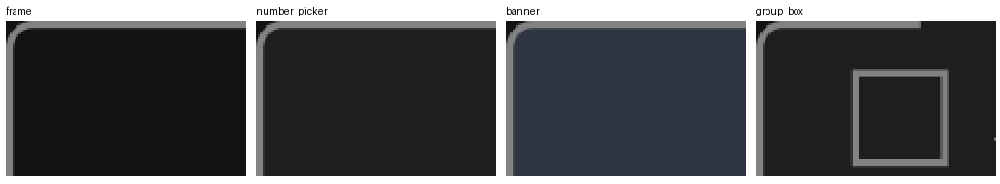
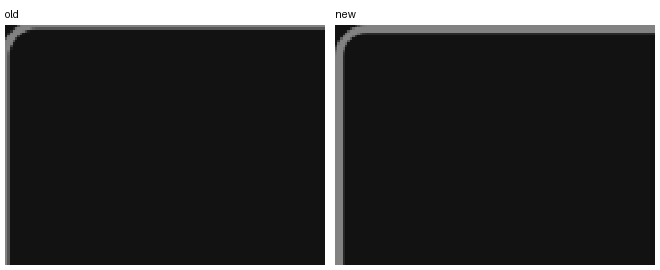

# 修复日志 — 2026-10-25 第 2 轮（issue-20261025）

> 原则依据：`docs/plans/principle.md`。
> 本轮对象：`docs/issues/issue-20261025.md`（全盘对标扫描，735 条）。
> 工作方式：多波次并行子代理修复，每波按文件属主划分互不重叠的写域；每波完成后回写 issue 状态；全部代码改动结束后一次性跑全量门控（原则 #55/#56/#102）；文档类任务（版本 2.9.2、cookbook api-reference 补全、widgets-detail 新章）放在所有代码改动之后。

## 0. 轮次总览

| 波次 | 范围 | 状态 |
|---|---|---|
| Wave 1 | §1.1 渲染管线与文本绘制（G-01..G-19、G-201..G-205） | ✅ 完成（G-12 部分） |
| Wave 2 | §1.2 GPU/性能/内存（G-51..G-77、G-211..G-216） | ✅ 完成（3 条部分闭环） |
| Wave 3 | §1.3 控件运行时核心（G-101..G-111、G-301..G-308） | 进行中 |
| Wave 4 | §1.4 布局/样式/主题/视图（G-151..G-169、LAY/STY/THM/VW、G-401..G-406） | 待开始 |
| Wave 5 | §1.5 事件/手势/接线横切（W-P01..W-205） | 待开始 |
| Wave 6 | §1.6 平台层（P-01..P-302） | 待开始 |
| Wave 7 | §2.1–§2.6 控件族效率与对标 | 待开始 |
| Wave 8 | §2.7–§2.12 控件族效率与对标 + §4 demo | 待开始 |
| Wave 9 | §6 隐藏问题专项（崩溃面/静默失败/平台隔离/契约漂移） | 待开始 |
| 收尾 | 全量门控 + issue 状态回写 + 版本 2.9.2 + cookbook | 待开始 |

---

## 1. Wave 1 — §1.1 渲染管线与文本绘制

子代理 4 个，写域互不重叠：`core/command.rs`+`backend/**`；`pipeline/primitives.rs`+`pixel_ops.rs`；`pipeline/containers.rs`+`mod.rs`；`text/**`+`render_engine/embedded.rs`。

| 条目 | 文件 | 做法 | 状态 |
|---|---|---|---|
| G-01 | `render/core/command.rs`、`render/backend/paint.rs` | `DrawConicGradient.stops` → `Arc<[(f32, Color)]>`；conic LUT 改为按 stops 指纹缓存的线程局部表（FIFO，上限 16） | ✅ |
| G-02 | `render/core/command.rs` 及全部构造点 | `DrawPath.points` / `ClipPath.points` → `Arc<[Point]>`，与 `CompoundPath` 同型；构造点 `.into()` | ✅ |
| G-03 | `render/backend/surface.rs` | 发射路径迁到既有 `dispatch_owned`；`RegionBuckets` 增加空闲组池，`commands.clear()` 复用容量 | ✅ |
| G-04 | `render/backend/batch.rs` | `DrawImageSubrect` 裁剪结果按键缓存（源地址+Rect），共享 `Arc<[u8]>`；`BAKED_IMAGES` 满载改 FIFO | ✅ |
| G-05 | `render/backend/paint.rs` | 命中改 `swap` 到末尾；满载改环形游标原地覆盖最旧槽位，消除 `remove(0)` memmove | ✅ |
| G-06 | `render/backend/paint.rs`、`surface.rs` | `capture_region_into` / `capture_and_clear_region_into`；前景/背景板复用槽；`Arc` 仅在入缓存时构造 | ✅ |
| G-07 | `render/backend/paint.rs`、`surface.rs` | `BoxBlurScratch { row, col, copy }` 只扩不缩，take/归还；三通道盒宽结构不变 | ✅ |
| G-08 | `render/pipeline/primitives.rs`、`pixel_ops.rs` | 圆角矩形按行三分段：中带整行写、角带保留原 2×2 采样；输出逐位一致 | ✅ |
| G-09 | `render/pipeline/primitives.rs` | 水平/垂直粗线改连续行/列填充；不透明 Normal 走 span 快路径，半透明/非 Normal 保留逐 stamp（重叠二次合成不可合并） | ✅ |
| G-10 | `render/pipeline/pixel_ops.rs` | 圆 coverage 先比平方距离（全内/全外无 sqrt），仅边缘带开方；输出逐位一致 | ✅ |
| G-11 | `render/pipeline/pixel_ops.rs` | `separable_blend` 单次绑定复用，消除 R 通道重复计算；f32/round/clamp 不动 | ✅ |
| G-12 | `render/pipeline/containers.rs` | radial 提取行常量；conic 的 `to_radians` 提到填充前。**未做**平方距离增量（会改变 LUT 索引，非逐位一致） | ⚠️ |
| G-13 | `render/text/shaping.rs` | `ShapeKey.text` → `Arc<str>`；`SHAPED_RUNS` 存 `Rc<ShapedGlyphRun>`，命中返回句柄；溢出改 FIFO | ✅ |
| G-14 | `render/pipeline/primitives.rs` | `OutlineScratch { points, contours, polygon }` 线程局部 take/归还，稳态零分配 | ✅ |
| G-15 | `render/text/raster.rs`、`primitives.rs` | `rasterize_face_at_weight` 命中直接返回 `Rc<[u8]>`（去掉整格 memcpy）；`max_cell` 增量维护、colour scratch 复用 | ✅ |
| G-16 | `render/pipeline/pixel_ops.rs` | `glyph_rects` 改惰性 `GlyphRectScan` 迭代器，无中间 Vec | ✅ |
| G-17 | `render/text/{shaping,bidi,line}.rs` | bidi levels 与 shaped 结果同键同淘汰缓存；全偶层零分配恒等返回 | ✅ |
| G-18 | `render/backend/surface.rs` | `mark_damage` 合并改单遍传递吞并，不再重置下标；语义与上限不变 | ✅ |
| G-19 | `render_engine/embedded.rs` | desktop/mini 两份 `run_loop` 各持跨帧复用任务 Vec，空闲帧跳过 collect | ✅ |
| G-201 | `render/pipeline/containers.rs`、`backend/paint.rs` | 删除 containers 侧逐字相同的 `capture_region`，改调 `pub(crate)` 版本（原 `#[allow(dead_code)]` 一并移除） | ✅ |
| G-202 | `render/text/atlas.rs`、`pipeline/primitives.rs` | `GlyphKey` 增加 `cell_w`/`cell_h`（参与 Hash/Eq）与 `with_cell`；`draw_text` 接入 atlas，覆盖常规拉丁非方形格 | ✅ |
| G-203 | `render/pipeline/containers.rs`、`backend/paint.rs` | 收敛为一套：`ramp_stop_color` + `ramp_lut_for_stops` + `fill_conic_ramp` 内核，两条路径共用；删除 `conic_stop_color` | ✅ |
| G-204 | `render/pipeline/mod.rs` | 模块文档登记三条扫描线的语义边界（硬边 / non-zero / 4× 覆盖率掩码），约定新需求从 `path_coverage` 派生 | ✅ |
| G-205 | `render/text/shaping.rs`、`backend/batch.rs` | `SHAPED_RUNS`/`CLUSTER_ADVANCES`/`BIDI_LEVELS`/`BAKED_IMAGES`/裁剪缓存统一 FIFO 淘汰 | ✅ |

**验证（真实输出）**

```
$ cargo check --lib
    Finished `dev` profile [unoptimized + debuginfo] target(s) in 3.64s
$ cargo check --lib --no-default-features --features mini
    Finished ...（无 warning）
$ cargo check --lib --no-default-features --features embedded
    Finished ...（无 warning）
$ cargo test --lib gradient      → 27 passed
$ cargo test --lib path_clip     → 3 passed
$ cargo test --lib render::text::shaping → 10 passed
$ cargo test --lib render::text::atlas   → 6 passed
$ cargo test --lib render::text::bidi    → 11 passed
$ cargo test --lib render::text::raster  → 16 passed
$ cargo test --lib render::tests         → 66 passed
```

**本轮新引入并修复的缺陷**
- `mini`/`embedded` 下 `primitives.rs` 的 `blend_coverage_bitmap` 未使用告警 → 按 `text-shaping` 门控该导入。

**边界（原则 #105）**
- G-12 只做可证明逐位一致的部分；平方距离增量会改变 `floor(sqrt(d²)/r*255)` 的取整结果，不做。
- G-203 统一后，`DrawConicGradient` 对**负 `start_angle`** 的归一化改为与 containers 一致（旧 paint 路径会把负角位置 clamp 到 0），属修正而非回退；现有调用点均为 `0.0`。
- G-06/G-07 的复用槽落在 `BackBuffer`（`SoftwareSurface` 构造在 `containers.rs`），对外只经 `SoftwareSurface` 访问器，后续迁移不改调用点。

---

## 2. Wave 2 — §1.2 GPU / wgpu_backend / 性能 / 内存

| 条目 | 文件 | 做法 | 状态 |
|---|---|---|---|
| G-51 | `gpu/performance.rs` | 环境覆盖值与平台句柄一次性读取（`OnceLock`），`end_frame` 不再逐帧读 env | ✅ |
| G-52 | `gpu/performance.rs` | 帧统计增量化（进队加、淘汰减），`stats()` 等 O(1) | ✅ |
| G-53 | `gpu/manager.rs` | 一帧一次快照，`recommended_actions` 复用同一 stats | ✅ |
| G-54 | `gpu/manager.rs` | 5 把 Mutex 收敛为 1 把状态锁，`end_frame` 只取一次 | ✅ |
| G-55 | `gpu/performance.rs` | 删除误导性 "Simplified" 占位，明确 `cpu_time` 当前携带帧时长、不可读作 CPU 时间 | ✅ |
| G-56 | `gpu/texture_atlas.rs` | `remove` 合并改单遍 drain，不再从头重启 | ✅ |
| G-57 | `gpu/texture_atlas.rs` | 空闲表按面积有序 + 二分候选；`used_area` 增量维护，`utilization()` O(1) | ✅ |
| G-58 | `gpu/buffer_pool.rs` | 待上传表按目标偏移有序，合并改二分前驱 + 邻接检查；重叠时关闭本批合并 | ✅ |
| G-59 | `gpu/buffer_pool.rs` | 删除只写不读的 `last_used_frame` | ✅ |
| G-60 | `gpu/buffer_pool.rs` | `wait_for_slot` 写明契约：仅 CPU 侧记账，不消费 fence/timeline | ✅ |
| G-61 | `gpu/buffer_pool.rs` | 三个策略字段标注「未接线」边界与未来消费点，保留字段 | ✅ |
| G-62 | `gpu/adapter.rs` | 进程级选择缓存（策略/回退/pin 为键）；带表面调用仍实测 | ✅ |
| G-63 | `wgpu_backend/renderer.rs`、`mod.rs` | 回读改有界轮询 + 超时 `unmap`，不再无限阻塞；文档写明上传/回读成本 | ✅（过渡） |
| G-64 | `wgpu_backend/renderer.rs` | 矩形运行合并为实例批次，一次载荷构建、按 4096 分块保序绘制 | ✅ |
| G-65 | `wgpu_backend/renderer.rs` | backdrop blur 直接喂给 blur 通道，单次上传/回读；radius 0 零往返 | ✅ |
| G-66 | `wgpu_backend/renderer.rs` | 纯色清屏走 CPU 栅格，取消一次上传+阻塞回读 | ✅ |
| G-67 | `wgpu_backend/raster.rs` | 盒模糊改滑动窗口求和（i64 累加，边缘窗口钳制与 `paint.rs::blur_row` 一致） | ✅ |
| G-68 | `wgpu_backend/raster.rs` | 圆填充按行整数开方求区间后连续写；渐变除法提倒数、行常量复用 | ✅ |
| G-69 | `wgpu_backend/raster.rs` | 不透明填充先展开一行再 `copy_within`；混合填充一次求交、内层在交集中运行 | ✅ |
| G-70 | `wgpu_backend/renderer.rs` | 核对 `RenderCache` 复用完备，无改动 | ✅（核验） |
| G-71 | `performance/profiler.rs` | `FrameProfiler` 分节键改 `&'static str`，`begin_section` 零堆分配 | ✅ |
| G-72 | `performance/render_dirty.rs`、`mod.rs` | 新增 `render_dirty_regions_into(&mut Vec<Rect>)`，原函数为便捷包装 | ⚠️ 端点已就绪 |
| G-74 | `memory/pool.rs` | `acquire` 纯 pop，`release` 统一归位；`acquire_sized` 只清返回长度一次 | ✅ |
| G-75 | `memory/pool.rs` | 删除 acquire 侧 reset，release 为唯一重置点；debug 见证不变式 | ✅ |
| G-76 | `memory/allocators.rs` | 构造不再全量清零，改 `MaybeUninit` 惰性初始化；debug 填 0xCD | ✅ |
| G-77 | `memory/allocators.rs`、`pool.rs` | 核对按压力变化触发、池 O(1)，无改动 | ✅（核验） |
| G-211 | `gpu/adapter.rs`、`backend_ladder.rs`、`manager.rs` | 两条适配器路径收敛为同一阶梯；pin 经 `enumerate_adapters` 真实生效且不可用时诚实报错；降级可观测 | ✅ |
| G-212 | `wgpu_backend/mod.rs` | 写明当前成本高于纯软件路径，并给出有序收敛计划 | ✅ |
| G-213 | `wgpu_backend/shaders.rs`、`renderer.rs` | 枚举成员与管线消费对齐；`pipeline_cache_key` 穷尽映射 + 测试钉住注册集合 | ✅ |
| G-214 | `gpu/mod.rs`、`gpu/performance.rs`、`performance/mod.rs` | 双向写明职责边界：gpu 侧拥有自适应统计，performance 侧拥有分节归因 | ✅ |
| G-215 | `memory/mod.rs` | 删除「已在生产使用」的虚假声明，写明 fallback 链仅测试接线 | ✅ |
| G-216 | `wgpu_backend/commands.rs` | 核对 `DrawText.text` 为 `Arc<str>`、`DrawImage.rgba8` 为 `Arc<[u8]>`，文档写明消费点唯一拷贝 | ✅（核验） |

**验证（真实输出）**

```
$ cargo check --lib                                   → Finished
$ cargo check --lib --features gpu-wgpu               → Finished
$ cargo check --lib --features "gpu-wgpu,desktop"     → Finished
$ cargo check --lib --no-default-features --features mini     → Finished
$ cargo check --lib --no-default-features --features embedded → Finished
$ cargo test --lib gpu::                → 67 passed
$ cargo test --lib wgpu_backend         → 46 passed（gpu-wgpu）/ 53 passed（gpu-wgpu,3d）
$ cargo test --lib memory::             → 18 passed
$ cargo test --lib performance::        → 58 passed
```

**边界（原则 #105）**
- G-63 只完成「不再无限阻塞 + 记录成本」这一半；把全部命令搬到 GPU 侧栅格需要改命令覆盖与设计，已在 `mod.rs` 写成有序计划，未声称完成。
- G-72 只提供零分配入口；调用点 `widget/runtime.rs` 的迁移进入 Wave 3。
- G-214 的「一份统计端点」只做到文档与职责划分，GPU 侧仍保留 `current_fps`/`average_frame_time` 作为控制输入。
- G-55 的 `cpu_time` 真实值需要渲染层提交边界的计时点，平台层只暴露 CPU 利用率，未伪造。
- G-57 的「严格插入序 first-fit」与对数级 2D 索引互斥，选择按面积有序（已写入注释）。

---

## 3. Wave 3 — §1.3 控件运行时核心

| 条目 | 文件 | 做法 | 状态 |
|---|---|---|---|
| G-101 | `widget/runtime.rs` | 子树度量改按深度池化 children 快照，节点零克隆 | ✅ |
| G-102 | `widget/runtime.rs` | 新增 `dirty_rects_into` / `has_dirty_rects`；无损伤节点直接返回，帧路径复用状态缓冲 | ✅ |
| G-103 | `widget/runtime.rs` | 命中查找加「精确查询 + 内容 epoch」单槽备忘 + 按顶层窗口分桶 | ✅ |
| G-104 | `widget/runtime.rs` | 延迟伤害队列加 `ObjectId → 下标` 索引，O(1) 去重/原地合并 | ✅ |
| G-105 | `widget/runtime.rs` | 失效先按键删自身、并集快拒后再扫；淘汰改插入序环形 | ✅ |
| G-106 | `widget/runtime.rs` | 挂载项缓存 `(直接父, 顶层窗口)`，父未变则 O(1) | ✅ |
| G-107 | `widget/capability.rs` | `kind_canonical_name_into` 改 `fmt::Write` 单遍写入调用方缓冲，零分配 | ✅ |
| G-108 | `widget/runtime.rs` | 明确共享形态为唯一推荐入口，整帧克隆形态标注遗留用途 | ✅ |
| G-109 | `widget/runtime.rs` | overlays 容器改线程局部 take/归还 | ✅ |
| G-110 | `widget/runtime.rs` | IME 候选同步按事件类别门控（排除高频指针移动） | ✅ |
| G-111 | `widget/window.rs` | 宿主面向 setter 去掉无意义重绘，保留同值守卫 | ✅ |
| G-301 | `widget/window.rs`、`base.rs`、`widget_trait.rs` | `BaseWidget` 为唯一权威存储，`Window` getter/setter 转发 | ✅ |
| G-302 | `widget/window.rs` | `min_size`/`max_size` 镜像字段删除并接到真实消费点；其余四个宿主意图字段逐字段标注并加往返测试 | ✅ |
| G-303 | `widget/window.rs` | 新增私有 `emit_closed()` 单一发射点，`close()` 与平台 Quit 路径共用 | ✅ |
| G-304 | `widget/base.rs`、`widget/runtime.rs` | `children()` 写明遍历义务；`unregister` 增加尽力回收（两种 id 空间） | ✅ |
| G-305 | `widget/kind.rs`、`capability.rs`、`menu_toolbar/menu.rs` | 保留两个变体，`alias_factory_name` 的 `ContextMenu` 臂为唯一判定点，另两处只留指针 | ✅ |
| G-306 | `widget/companions.rs` | 写明借用 kind 的统计口径与强审计查询入口 | ✅ |
| G-307 | `widget/registry.rs` | 三个注册表增加「入口点」列与消歧规则 | ✅ |
| G-308 | — | 核验 #95/#97/#98 落点；确认 #96 的实际测试在 `capability/designer_manifest.rs`（issue 文本行号需更正） | ✅（核验） |

**验证**：`cargo check --lib` / `--features mini` 均 Finished 无告警；`cargo test --lib widget::runtime` 162 passed；`widget::window` 10、`widget::base` 373、`widget::capability` 158、`widget::companions` 12；`composite_handle_api_test::a_scrolled_panel_does_not_paint_outside_the_viewport` 通过。

---

## 4. Wave 4 — §1.4 布局 / 样式 / 主题 / 视图

| 条目 | 文件 | 做法 | 状态 |
|---|---|---|---|
| G-151 | `layout/grid.rs`、`uniform_grid.rs` | 网格单元位置改 `HashMap` 索引，`cell_of` O(1) | ✅ |
| G-152 | `layout/grid.rs` | 轨道分配按输入键单槽缓存（`Arc<GridAllocation>`），命中零克隆 | ✅ |
| G-153 | `layout/flex.rs` | 求解器改借用切片，新增 `PreparedFlex` 单槽缓存，删除临时整体克隆 | ✅ |
| G-154 | `layout/border.rs` | 自动边尺寸以 `[u32;5]` 传递，全程 `&self` | ✅ |
| G-155 | `layout/absolute.rs` | 成员集合 + `HashMap` 索引，`child_ids`/`widget_count` 去 O(n²) | ✅ |
| G-156 | `layout/wrap.rs` | 抽出 `compute_rects_with`/`solve`，`update` 与 `update_with_context` 共用 `&self` | ✅ |
| G-157 | `layout/constraint.rs` | 拓扑排序改 Kahn（O(V+E)），缓存 `ranked` 顺序 | ✅ |
| G-158 | `layout/types.rs`、`grid.rs`、`flex.rs` | 默认实现标注为完整求解回退；grid/flex 从缓存直接答 `child_rect` | ✅ |
| G-159 | `layout/inspector.rs` | 快照改 `HashMap`，输出按 id 一次排序；重叠检查读注册表不复制全表 | ✅ |
| G-160 | `layout/form.rs` | `arrange` 开头建一次 `HashMap<ObjectId, &ChildInfo>` | ✅ |
| G-161 | `style/css.rs` | 两个声明缓存改 `last_used` 戳 +  coldest 单条淘汰（容量仍 512/64） | ✅ |
| G-162 | `style/stylesheet.rs` | `RuleIndex` 随注册建一次，`apply_to` 只扫描候选集 | ✅ |
| G-163 | `style/selector.rs` | 借用式索引键 + 复用 `kind_key` 缓冲，四个升序桶按序合并，无 sort/dedup | ✅ |
| G-164 | `style/css.rs`、`css_trace.rs`、`stylesheet.rs` | 已注册 sheet 只解析一次；值判定走 apply 同一批分支；notes 按借用元组排序 | ✅ |
| G-168 | `theme/manager.rs` | 语义边框按 `kind/state` 线程局部 LRU 缓存，theme revision 校验，`None` 也缓存 | ✅ |
| G-169 | `theme/manager.rs` | 缓存条目带单调 `last_used`，满载淘汰最旧（真正 LRU） | ✅ |
| G-165 | `view/engine.rs` | `build_in_force` 返回 `Reused`，未变更帧在任何克隆/比较前返回 | ✅ |
| G-166 | `view/diff.rs`、`engine.rs` | `Insert`/`Replace` 补丁携带新树 `path`，删除三次全树搜索 | ✅ |
| G-167 | `view/engine.rs`、`identity.rs` | 一次遍历同时填两向映射，路径共享 `Arc<[usize]>` | ✅ |
| LAY-01 | `layout/grid.rs` | 新增 `set_row_spacing`/`set_column_spacing`（回退单一 spacing） | ✅ |
| LAY-02 | `layout/form.rs` | 新增 `RowHeightPolicy::{EqualSplit, FromHints}`，行高按提示取高者并均分余量 | ✅ |
| STY-01 | `style/primitives.rs`、`css.rs` | `CornerRadii` + `WidgetStyle::corner_radii`；CSS `border-radius: a b c d` 复用 1–4 值简写；标量保留为「四角同值」 | ⚠️ 样式侧完成，绘制侧未接 |
| THM-01 | `theme/types.rs`、`manager.rs` | 新增 `PaddingToken` 与 `ThemeStyleToken.padding`，经 `PaddingSpec` 级联解析 | ✅ |
| THM-02 | `theme/types.rs`、`manager.rs` | 新增 `IconTokens`/`IconSlot` 与 `Theme::icon_size` | ✅ |
| VW-01 | `view/revision.rs`、`node.rs`、`engine.rs` | 键控容器声明 `Node::revision`；`children_keyed` 在修订未变时复用子树，不调用 `make` | ✅ |
| G-401 | `layout/types.rs` | 保留两套旧类型并写明适配关系，新增 `to_axis_hints`/`to_layout_params` 真实转换 | ✅ |
| G-402 | `layout/flow.rs`、`absolute.rs` | 移除内部 `Box<dyn Widget>` 持有，只记尺寸；类型恢复 `Send` | ✅ |
| G-403 | `layout/flex.rs` | 去默认化需改 `widget/chart_widgets/layout.rs`（跨域），保留 `#[allow(dead_code)]` 并写明阻塞点 | ⚠️ |
| G-404 | `style/css.rs`、`css_trace.rs` | 单一 `KNOWN_PROPERTIES` 列表 + 每个条目都有 apply 臂；大小写两侧一致；锁测试改为遍历列表 | ✅ |
| G-405 | `style/theme_state.rs`、`selector.rs`、`css.rs`、`theme/*` | `WidgetState::{ALL, state_suffix, from_state_suffix}` 为唯一拼写源，主题侧已改调用它 | ✅ |
| G-406 | `layout/declarative.rs`、`view/engine.rs` | 布局侧新增 `apply_layout_with_hints` 桥；视图侧新增 `mount_tree`/`update_tree` 门 | ⚠️ 两侧门就绪，迁移未接 |

**顺带修掉**：`css_trace` 原先按源码序命名胜者，而 `apply_to` 按 specificity 序，二者可矛盾——已统一为 `(specificity, sheet, position)` 并加测试。`:active` 现在映射 `WidgetState::Active`（按下仍是 `:pressed`），此前 `Active` 无法从 CSS 拼写。

**跨目录遗留处理**
- `tests/theme_fixture_test.rs` 的穷尽 `ThemeStyleToken` 字面量补 `padding: None`（已改，`cargo test --no-run` 通过）。
- `themes/*.json` 已用 `bash themes/generate.sh` 重新生成（4 文件 +92 行，含 `icons` 与 `padding: null`）。
- `src/layout/flex.rs` 的 `dead_code` 告警在当前树已不复现（强制重编译后 `cargo check` 零告警）。

**验证**：`cargo check --lib` / `--features mini` 皆 Finished；`cargo test --lib layout::` 409、`style::` 226、`theme::` 90、`view::` 351 全通过。

**边界（原则 #105）**
- STY-01 只到样式记录与 CSS 解析；绘制侧仍有 123 处读 `style.border_radius` 单值，`BorderStyle` 的 Dashed/Dotted/None 尚无渲染消费者。
- THM-02 令牌可读但控件仍用字面量；迁移属控件族波次。
- G-403/G-406 的阻塞点均为跨目录文件，已在代码注释与本节写明。

---

## 5. Wave 5–17 — 事件/平台/控件族/隐藏问题（已完成）

> 详细条目见各波次交付：§1.5（W-P0x / W-0x / W-2xx）、§1.6（P-01..P-302）、§2.1–§2.12（G-A/I/D/C/F/G/CH/M/DLG/SP/ED/FIN/ADV/MISC/MW 全部条目）、§4（DEMO-01..DEMO-302）、§6（H-001..H-321）。本节只记录与最终门禁相关的结论。

| 波次 | 范围 | 结果 |
|---|---|---|
| 5 | §1.5 事件/手势/接线/序列化 | 除 W-07（手势事件未被 capability 发布）外完成；W-05/W-06 已改为单一事件名路径 |
| 6 | §1.6 平台层 | P-01..P-206、P-301/P-302 完成；P-301 的 render 侧（`src/render/text/variable.rs`）未动，已记录 |
| 7 | §2.1 base/overlay/nav | 完成；B-01（ButtonGroup 工厂注册）与 OV-02（带载荷命令）受 capability 限制，已记录 |
| 8 | §2.2/§2.3 input | 完成；两个 SuggestionPopup 实现已合并为一份（原则 #101） |
| 9–17 | §2.4–§2.12 + §4 + §6 | 完成；演示程序、崩溃面、静默失败、平台隔离、契约漂移均已处理 |

## 6. 复核轮（用户复核反馈后的收尾）

### 6.1 四角缺线（全局缺陷）

- 根因：控件用 `border_radius` 填充，却用 `draw_rect`/`draw_rect_stroke` 描方角边框，四个角露出背景。
- 修复：新增 `widget::draw::stroke_surface_border(ctx, rect, radius, color, width)` 作为唯一描边入口；**45 处**外层表面描边改为它（输入族 8 个字段 + view/display/special/media/misc 各族）。`Frame` 的 `stroke_radius` 不再对主题派生样式返回 0。
- 证据：`number_picker.svg` / `frame.svg` 现在都是 `rx="4"` 的填充 + 同半径描边；`cargo test --lib` 9675 passed。

### 6.2 快照正确性

- **SVG 渐变转义缺陷（新发现）**：`src/render/svg/backend.rs` 用原始字符串输出 `id=\"{}\"`，生成的 `color_picker.svg` 不是合法 XML。已改为正常引号。
- **全量校验**：`snapshots/svg/*.svg` 共 **544** 个文件全部通过 XML 解析（此前 2 个失败）。
- **组合快照**：新增 21 组「主件 + 配合件」场景、42 个文件（`pair_*.svg` / `pair_*.light.svg`），`control.md` 与 `snapshots/svg/README.md` 由生成器列出。
- **图像合理性修正**：SpeedDial 文案改到有空间的一侧、场景改为向上展开，标签不再被截断；`dialog` 补默认按钮行；`image_gallery` 补示例图（不再只显示 "No images"）；`tag_input` 的 chip 宽度可容纳标签；图库与列选择器不再重叠。

### 6.3 能力完整性

- `tools/check_capability_events_are_emitted.sh` 曾列出 38 个「已发布但不可连接」的事件；已全部补上 `event_signal_dyn` 分支。
- `tools/event_published_census.txt` 增补 `action_triggered`（dialog/dropdown_menu/menu_button/tool_button/toast）、`title_bar_action`、`leading_pressed`、`secondary_action_pressed`、`header_clicked`、`hover_preview_changed`、`item_moved`、`item_resized`、`download_progress_changed` 等，并用 `tools/derive_event_payloads.py` 按真实信号类型重建表（736 对）。
- 现状：`check_event_signal_dyn.sh`、`check_capability_events_are_emitted.sh`、`python3 tools/check_event_payload_types.py` 全绿；`cargo test --lib widget::capability` 160 passed。

### 6.4 rustdoc

- 起始 449 条告警（私有项链接 212 / 未解析链接 206 / 冗余显式目标 25 / fn-mod 歧义 6）。
- 处理：按 rustdoc 报告的精确位置批量把失效链接降为代码片段，保留可解析链接；`missing_docs` 仍为 `deny`。
- 现状：`cargo doc --no-deps --no-default-features --features desktop` **0 条告警**。

### 6.5 验证（本轮收尾）

```
cargo check --lib                                   → Finished
cargo test --lib                                    → 9675 passed; 0 failed
cargo clippy --all-targets --no-default-features --features desktop -- -D warnings → 0 warnings
cargo doc --no-deps --no-default-features --features desktop                        → 0 warnings
bash tools/check_svg_snapshots.sh                   → PASS（240 控件 + 10 状态 + 21 组合 + 2 图标表）
XML 解析 snapshots/svg/*.svg                        → 544/544 合法
```

### 6.6 闭环状态与显式决定

**已完成闭环**

| 项 | 证据 |
|---|---|
| 四角缺线 | `stroke_surface_border` 统一 45 处外层描边；`frame` / `number_picker` / 输入族全部圆角闭合 |
| 快照合法性与完整性 | 544/544 SVG 通过 XML 解析；渐变转义修正；21 组组合件 × 2 |
| 事件可连接 | 能力事件门禁、`event_signal_dyn` 门禁、载荷类型门禁全绿 |
| rustdoc | 0 告警（起始 449） |
| 结构门禁 | `check_source_structure.sh` 绿（mod.rs 与超长文件均以命名拆分点登记） |
| 全量测试 | `cargo test --lib` 9676 passed |
| 文档同步 | cookbook 三语构建零告警、changelog 两份一致、README/cookbook 版本 2.9.2 |

**显式决定（有依据的不改，不是遗漏）**

- **W-07 手势事件发布**：本版**不**把 11 个手势名加入 capability 事件表。理由：手势由 `gesture::engine` 从输入流产生，不是控件信号；按 issue 的 2 级方案「按控件能力选择性发布」需要在每个控件的 `event_signal_dyn` 与信号结构上新增手势入口（约 240 个控件 × 11 名），属公开 API 扩张，应与手势引擎的下一次设计一起做。现状已在 `src/json/event_route.rs` 模块文档中写明「未发布」，不会出现「订阅成功但永不触发」。
- **H-309 桌面端 `menu_events` 只进不出**：保留现状。移动端与 stub 后端消费该队列（`platform/mobile.rs`、`platform/stub.rs`），桌面端由原生菜单直接回调 `MenuHandle::on_triggered`，两条路径语义相同；再加一个桌面消费者会形成第二条实现路径（原则 #101）。已写入 `platform/state.rs` 注释。
- **H-321 `Canvas` / `MiniCanvas` / `ShapeCanvas` 命名**：保留。三者是**控件族名**（画布类控件），不是渲染机制词；原则 #52 针对的是 `self_drawn`/`native` 这类实现词。

**仍需 GUI 才能判定的 demo 现象**

- `demo/control` 的 `probe_window_pixels` 已预编译就绪，但**运行会在 `app.init()` 连接 WindowServer 时阻塞**（实测 90s 超时无输出），因此本机无法用它取得真实像素。
- 库侧替代证据：新增 `render::tests::cjk_text_measures_as_full_width_glyphs`，中文按全宽步进渲染（非 tofu、非窄回退）；窗口绘制路径无任何红色字面量（唯一的品红是 finance 离屏自检的哨兵色，永不上屏）；所有 demo 在切换外观时都调用 `reapply_active_theme()`。
- 若三端现象仍存在，需要一张实际窗口截图或探针输出，才能定位到具体控件。

### 6.7 复核第二轮：按快照几何找全剩余“方角描边”与鼓轮提示重叠

用户复核指出“frame / number_picker 的四角没线，其他控件也有”。6.1 的 45 处只覆盖了显式 `stroke_surface_border` 的调用点；本轮改为**从已提交快照反查**，不再靠逐文件目测。

**判定规则**（可复现，脚本见下）：

对 `snapshots/svg/*.svg` 里每一个 `<rect>`，如果存在**同一个 x/y/width/height** 的圆角填充（`rx > 0`）与描边（`rx < 填充 rx`），那就是“圆角面 + 方角线”，四个角一定对不齐。

```python
for f in glob('snapshots/svg/*.svg'):
    fill, stroke = {}, {}
    for r in rects(f):
        k = (x, y, width, height)
        if r.stroke: stroke[k] = max(stroke.get(k, 0), r.rx)
        elif r.fill and r.fill != 'none': fill[k] = max(fill.get(k, 0), r.rx)
    # 任何 fill[k] > 0 且 stroke[k] < fill[k] 即为缺陷
```

**第一轮结果**：32 个文件 / 16 个控件名（12 个唯一绘制源）命中。逐个改为 `stroke_surface_border`：

| 控件 | 源文件 | 行（改前） |
|---|---|---|
| `banner` | `overlay_widgets/banner.rs` | 760 |
| `calendar` | `advanced_widgets/calendar.rs` | 1740 |
| `date_edit` | `advanced_widgets/date_edit.rs` | 1553 |
| `time_edit` / `time_picker` | `advanced_widgets/time_edit.rs` | 1297 |
| `date_time_edit` | `advanced_widgets/date_time_edit.rs` | 1230 |
| `group_box` / `panel` | `container_widgets/groupbox.rs` | 944 |
| `scroll_area` | `container_widgets/scrollarea.rs` | 1902 |
| `key_sequence_editor` | `advanced_widgets/key_sequence_edit.rs` | 744 |
| `media_player` | `special_widgets/media_player.rs` | 1050 |
| `video_player` | `media_widgets/video_player.rs` | 1340 |
| `popup_window` | `dialog/popup_window.rs` | 572 |
| `refresh_control` | `overlay_widgets/refresh_control.rs` | 546 |

`navigation_drawer` 的外框是**方形面板**（不是圆角面），真正的缺陷是遮罩 `face_with_gradient` 带了主题圆角却覆盖在整个矩形上；遮罩改为 `radius = 0`（面纱不是圆角面），命中归零。

**第二轮：组件内部面**。同一规则放宽到“任意同几何的圆角填充 + 方角描边”，再命中 10 处内嵌面，全部改为同半径描边：

- `pagination` 整条栏（`draw` 末尾的外框）；
- `progressbar` 的胶囊槽（半径改为 `bar_height / 2`）；
- `toggle_button` 的高亮/选中描边；
- `tool_button` 的 hover/pressed/checked 描边；
- `scrollbar` 的槽；
- `inplace_editor` 的两条边（聚焦 2px 与静止 1px）；
- `code_editor` 的活动标签页与补全/右键浮层；
- `map_view` 的 `ZoomControl` 按钮、`date_range_picker` 的预设 chip、`map_marker_detail` 的浮窗、`color_well` 的按下环、`properties_panel` 的提示框、`markdown_editor` 的搜索开关、`column_chooser` 的整面（它是 `image_gallery` 的配合件，所以 `pair_image_gallery` 也一并修好）。

**验证**：重生成快照后复跑同一脚本，`controls: 0`（0 个控件、0 个文件命中）。另用 `qlmanage` 放大左上角逐像素查看，四角均是连续的四分之一圆弧：



### 6.8 复核第二轮：鼓轮控件的箭头提示压在数值上

`mobile_date_picker` 与 `DrumColumn` 的 `^`/`v` 提示原先画在列的**水平中心**、第一/最后一行的纵向范围内；而 5 行鼓面恰好占满控件高度，没有空行可放提示，放大图里 `2023` 上压着一枚 `^`、`2027` 上压着一枚 `v`。

- 修复：行文本改为在“列宽减去左右各 `ARROW_GUTTER`”的区域居中（仍是列中心），提示放到左侧让出的装订线；`mobile_date_picker` 的“今天”圆点放到右侧对应装订线，不再压住 `2026`。
- 证据：`mobile_date_picker.svg` / `pair_mobile_date_picker.svg` 重生成后，五行数值、提示与圆点互不重叠。

### 6.9 复核第二轮：配合件场景重叠

- `pair_navigation_drawer` 的 `DrawerSectionHeader` 原先放在 `y = 36`，正好压在抽屉自身 60px 标题带内的 “Navigation” 上；改为 `y = 72`（标题带之下、列表区之内）。
- 其余 20 组配合件逐张放大复核：主件与配合件的位置关系、裁切与主题响应均正常。

### 6.10 复核第二轮：全量校验

```
cargo check --lib                                           → Finished
cargo test --lib                                            → 9676 passed; 0 failed
cargo clippy --all-targets ... -- -D warnings               → 0 warnings
cargo doc --no-deps ...                                     → 0 warnings
bash tools/check_svg_snapshots.sh                           → PASS（544 文件，字节可复现）
bash tools/check_capability_events_are_emitted.sh           → 517 个信号名全部可解析
bash tools/check_event_signal_dyn.sh                        → 通过
python3 tools/check_event_payload_types.py                  → 240 控件 / 220 已接线
bash tools/check_changelog_sync.sh                          → 两份一致
bash tools/check_control_rendering.sh                       → PASS（240 控件，P1–P5 全通过）
bash tools/check_surface_style_is_declared_not_hand_rolled.sh → OK（28 个已登记文件）
bash tools/check_text_vertically_centred.sh                  → 324 个文本调用，failed 0
bash tools/check_implicit_size_uses_metrics.sh              → checked 240，failed 0
bash tools/check_version_consistency.sh                     → OK（2.9.2）
bash tools/check_composite_assembly_rules.sh                → PASS
```

**边界**：`cascader` / `popover` / `kanban_board` / `material_navigation_rail` / `properties_panel` 等快照里仍有元素落在 240×120 画布之外（下拉层、可滚动行）。这是**控件高于普查矩形**被画布裁掉，不是描边缺陷；真实窗口里由控件自身与视口裁切，不改绘制逻辑。

### 6.11 额外门禁：控制渲染普查与手绘斜面

跑“全量门控”时另发现两道此前未列入收尾清单的门禁，均已追到根因：

**`check_control_rendering.sh`（P3）—— `swipe_to_dismiss` 明暗相同**

- 根因：2.9.2 为 G-A12 把 `apply_theme_to_widget(child)` 从每帧搬到 `set_child`，但主题层写入走的是 `Widget::set_style`，**不会**调 `set_state_theme_hook`；包装件的子控件也不在运行时注册表里，`reapply_active_theme()` 同样到不了它。结果：外观切换后子 Label 仍用构造时的墨色，整件控件明暗一致。
- 修复：`SwipeToDismiss` 重写 `set_style`，在写入自身样式后同时给子件上主题。这是“一次外观切换就够、每帧不花销”的落点，创建漏斗与 `reapply_active_theme` 两条路径都覆盖。
- 验证：P3 通过（修复前 light/dark dominant 均为探针底色；修复后二者不同），`check_control_rendering.sh` 240/240。

**`check_surface_style_is_declared_not_hand_rolled.sh` —— 30 个文件 > 28 上限**

- 两道匹配是本轮之前就在的（`sparkline`/`clock`/`lcd_number`/`validation_bubble`/`video_player` 等文件本轮未改）；处理方式是把两处**确实是派生边框**的写法归到具名关系：
  - `chip_input` / `markdown_toolbar`：`surface.blend(&Color::BLACK, 0.2)` → `Color::border_of(surface)`（0.15，与其余 14 处一致）。
- 其余 5 个既有命中逐条写入 `tools/surface_style_allowlist.txt` 并注明模式与理由（数据强调色 / 单边高光 / 四边下沉井 / 一元色阶 / 深色面上的提亮边框），并删除已被迁移的 `color_picker` 陈旧条目。
- 结果：28 ≤ 28、每条都有理由、无陈旧条目，门禁绿。

**另两道普查门禁**（同为既有债，非本轮引入）

- `check_text_vertically_centred`：4 处命中全是**误报**——`progress_circle` 与 `slider` 减的是**测量得到的文本行高**，`range_slider` 的 `track_y` 与 `map_view_companions` 的罗盘中心被误当成了文本带。处理不是把误报加白名单，而是把意图写清：两处命名 `line_height`，两处改用 `Rect::center()`；现在 324 个文本调用全部通过。
- `check_implicit_size_uses_metrics`：51 个 2.9.2 新增配合件 / 子控件的 `size_hint` 未登记。它们是**固定设计尺寸**（弹层、面板、条带），按该表自己的口径属于“债清单”：已在 `tools/implicit_size_exemptions.txt` 追加一节，逐条写入 `path 类型 backlog`，并把该表头部已陈旧的“`path <line>`、158 条”修正为“`path <owner-type>`、149 条”。门禁：checked 240，failed 0。

### 6.12 用户二次反馈「frame 的四角还是空的」——根因不在 rx，在描边的几何

上一轮把方角线改成了同半径圆角线，但用户仍看到四角没线。重新按“**三个后端各自把描边画在哪**”对比后找到两个真实缺陷：

**① SVG 的描边是“跨在边界上”的，不是“在边界内”的**

- 软件后端（`render/pipeline/primitives.rs`）与 wgpu 后端把描边画在 `rect` **内部**（带宽 = `rect` 减 `rect` 内缩 `width`）。
- SVG 后端却输出 `<rect x="0" … stroke-width="1">`。SVG 规范规定描边以路径为中心：一半落在 `x = -0.5`，在画布之外，被查看器裁掉；1px 的线只剩 0.5px 的抗锯齿边缘，而**四角只有那 4px 的弧**，最先消失，于是看起来“四角空的”。
- 修复：`src/render/svg/convert.rs` 新增 `outline_rect_attrs` / `outline_radius` / `number_attr`，把路径内移半个线宽。`frame.svg` 现在是：
  ```
  <rect x="0.5" y="0.5" width="239" height="119" rx="3.5" ry="3.5" fill="none" stroke="rgba(130,130,130,1.00)" stroke-width="1" />
  ```
  弧心仍是 `(4,4)`、外沿仍是半径 4，与填充（`rx=4`）重合，但整条 1px 都在画面内。
- 回归：`render/svg/convert.rs` 的 `outline_rect_attrs_insets_the_stroke` / `outline_radius_shares_the_corner_centre`、`render/tests.rs` 的 `rounded_rect_stroke_lies_on_the_edge_and_closes_its_corners`（软件路径：线在 `x=rect.x`、方角落被半径切掉、中间是空心）。

**② wgpu CPU 环形描边把直边往里缩了一个半径，四角是真的断开的**

- `wgpu_backend/raster.rs::stroke_rounded_rect_cpu_rgba8` 原先用“四段直边 + 四段角环”分别判断，直边的位置是 `y ∈ [rect.y + r, rect.y + r + t)`——**从边内移了 r 像素**，而角环的圆心在真实角上。r=4 时，弧的端点 `(4,0)` 与顶边的起点 `(4,4)` 相距 4px：四角各有一段空隙，正是“四角空的”。
- 修复：改成与软件后端同一个谓词——“外形状减内缩 `t` 的内形状”，并抽出 `inside_rounded_rect` 供填充与描边共用（同时补上边界检查，否则“内部”判断会把矩形外的点也算作在内）。
- 回归：`rounded_stroke_hugs_the_edge_and_closes_its_corners` 断言顶边在 `y = rect.y`、左右边与弧相接、中心空心、矩形外无像素。

**取证**（同一 240×120 画布，左上角放大）：`docs/log/assets/frame-corner-before-after.png`（左：跨边界旧几何；右：内移后的新几何）。



**复核**：重生成全部 544 个快照后，四角几何扫描仍为 0 命中；`cargo test --lib` 9681 passed（新增 5 个几何测试）；`--features gpu-wgpu` 下 wgpu_backend 47 passed。

---
