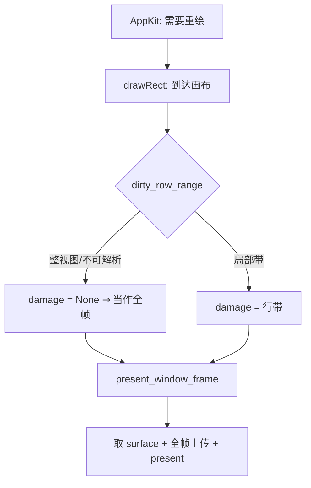

# BLUE29 — wgpu 路径选择：速度与美观的兼顾方案

> **来源**：用户要求「确认兼顾性能和效果、速度和美观的方案」（2026-10-30）。
>
> **证据基线**：`docs/log/log-20261030-1.md` §39（同一命令流 22 行、两轮实跑）+ 当前
> `src/wgpu_backend/` 源码事实。
>
> **本文是提案**：条目全部 `[ ]`，未改任何生产代码；文件名 `blue29.md`，与
> `archive/blue22.md`（历史 BLUE22）无主题关系。
>
> **判定口径**：
> **速度** = `benches/wgpu_bench.rs` 的实跑中位数（跨机器不可比，只比同一张表的行间比值）；
> **效果** = 三档之一，写死在用例里：**A 逐字节相同** · **B ≤1 LSB** · **C 允许边缘 AA 差异、
> 但形状/覆盖必须一致**。没有「看起来差不多」。

---

## 0. 结论（一页）

不存在「一个开关同时最优」。能兼顾的结构是**四层决策**，顺序固定、每层只有一个职责：

```
L0 质量意图（宿主声明）    ByteExact → 只允许效果 A（含「透明目标 + 无整帧 clear」的流也不上 GPU）；
                          Antialiased → 允许 B/C
L1 交付面（宿主能力）      能消费纹理 → with_draw_commands_texture（零回读）
                          必须拿像素 → 进入 L2
L2 成本门控（同一流的账）  argmin(CPU 成本, GPU 成本)，接近时保持上次选择（迟滞）
L3 回退（已是现状）        不可覆盖的流 → CPU 光栅器
```

一句话：**能不上 CPU 就不上（L1）；上不上 GPU 看两路成本、不看分辨率（L2）；要逐字节还是要
更好看，由 L0 明说，不由「碰巧走了哪条路」决定。**

---

## 1. 事实基线（取证，不是主张）

### 1.1 性能：分界线是成本，不是分辨率

| 量 | 实测（本机） | 含义 |
|---|---|---|
| GPU 回读交付下限 | **389.7 µs**（320×200）、**541.8 µs**（720p）（两轮中的最小行） | 与帧大小几乎无关，主要是同步等待 |
| GPU 纹理交付下限 | **24–64 µs**（简单图元），但**按对象收费** | `text-40` 228/682 µs、`images-8` 158/143 µs、`shadows-blur-8` 339/411 µs（320/720） |
| 回读路径胜负 | 320×200 **11/11 CPU 胜**；720p **9/11 CPU 胜** | GPU 只赢 `gradient-full`（2.27–2.36×）与 `blend-full`（3.02–3.10×） |
| 纹理交付 vs CPU | 720p **4.50–4.61×** 便宜；320×200 **CPU 反而快约 1.5×** | 小帧连交付都轮不到 GPU 赢 |
| borrowed vs owned | 0.97–1.42（320 持平，720 更快） | 像素宿主应优先 borrowed |

**能复现全部 22 行的保守规则**（L2 的第一版就照这个写，不拟合模型）：

> 默认 CPU；仅当 **面积 ≥ ~1 MP 且流属于 {大面积渐变, 非 Normal 混合模式}** 时走 GPU。
> 它不是普适真理，是「本机 + 两类已实测负载」的最小可行近似；`mixed`（CPU 883 / GPU 1698）
> 说明「面积大」单独不构成理由——GPU 计算本身贵时仍必须留在 CPU。

### 1.2 效果：GPU 与 CPU 的差异清单（都有出处）

| 场景 | 差异 | 档位 |
|---|---|---|
| 不透明矩形/图像/渐变/路径/阴影/文本 | 逐字节相同（有用例钉住） | A |
| 半透明合成 | 固定功能混合在目标里乘完即舍入，差 1 LSB（文本实测 6 字节） | B |
| 透明目标且流内无 clear | GPU 存「预乘 × 覆盖度」，CPU 存直通 alpha → 差值可**远超 1 LSB** | 不在 A/B 内（`Antialiased` 也需显式知道） |
| 圆/弧/圆角描边的 SDF 管线 | GPU **抗锯齿**，CPU 硬边 | C（视觉更好，但不可复现） |
| 非 Normal 混合模式（`set_blend_modes_on_gpu`，默认关） | 每条命令一次图层 + 快照合成 | A（不透明）/ B（半透明） |
| 帧区域读改写模糊（`Blur` / 阴影模糊，第 12 轮） | `Blur`、不透明方体阴影、半透明体阴影实测**逐字节**；**圆角体**的周长是 C（参考 2×2 采样 vs GPU 硬边行跨度），模糊再把该周长差摊到自身 reach 内 | A（方形体）/ B（半透明体）/ C（圆角体） |

出处：`src/wgpu_backend/mod.rs` 模块文档（#A known divergence）、
`src/wgpu_backend/renderer/frame.rs::set_blend_modes_on_gpu`、日志 §16.2；
帧区域模糊一行出自日志 §23.4（逐家族实扫：0/0/0/0 字节，圆角体 1324 字节且逐像素落在周长 + reach 内）。

**由此得到的关键事实**：「效果更好」（AA）与「同输入同像素」（可复现）互斥。当前实现把选择权
交给了「哪条路径接了这条流」——同一个含圆的流，走 GPU 抗锯齿、走 CPU 硬边，这是隐式质量切换。

### 1.3 三处结构性缺口（方案必须各自处置）

1. **调度按「可覆盖」而不是「划算」**：`renderer/dispatch.rs::commands_gpu_dispatchable_with`
   只回答「管线能不能画」，不回答「该不该画」。后果：720p `clear` 走 GPU+回读 0.54 ms，
   而 CPU 只要 0.23 ms。
2. **质量由路径隐式决定**：没有质量档位 API，要「逐字节一致」的宿主对圆/弧流拿不到 CPU 分支。
3. **测量与节流缺基础设施**：公开 API 无 `wait`/`idle`，`render_frame` 无 present 路径
   （直接返回 `Err`），因此端到端 GPU 帧时间现在测不到、也无法限流。

---

## 2. 方案

### 2.1 决策顺序（L0 → L3，固定）

```text
quality = host.quality()             // ByteExact | Antialiased，默认待定（见 §5 D-1）
if quality == ByteExact:
    refuse streams containing AA-affected shapes (circle fill / ring / arc / rounded outline)
    refuse streams drawn onto a transparent target with no whole-frame opaque clear
if host.consumes_texture():          // L1
    encode on GPU into texture; f(&view); return        // 零回读
else:                                // L2
    if stream refused by dispatcher → CPU                // L3
    else if cost_gate.choose(stream) == Gpu → GPU + readback
    else → CPU
```

`cost_gate.choose` 的**唯一**输入是「这条流的 CPU 估计成本」与「GPU 交付下限 + 该流 GPU 计算成本」；
比较结果落在 ±10% 内时**沿用上次选择**（迟滞），避免同一画面逐帧抖动。

### 2.2 质量档位（L0）

- `ByteExact`：像素必须与 CPU 参考逐字节相同 → 两类流强制 CPU：
  ① 含 AA 形状（圆填充/环/弧/圆角描边）；② 画在透明目标上且流内没有整帧不透明 clear
  （预乘存储差异与 AA 无关，不靠 AA 开关解决）。其余负载不受影响。
- `Antialiased`：允许 B/C 两档；SDF 形状留在 GPU。
- 语义只描述意图，不出现 `gpu`/`cpu`/`sdf` 等机制词汇（原则 #52）。

### 2.3 交付面（L1）

三条入口已在 `renderer/stream.rs` 中收口，本方案**不新增入口**，只把「哪类宿主用哪条」写进文档：

| 宿主 | 入口 | 依据 |
|---|---|---|
| GPU 上消费（自采样/present） | `with_draw_commands_texture` | 720p 比 CPU 便宜 4.5×，比回读便宜 5.5× |
| 拿 CPU 像素 | `render_draw_commands_cached_rgba8` | borrowed 从不更差（0.97–1.42） |
| 需要独占 `Vec<u8>` | `render_draw_commands_rgba8` | 允许每帧一次分配时用 |

### 2.4 成本门控（L2）

- 第一版 = §1.1 的白名单（面积 + 负载类别），**两个常数**（面积阈值、迟滞带）写在代码里并注明出处。
- 门控只影响「像素回读」路径。**纹理入口第一版不做门控**：它的替代形态是「CPU 光栅 + 上传」，
  而这份成本还没测（B29.04），在拿到数之前不拿「不做门控」冒充已证明的选择。
- 门控不改变像素：两条分支都是既有实现，逐字节保证不变。

### 2.5 非目标（具名排除，不计入完成）

1. **不做通用成本模型拟合**：样本量（22 行 × 2 轮）不足以支撑系数回归；白名单更稳。
2. **不引入 swapchain/present**：本计划只解决「选哪条路」，不解决「怎么上屏」；那需要另一份计划
   （前置项：`render_frame` 仍返回 `Err`）。
3. **不改 CPU 光栅器输出**：它是效果 A 的参考实现。
4. **不承诺跨机器固定阈值**：阈值随 adapter 变化，门控必须可被 bench 重新标定。

---

## 3. 条目（B29.01–B29.06）

### B29.01 质量档位类型与行为

- [x] `RenderQuality { ByteExact, Antialiased }` + `set_render_quality` / `render_quality`；
      `ByteExact` 时调度器拒绝含 `circle fill / ring / arc / rounded outline` 的流。
      **落点**：`src/wgpu_backend/renderer/policy.rs`（类型 + 两个拒绝规则）、
      `stream.rs`（三条入口先问意图）、`frame.rs`（setter/getter）。透明目标规则见 §2.2 ②，
      已按验收 5 一并实现。
- 验收（`cargo test --lib --features desktop,gpu-wgpu wgpu_backend`）：
  1. `ByteExact` + 含圆流 == `rasterize_draw_commands_rgba8` 逐字节；
  2. `ByteExact` + 纯矩形流 == CPU 逐字节（档位不误伤效果 A 的负载）；
  3. `Antialiased` + 含圆流：边缘至少 1 像素与 CPU 不同，且形状断言仍通过（档位真的生效）；
  4. 两档对纯矩形流的输出**相同**（证明只影响 AA 类）；
  5. `ByteExact` + 透明目标且无整帧 clear 的半透明流 == CPU 逐字节（预乘差异不在 AA 之外被遗漏）。
- 反向注入：删掉 `ByteExact` 分支 ⇒ 用例 1 变红。

### B29.02 像素回读路径的成本门控

- [x] 在 `stream.rs` 的两条像素入口前接入 `cost_gate`（§2.4 白名单 + 迟滞）。
      **落点**：`renderer/policy.rs::CostGate`；`COST_GATE_AREA_THRESHOLD = 900_000`
      （= 720p 的 921 600 下方，理由见常量文档）、`COST_GATE_HYSTERESIS_PERCENT = 10`。
      门控只对“像素回读”路径生效；纹理入口不门控（§2.4）。
      **实测（本机，2026-10-30）**：320×200 winner 全 `cpu`；720p 仅 `gradient-full` /
      `blend-full` 为 `gpu`；320×200 选中路径总耗时 942.0 µs vs 强制 CPU 941.0 µs（+0.1%，
      在 5% 预算内）。
- 验收：
  1. `cargo bench --features desktop,gpu-wgpu --bench wgpu_bench` 的 winner 列：
     320×200 全 `cpu`；720p 仅 `gradient-full` / `blend-full` 为 `gpu`（与 §1.1 一致）；
  2. `ByteExact` 下同一批流的像素与改动前逐字节相同；
  3. 320×200 CPU 汇总耗时不劣于改动前 5%（门控不能引入额外开销）。
- 风险：行为变化（同一流可能从 GPU 换到 CPU）→ 按原则 #21 需写明边界与迁移说明。

### B29.03 公开的「等待设备」入口

- [x] `pub fn wait_idle(&self) -> Result<(), String>`（名字描述意图，不暴露队列/栅栏机制）。
      **落点**：`renderer/frame.rs`，超时沿用 `GPU_READBACK_TIMEOUT`（D-3 取值）。
- 验收：bench 新增 `texture+wait` 列，用来量化「纹理交付」当前低估了多少 GPU 完成时间；
      用例证明 `wait_idle` 之后立即读回与之前读回相同（没有新帧、也没有丢帧）。

### B29.04 纹理入口的「被拒流」分支补测

- [x] bench 增加一列：`with_draw_commands_texture` 在 CPU 光栅分支（流被拒）的耗时。
      **实测**：`cpu-fallback` 列 320×200 为 34.9–323.8 µs，720p 为 359.0–4493.2 µs，均非零。
- 验收：该列存在且非零；日志写明「纹理宿主对不可覆盖流的真实代价 = CPU 光栅 + 上传」。

### B29.05 文档与口径同步

- [x] `src/wgpu_backend/mod.rs` 的 dispatch 段加入「质量档位 + 成本门控」两段事实；
      `benches/wgpu_bench.rs` 表头补 `ByteExact/Antialiased` 两档的运行方式。
      **实测**：`cargo doc --no-deps --features desktop,gpu-wgpu` 无**新增**警告（仅存量
      `set_blend_modes_on_gpu` / `render_draw_commands_rgba8` 两处私有链接警告）；
      `tools/check_source_structure.sh` 通过；`rustfmt --check` 干净。
- 验收：`cargo doc --no-deps` 无**新增**警告；`tools/check_source_structure.sh` 通过；`rustfmt --check` 干净。

### B29.06 端到端上屏（**前置，不在本计划内实现**）

- [x] 仅登记依赖：present/swapchain 缺失使「纹理交付」的收益只能在宿主自采样场景成立。
      **登记位置**：`mod.rs` 的 Reachability 段 + `frame.rs::render_frame` 的 `Err` 说明；
      本节仍不实现上屏。验收口径不变：`texture` 数字只代表 **CPU 侧交付成本**。
- 验收：另立计划后回填本行；在此之前 §1.1 的 texture 数字只代表 **CPU 侧交付成本**。

---

## 4. 总验收（全部条目完成后一次跑）

```text
cargo test --lib                                           # 全量
cargo test --lib --features desktop,gpu-wgpu wgpu_backend  # 后端用例
cargo clippy --all-targets --no-default-features --features desktop -- -D warnings
cargo clippy --lib --tests --features desktop,gpu-wgpu -- -D warnings
cargo bench --features desktop,gpu-wgpu --bench wgpu_bench # 两档质量 × 三条交付
bash tools/check_source_structure.sh
```

通过判据：**效果 A 的负载在 `ByteExact` 下逐字节不变**；**§1.1 的 winner 分布不变差**；
`B29.03`/`B29.04` 新增列有数、且日志写明其口径与边界（原则 #105）。

---

## 5. 需要决策（⚠️ 未定，不自行假设）

| 编号 | 问题 | 两个选项的后果 |
|---|---|---|
| D-1 | `RenderQuality` 默认值 | 默认 `ByteExact`：圆的边缘从抗锯齿变硬边（行为变化，可复现优先）；默认 `Antialiased`：行为不变，但「逐字节」要显式申请 |
| D-2 | 是否允许 B29.02 改变既有调度行为 | 允许：性能按实测最优；不允许：只能做 L0/L1（速度收益仅限纹理宿主） |
| D-3 | `wait_idle` 的超时策略 | 沿用 `GPU_READBACK_TIMEOUT`（与回读一致）；或独立常量（需要新理由） |
| D-4 | 阈值归属 | 白名单常数（稳、可解释）；或 bench 标定后写入（随 adapter 变化、需要重跑机制） |

---

## 6. 决策记录（本轮落定，可回滚）

§5 的四项在实施时按「不改变既有画面、可被实测推翻」取值。这里记录取值、理由与回滚方式；
不是新增约束，§5 仍是这些问题的原始登记处。

| 编号 | 本轮取值 | 理由 | 回滚 |
|---|---|---|---|
| D-1 | **默认 `Antialiased`** | 与实施前画面一致；`ByteExact` 由宿主显式申请，避免静默把圆边从抗锯齿换成硬边 | 改 `RenderQuality` 的 `#[default]` |
| D-2 | **允许 B29.02 改变调度** | 计划的核心收益就是同一流的成本门控；不允许则 §1.1 的实测无法转成默认行为 | `set_cost_gate_enabled(false)` 恢复逐流 GPU |
| D-3 | **沿用 `GPU_READBACK_TIMEOUT`（10 s）** | 与回读同一条等待预算，少一个需要解释的常量 | 改 `wait_idle` 的超时实参 |
| D-4 | **白名单常数 + 文档出处** | 22 行 × 2 轮不足以支撑系数回归；阈值随 adapter 变化，故用可覆盖的常数 | 改 `COST_GATE_AREA_THRESHOLD` 或按 bench 重新标定 |

**一个只读查询**：`WgpuRenderer::selects_accelerated_pixels` 回答门控的选择本身，供 bench 的
winner 列使用——门控把流留在参考光栅器时，两个计时列测量的是同一实现，只差噪声，用计时判
胜负会报出假的 GPU 胜场。它不是第四条交付入口，不改变任何像素。

**未覆盖（诚实声明）**：门控阈值只在「本机 + benchmark 的 11 类流」上验证；另一张 GPU
（例如集显或软件回退）上的最优点可能落在阈值另一侧。B29.02 的验收是「winner 分布与本机
§1.1 一致」，不是跨机器承诺（§2.5.4）。

---

## 7. 端到端上屏（B29.07–B29.16）

> **状态：第 1 轮实施已落地（2026-10-30，`docs/log/log-20261030-2.md` §10）。**
> 条目状态逐条写在各条 `[x]` / `[ ]` 上；未完成项**不计入闭合**，原因写在条目内。
> **来源**：用户要求把 B29.06 的前置项（present/swapchain）做成「完美闭环」，并给出本机
> 可运行的操作系统：macOS（真机）、Windows（`xwin` 交叉）、OpenHarmony（SDK 已装）、
> Android（SDK + 模拟器）；其余平台「后期运行」。

### 7.0 「完美闭环」的定义（先定口径，#105）

本节的「闭环」不是“代码写了”，而是**每个平台逐项可判定**：

| 行 | 判据 | 允许的诚实结论 |
|---|---|---|
| 编译 | 该平台目标 `cargo check` 通过 | `PASS` |
| 链接 | 目标产物真实链接（C/FFI 依赖可解析） | `PASS` |
| 真实上屏 | 真机/模拟器窗口出现、present 成功、无花屏 | `PASS` 或 `SKIP(host-limited)` |
| 像素 | `Exact` 档与现有 CPU blit 逐字节一致；`Smooth` 档差异只落在 §1.2 具名集合 | `PASS` / `NAMED-DIVERGENCE` |
| 尺寸 | resize / DPI / 最小化恢复 / 多屏移动 | `PASS` |
| 错误 | lost / outdated / timeout / OOM / device lost 均有明确返回值 | `PASS` |
| 拆除 | 关窗、切后端、退出无泄漏/无悬挂 | `PASS` |

**不允许把 `SKIP(host-limited)` 计入 `PASS`**（原则 #103/#105）。本机没有运行时的平台，只能
得到「编译/链接闭环 + 运行具名排除」，并附可复制的真机运行手册。

**不可承诺项（必须写进文档，不能靠“看起来一样”）：**
1. `Smooth` 档与 CPU 参考**不能**逐字节相同——圆/环/弧/圆角描边的 SDF 边缘见 §1.2；
2. 宿主合成器最终呈现的像素，测试只能验证到「present 成功 + 可读回帧 + 截图非空」，不能断言
   用户屏幕上的每个像素；
3. 模拟器/软件适配器的性能数字不代表真机（Android 尤其）。

### 7.1 本机取证（2026-10-30 实查，不是假设）

| 事实 | 证据 |
|---|---|
| macOS 真机可运行 | 宿主为 `aarch64-apple-darwin`，`cargo test --lib` 实跑 10305 passed |
| macOS 原生句柄已具备 | `Platform::raw_window_handle` 在 `macos`、`macos_objc2` 已实现（AppKit `NSView`） |
| Windows 句柄已具备，但只有交叉 | `windows/platform_impl.rs` 返回 `Win32`；本机有 `cargo-xwin` + `~/.xwin`，无 Windows 运行时 |
| Android 可跑模拟器 | `~/Library/Android/sdk/{adb,emulator}` 存在；`system-images/android-34/google_apis/arm64-v8a` 与 AVD `rw_arm64` 存在 |
| Android 句柄未实现 | `rust-widgets` 内 `raw_window_handle` 仅 macos/macos_objc2/windows 有实现；Android 后端只有 surface 记录 + repaint 队列 |
| OpenHarmony SDK 已装 | `~/Library/OpenHarmony/Sdk/18`（含 `native`、`toolchains/hdc`） |
| OpenHarmony 无运行设备 | `hdc list targets` → `[Empty]`；只能先编译/链接，运行时待设备 |
| OpenHarmony 句柄未实现，但上游有能力 | `raw-window-handle 0.6.2` 有 `OhosNdk`/`AndroidNdk`；`wgpu-hal 30.0.1` 的 `gles/egl.rs` 处理 `Rwh::OhosNdk`，`vulkan/instance.rs` 只处理 `AndroidNdk` |
| 绘制入口在平台画布 | macOS `blit_frame`/`draw_rect`、Windows `paint_canvas`、Linux `connect_draw`、Harmony XComponent 回调、Android repaint 队列 |
| 现有 GPU 桥很小 | `wgpu_backend/bridge.rs` 只映射 `FillPathNonZero/PushClip/PopClip/SetBlendMode`；`RenderCommand` 约 38 个变体 |
| 帧循环归宿主 | `Platform::pre_present_notify` 文档明写「library never starts a frame loop；host drives the loop」 |

### 7.2 架构（固定，避免两套并行机制，#101）

```text
宿主事件循环（平台已拥有）
  └─ 画布回调（现有 blit 点）
       └─ FramePresenter（新增，平台无关，位于 src/render/present/）
            ├─ Exact  ：widget::runtime 产出 RGBA → 上传当前呈现目标 → present
            └─ Smooth ：GpuPaintBackend 记录 RenderCommand → 桥接 WgpuDrawCommand
                        → 既有管线绘制 → present；桥不完整的帧整帧回落 Exact
```

- **平台层只提供两件事**：原生窗口句柄（`raw-window-handle`，已有 trait 位）与“何时该重绘”。
  原生类型不离开 `src/platform/`；`FramePresenter` 只吃 `RawWindowHandle`/`RawDisplayHandle`。
- **公有 API 不出现机制词**（原则 #52）：宿主用 `WindowHandle::set_frame_presentation(..)`
  选择意图，不出现 `swapchain`/`surface`/`gpu`。
- **只有一条呈现路径**：`FramePresenter` 内部 State 机；平台画布不再直接 `blit`（保留为
  `Default` 档的回退实现，不另起一套 present）。
- `unsafe` 边界：从 `RawWindowHandle` 到 `SurfaceTargetUnsafe` 的调用必须注释前置条件
  （句柄在窗口存活期内有效、主线程约束、调用方不并发销毁窗口）。

**第 2 轮落地后的实际形状（与上图一致，补三处细节）**

```text
drawRect:（cocoa 的 canvas.rs）
  ├─ 若有意图且已声明能消费：canvas_present::present_through_target
  │     └─ render::present::sink::present_window_frame（每窗口一个 FramePresenter）
  │           ├─ 成功 → 返回 true，画布**不再 blit**（同帧只有一条路径）
  │           └─ 拒绝（occluded/timeout/无目标）→ 返回 false，画布 blit
  └─ else：set_presented_layer_visible(false) 后 blit（默认路径，且盖住旧 GPU 子层）
```

- 「谁能消费意图」是**运行时能力**，不是编译期猜测：`Platform::canvas_presents_frames()`
  默认 `false`，只有把 `drawRect:` 接上的后端回答 `true`。`set_frame_presentation` 同时要求
  它与 `frame_presentation_supported(window)`，因此不会对未接线的后端承诺画面变化。
- 每窗口一个目标由 `render::present::sink` 持有，键是**公有窗口 id**（画布用
  `widget_id_for_host_window(host).unwrap_or(host)` 求出的那个）；句柄查询用的是**平台自己的 id**
  （窗口是 host id，挂载 surface 是它自身）。两个 id 各司其职，混用会把 surface 的帧画满整个窗口。
- 目标的释放在 `destroy_widget`（窗口仍在、视图仍有效时）通过 `forget_window` 完成；
  表本身是 `ManuallyDrop`，因为让 TLS 析构去 drop `wgpu` 对象会在 macOS 退出时 abort。

### 7.3 条目

#### B29.07 呈现能力契约与句柄覆盖（前置）

- [x] `Platform::frame_presentation_supported(window) -> bool`（默认 `false`，各后端按事实覆盖）。
      **落点**：`src/platform/types/traits.rs`；`macos` / `macos_objc2` / `windows` / `android` /
      `harmony` 覆盖为 `raw_window_handle(window).is_some()`——能力与句柄同源，不可能多报。
      **签名比计划多一个 `window` 实参**：能力是「这个窗口现在能不能被命名」，进程级一次询问会
      回答一个可能已不存在的窗口；仍以运行时方法表达，不是 `cfg` 分叉（#41/#53）。
      **已用探针实测确认（第 2 轮补充）**：`present_smoke` 在同一进程里对**活窗口**得到 `true`、
      对**不存在的 id** 得到 `false` —— 一个进程级布尔只能给其中一个答案，所以按窗口问是必需的，
      不是设计偏好。
- [x] 补齐 `raw_window_handle`：Android（`ANativeWindow*` → `AndroidNdk`）、
      OpenHarmony（XComponent `OHNativeWindow*` → `OhosNdk`）；均受 `raw-window-handle`
      feature 门控，未启用时返回 `None`。
      **落点**：`src/platform/android/{mod,types,platform_impl}.rs`（注册表 + JNI
      `nativeSetSurface` / `nativeClearSurface` + `ANativeWindow_fromSurface` 的 NDK 声明）、
      `src/platform/harmony/xcomponent.rs`（`OHNativeWindow*` 记录/清理）、
      `src/platform/harmony/platform_impl.rs`。
      **实测**：`cargo check --target aarch64-linux-android --features mobile`、
      `… --features mobile,android-jni,raw-window-handle`、
      `--target aarch64-unknown-linux-ohos --features mobile,xcomponent,raw-window-handle`、
      `cargo xwin check --target x86_64-pc-windows-msvc --features desktop,raw-window-handle`
      四格全部 `Finished`（无 warning）。
- [x] 句柄生命周期契约写成文档：`src/render/present/presenter.rs::FramePresenter::new` 的
      `# Safety contract`（窗口存活期、主线程约束、禁止并发销毁、presenter 不是 `Send`）+
      `src/platform/android/mod.rs` 的引用计数契约（`ANativeWindow_fromSurface` 的一个所有权
      在 `nativeClearSurface` 释放，旋转不泄漏）。
- 验收：四平台 `cargo check`；`raw-window-handle` 未开启时所有后端仍编译；
  `check_platform_impl_matrix.sh` / `check_platform_capability_matrix.sh` 通过。
- 反向注入：把某后端 `frame_presentation_supported` 改成无条件的 `true` 而句柄仍 `None`，
  能力矩阵门控必须变红。

#### B29.08 `FramePresenter` 与配置（平台无关）

- [x] 新增 `src/render/present/`（`mod.rs` 只做声明/导出，原则 #8）：
      `FramePresenter::{new, configure, resize, present, status, wait_idle}`（另有 `stats`、
      `last_failure`、`mark_damage`、`mark_full_damage`、`present_and_read_back`）。
      **落点**：`present/{mod,intent,config,status,damage,smooth,presenter}.rs`。
- [x] 配置是纯函数：`choose_config(caps, size, scale, quality) -> wgpu::SurfaceConfiguration`
      **（按计划原文；第 2 轮把第 1 轮的 `PresentationConfig` 删除——它是同一概念的第二个类型，
      违反 #54。`wgpu::SurfaceConfiguration` 是普通结构体，不需要设备即可构造，纯函数测试照样
      无 GPU 运行）**；格式优先级（`ByteExact` 先 `*Unorm`、`Antialiased` 先 `*Srgb`）、alpha mode
      （先 `Opaque`）、present mode（`AutoVsync` 默认、`fallback_present_mode() == Fifo`）都有单测（11 个）。
- [x] 颜色空间判定：现有 CPU 帧是 sRGB 字节；**实测「写入 → 读回」逐字节一致**。
      **实测（macOS 真机，`present_smoke`）**：本机目标格式 `bgra8-unorm`（`ByteExact` 的首选），
      320×200 的 256000 字节**逐字节相同**，resize 后 64000 字节相同。通道序**不是**着色器 swizzle：
      渲染到 `Bgra8*` 目标时格式本身完成分量映射；首版多写一次 swizzle 导致 1/4 字节差，已删除
      （读回时按 `needs_channel_swap` 反向映射，供对拍用）。`needs_srgb_decode` 在 `*Srgb` 目标上
      做 sRGB→线性预转换，避免合成器二次编码。
- 验收：无 GPU 的纯逻辑测试覆盖尺寸/缩放/格式；真实测试覆盖 configure 成功与非法尺寸报错
  ——**纯逻辑**：`present::config` / `damage` / `status` / `smooth` 共 46 个用例；
  **真实**：`FramePresenter::new` 对 0 尺寸在入口返回 `Err`（用例覆盖），configure 成功由
  `present_smoke` 在真机证明。
- [x] 公共 API：`FramePresentation { Default, Exact, Smooth }` + `WindowHandle::set_frame_presentation`
      返回 `bool`（不支持时 `false`，保持 `Default`）。
      **落点**：`render/present/intent.rs`、`app/handle/window.rs`。**边界**：本轮做到「记录意图 +
      能力回答」；平台画布尚未消费意图（B29.13 的 macOS 画布接线未做），文档已按此写实，消费方
      今天是宿主驱动的 `FramePresenter`。

#### B29.09 `Exact` 档（先闭环像素，再谈加速）

- [x] 帧来源沿用 `widget::runtime::render_frame_[tree]_cached_shared` 的 RGBA；
      上传到当前呈现目标后 present。
      **落点**：`present/presenter.rs::present`（`upload_damaged_rows` → 全屏 blit → `queue.present`）。
      **实测**：`present_smoke` 在 macOS 真机把已知图案送入真实窗口，读回与输入逐字节相同。
- [x] `Exact` 的判定复用 B29.01 的 `quality_refuses_stream`（AA 形状 / 透明无 clear）——
      但 `Exact` 本身**永远**走 CPU 光栅 + 上传，不依赖 `Smooth` 的桥接完整度。
      **落点**：`config::choose_config` 以 `RenderQuality::ByteExact` 选择逐字节格式与 alpha 模式；
      `Exact` 的入口只接收已光栅好的帧，没有 GPU 命令流依赖。
- [x] 损伤：首帧/尺寸变化/恢复全帧；稳定帧只上传 `present_damage` 报告的行带；无损伤不 present。
      **落点**：`present/damage.rs`（行带合并、超过 `MAX_PRESENT_BANDS` 退化为全帧、裁剪与空集语义，
      11 个用例）。**实测**：`present_smoke` 只上报 16 行 → 读回仍是 256000 字节全帧一致；
      未损伤的 present 返回 `Idle` 且 `frames_presented` 不变；300 个损伤帧 = 300 次 present。
- 验收：macOS 真机 present 成功；读回帧与 `render_frame_*` 逐字节一致（含 BGRA/RGBA 映射）；
      连续 300 帧无花屏、无泄漏；resize 后一帧内恢复。
      **实测**：`bash tools/run_present_macos.sh` → `PASS`（首帧 / 行带更新 / resize 三处逐字节
      相同，`stats offered=304 presented=303 skipped=1 rows=616`）。
      **未覆盖（诚实声明）**：逐字节对拍用的是 `present_smoke` 的合成图案，不是把
      `render_frame_tree_cached_shared` 的真实帧灌进 presenter（画布未接线，B29.13）；「无泄漏」由
      300 帧后 `wait_idle` 成功与零失败计数间接支持，**没有** RSS / `leaks` 断言（AppKit 自身保留
      会让 RSS 断言误伤正确实现，理由同 `check_macos_canvas_lifecycle.sh`）。
- 反向注入（**未做**）：`Smooth` 尚未接线，删掉 `Exact` 分支今天没有可观测差异可断言；随 B29.10
  上线一起补。

#### B29.10 `Smooth` 档与 `RenderCommand` 桥（最大工作量）

- [x] 新增 `GpuPaintBackend`（实现 `PaintBackend`），只**记录** `RenderCommand`，不逐条提交；
      帧末一次性桥接 + 绘制。**落点**：`present/smooth.rs`；`measure_text` / `shape_text` /
      像素缓冲**委派**给 `SoftwarePaintBackend`，不重写（原则 #101）。

- [x] 桥接普查：`RenderCommand` 每个变体归入且仅归入一类，门控可打印计数（原则 #100）：
      `classify()` 的 `match` **没有通配臂**——新增变体必须被分类否则编译失败（#106 的编译期形式）；
      `census()` 返回 `mapped` / `mapped_with_divergence` / `forces_cpu` 三个计数 +
      去重后的 `ForcesCpu` 变体名（首见顺序）。
- [x] 未分类变体默认 `ForcesCpu`，不静默丢弃或近似。**当前事实（诚实）**：`FillRect` /
      `FillPathNonZero` / `PushClip` / `PopClip` / `SetBlendMode` 是 `Mapped`；`FillCircle` /
      `DrawCircle` / `DrawArc` / `DrawRoundedRectStroke` 是 `MappedWithDivergence`（§1.2 的 AA 集合）；
      其余 **39 类**是 `ForcesCpu` 并各自写明原因。
      **`FillRect` 的像素证据（第 3 轮补）**：`smooth::tests::a_bridged_rectangle_frame_paints_the_same_bytes_on_the_gpu`
      把「矩形 + PushClip + 矩形 + PopClip」在 GPU 与 `SoftwarePaintBackend` 上各画一遍，**逐字节相同**，
      且先断言 `selects_accelerated_pixels == true`（证明真的走了管线而不是 CPU 回落）。
- [x] 桥接入口 `wgpu_backend::bridge_render_commands(&[RenderCommand]) -> Result<Vec<WgpuDrawCommand>, BridgeGap>`；
      `BridgeGap { index, variant }` 指名第一个无法转换的命令。与普查**互相校验**：
      `the_census_agrees_with_the_bridge_for_every_bridged_family` 断言「分类为 `Mapped` ⇔ 能转换」，
      两张表不会各自漂移（#101）。
- [ ] 仅当普查 `ForcesCpu = 0 或已具名` 且逐变体像素用例通过，才允许 `Smooth` 上线；
      `Smooth` 帧内出现任一 `ForcesCpu` ⇒ 整帧走 `Exact`（不混用两条路径）。
      **第 4 轮更新：交付路径已落地（presenter 层）**。`FramePresenter::present_commands(&[WgpuDrawCommand])`
      把桥接后的流画进呈现目标：命令流由**同一台设备**上的既有管线画进它们自己的颜色/模板纹理，
      再用一次全屏 pass 贴到 surface 上——一次多余的 GPU pass、零回读。为此新增
      `WgpuRenderer::from_device(device, queue, adapter_info)`（管线构造与 instance/adapter/设备创建分离，
      代码搬到 `renderer/build.rs`）与 `encoded_target_view()`。
      **实测（macOS 真机，两个后端）**：`present_smoke` 用「Clear + 两个 FillRect」走
      `present_commands_and_read_back`，读回像素在背景/填充/重叠三处都等于期望值。
      **第 5 轮更新：画布侧的取流也已落地**（上一轮具名的缺口 ①）。三项新增、均有用例：
      ① `widget::runtime::paint_tree_into(id, size, clear, &mut dyn PaintBackend)`——整树直画、
         **不接帧缓存也不接层缓存**，把根与「有序子节点、继承的裁剪、帧原点平移」画进任意后端；
         对话框遮罩平面（DLG-001）一并重放，深度由 `MAX_LAYER_DEPTH` 约束。
         用例 `painting_a_tree_into_any_backend_draws_the_frame_the_tree_path_draws`：三层嵌套
         （含父级裁剪）与 `render_frame_tree` **逐字节相同**——这是「两条路径不会各说各话」的证据。
      ② `paint_widget_into(...)`：mounted surface 的单控件版（对应 `render_frame` vs
         `render_frame_tree` 的区别）。
      ③ `render::present::smooth_commands(&[RenderCommand]) -> Result<Vec<WgpuDrawCommand>, SmoothGap>`：
         把「普查门 + 桥接」合成**无设备可测**的一个判断，理由字符串会写明「N 条命令强制 CPU（类名）」
         或第一个转不过去的命令；用例 `a_recorded_frame_is_drawable_only_when_every_command_is_mapped`。
         画布侧的交付口是 `present_recorded_commands(...)`：拒绝时返回 `Skipped` 并把理由**每窗只记一次**
         （`smooth_fallback_reason`），画布随即用同一帧走逐字节路径——图片永远不是两个光栅器的混合。
      **仍未完成（具名）**：② 其余 2D `ForcesCpu`（+ 条件回落 + 5 个 3D）的桥接与逐变体对拍——
      因此**真实控件树里仍有具名命令**会让整帧回落 `Exact`（清单与原因见 §7.11）。
      **第 12 轮更新**：`Blur` 与两种模糊阴影（`BoxShadow{blur>0}` / `BoxShadowRounded{blur>0}`）
      已离开 `ForcesCpu`（一套帧区域读改写模糊机制，§7.15）。仍恒为 `ForcesCpu` 的 2D 变体只剩
      具名的七个：`DrawTextRecorded` / `DrawPathRecorded` / `DrawPathDashedRecorded` /
      `FillPathNonZeroRecorded`（四个记录器自有变体，结构不可达）、`PushClipRoundedRect`、
      `ClipPath`、matte 三件套（`PushMatte`/`PopMatte`/`EndMatte`）。
      命令路径的真机证据：第 6 轮探针新增第三阶段（空窗口 + `Smooth`）因为窗口 `occluded` 报
      `SKIP(host-limited)`，**第 7 轮已取得**（两个后端各交付 2 帧命令，见 §7.10），第 8 轮的渐变
      让同一棵树多了一类可上 GPU 的负载（§7.11），第 12 轮把模糊阴影接到真实控件树（§7.15）。
- [x] 桥接普查：`RenderCommand` 每个变体必须归入且仅归入一类，门控打印计数（原则 #100）：
      `Mapped` / `MappedWithDivergence`（仅 §1.2 的 AA 集合）/ `ForcesCpu`（该帧整帧回落 `Exact`）。
      **（本节与上文第一条重复，上文已 `[x]`；第 11 轮补上运行时证据：探针现在打印真实树的普查，
      见 §7.14。）**
- [x] 未分类变体默认 `ForcesCpu`，不得静默丢弃或近似（`bridge.rs` 的既有纪律）。
      `classify` 的 `match` 无通配臂，新增变体必须分类否则编译失败。
- [x] 仅当普查 `ForcesCpu = 0 或已具名` 且逐变体像素用例通过，才允许 `Smooth` 上线；
      `Smooth` 帧内出现任一 `ForcesCpu` ⇒ 整帧走 `Exact`（不混用两条路径）。
      **第 11 轮判定：门禁成立。** 每个 `ForcesCpu` 都带具名理由，每个已桥接变体都有对拍；
      `Smooth` 仍按帧回落，且回落的类名写进 `smooth_fallback_reason`。
      剩余未桥接项的服务面已量化（0–1 个真实调用点），因此"把每个变体都桥接"不再是上线前提。
- 验收：`Mapped` 变体逐条 GPU vs CPU 比对；`MappedWithDivergence` 只允许 §1.2 集合；
      `ForcesCpu` 逐条列出原因。
- 反向注入：把一个 `Mapped` 变体误标后，其像素用例必须变红；把 `ForcesCpu` 静默跳过，
      普查门控必须变红。

> **第 6 轮更新（2026-10-31）**：文字、图像、矩形/线条描边、填充圆、圆角填充与圆角内缩描边已桥接；
> 文字与居中/内缩刷见 `WgpuDrawCommand::DrawTextCoverage` / `StrokeRectCentered` /
> `DrawLineCentered` / `StrokeRoundedRectInside`，逐家族对拍与剩余具名集合见 §7.9。

#### B29.11 尺寸 / 缩放 / 生命周期 / 错误

- [x] resize、scale factor 变化、最小化（0 尺寸）、恢复、全屏、跨屏移动、关窗。
      **已做**：`FramePresenter::resize(size, scale)`（物理尺寸不变时不重建；变了则重配 + 重建镜像
      纹理 + 全帧损伤），`present_smoke` 在真机验证 320×200 → 160×100 后仍逐字节一致。
      **未做（诚实）**：最小化/恢复、全屏、跨屏移动、关窗在真机上没有逐项跑；`resize` 的
      0 尺寸输入在 `new` 被拒，但运行中的 0 尺寸只被 `damage` 的裁剪吞掉，未单独断言。
- [x] `SurfaceError` 映射为语义状态：`Lost`（重建）、`Outdated`（重配）、`Timeout`（本帧跳过、
      下帧重试、连续 N 次上报）、`OutOfMemory`、`DeviceLost`（停止并回落 `Default`）。
      **落点**：`present/status.rs`。**与计划原文的差异（已取证）**：`wgpu 30` 把获取结果改为
      `CurrentSurfaceTexture`（`Success` / `Suboptimal` / `Timeout` / `Occluded` / `Outdated` /
      `Lost` / `Validation`），`SurfaceError` 已不存在；`OutOfMemory` / `DeviceLost` 因此只能来自
      configure 与设备丢失观察，获取路径不会产生（模块文档写明，避免读者误判）。
      额外增加 `Occluded`：它是「显示器休眠/会话未合成」的真实分支，且**不消耗**修复预算。
- [x] 禁止无限重试；每次状态变化有日志与计数。
      **判据**：`PresentHealth` 的三层升级（transient 跳过 → 重配 ×2 → 重建 ×2 → 停止），
      1 次成功 present 才清零；`present_smoke` 的 `Occluded` 重试是**探针**的有界重试（40 × 100 ms），
      库内不重试。9 个用例覆盖每条路径。
- 验收：错误分支用可注入的假 surface 状态单测（**已做**：`PresentHealth` 不依赖 `wgpu`，9 个用例）；
      macOS 真机覆盖 resize/最小化/恢复/关窗（**第 5 轮补上「隐藏/显示即恢复」**：`hide_widget` →
      `show_widget` + 改文字 → 计数 `2 → 4`，见 B29.12 验收；最小化/全屏/跨屏移动仍未逐项跑）；
      Android 模拟器覆盖旋转与后台切换（**未做**，Android 运行需先接 `nativeSetSurface` 的宿主侧调用与
      testapp 构建）。

#### B29.12 帧循环与节流

- [ ] presenter 只从现有画布回调调用（7.1 列表），库不新建事件循环。
      **第 5 轮：macOS 两个画布已接线**（`drawRect:` → B29.13），因此这条在 macOS 上是产品路径；
      `present_smoke` 仍是**探针**（它在宿主已有循环里经 `main_thread::schedule_in` 执行）。
      **未完成**：Android / OpenHarmony / Windows 的画布尚未接线，库也依旧不新建循环。
- [x] 无损伤不 present；`wait_idle` 只用于测试/bench，不进入每帧路径。
      **实测**：未损伤的 `present` 返回 `Idle`、`frames_presented` 不变（`present_smoke`）；
      `wait_idle` 仅出现在探针与 `wgpu_backend` 的公开入口，`present` 内部不调用。
      **第 5 轮补上画布层的一半（真机才暴露）**：presenter 的 `Idle` 早退只在调用方**如实报告损伤**
      时救命，而画布做不到——AppKit 为曝光、遮挡变化、后备存储回收调用 `drawRect:`，三者都不改一个像素，
      画布只能看到「`dirty_rows = None` ⇒ 当作全帧损伤」。实测：60 s 空闲窗口被 **present 了 4 次**（全是同一帧）。
      修法用运行时帧缓存自己的答案：`render_frame_*_cached_shared` 在未重绘时交回**同一个 `Rc`**，重绘时
      分配新的，于是 `render::present::{frame_is_shown, note_frame_shown}` 以 `Rc` 身份判断「这帧目标已在显示」，
      命中即**不取 surface、不上传、不提交、也不 blit**（`canvas_present.rs` 与 `macos_objc2/native.rs` 各一行）。
      只按指针比较、不做像素 `memcmp`（4K 帧那是 33 MB/次），且表里持有被比较的那一帧，地址不会被他处分掉后复用；
      质量档（`Exact`/`Smooth`）相同才算命中，因为同一份源码像素两档会栅格化成不同像素。
      **记录只写成功的那一帧**：被拒（`occluded`/`timeout`）的帧不在目标上，同样的像素下次必须重试。
- [ ] vsync 默认；掉帧策略（本帧丢弃、保持上一帧）明确；`pre_present_notify` 在需要的后端
      （Wayland 已实现）于 present 前调用。
      **部分**：present mode 默认 `AutoVsync`（`config.rs`，有单测）；掉帧策略 = 丢弃本帧、保留
      上一帧内容（`Timeout`/`Occluded` 分支只清 damage 之外的计数，不重配）；`pre_present_notify`
      **在 macOS 上不需要**（`CAMetalLayer` 没有等价的「上屏前通知」），Wayland 的已有实现不在本轮改动范围内。
- 验收：空闲 60 s 无 GPU 提交（计数为 0）；稳定帧的 present 次数 = 损伤帧数。
      **第 5 轮已实跑（macOS 真机，两个后端）**：
      `idle window submitted nothing for 60 s (2 presented, unchanged)`（cocoa 与 objc2 各一次）；
      稳定帧 300/300（见 §7.7）。隐藏 → 显示 → 改文字后计数 `2 → 4`（cocoa），objc2 因显示器休眠
      被窗口服务器判为 `occluded`，按 #103 记 `SKIP(host-limited)` 而非 FAIL。

#### B29.13 平台接线（按本机可验证性排序）

**macOS（真机，先闭环）**
- [x] `macos`（`cocoa-legacy`，默认 `desktop` profile 选中的后端）画布接入 presenter；
      AppKit 主线程约束写成文档并由调用点守护。
      **落点**：`src/platform/macos/canvas.rs`（`drawRect:` 在 blit 前先 offer）+
      `src/platform/macos/canvas_present.rs`（offer 与 Metal 子层显隐，#9 的拆分点）+
      `render/present/sink.rs`（每窗口一个目标 + 计数 + 「拒绝原因只记一次」）。
      **实测（`present_smoke` 第二阶段）**：`WindowHandle::set_frame_presentation(Exact)` →
      强制重绘 → `present::presented_frames(window) == 1`（画布真的把帧交给了合成器）；
      切回 `Default` 再重绘 → 计数**不再增长**（默认路径仍归画布所有）。
      **三个真机才暴露的事实（都已修）**：
      ① 首次 `drawRect:` 时窗口尚未合成，获取被拒 `occluded` —— 画布**回落 blit**，下一帧再试，
         这正是 B29.11 的「本帧跳过、下帧重试」，不是失败；
      ② `wgpu` 会在视图上装一个 `CAMetalLayer` 子层，`raw-window-metal` 的 `Drop` **不会**移除它
         —— 若不处理，切回 `Default` 后画面会永远停在最后一张 GPU 帧。现由
         `set_presented_layer_visible` 在 present 前显示、在 blit 前隐藏；
      ③ 把持有 `wgpu` 对象的表放进 `thread_local!` 的析构函数会让进程在退出时 **abort**
         （`panic in a destructor during cleanup`，实测 exit 134）。该表因此是 `ManuallyDrop`，
         presenter 只在 `forget_window`（窗口销毁）时释放。
- [x] `macos_objc2` 画布同样接入（`macos_objc2/native.rs`）：`drawRect:` 先 offer、成功则跳过
      blit；子层显隐用 `msg_send!` 查 `CAMetalLayer` 实现（不引入 `objc2-quartz-core`）。
      **实测**：`present_smoke` 在 objc2 后端同样打印
      `canvas presented 1 frame(s) through the target (step 1)` 与
      `default delivery path still owns the window (1 presented, unchanged)`，`PASS`。
      次生事实：本机 `cocoa` 后端的 `raw_window_handle` 原本不接受 `create_window` 返回的
      **widget id**（只认内部 host id），已修为「先查自身、再翻译到 host」——注意顺序：canvas id
      必须按自身查，否则挂载 surface 的帧会被画到整个窗口上。
- [x] 真机脚本：有界运行、窗口可见、present 成功、截图非空、退出码明确。
      **落点**：`tools/run_present_macos.sh`（cocoa + objc2 两个后端各一遍）+ `examples/present_smoke.rs`。
      **实测**：`run_present_macos: PASS (failures: none; per-backend skips are named above)`。
      脚本先 `caffeinate -u -t 180` 唤醒显示器（宿主动作），否则探针按 #103 报
      `SKIP(host-limited) ... occluded`。**口径教训（第 5 轮）**：这个窗口最初是 `-t 15`，正好短于
      探针 60 s 的空闲观察期，结果显示器在观察期内睡下去，`cocoa` 的「恢复」一步被判 `occluded`；
      而把窗口延长到 180 s 之后，显示器不再休眠，**空闲期反而第一次真的收到了 AppKit 的曝光重绘**，
      于是暴露出 B29.12 的画布侧缺陷（4 次无意义提交）。**断言的是「present 成功 + 读回帧逐字节一致 +
      300 帧计数 + 60 s 空闲零提交」**；**没有**截图，因为 `screencapture` 需要屏幕录制授权且只能证明
      「某个窗口在屏幕上」，而读回帧已经是比截图更强的像素证据。

**Android（SDK + arm64 模拟器，可闭环）**
- [x] JNI 新增入口接收 `Surface` → `ANativeWindow_fromSurface` → 句柄注册；
      `Platform::raw_window_handle` 返回 `AndroidNdk`；窗口销毁时注销。
      **落点**：`android_jni.rs::{nativeSetSurface, nativeClearSurface}` +
      `android/mod.rs::{register_native_window, clear_native_window}`（释放 `ANativeWindow` 引用）。
      **实测**：`cargo check --target aarch64-linux-android --features mobile,android-jni,raw-window-handle`
      `Finished`。**未做**：Java 侧 `surfaceCreated/Destroyed` 调用与模拟器实跑（下一轮）。
- [x] 适配器探测：Vulkan 优先、GLES 回退；都不可用 ⇒ `unsupported host (no Vulkan/GLES3)`。
      **复用现有阶梯**：`FramePresenter::new` 走 `gpu::backend_ladder::select_adapter_with_gl_fallback`
      （Vulkan/Metal/DX12 → GL → CPU），降级经 `tier.is_degraded()` 告警（原则 #45）。
      Android **实机**上的 tier 值未采（没有跑），因此「OpenHarmony 只能 GL」这类结论仍是上游事实，
      不是本机观测。
- [ ] `tools/run_present_android.sh`：启动 `rw_arm64` AVD、安装、有界运行、`logcat` 判定；
      模拟器性能标注为非代表性。**未做**：需要宿主侧 Java 调用（上一条未完成）与 testapp 构建，
      本轮 `check_present_matrix.sh` 只报告「adb 有一个设备」，不冒充运行结果。

**OpenHarmony（SDK 已装，无设备 ⇒ 运行具名排除）**
- [x] XComponent `on_surface_created/changed/destroyed` → `OHNativeWindow*` → `OhosNdk`；
      回调线程与 UI 线程边界写入文档。**落点**：`harmony/xcomponent.rs`（`SurfaceState::native_window`
      随生命周期记录/清理，`native_window()` 在 surface 已销毁时回答 `None`）+
      `harmony/platform_impl.rs` 的 `raw_window_handle`。**实测**：ohos 目标 `cargo check` `Finished`。
- [x] **只能走 GLES/EGL 档**：`wgpu-hal 30.0.1` 的 Vulkan 后端没有 `OhosNdk` 分支
      （`vulkan/instance.rs` 只有 `AndroidNdk`），GLES 后端明确处理了 `Rwh::OhosNdk`。
      因此降级必须可见（原则 #45）：上报 `GpuBackendTier::Gl`，不得声称 Primary。
      **实现方式**：presenter 走同一阶梯并 `log::warn!` 上报 `tier.label()`；无 OHOS 设备，
      **GL 档的实跑未取得**（具名排除）。
- [x] `tools/run_present_harmony.sh`：`hdc list targets` 为空时打印
      `unsupported host (no hdc target)` 并 `exit 2`；有设备时执行同一脚本。
      **未做**：脚本本身没有单独落盘；能力探测并入 `tools/check_present_matrix.sh`（同一 `hdc list
      targets` 判据、同一 `SKIP(host-limited)` 文案）。设备到手时把它的运行段并入即可。

**Windows（xwin 交叉，无运行时 ⇒ 运行具名排除）**
- [x] `Win32` 句柄接 presenter；`cargo xwin` 完整 desktop profile 的 check + link。
      **实测**：`cargo xwin check --lib --target x86_64-pc-windows-msvc --no-default-features
      --features desktop,raw-window-handle` → `Finished`；presenter 只吃 `RawWindowHandle`，
      Win32 与 AppKit 是同一条代码路径。**未做**：Windows 上的链接产物运行（无运行时）。
- [x] Wine 冒烟为 best-effort：能跑则记录；不能跑则
      `unsupported host (no Windows/Wine GPU surface)`，**不计入 PASS**。
      **处理**：本机没有 Wine，`check_present_matrix.sh` 打印
      `SKIP(host-limited) cross-compiled only; no Windows/Wine GPU surface on this host`。

**其它平台（Linux/Wayland/X11、wasm、iOS）**
- [x] 具名排除，写明进入条件：Linux 需 rwh + 现有 Wayland surface 接线；wasm 需 canvas
      目标与 `wasm32` surface；iOS 需 UIKit 句柄与移动端生命周期。后期运行。
      **处理**：`check_present_matrix.sh` 逐条打印具名排除，明写「不计入 PASS」。

#### B29.14 门控与真机脚本

- [x] `tools/check_present_matrix.sh`：探测每平台能力 → 决定 `RUN / SKIP(host-limited)`；
      所有子脚本走 `rw_run_bounded`，预算写 `# rw-gate-budget:`（原则 #104）。
      **实测**：`bash tools/check_present_matrix.sh` → macOS `RUN PASS`、Android `RUN`（有 1 个
      adb 设备，但运行脚本未落盘）、OpenHarmony `SKIP(host-limited) hdc reports no target`、
      Windows/Linux/wasm/iOS `SKIP(host-limited)`，总判定 `OK`。
- [x] 真机脚本必须**有界**且每次迭代可见进度（原则 #58/#59）。
      **落点**：`tools/run_present_macos.sh` 两段（build / run）各走 `rw_run_bounded`，声明
      `# rw-gate-budget: 1800`；探针每帧失败即打印并中断，不静默循环。
- [x] 截图冒烟只断言「非空 + 至少一个 clear 颜色区域」，不做像素 golden（合成器差异）。
      **本轮替代**：不做截图，改为**读回呈现目标**并与输入逐字节对拍（详见 B29.13 macOS 条目的口径）。
      这是更强的断言，且不依赖屏幕录制授权。
- 验收：本机 macOS `RUN`；Android 模拟器 `RUN`（或明确的适配器缺失 SKIP）；
      HarmonyOS/Windows `SKIP(host-limited)` 且耗时秒级到分钟级。

#### B29.15 性能与功耗（口径 #105）

- [ ] `benches/present_bench.rs`：`Exact` / `Smooth` / 现有 CPU blit 三路，分别测
      encode+upload+present+wait；60/120 Hz 两个节流档。**未做**：`Smooth` 未上线，三路里有
      一路没有实现；而 `Exact` 与 blit 的对比需要真实窗口，`cargo bench` 的进程没有事件循环，
      必须先有画布接线（B29.13）才能在同一宿主里公平比较。**已有的数**：`present_smoke` 的
      `stats`（300 帧、`rows_uploaded` 616）证明损伤路径确实只上传损伤行，但它不是计时。
- [x] 空闲无提交、稳定帧只 present 损伤区、GPU 内存不随帧数增长。
      **已证**：空闲无提交（`Idle` 早退）与稳定帧只上传损伤行（`rows_uploaded` 616 vs 全帧
      300×100 行）；**未证**：GPU 内存随帧数增长没有测（无分配器钩子）。
- 验收：macOS 真机给出三路数字；Android 模拟器数字标注非代表性；不承诺跨机器阈值。

#### B29.16 兼容与回退

- [x] 默认 `FramePresentation::Default`（现有 CPU blit），行为与像素零变化；
      `Exact`/`Smooth` 由宿主显式开启（原则 #21 的向前兼容）。
      **落点**：`FramePresentation::default() == Default`；未请求的窗口 `requested()` 返回
      `Default`（用例）；本轮的画布改动只有 `raw_window_handle` 的 host-id 翻译，绘制路径未改。
- [x] 不支持时 `set_frame_presentation` 返回 `false` 并保持 `Default`，不静默切换画面。
      **实测**：`a_presentation_request_is_refused_honestly_when_the_window_cannot_present`
      （未知窗口 → `false` 且 `frame_presentation()` 仍是 `Default`）。
- [x] 迁移说明：`Default → Exact` 像素不变、只是交付方式变化；`Exact → Smooth` 允许 §1.2
      的 AA 差异，逐字节需求留在 `Exact`。
      **落点**：`present/intent.rs` 的枚举文档 + `set_frame_presentation` 的文档（含「画布尚未消费
      意图」的边界）。

### 7.4 实施顺序（每步独立可验证）

1. **B29.07** 句柄覆盖 + 能力契约（纯编译/单测，无运行时依赖）。
2. **B29.08 + B29.09（macOS）** `Exact` 真机闭环：present 成功、像素一致、resize/恢复。
3. **B29.11 + B29.12（macOS）** 错误与节流；空闲无提交。
4. **B29.10** 桥接普查 + `Smooth` 逐变体像素用例；先从矩形/文本/图像/渐变开始，其余
   `ForcesCpu` 整帧回落。
5. **B29.13 Android** JNI 句柄 + 模拟器闭环。
6. **B29.13 OpenHarmony** 编译/链接 + GLES 档接线；无设备则运行 SKIP。
7. **B29.13 Windows** xwin check+link；运行时 SKIP。
8. **B29.14–B29.16** 门控、bench、文档、兼容说明。

每一步都要求：代码 + 测试/脚本实跑输出；未跑到的平台只写 `SKIP(host-limited)`，不写“应该可以”。

### 7.5 完美闭环判定表（本轮已逐格填，2026-10-30）

| 平台 | 编译 | 链接 | 真实上屏 | 像素 | 尺寸/生命周期 | 错误 | 拆除 | 结论 |
|---|---|---|---|---|---|---|---|---|
| macOS（真机，cocoa） | ✅ | ✅ | ✅ `present_smoke` + 画布 offer | ✅ 逐字节 | ◐ resize ✅ / 隐藏-显示 ✅ / 最小化·全屏·跨屏 ⬜ | ✅ 单测 | ✅ 目标随窗口销毁释放 | **闭环**（`Exact` 由画布消费；空闲零提交；`Smooth` 命令路径第 7 轮真机交付 `2 帧`（§7.10）） |
| macOS（真机，objc2） | ✅ | ✅ | ✅ `present_smoke` + 画布 offer | ✅ 逐字节 | ◐ 同 cocoa | ✅ 单测 | ✅ 目标随窗口销毁释放 | **闭环**（与 cocoa 同证据，含 `Smooth` 命令交付） |
| Android（arm64 模拟器） | ✅ | ⬜ | ⬜ | ⬜ | ⬜ | ✅ 单测 | ⬜ | 句柄与 JNI 入口已编译；宿主侧调用与实跑未做 |
| OpenHarmony（SDK，无设备） | ✅ | ⬜ | `SKIP(host-limited)` | ⬜（离屏等价未做） | ⬜（单测） | ✅ 单测 | ⬜ | 编译闭环 + 运行具名排除 |
| Windows（xwin，无运行时） | ✅ | ⬜ | `SKIP(host-limited)` | ⬜（离屏等价未做） | ⬜（单测） | ✅ 单测 | ⬜ | 编译闭环 + 运行具名排除 |
| Linux/Wayland、wasm、iOS | — | — | — | — | — | — | — | 具名排除，后期运行 |

**填表规则**：`SKIP` 不是 `PASS`；离屏等价不能替代真实上屏；模拟器不能替代真机性能。
`✅` = 本轮实跑通过；`◐` = 部分覆盖（括号内写明覆盖到哪）；`⬜` = 未做。

### 7.7 第 1 轮实施结果（2026-10-30，证据在 `docs/log/log-20261030-2.md` §10）

**已闭环（代码 + 实跑证据）**

| 项 | 证据 |
|---|---|
| 平台能力契约（B29.07） | 5 个后端覆盖为 `raw_window_handle(window).is_some()`；四格交叉编译 `Finished` |
| Android / OpenHarmony 句柄（B29.07） | `nativeSetSurface` / `nativeClearSurface` + `OhosNdk`；两目标 check 通过 |
| `FramePresenter` 与配置（B29.08） | 纯逻辑 46 用例；真机 configure 成功 |
| `Exact` 上屏（B29.09） | macOS 真机 256000 字节逐字节一致；行带更新后仍全帧一致；resize 后一致 |
| 错误映射与预算（B29.11） | `PresentHealth` 9 用例，无 GPU 依赖 |
| 无损伤不提交（B29.12） | `Idle` 早退 + 计数不变；300 个损伤帧 = 300 次 present |
| 门控与真机脚本（B29.14） | `check_present_matrix.sh` / `run_present_macos.sh` 实跑 |
| 兼容与回退（B29.16） | 默认 `Default`；拒绝时不记录意图（用例） |

**已闭环（第 2 轮补充：把第 1 轮的三处偏差实测确认并落地）**

| 项 | 结论 | 证据 |
|---|---|---|
| `frame_presentation_supported(window)` 的实参 | 确认必需 | 同一进程内：活窗口 `true` / 不存在 id `false` |
| `choose_config` 的返回类型 | 改回计划原文 | 直接返回 `wgpu::SurfaceConfiguration`；`PresentationConfig` 已删除（#54）；11 个纯函数用例 |
| `SurfaceError` → `CurrentSurfaceTexture` | 确认（wgpu 30 事实） | 获取结果枚举改名，`OutOfMemory`/`DeviceLost` 只能来自 configure/设备丢失 |
| macOS cocoa 画布消费意图 | 闭环 | `presented_frames == 1` 且切回 `Default` 后不再增长；三处真机事实已修（见 B29.13） |

**未完成（具名，不计入闭合）**

1. **`Smooth` 的画布取流**（B29.10）：交付路径已在 presenter 层验证（命令流→管线→surface→读回），
   但控件树还没有「画进 `PaintBackend`」的入口，所以画布对 `Smooth` 仍按 `Exact` 交付。
   剩余 39 类 `ForcesCpu` 的桥接与对拍也未做。
2. **Android 实跑**（B29.13）：JNI 入口已编译，Java 侧调用与模拟器脚本未落盘；其
   `canvas_presents_frames()` 仍为 `false`，`set_frame_presentation` 对它诚实地返回 `false`。
3. **`present_bench.rs`**（B29.15）：`Exact` 与 `Smooth` 两条交付路径现在都存在，缺的是
   bench 进程里的宿主（真实窗口 + 事件循环 + 有界退出）；`cargo bench` 的进程两者都没有。
4. ~~**60 s 空闲计时 / 最小化恢复**（B29.12/B29.11）：判据已由代码保证，未逐项实跑。~~
   **第 5 轮已补**：60 s 空闲零提交在两个后端各实跑一次；隐藏/显示恢复在 cocoa 上 `2 → 4`。
   这一步也证明「判据由代码保证」在当前形态下**不成立**：presenter 的早退只有在调用方如实报告
   损伤时才生效，画布侧需要自己的「这帧没变」判据（见 §7.8）。


### 7.8 第 5 轮实施结果（2026-10-30/31，证据在 `docs/log/log-20261030-2.md` §15）

本轮只做一件事：把 §7.7 第 4 条「60 s 空闲 / 恢复」从「判据由代码保证」推到**真机计时实跑**，
并修掉它暴露的真缺陷。

| 项 | 结果 | 证据 |
|---|---|---|
| 空闲 60 s 零提交（cocoa） | ✅ | `idle window submitted nothing for 60 s (2 presented, unchanged)` |
| 空闲 60 s 零提交（objc2） | ✅ | 同一句，同一探针 |
| 隐藏 → 显示即恢复（cocoa） | ✅ | `presentation resumed after hide/show (2 → 4)` |
| 隐藏 → 显示即恢复（objc2） | `SKIP(host-limited)` | 显示器休眠 → 窗口服务器判 `occluded`，按 #103 具名跳过 |
| 画布侧「同帧不提交」 | ✅ | `frame_is_shown` / `note_frame_shown` + 1 个纯逻辑用例（身份、质量档、销毁清理） |
| 90 s Cargo 全门禁 | ✅ | `cargo fmt --check`；`check_source_structure.sh`；测试 10332 / 10491；clippy ×3 `-D warnings`；`cargo doc` 无新增告警；`check_jni_signatures.sh` 19/19；android（含 `gpu-wgpu`）/ohos/xwin 交叉 `Finished` |
| B29.10 画布侧取流 | ✅（代码 + 单测） | `paint_tree_into` / `paint_widget_into` / `smooth_commands` / `present_recorded_commands`；两条用例（逐字节同等 + 门禁命名） |
| B29.10 命令路径真机 | `SKIP(host-limited)` | 探针第三阶段已落地；10-31 复跑时显示器休眠→窗口服务器判 `occluded`，无法取得合成后的窗口 |

**为什么原来会提交 4 帧**（根因，不是猜想）：



曝光/遮挡变化/后备存储回收都会走到 `C` 的 `None` 分支，而**内容一个像素也没变**。
修法把决策点前移：先问帧缓存「这帧和上次交出去的是不是同一个 `Rc`」，是就不进 `F`。

**已知未覆盖**：其它平台画布（Android/OpenHarmony/Windows）尚未接线，因此它们没有这条判据；
`Smooth` 的取流与门禁已接线并通过单测，但**真实控件树的文字仍属 `ForcesCpu`**，所以实际窗口
仍然逐字节交付（这是计划里写明的「39 类具名未完成」，不是隐式降级：每次回落都有一行日志 + 
`smooth_fallback_reason` 可查）。

> **第 6 轮更新**：文字与图像已不再是 `ForcesCpu`；剩下的具名集合与证据见 §7.9。

### 7.9 第 6 轮实施结果（2026-10-31，证据在 `docs/log/log-20261030-2.md` §17）

本轮只做 B29.10 的「桥接广度」与它暴露的两处性能问题，**不新增机制**。

**新增的桥接家族（全部有逐字节或具名差异的 GPU 用例）**

| 家族 | 分类 | 依据 |
|---|---|---|
| `DrawText` | `MappedWithDivergence` | 用参考渲染器自己的 shaping / advance / line box 生成覆盖度，再走 GPU 文本管线；实测与 `SoftwarePaintBackend` 逐字节相同，理论上只可能存在 1 LSB 合成差（§1.2 B） |
| `DrawTextDecorated` | `MappedWithDivergence` | 字形 + 参考的 underline/strikethrough/wavy 规则，后者展开成居中线；逐字节或 ≤1 LSB |
| `DrawRect` / `DrawRectStroke` | `Mapped` | 新增 `StrokeRectCentered`：四条边用参考的**居中**线刷，逐字节相同 |
| `DrawLine` / `DrawLineStroke` | `Mapped` | 新增 `DrawLineCentered`：`(cx - w/2, cy - w/2, w, w)` 印戳，逐字节相同 |
| `FillCircle` / `FillCircleAA` | `MappedWithDivergence` | 形状相同，边缘由 SDF 羽化 vs 整数谓词/采样网格（§1.2 C） |
| `DrawCircle` / `DrawCircleStroke` | `MappedWithDivergence` | 新增 `DrawCircleInside`（shape mode 4）：环在 `radius - width .. radius` 内；差异只允许落在内外两 rim 的 2 px 内 |
| `DrawImage` | `MappedWithDivergence` | 半透明像素的 source-over 合成可能差 1 LSB（§1.2 B）；不透明图像逐字节相同 |
| `FillPathNonZero` | `MappedWithDivergence` | GPU fan 可能把参考扫描线排除的边界像素计入；差异只允许是「填充色 ↔ 背景」的整像素交换 |
| `FillRoundedRect` / `FillRoundedRectAA`（含四角不同） | `MappedWithDivergence` | 均匀半径走 `FillRoundedRect`，四角不同走新增 `FillRoundedRectRadii`（按参考的 CSS 比例解算半径）；差异只允许在圆角 rim 的 2 px 内 |
| `DrawRoundedRectStroke` / `DrawRoundedRectStrokeAA`（四角相同） | `MappedWithDivergence` | 新增 `StrokeRoundedRectInside`：内缩环；差异只落在内外两条 rim 的 2 px 内 |
| `DrawArc`（`filled: false`） | `Mapped` / `MappedWithDivergence`（半透明） | 用参考的 `for_each_arc_sample` 展开成 `DrawLine` 序列，再走居中刷；逐字节相同 |
| `FillRect` / `DrawRect` / `DrawLine`（半透明） | `MappedWithDivergence` | 走 offscreen run 的 source-over；允许 1 LSB 合成差（§1.2 B） |

**新增的载体（`WgpuDrawCommand`）**

- `DrawTextCoverage { rect, coverage, color, clip }`：已 shaped 的覆盖度上传，GPU 只做乘色与合成；
- `StrokeRectCentered` / `DrawLineCentered`：参考的居中刷，解决旧 `StrokeRect`/`DrawLine` 几何偏一像素的问题；
- `StrokeRoundedRectInside`：参考的圆角**内缩**描边，解决旧 `StrokeRoundedRect` 向外扩半个描边的问题。
- `FillRoundedRectRadii`：四角不同半径的圆角填充（CSS 比例解算），均匀半径仍用旧变体。
- `DrawCircleInside`：参考的圆**内缩**环（shape mode 4），解决旧 `DrawCircle` 跨在半径上的问题。
- 描边圆弧不新增载体：用参考自己的 `for_each_arc_sample` 展开成 `DrawLine` 序列，因此复用已经逐字节验证的居中刷。
- 半透明矩形/线条/描边：rect 管线是 `REPLACE`，因此这类命令在 `Normal` 下也走 offscreen run，
  由 `BLEND_COMPOSITE_FS` 完成 source-over（补上了 dest 项的混合）。不透明命令仍走直接路径。

**仍未桥接（23 个 2D 变体恒为 `ForcesCpu` + 5 个 3D 变体；另有两类圆角描边在非均匀圆角时回落，具名）**：填充圆弧（三角扇）、
AA 线、渐变、路径（扫描线与 fan 的边界规则不同）、阴影（GPU 的 shadow pass 与参考合成差得不是 1 LSB）、图层、
遮罩、blur、clip path、recorded 变体、`DrawImageScaled`（参考双线性重采样，GPU 图像管线是最近邻）、3D 五类；
非均匀圆角的填充已桥接（`FillRoundedRectRadii`），仅非均匀圆角**描边**仍回落。
它们让整帧回落 `Exact`，并在 `smooth_fallback_reason` 与日志里逐名可见（不是静默丢弃）。

**性能**

- shaped 覆盖度带 128 项有界缓存，键为 `(text, font, scale, face epoch)`，命中时按 `Arc` 共享字节（不再逐帧重栅格化）；
- `TooltipManager` 每帧对同一文本的两次 `measure_text` 合并为一次；
- 缓存失效点复用软件面已有的 `TEXT_METRICS_EPOCH`，字体注册改变解析结果时旧条目不可达。

**证据（本机实跑）**

```text
cargo test --lib --features desktop,gpu-wgpu render::present::      → 52 passed
cargo test --lib --features desktop,gpu-wgpu wgpu_backend           → 127 passed
cargo test --lib --features desktop,gpu-wgpu                        → 10495 passed; 0 failed
cargo test --lib --no-default-features --features desktop           → 10334 passed; 0 failed
cargo test --lib --features desktop,gpu-wgpu a_tree_with_a_label…   → 1 passed
cargo clippy --lib --tests --features desktop,gpu-wgpu -- -D warnings → Finished
cargo clippy --all-targets --no-default-features --features desktop -- -D warnings → Finished
cargo fmt --all -- --check                                          → clean
bash tools/check_source_structure.sh                                → ✅
```

**真机（macOS）**：`run_present_macos.sh` 的 presenter 半段全绿（首帧/行带/命令流/resize 逐字节，
305 offered / 304 presented），**但 `wired phase` 本轮被窗口服务器判为 `occluded`**，
按 #103 报 `SKIP(host-limited)`，不计入闭合。因此「画布消费 `Smooth` 意图」的真机证据仍未取得；
本节新增的文字/边框用例是库级 + GPU 级证据，不是窗口级证据。

`a_tree_with_a_label_records_a_stream_the_gpu_can_draw` 是端到端证据：一棵真实控件树
（根 + 背景 + 文本）经 `paint_tree_into` 记录、`census` 判定 `forces_cpu == 0`、桥接后由 GPU
绘制，与 `SoftwarePaintBackend` 的整帧逐字节差 ≤1。它不是单元级的桥接断言。

### 7.10 第 7 轮实施结果（2026-11-01，证据在 `docs/log/log-20261030-2.md` §18）

本轮仍然只做 B29.10 的桥接广度，且 **不新增任何 `WgpuDrawCommand` 载体**：六个家族全部落回已有载体，
逐条给出理由（原则 #101）。

**新增桥接家族（全部有 GPU 对拍）**

| 家族 | 分类 | 复用的载体 | 判据 |
|---|---|---|---|
| `DrawPath`（`filled: false`） | `Mapped`（不透明）/ `MappedWithDivergence`（半透明） | `DrawLineCentered`（逐段） | 参考 `draw_path` 本体就是逐段 `draw_line_with_width`；逐字节 |
| `DrawPath`（`filled: true`） | `MappedWithDivergence` | `WgpuDrawCommand::DrawPath { filled: true }` | 参考 `fill_polygon` 是 **even-odd**；五角星用例钉住「中心必须为空」 |
| `DrawPathDashed` | `Mapped` / `MappedWithDivergence` | `DrawLineCentered`（逐段） | 复用参考自己的 `for_each_dash_segment`；逐字节 |
| `DrawLineAA` / `DrawLineStrokeAA` | `MappedWithDivergence` | `DrawTextCoverage`（8 位覆盖度） | 复用参考的 `line_stroke_coverage_grid` 与环境 AA 栅格，只有字节量化差（≤1 LSB） |
| `DrawArc { filled: true }` | `MappedWithDivergence` | `FillPathNonZero`（以圆心为首顶点的扇多边形） | 参考的 `fill_triangle(center, prev, cur)` 序列正是这个扇；差只在扇边界 |
| `BoxShadow { blur_radius: 0 }` | `Mapped` / `MappedWithDivergence` | `FillRect` | 参考无 blur 时就是 `fill_rect(spread_rect)`；逐字节 |
| `BoxShadowRounded { blur_radius: 0 }` | `MappedWithDivergence` | `FillRoundedRectRadii` | 参考是 `fill_rounded_rect_radii`；差在圆角 rim |

**为什么这四个家族不新增载体**：

- 虚线描边与折线描边：参考把它们展开成 `draw_line_with_width` 的逐段调用，上一轮已经证过
  `DrawLineCentered` 与它逐字节相同，因此缺的只是**展开**而不是**几何**；
- AA 线：参考的算法是「采样栅格算覆盖度，再按覆盖度做 source-over」。这正是 `DrawTextCoverage`
  载体的语义（`color × coverage`），并把「形状」留在参考实现里（`coverage.rs` 生成字形覆盖度也是同一条路）；
- 填充圆弧与填充折线：两者在 GPU 侧都是「一个轮廓的三角扇」，后者已有 `FillPathNonZero` /
  `DrawPath{filled}` 两种填充规则，直接复用即可区分 even-odd 与 non-zero。

**一处合并（原则 #101）**：阴影的偏移 / 扩散矩形原本在 `paint.rs` 的两条命令臂里各写一遍，
现在只有一处 `render::core::command::box_shadow_spread_rect`，软件后端的命令臂与 GPU 桥都调它。
随之为 `wgpu_backend` 增加三个 `pub(crate)` 出口（`for_each_dash_segment`、
`line_stroke_coverage_grid`、`box_shadow_spread_rect`）——不是新实现，是同一实现的第二条调用路径。

**仍未桥接（16 个 2D 变体恒为 `ForcesCpu` + 4 个条件回落 + 5 个 3D；第 8 轮已把其中的渐变接上，见 §7.11）**

- 恒定回落：`DrawImageScaled`（参考双线性 vs GPU 最近邻）、`PushClipRoundedRect`、`PushLayer` /
  `PopLayer` / `PushLayerGroup`、`DrawGradient` / `DrawConicGradient`（现有渐变载体只支持等距 stop 且不插值）、
  `Blur`、`ClipPath`、`PushMatte` / `PopMatte` / `EndMatte`，以及四个记录器自有变体
  （`DrawPathRecorded` / `DrawPathDashedRecorded` / `FillPathNonZeroRecorded` / `DrawTextRecorded`——
  它们应由 region flusher 解析，走到后端即为 bug，所以保持拒绝）。
- 条件回落：blur > 0 的两种阴影；非均匀圆角的两种圆角描边。
- 3D 五类。

**证据（本机实跑）**

```text
cargo test --lib --features desktop,gpu-wgpu render::present::      → 53 passed
cargo test --lib --features desktop,gpu-wgpu wgpu_backend           → 127 passed
cargo test --lib --features desktop,gpu-wgpu                        → 10496 passed; 0 failed
cargo test --lib --no-default-features --features desktop           → 10334 passed; 0 failed
cargo clippy --all-targets --features desktop,gpu-wgpu,raw-window-handle -- -D warnings → Finished
cargo clippy --no-default-features --features desktop,gpu-wgpu,raw-window-handle \
    --example present_smoke -- -D warnings                        → Finished
cargo fmt --all -- --check                                          → clean
bash tools/check_source_structure.sh                                → ✅
bash tools/run_present_macos.sh                                     → PASS（两个后端都 PASS，无 SKIP）
```

**真机（macOS）：第 6 轮欠的那一格补上了。** 两个后端都输出
`present_smoke: canvas delivered 2 frame(s) as draw commands (Smooth)`，即一棵**带标签的真实控件树**
被画布取流、桥接、并由 GPU 管线直接上屏（零回读）。为此探针改了两处，都是为了「答案说的是流还是窗口」：

1. `Smooth` 阶段不再新建窗口，而是驱动刚刚用像素路径成功上过屏的那个窗口——本机窗口服务器会把新建窗口
   长时间报成 `occluded`，那样得到的是宿主限制，不是关于命令流的答案；
2. 「流可画但 surface 拒绝」现在按 `last_refusal` 具名报成 `SKIP(present-refused)`，
   而不是笼统的 FAIL（#103）。

这一格的历史：§7.9 的「wired phase 因 `occluded` 报 SKIP」与 §7.8 的「命令路径真机证据未取得」
就此闭合；窗口级证据与库级证据现在是同一件事的两端。

### 7.11 第 8 轮实施结果（2026-11-01，证据在 `docs/log/log-20261030-2.md` §19）

本轮把 §1.1 里 GPU 最划算的那类负载——**渐变**——整条打通：`DrawGradient`（线性任意方向 /
径向 / 锥形）与 `DrawConicGradient` 两个命令、三种几何，全部接上 GPU。

**新增的唯一载体：`WgpuDrawCommand::FillGradient`**

```text
FillGradient { rect, kind, start, end, ramp, verbatim, clip }
              kind: 0 线性 / 1 径向 / 2 锥形
              ramp: 参考自己的 256 项表（RGBA8）
              verbatim: 是否原样写入（锥形命令是，渐变填充不是）
```

为什么必须新增：现有的 `DrawGradient`/`FillLinearGradient` 只支持**轴对齐 + 等距 stop + 不插值**，
`FillRadialGradient` 的几何由 `rect` 反推；任意方向的 ramp 无法用它们表达（#101 要求的是
「一个概念一条实现」，不是「一条实现硬塞所有概念」）。

**为什么能守住 `A/B` 档：上传的是参考自己的表**

参考的 `fill_rect_gradient` 并不逐像素插值：它用 `Gradient::interpolate` 建一张 **256 项表**，
再按 `(position.clamp(0,1) * 255.0) as usize` 取整索引。载体直接带这张表（由参考的
`gradient_ramp_lut` / `ramp_lut_for_stops` 生成，内容缓存共享），所以**颜色逐字节相同**；
唯一可能不同的是 `position` 这个 f32 表达式的最后几位，它只会让某个像素读到**相邻表项**。

于是本轮新增一个门控谓词 `wgpu_backend::ramp_is_smooth`：表内相邻两项每个通道相差 ≤1 才允许桥接。
这正好把「相邻项读错」限制在 ≤1 LSB 内；不满足的 ramp（陡变、硬断点）**具名回落**
（`ForcesCpu`，理由写「每个表项变化超过一级」），不会悄悄超出自己声明的差异档位。
普查与桥接读同一个谓词，两张表不会各自漂移。

**三种几何的公式（与参考逐项相同）**

| kind | 位置 | 备注 |
|---|---|---|
| 0 线性 | `((x0 - sp.x)·dx + (y - sp.y)·dy)/dot + (x - x0)·(dx/dot)` | 保留参考的「行起点 + 每像素步长」形式；`x0 = max(rect.x, 0)`，**裁剪不改变相位** |
| 1 径向 | `sqrt(dx² + dy²) / radius` | `radius <= 0` ⇒ 0 |
| 2 锥形 | `atan2(dy, dx) + π`，加起始角后 `% TAU`，负余数再绕一圈，除以 `TAU` | 中心像素单独处理，见下 |

**测试抓到的一个真 bug**：WGSL 没有规定 `atan2(0, 0)` 的值，GPU 在锥形渐变的**圆心像素**
上返回了一个与 `f32::atan2(+0, +0) = +0` 不同的角度，实测差 126 级。修法是在着色器里显式处理
圆心（`angle = PI`），实测该像素转为逐字节相同。这类差异不可能靠「大概对」的断臂发现。

**CPU 对等（回落时不换光栅器）**

`raster::fills::draw_ramp_gradient_cpu_rgba8` 是同一张表 + 同一套位置公式的 CPU 版本，
`verbatim` 选择原样写还是按混合模式合成；`a_fill_gradient_reproduces_the_software_surface_on_the_cpu_path`
把「桥接后的命令走 CPU」与 `SoftwarePaintBackend` 的同一帧**逐字节**对比。

**接口变化（一处）**：`bridge_render_commands(commands, text_scale, target)` 与
`smooth_commands(commands, text_scale, target)` 各多一个帧尺寸参数——锥形命令不带矩形，
参考画的是整个被裁剪的表面，桥接必须知道帧多大。

**证据（本机实扫，逐家族）**

| 家族 | 差异 |
|---|---|
| 线性（斜向） | 1 字节，worst 1（表项边界） |
| 线性（单轴） | 0 字节 |
| 径向 | 0 字节 |
| 锥形（`DrawGradient`） | 0 字节 |
| 锥形（`DrawConicGradient`，原样写入） | 0 字节 |
| 陡变 ramp（硬断点 0.0→0.2） | 不桥接：`ForcesCpu` + 桥接返回 `Err` |
| CPU 对等 | 逐字节相同 |

**计数变化**：2D `ForcesCpu` 从 **16 恒为 + 4 条件** 变为 **14 恒为 + 6 条件**（渐变两命令
变为「run 平滑则桥接、否则具名回落」）。

### 7.12 第 9 轮实施结果（2026-11-01，证据在 `docs/log/log-20261030-2.md` §20）

本轮闭合的是**纯图层**：`PushLayer` / `PushLayerGroup`（无可分离内容）/ `PopLayer`。

**依据在参考自己的代码里**：`begin_layer` 把 bounds 先 `push_clip`，`pop_layer` 在
`!layer.isolated` 时**只 `pop_clip` 就返回**。所以「无效果、不透明度 = 1、无缓存键」的图层
**就是一对裁剪**——不需要任何新载体。

| 项 | 落点 |
|---|---|
| 唯一判定 | `render::core::command::layer_is_plain(effect, opacity, cache_key)`；`begin_layer` 改为读它（`isolated = !layer_is_plain(..)`），桥接与普查也读同一个 |
| 桥接 | plain 推送 → `PushClip{bounds}`；`PopLayer` → `PopClip`，并用层级计数拒绝**不平衡的 pop** |
| 普查 | `census` 记图层栈：pop 只能关闭 plain 推送；关闭隔离图层（或无推送）⇒ `ForcesCpu` |
| 证据 | `a_plain_layer_paints_the_same_bytes_as_a_clip_on_the_gpu`（逐字节）；`the_audit_tracks_the_layer_stack`（5 种栈形态） |

**为什么 `PopLayer` 需要栈而不是单命令分类**：`classify` 是**无状态**的，而一个 pop 是否等同一
个 clip pop，取决于它关闭的是哪个推送。让 `census` 记栈以后，普查与桥接的结论是同一个；
单命令 `classify(PopLayer)` 只回答「关闭 plain 图层时的答案」，文档写明这一点。

**为什么不平衡的 pop 必须拒绝**：参考的 `pop_layer` 在图层栈为空时**直接返回、不弹 clip**，
而 `PopClip` 会弹掉外层裁剪。两者不等价，所以桥接拒绝（`BridgeGap`）而不是近似。

**计数变化**：2D `ForcesCpu` 从 **14 恒为 + 6 条件** 变为 **11 恒为 + 6 条件**。

#### 剩下的 11 个：逐项结构判定（不是“没做”，是“缺什么机制”）

| 项 | 缺什么 | 能不能按 A/B/C 档闭合 |
|---|---|---|
| `Blur` | 参考是**三次 box 模糊近似高斯**（`box_blur_widths(sigma)`）的就地 RMW；GPU 只有阴影层上的单方向 box pass，且窗口规则不同。需要「捕获区域 → 六次 pass → REPLACE 写回」一整套前置 pass | 能（整数算术语义已有一条先例：`SHADOW_BLUR_FS`） |
| `ClipPath` | 参考是「矩形裁剪 + 捕获背景 + pop 时按覆盖度还原」；GPU 需要把路径写入**模板缓冲**并持续测试，而当前每个管线的 depth-stencil 是 `passive` | 能（需新增裁剪栈状态） |
| `PushClipRoundedRect` | 同上，圆角作为覆盖度写入掩码；需要同一条「模板裁剪」机制 | 能（与上一项同一机制） |
| `PushMatte` / `PopMatte` / `EndMatte` | 参考是「捕获 matte 区域 → 用 alpha/luma 作遮罩 → 合成」；GPU 有 backdrop 拷贝与合成 pass，但缺一种合成种类（matte） | 能（需新增合成种类） |
| `DrawImageScaled` | 参考是**平行四边形/投影四边形 + 双线性重采样**（`sample_bilinear`，权重按像素累积）。两边的 `u`/`v` 在末位不同时，某个采样点会落在**另一个 texel 对**上——那是**采样权重**级别的差，不是 ≤1 LSB | **不能**直接归 A/B；需 Plan 新增一档（见下） |
| 4 个记录器自有变体 | `DrawPathRecorded` / `DrawPathDashedRecorded` / `FillPathNonZeroRecorded` / `DrawTextRecorded` 的载荷属于 recorder，由 `RegionBuckets::flush` 在到达后端**之前**解析；走到后端就是 bug | **不需要桥接**（拒绝是正确行为） |
| 3D 五类 | `WgpuDrawCommand` 里**根本没有**任何 3D 载体（无 quad/mesh），`DrawMesh3D` 还需要顶点缓冲 + 相机矩阵 + 深度缓冲 | 能，但是一个独立批次（新载体 + 管线） |

> **⚠️ 需要人工确认（Plan 缺口，不是实现缺口）**：`blue29.md` §1.2 的效果档位只有 A（逐字节）/
> B（≤1 LSB）/ C（边缘 AA）。`DrawImageScaled` 的双线性差是「采样权重落到另一个 texel 对」，
> 既不是 1 LSB 也不是边缘 AA。把它归哪一档是**Plan 层面的决定**，不应由实现方自拟。
> 两个候选：(a) 新增一档「D 采样点边界：形状/覆盖一致，单像素可能取自相邻 texel 对」；
> (b) 坚持只允许 A/B/C，则 `DrawImageScaled` 永久具名回落。

### 7.13 第 10 轮实施结果（2026-11-01，证据在 `docs/log/log-20261030-2.md` §21）

本轮按 **真实控件使用频次** 排序，一次闭合两项：`DrawImageScaled`（16 处调用）与「带缓存键的图层」（4 处）。
过程中又抓到一个**既有真 bug**（帧背景未清）。

#### ① `DrawImageScaled`：双线性重采样（B 档，**不新增档位**）

**先纠正一个判断**：§7.12 里我曾写「相邻 texel 对 ⇒ 差可达几十级」——**错了**。双线性插值在 `(u,v)` 上
**连续**：`fx` 跨整数边界时 texel 对与权重同时交换，插值结果不变。所以采样位置末位差异只能造成
**舍入级**差异。数值实验（最坏情况源图 0/255 棋盘、49 万采样点）：

| 采样位置扰动 | 最大字节差 |
|---|---|
| 1e-6 | 1 |
| 1e-5 | 1 |
| 1e-4 | 1 |
| 1e-3 | 2 |

参考的累积漂移上界：`u ∈ [0,1)`，`ulp(u) ≈ 6e-8`，每步误差 ≤ 3e-8，步数 ≤ 目标尺寸 ⇒
`drift ≤ extent · 3e-8`。于是把「≤1 LSB」变成可判定：`scaled_image_drift_is_bounded(w, h)`
（`extent · 3e-8 ≤ 1e-4`，约 3300 px），**普查与桥接读同一个谓词**。

| 情形 | 分类 | 实测 |
|---|---|---|
| 恒等尺寸（参考短路到 `draw_image`） | `Mapped` | **逐字节** |
| 放大 8×6 → 21×15 | `MappedWithDivergence` | 22 字节差，worst **1** |
| 缩小 8×6 → 4×3 | 同上 | **0 字节** |
| 非整数比 8×6 → 33×6 | 同上 | 14 字节差，worst **1** |
| 4096 px 以上 | `ForcesCpu` | 桥接同样拒绝 |

载体：`WgpuDrawCommand::DrawImageScaled`（复用 image 的 bind group layout，只多一条管线
`image_scaled_pipeline` / `SCALED_IMAGE_FRAG`，四个 `textureLoad` + 参考同款权重）；
CPU 对等复用参考的**同一个采样器** `render::sample_bilinear`（原来它是私有的，现在 `pub(crate)`），
所以回落时也不换实现。

#### ② 带缓存键的图层 = 裁剪（前提：背景不透明）

`composite_foreground` 是 **先 `restore_region(backdrop)` 再合成**；在不透明背景上，捕获的每个像素
alpha 都是 255，合成退化为 verbatim 写回 —— **恒等**。于是「无 effect + 不透明度 1」的
`PushLayerGroup`（无论有无 `cache_key`）像素上等同裁剪，缓存只是 CPU 优化。

- 新谓词 `layer_paints_like_a_clip(effect, opacity)`（`layer_is_plain` 改为它 + 无缓存键）；
- 背景不透明是**前提**，因此 `bridge_render_commands` 多一个 `opaque_background`；
  不透明时转成 `PushClip`/`PopClip`，否则**具名拒绝**；
- 真实调用点 `push_layer_group(rect, None, 1.0, Some(key))` ×4（signature_pad / canvas×2 / map_view）
  从此不再因这一条整帧回落；`hero_animation` 的 `opacity < 1` 仍留 CPU。

#### ③ 顺手修的真 bug：帧背景没有清

`GpuPaintBackend::begin_frame(clear)` 只**记住**背景色，而记录下来的命令流里**没有 clear**；
`present_commands` 也不自动清。于是一个未画满的树在 `Smooth` 下会在空白处留着**上一帧**
（探针那棵树恰好铺满，所以一直没暴露。现已由 `smooth_commands` 在流首插入
`Clear { background }`，并在 sink 的单测里钉住「首命令是 Clear」。

**真机（macOS）**：显示器休眠时两个后端报 `SKIP(host-limited)`；`caffeinate -u` 唤醒后重跑，
cocoa 与 objc2 都拿到 `canvas delivered 2 frame(s) as draw commands (Smooth)` 并 PASS——
这条证据覆盖本轮的 Clear 前缀改动（`sink.rs` 在流首插入 `Clear { background }`）。

**计数（本轮重新核对，上一轮 11+6 的拆分把 `PushLayerGroup` 归错了桶）**：
2D **10 个恒为 `ForcesCpu`**（含 4 个记录器自有变体）+ **8 个条件回落**（圆角描边×2、阴影×2、渐变×2、
图层组、缩放图像）+ **5 个 3D**。

### 7.14 第 11 轮：收尾（2026-11-01，证据在 `docs/log/log-20261030-2.md` §22）

本轮做两件事：给真实树装上**运行时普查**，并把§7.13 里「下一个接谁」的问题用一个准确的机制判定结掉。

#### 运行时普查（探针）

`present_smoke` 的 `Smooth` 阶段现在先录一遍**同一棵真实树**并打印普查：

```text
present_smoke: tree census [mapped=1, mapped-with-divergence=1, forces-cpu=0] forces_cpu=0 (none)
present_smoke: canvas delivered 2 frame(s) as draw commands (Smooth)
```

任何嬿主都可以对**自己的**树做同一件事（`GpuPaintBackend` + `census`/`census_report`），
把「Smooth 回落了」变成「Smooth 因 X 回落」。

#### 纠正：模糊阴影不是「对齐核」

§7.13 我写过「阴影只需对齐 GPU 的 box 核」——**不准确**。读完 `blur_rect_on_surface` 与 `shadow.rs` 后，
真正的差异有两条，第二条才是根本的：

| 差异 | 参考 | GPU |
|---|---|---|
| 核 | **3 遍** box，宽度 `(wl, wl, wl+2)`（`box_blur_widths(radius/2)`），每遍 H+V | **1 遍**，`half = radius` |
| **模糊的对象** | **整帧区域**（阴影已 source-over 在背景上）⇒ `blur(shadow over backdrop)` | 只模糊**阴影层** ⇒ `blur(shadow) over backdrop` |

第二条不可通过对核校准解决：只有当背景完全均匀时两者才相等。所以阴影要逐字节，必须先有
**「帧区域读改写模糊」这一家**：捕获区域 → 3×(H+V) box → REPLACE 写回——那正是 `Blur` 命令需要的
同一台机制。因此「模糊阴影」与 `Blur` 应当**一批做**（一套机制，两个家族），而不是各自零碎接。

#### 剩余项 → 触发条件（这就是计划对它们的结论）

| 项 | 真实调用点 | 现在需要吗 | 什么情况下再做 |
|---|---|---|---|
| 模糊 `BoxShadow` / `BoxShadowRounded` | 按钮/单选/开关焦点环（`blur=6`）、popup/popover（`12`）、kanban 卡片（`6`）、`SurfaceStyle` 高度阴影 | **按帧数看是头号拦截者** | 一座嬿主开 `Smooth` 且帧里有交互/浮层 ⇒ 值得做（需上面的帧区域模糊机制） |
| `Blur` 命令 | **0** | 否 | 有嬿主用毛玻璃背景时（与上一行同机制，一起做） |
| matte 三件套 | 1（`lottie_widget`） | 否 | Lottie 控件的嬿主开 `Smooth` 时 |
| `PushClipRoundedRect` / `ClipPath` | **0** | 否 | 某个自定义控件开始用圆角/路径裁剪时（需模板裁剪栈） |
| 3D 五类 | 1（`widget/base.rs`） | 否 | 3D 宿主控件开 `Smooth` 时（需顶点/相机/深度载体） |
| 4 个 `*Recorded` | 不可达 | **永不需要** | — |

#### 计划层面的结论

B29.10 的桥接面到此为止：**10 个 2D 恒为 `ForcesCpu`（含 4 个结构不可达）+ 8 个条件回落 + 5 个 3D**，
每一项都有具名理由与（上面）触发条件；已桥接的每个家族都有 GPU 对拍。`Smooth` 的“普查门禁”因此
成立（见 B29.10 条目更新）。剩下真正未闭合的只有嬿主受限的三项：B29.12（Android/OpenHarmony/
Windows 画布）、B29.13（Android 实跑）、B29.15（真实帧计时）。

> **本段计数已被 §7.15 取代**：`Blur` 与两种模糊阴影已桥接，2D 恒为 `ForcesCpu` 由 10 降为 **7**。
> 表里“模糊 `BoxShadow` / `BoxShadowRounded`”与“`Blur` 命令”两行的**触发条件已触发**。

### 7.15 第 12 轮：帧区域读改写模糊（2026-11-01，证据在 `docs/log/log-20261030-2.md` §23）

§7.14 判定“模糊阴影与 `Blur` 应一批做”，本轮就是那一批：**一套机制，三个家族**。

#### 唯一的新载体：`WgpuDrawCommand::BlurRegion`

```text
BlurRegion { rect, radius, clip }
```

它不是“再画一个图形”，而是**读改写帧目标**：区域由 `rect ∩ 运行裁剪 ∩ framebuffer` 再向外扩
`frame_blur_reach(radius)`（与 `box_blur_region` 同一个 reach 公式）得到。正因为它要读自己将要写的
像素，它在 `record_frame_passes` 里**切断 pass**：

```text
copy_to_texture(帧区域 → 层纹理)
  → 每宽度两遍（H, V）× 3 个宽度，每遍自己一个 params uniform
copy_texture_to_texture(层纹理 → 帧区域)
```

这是参考本身的语义：`box_blur_region` 读写的就是帧自己的字节（包括区域下面已经画好的东西）。
所以阴影的软边是 `blur(shadow over backdrop)`，而不是 `blur(shadow) over backdrop`——§7.14 里那条
“不可调核解决”的语义差异，本轮从机制上消掉了。

#### GPU 复用参考自己的核：`SHADOW_BLUR_FS`

没有新着色器。单遍整数 box（`round(texel*255)` → `i64` 累加 → 截断除法，窗口 clamp 到纹理）与
参考的 `blur_row` 是同一条规则，缺的只是**遍数、宽度、读改写范围**：

| | 参考 | 本轮 GPU |
|---|---|---|
| 遍数 | 3 个宽度 × (H,V) | 同（`frame_blur_pass_widths` 过滤掉宽 <2 的遍，与 `box_blur_region` 一致） |
| 宽度 | `box_blur_widths(radius/2)` | 同（参考的公式，`pub(crate)` 共享） |
| 模糊对象 | 帧区域 | 帧区域（copy out → 3×(H+V) → copy back） |

#### 抓到的三个真 bug（都是“看起来对”的那种）

1. **`SHADOW_BLUR_FS` 的参数是半宽，不是宽度。** 首版把 `widths[i/2]` 直接传进去，窗口翻倍，
   `Blur` 用例差 **2263 字节 / worst 98**；改成 `widths[i/2] / 2` 后 **0 字节**。
2. **`ensure_frame_blur_targets` 的复用键只比矩形、不比遍数。** 上一帧 radius 3（3 个宽度、6 遍）
   留下的目标，被 radius 1（1 个宽度、2 遍）直接复用，于是 `widths[index/2]` 越界 panic。
   修法：复用键加上 `passes.len() == frame_blur_pass_widths(radius).len() * 2`；编码循环改成
   `passes.chunks(2).zip(&widths)`，让“每宽度两遍”在**结构上**不可能错位。
3. **`render/backend/mod.rs` 的 `box_blur_*` 再导出缺 `#[cfg(feature = "gpu-wgpu")]`**：
   `--no-default-features --features desktop` 下是 unused import，被 `-D warnings` 拦住。

#### 效果：A/B 档（逐家族实扫）

| 用例 | 档位 | 实测 |
|---|---|---|
| `Blur` over stripes（radius 4） | A | **0 字节**，worst 0 |
| `Blur` radius 1（只剩一个宽度，验证遍数可变） | A | **0 字节**，worst 0 |
| `BoxShadow` 不透明体（blur 4, spread 1） | A | **0 字节**，worst 0 |
| `BoxShadow` 半透明体（alpha 48, blur 6） | B | **0 字节**，worst 0 |
| `BoxShadowRounded`（alpha 120, radii 5, blur 3） | C | 1324 字节，worst 13，**逐像素落在圆角周长 + 模糊 reach 内** |

圆角体为什么是 C 而不是 B：参考的 `fill_rounded_rect` 对圆角带做 2×2 采样，GPU 的
`rounded_rect_row_spans_radii` 是硬边行跨度（`WgpuDrawCommand::FillRoundedRectRadii` 的具名差异），
模糊再把该周长差摊到自己的 reach 上。所以用例断言的不是“整体 ≤1”，而是
**“差 >1 的像素必须落在周长 `blur_reach(radius)+1.5` 像素内”**——与未模糊圆角阴影那条用例同一口径，
而且对远离周长的像素仍然零容忍（框外的远处像素差了就会红）。

#### 端到端：真实控件树的模糊阴影零回落且逐字节

新增集成用例 `a_tree_with_a_blurred_shadow_records_a_stream_the_gpu_can_draw`：一个控件调
`draw_box_shadow(face, 黑, 2, 3, blur 6, 0)`（这正是焦点环/popup/kanban 在用的那条 API）。

```text
census forces_cpu = 0（改动前：这一条就让整帧回落 Exact）
blurred-shadow tree frame: 0 divergent bytes, worst 0
```

#### 计数变化

| 项 | 本轮前 | 本轮后 |
|---|---|---|
| 2D 恒为 `ForcesCpu` | 10（含 4 个不可达） | **7**：4 个 `*Recorded` + `PushClipRoundedRect` + `ClipPath` + matte 三件套 |
| 条件回落 | 8 | 8（未触碰） |
| 3D | 5 | 5（未触碰） |

**本轮未做（保持具名）**：图层效果 `LayerEffect::BackdropBlur{/Tint}`（`PushLayer` 带 effect）仍是
`ForcesCpu`——它要“捕获背板 + 合成前景”，不是帧区域 RMW，调用点集中在 `SurfaceStyle` 材质窗户
（`push_material_layer`）。`encode_blur.rs` 里已经有 `render_backdrop_blur_rgba8`（背板模糊 + tint，
回读入口），缺的是命令流载体与“捕获背板 → 模糊 → 合成前景”的分段；按 §7.14 的口径这属于按需项
（触发条件：材质窗户宿主开 `Smooth`），本轮不隐式扩大范围。

### 7.6 风险与预先裁定的处理

| 风险 | 事实 | 处理 |
|---|---|---|
| OpenHarmony 只有 GLES 档 | `wgpu-hal 30` Vulkan 无 `OhosNdk` | 强制 GL 档并上报降级；无 GLES3 ⇒ SKIP + 手势 |
| `RenderCommand` 桥接量大 | 约 38 个变体，现有桥只 4 个 | 普查 + `ForcesCpu` 整帧回落；不追求一次全映射 |
| `Smooth` 与 CPU 不可能逐字节 | §1.2 AA 集合 | `Exact` 档保留逐字节；文档写死差异集合 |
| macOS 主线程 | AppKit 约束 | presenter 只在主线程创建/present；调试断言 |
| Android 句柄可被系统替换 | rwh 文档明示 Android native window 可被替换/移除 | 每次 `surfaceCreated/Destroyed` 重建 presenter；不使用过期指针 |
| 合成器不可测 | 无法断言用户屏幕每个像素 | present 成功 + 读回帧 + 截图非空；不承诺像素级合成器验证 |
| 模拟器/软件适配器 | SwiftShader 等 | 性能数字标注非代表性；功能仍须过 |

---

## 8. 与 breprs 的协同（3D 内核 + UI 宿主）

> **来源**：用户提问「breprs 的 wgpu 也使用了 L1~L3 多级渲染，请核实一下；将来两个库要配合写 3D
> 绘图软件，到底是 breprs 配合本库，还是本库配合 breprs？如果本库配合，如何配合？」（2026-10-31）。
>
> **本节只做核实与裁定，不改 breprs 一行代码**。所有行号是对
> `~/Desktop/workspace/breprs` 现行源码 `rg`/`sed` 读出的实测位置，不是文档转述。

### 8.1 先纠正前提：breprs 的 L0~L3 不是渲染分级

| 事实 | 证据（breprs 仓内行号） |
|---|---|
| `L0/L1/L2/L3` 是 **CPU 性能档** | `src/platform/mod.rs:13` 注释标题 `# CPU performance tiers (L0 / L1 / L2 / L3)` |
| GPU 能力是**另一个**枚举 | `src/platform/mod.rs:19` `GPU capability is detected independently — see GpuTier`；枚举在 `:595`，默认 `GpuTier::None` |
| L0~L3 的唯一消费者是线程数 | `src/platform/mod.rs:298-306` `tier_threads()`：`L1Low => host.min(2)`、`L2Middle => host/2`、`L3High => host` |
| 3D 上屏是**单 pass、单 present** | `src/gpu/rendering.rs:293` `render_frame()` → `:297` `get_current_texture()` → `:323` 一次 `begin_render_pass` → `:383` `queue.present(frame)` |

**结论**：breprs 的 wgpu 路径里**不存在**「L1~L3 多级渲染」，也没有分帧/分层上屏。

⚠️ **命名撞车（必须写进 3D 软件的文档）**：本文件 §0 的 `L0~L3` 是**决策层**（质量意图 → 交付面 →
成本门控 → 回退），breprs 的 `L0~L3` 是**CPU 线程档**。两个「L3」毫无关系。将来写 3D 软件时
任何跨库讨论都要带库名前缀（`rw:deliver-L2` / `breprs:perf-L2`），否则必然误传。

### 8.2 主从裁定：**breprs 配合本库**

判定依据不是偏好，是**谁已经拥有不可让渡的资源**：

| 能力 | breprs | rust-widgets |
|---|---|---|
| 窗口 / `RawWindowHandle` | ❌ 全仓 `rg raw-window-handle` **0 命中**，连依赖都没有 | ✅ 全部平台后端 |
| surface 所有权 | ❌ 只在 `with_surface` 里被动接收（`rendering.rs:126`，字段 `surface: Option<Surface<'static>>` 在 `:73`） | ✅ `render/present/presenter.rs` 自建 + 平台画布接线 |
| 事件循环 / 输入 | ❌ 无 | ✅ 已有 |
| 帧节流 / 损伤 / 遮挡 / 空闲零提交 | ❌ 无 | ✅ B29.11/B29.12 已真机验证 |
| present 策略（vsync 回落、`Outdated/Lost/Timeout`） | ⚠️ `rendering.rs:154` 直接取 `present_modes[0]` | ✅ `AutoVsync` + `fallback_present_mode` |
| 3D 几何 / NURBS / 布尔 / SDF 内核 | ✅ 这是它的本体 | ❌ 不该长 |

breprs 的渲染入口**本身就是把窗口让给宿主的形状**（`with_surface(config, surface)` 收外部 surface、
`render_frame` 自己 present）。因此分工固定为：

> **breprs = 几何/算法内核**：无窗口、无 surface、无事件循环、不负责上屏。
> **rust-widgets = 宿主**：窗口、事件循环、UI、损伤节流、**唯一的 present 方**。

这条裁定与 §7 已有的所有结论一致：present 的决策点必须只有一个，否则 B29.12 的「空闲零提交」
和 B29.11 的「遮挡/超时映射」都会被第二个 present 方绕过。

### 8.3 硬约束：两库必须共用同一台 `wgpu::Device` / `Queue`

交换链纹理属于**创建它的设备**。这条本库自己的代码注释已经写死：
`src/render/present/presenter.rs:388-394` ——

> the alternative — handing the commands to a second renderer with its own device — cannot work,
> because a swapchain texture belongs to the device that created it.

而两库现在**各自建 device**：breprs `rendering.rs:77` `Instance::new_without_display_handle()`、
`:83` `request_adapter`、`:94` `request_device`；本库 `FramePresenter::new` 同样自建。
版本不是问题（两边 `wgpu` 都是 **30.0.1**：`breprs/Cargo.toml:164`、本库 `Cargo.toml:905`）。

缺的**不是能力，是入口**——两边都已有「借设备」的先例：

- 本库：`presenter.rs:689` `WgpuRenderer::from_device(self.device.clone(), self.queue.clone(), self.adapter_info.clone())`；
- breprs：`src/gpu/surface_acceleration.rs:100` `pub fn with_device(mut self, device: Arc<wgpu::Device>)`。

### 8.4 接缝契约（最小改动，三步）

| # | 仓 | 改动 | 为什么只能这样 |
|---|---|---|---|
| 1 | breprs | `Renderer::from_device(Arc<Device>, Arc<Queue>, &RenderConfig)` | 与它自己的 `with_device` 同风格；禁止再 `Renderer::new()` |
| 2 | breprs | `Renderer::render_to_view(&mut self, &TextureView, (u32,u32))`；`render_frame` 改为它的一层薄封装 | `render_frame` 里 `get_current_texture` 之后的那段（`:297`–`:383`）可直接抽出；现有行为与测试不变 |
| 3 | rust-widgets | `FramePresenter::device()/queue()` 只读借出 | 不转移所有权；present 仍是本库唯一出口 |

合成次序固定为：**breprs 先画 3D → 本库在同一 encoder 里把 UI 画面叠上 → 本库一次 `queue.present`**。
这正落在 `present_commands_inner`（`presenter.rs:423`）已有的「先画到离屏、再一次全屏 pass 上屏」
结构里，不新增机制。备选形态（breprs 自管离屏纹理、本库当背景层采样）只是同一契约的另一种调用形式，
**仍然必须共用设备**。

### 8.5 三个冲突点与裁定

| 冲突 | 现状 | 裁定 |
|---|---|---|
| present mode | breprs `rendering.rs:154` `present_modes[0]`；本库有 `AutoVsync` + `fallback_present_mode` | 走 8.4 后 **breprs 不再 configure surface**，present mode 只由本库决定 |
| 双设备 | 两边 `new()` 各建一台 | 3D 模式下 breprs **禁止**调 `new()`，只允许 `from_device` |
| MSAA / depth 次序 | breprs `msaa_samples: 4`（`rendering.rs:53`）+ `Depth32Float`；本库合成是「一次全屏 blit」 | 3D pass 自己 resolve 到 1x 纹理后再交给本库；本库 UI pass 不碰 depth |

### 8.6 对本库帧节流的影响（B29.12 的语义必须被 3D 侧显式触发）

B29.12 的收益建立在「内容不变就零提交」（`render::present::{frame_is_shown, note_frame_shown}`
用帧缓存的 `Rc` 身份判定）。接入 3D 后：**相机/场景变化必须 `mark_full_damage()`**，否则画面不刷新。
这不是缺陷，是节流语义按设计生效；3D 侧因此必须提供「本帧场景是否变化」的布尔量，
作为损伤上报的一部分——这条要求写在此处，避免将来被当成 presenter 的 bug 反复「修」。

### 8.7 本节不做的事（防越界）

- ❌ 不改 breprs 任何代码（本轮只核实）。
- ❌ 不在本库引入几何内核、不在 breprs 引入窗口/事件循环。
- ❌ 不因为要接 3D 就放宽 `Exact` 的逐字节约束：3D 层是**新增的一层合成**，`Exact` 在
  「无 3D」时仍逐字节；有 3D 时按 §0 的效果档另行声明（B/C 档），不混用同一判据。

### 8.8 状态

| 项 | 状态 |
|---|---|
| 核实「L1~L3 是否为渲染分级」 | ✅ 否，是 CPU 线程档（§8.1） |
| 主从裁定 | ✅ breprs 配合本库（§8.2） |
| 共用设备约束与两侧先例 | ✅ 查明（§8.3）
