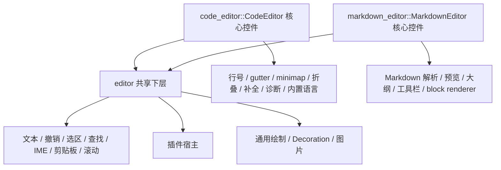

# BLUE31 — 编辑器分层重构 + CLI 双向转换器

> **来源**：用户 2026-11-10 确认的最终架构。
>
> **本次范围声明**：本文件只记录计划；不表示已实现、不修改源码、不新增依赖。
>
> **判定口径（原则 #105）**：每条“完成”必须同时给出 ①可执行门禁/测试名 + 预期输出，
> ②具名排除项及原因。没有门控的收编不算收编；“打算做”不计入闭合。

---

## 1. 编辑器分层重构

### 1.1 最终结论

| 项 | 最终决定 |
|---|---|
| `code_editor` | **核心控件**，由 `code-editor` feature 可选编译；公开名称、路径、API 全部保留 |
| `markdown_editor` | **核心控件**，由 `markdown-editor` feature 可选编译；公开名称、路径、API 全部保留 |
| `editor` | **共享下层**，不是第三个公共核心控件；公开共享类型，内部持有编辑器实现 |
| 公共 API | `CodeEditor`、`MarkdownEditor` 及其现有类型、capability、WidgetKind、Toolbar、Outline、FindBar 全部保留 |
| 内部删除 | 只删除 `MarkdownEditor` 与共享内核重复的文本/撤销/选区/查找/IME 实现 |
| 依赖修复 | `diff_viewer`、`terminal_view` 从 `code_editor` 改为依赖 `editor` |
| Markdown 能力 | `MarkdownEditor` 门面保留 Markdown 解析/预览/工具栏/大纲/块渲染；外部插件继续可接入 |

**两个核心控件默认开启，保持现有行为；外部可以单独关闭任意一个。**

```toml
default = [
    "desktop",
    "code-editor",
    "markdown-editor",
    "builtin-languages",
]

code-editor = []
markdown-editor = []
builtin-languages = []
```

---

### 1.2 现状取证

以下均为仓库现存事实：

| 事实 | 证据 |
|---|---|
| `code_editor` 只在 `full_widgets` 下编译 | `src/widget/mod.rs:195-203` |
| `code_editor` 内部没有 per-language `cfg` | grep `cfg(feature` / `cfg(full_widgets)` 在 `code_editor/**` 无命中 |
| `LanguageId` 固定包含 21 个语言变体 | `src/widget/special_widgets/code_editor/syntax.rs:173-217` |
| `BuiltinHighlighter` 与全部 keyword/type 表始终编译 | `syntax.rs:970-984`、`330-334`、`824-828` |
| `CodeEditorConfig` 默认语言是 `PlainText` | `code_editor/types.rs:1546-1556` |
| `markdown_editor` 直接依赖 `code_editor` | `markdown_editor/editor.rs:12-14`、`preview.rs:9-11` |
| `markdown_editor` 的 fenced code 使用 `BuiltinHighlighter` | `markdown_editor/editor.rs:1355-1393`、`preview.rs:222-227` |
| `diff_viewer` 依赖 `code_editor` 的语法类型 | `crates/rust-widgets-suites/src/devtools/diff_viewer/viewer.rs:25-27` |
| `diff_viewer/tests` 依赖 `code_editor` 的 `LanguageId`/`TokenKind` | `crates/rust-widgets-suites/src/devtools/diff_viewer/tests.rs:12-16` |
| `terminal_view` 依赖 `code_editor::CaretStyle` | `crates/rust-widgets-suites/src/devtools/terminal/terminal_view.rs:32-36` |
| `FindBar` 当前位于 `markdown_editor/find.rs` | `src/widget/special_widgets/markdown_editor/find.rs` |
| `crates/rust-widgets-suites` 的 `devtools` feature 当前为空 | `crates/rust-widgets-suites/Cargo.toml:51-52` |

结论：

1. 目前 `code_editor` 一旦编译，全部内置语言 lexer 都会被编译；
2. `markdown_editor` 为了 fenced code 高亮，会把整个 `code_editor` 拉进来；
3. `crates/rust-widgets-suites` 的 `diff_viewer`、`terminal_view` 也通过 `code_editor` 取通用类型；
4. 因此“只用 Markdown、不编译 Code”目前无法做到。

---

### 1.3 目标结构



依赖方向严格单向：

```text
editor  ←  code_editor
editor  ←  markdown_editor
editor  ←  crates/rust-widgets-suites（仅使用 syntax / caret / plugin）
```

`code_editor` 与 `markdown_editor` 互不依赖。

---

### 1.4 公共类型边界

`editor` 是共享下层，**不作为第三个公共核心控件**。公开的是共享类型，不是 `Editor` widget。

#### 公开

```rust
rust_widgets::widget::special_widgets::editor::syntax::{
    LanguageId,
    LineState,
    TokenKind,
    TokenSpan,
    SyntaxHighlighter,
    BuiltinHighlighter,
};

rust_widgets::widget::special_widgets::editor::CaretStyle;

rust_widgets::widget::special_widgets::editor::plugin::{
    EditorPlugin,
    Decoration,
    InlineStyle,
    BlockRenderer,
    BlockSpec,
    BlockRender,
};

rust_widgets::widget::special_widgets::editor::companions::FindBar;
```

#### 内部可见

```rust
editor::Editor          // 实现体；不作为第三个公共控件
editor::EditorConfig
editor::EditorDocument
editor::core
editor::layout
editor::render
```

`CodeEditor` / `MarkdownEditor` 各自 re-export 需要的共享类型：

- `code_editor` 保留旧路径 `code_editor::{LanguageId, TokenKind, CaretStyle, ...}`；
- `markdown_editor` 也 re-export 它需要的 `LanguageId`、`TokenKind`、`SyntaxHighlighter`、`FindBar`；
- 外部旧代码不需要改 import。

#### 公共核心控件只有两个

```rust
rust_widgets::widget::special_widgets::code_editor::CodeEditor
rust_widgets::widget::special_widgets::markdown_editor::MarkdownEditor
```

---

### 1.5 feature 设计

```toml
[features]
default = [
    "desktop",
    "code-editor",
    "markdown-editor",
    "builtin-languages",
]

# 核心控件 1：CodeEditor
code-editor = []

# 核心控件 2：MarkdownEditor
markdown-editor = []

# 共享内置语言 lexer
# 供 CodeEditor，以及 MarkdownEditor 的 fenced code 使用
builtin-languages = []
```

规则：

| feature | 编译内容 |
|---|---|
| `code-editor` 开 | `code_editor` 核心控件 + Code 专属模块 |
| `code-editor` 关 | 不编译 `code_editor` 及其 capability/constructor/event |
| `markdown-editor` 开 | `markdown_editor` 核心控件 + Markdown 专属模块 |
| `markdown-editor` 关 | 不编译 `markdown_editor` 及其 capability/constructor/event |
| `builtin-languages` 开 | 真实内置 lexer（Rust/Python/…） |
| `builtin-languages` 关 | `BuiltinHighlighter` 为 stub，返回空 token |

`editor` 的共享类型：

```rust
#[cfg(full_widgets)]
pub mod editor {
    pub mod syntax;   // 始终编译
    pub mod plugin;   // 始终编译
    pub mod caret;    // 始终编译

    #[cfg(any(feature = "code-editor", feature = "markdown-editor"))]
    pub mod companions; // FindBar

    #[cfg(any(feature = "code-editor", feature = "markdown-editor"))]
    mod core;          // Editor 实现体
    #[cfg(any(feature = "code-editor", feature = "markdown-editor"))]
    mod render;
}
```

因此：

- 只编译 `crates/rust-widgets-suites` 的 `diff_viewer` 时，只需要 `editor::syntax`；
- 两个核心控件都关闭时，`editor` 的 widget 实现也不编译；
- `builtin-languages` 独立于两个控件 feature，diff_viewer 可在不启用 `code-editor` 的情况下使用内置 lexer。

#### 编译矩阵

| 外部需求 | features | 编译结果 |
|---|---|---|
| 默认 / 全量 | default | `editor` 共享层 + `CodeEditor` + `MarkdownEditor` + 内置语言 |
| 只用 Markdown | `desktop,markdown-editor` | `editor` 共享层 + `MarkdownEditor`；不编译 `CodeEditor`；不编译内置语言 |
| Markdown + fenced code 高亮 | `desktop,markdown-editor,builtin-languages` | 同上 + 共享 lexer；仍不编译 `CodeEditor` |
| 只用 Code | `desktop,code-editor` | `editor` 共享层 + `CodeEditor`；不编译 `MarkdownEditor` |
| Code + 外部语言插件 | `desktop,code-editor` | `CodeEditor` 编译，内置语言不编译 |
| Code + 内置语言 | `desktop,code-editor,builtin-languages` | `CodeEditor` + 内置语言 |
| 两者都不要 | `desktop` | 不编译两个核心控件；只保留其它控件 |

---

### 1.6 模块结构

```text
src/widget/special_widgets/
  editor/
    mod.rs
    syntax/
      mod.rs                 // LanguageId / LineState / TokenKind / TokenSpan / SyntaxHighlighter
      builtin/               // BuiltinHighlighter 门面 + #[cfg(builtin-languages)] 真实 lexer
    caret.rs                 // CaretStyle
    plugin/
      mod.rs                 // EditorPlugin / Decoration / InlineStyle / 注册表
      block.rs               // BlockRenderer / BlockSpec / BlockRender
    companions/
      find_bar.rs            // FindBar 共享实现
    core/
      model.rs
      history.rs
      selection.rs
      find.rs
      input.rs
      clipboard.rs
    layout/
      rows.rs
      coords.rs
    render/
      source.rs
      rendered.rs
      chrome.rs
    widget.rs                // Editor 实现体（内部）

  code_editor/               // #[cfg(feature = "code-editor")]
    mod.rs
    editor.rs                // CodeEditor { editor: Editor, code: CodeFeatures }
    config.rs                // CodeEditorConfig
    document.rs              // CodeEditorDocument
    syntax.rs                // BuiltinHighlighter re-export
    render/                  // gutter / minimap / fold / popup / status

  markdown_editor/           // #[cfg(feature = "markdown-editor")]
    mod.rs
    editor.rs                // MarkdownEditor { editor: Editor, markdown: MarkdownFeatures }
    preview.rs               // Markdown 解析 → Decoration
    block_renderer.rs        // MarkdownBlockRenderer → editor::BlockRenderer 适配
    document.rs              // 保留的 Markdown 辅助类型
    outline.rs               // 保留
    markdown_toolbar.rs      // 保留
```

---

### 1.7 两个门面的职责

#### `CodeEditor`

```rust
pub struct CodeEditor {
    editor: Editor,
    code: CodeFeatures,
}
```

- 文本、撤销、选区、查找、IME、剪贴板、滚动：委托 `self.editor`；
- 行号、gutter、minimap、折叠、补全、诊断、CodeLens、snippet、breakpoint、diff：留在 `self.code`；
- `Draw`：先 `self.editor.draw(context)`，再画 Code 专属 chrome；
- `handle_event`：先处理 gutter/minimap/tab/popup，再委托 `self.editor`；
- `WidgetProperties`：先匹配 Code 专属属性，再委托 `self.editor`；
- `base()` 委托 `self.editor.base()`，避免两个 `BaseWidget`。

#### `MarkdownEditor`

```rust
pub struct MarkdownEditor {
    editor: Editor,
    markdown: MarkdownFeatures,
}
```

- 文本、撤销、选区、查找、IME、剪贴板、滚动：委托 `self.editor`；
- Markdown 解析、预览、大纲、工具栏、block renderer：留在 `self.markdown`；
- `preview_mode` 映射为 `EditorPresentation::Rendered`；
- `Draw`：先 `self.editor.draw(context)`，再画 Markdown header/outline/toolbar；
- Markdown 富文本、隐藏标记、代码块、图片通过 `Decoration` / `BlockRenderer` 交给 `Editor` 绘制；
- 所有现有公开方法签名保持不变。

#### 绘制协作

`Editor` 负责：

- 背景、文本、token 颜色；
- 光标、选区、搜索高亮；
- 行内/块级装饰；
- 图片；
- 滚动条；
- 基础 caret 闪烁。

`CodeEditor` 负责：

- gutter、minimap、fold summary、completion popup、diagnostics、status；
- 通过 `Decoration` 把当前行、缩进线、括号匹配、出现位置交给 `Editor` 画。

`MarkdownEditor` 负责：

- header、Markdown 工具栏、大纲面板；
- 把 Markdown 解析结果转成 `Decoration` / `BlockRenderer` 交给 `Editor` 画。

统一使用 `EditorInsets`：

```rust
pub(crate) struct EditorInsets {
    pub left: u32,    // gutter
    pub right: u32,   // minimap + scrollbar
    pub top: u32,     // tab strip / header
    pub bottom: u32,  // status bar
}
```

---

### 1.8 `markdown_editor` 去掉 `code_editor` 依赖

这是本计划的关键修复。

当前：

```rust
// markdown_editor/editor.rs:12-14
use crate::widget::special_widgets::code_editor::{
    BuiltinHighlighter, LanguageId, LineState, SyntaxHighlighter,
};

// markdown_editor/preview.rs:9-11
use crate::widget::special_widgets::code_editor::{
    BuiltinHighlighter, LanguageId, LineState, SyntaxHighlighter, TokenKind,
};
```

最终：

```rust
use crate::widget::special_widgets::editor::syntax::{
    BuiltinHighlighter, LanguageId, LineState, SyntaxHighlighter, TokenKind,
};
```

`BuiltinHighlighter` 的归属：

- 类型位于 `editor::syntax::builtin`；
- `builtin-languages` 开：真实 lexer；
- `builtin-languages` 关：stub，返回空 token；
- `code_editor::BuiltinHighlighter` 继续 re-export，旧路径不变；
- `markdown_editor` 内部直接使用 `editor::syntax::builtin::BuiltinHighlighter`。

结果：

- `markdown-editor` 开启、`code-editor` 关闭时，`markdown_editor` 可以独立编译；
- fenced code 高亮由 `builtin-languages` 控制，不再拉入整个 `CodeEditor`；
- `builtin-languages` 关闭时，Markdown fenced code 显示纯文本，行为诚实。

---

### 1.9 `crates/rust-widgets-suites` 迁移

#### 1.9.1 `diff_viewer/viewer.rs`

```rust
use rust_widgets::widget::special_widgets::editor::syntax::{
    BuiltinHighlighter, LanguageId, LineState, SyntaxHighlighter, TokenKind, TokenSpan,
};
```

#### 1.9.2 `diff_viewer/tests.rs`

```rust
use rust_widgets::widget::special_widgets::editor::syntax::{LanguageId, TokenKind};
```

#### 1.9.3 `terminal_view.rs`

```rust
use rust_widgets::widget::special_widgets::editor::CaretStyle;
```

否则 `devtools` 仍会隐式依赖 `code_editor`。

#### 1.9.4 `webview/find_bar.rs`

注释从：

```text
special_widgets::markdown_editor::FindBar
```

改为：

```text
special_widgets::editor::companions::FindBar
```

`FindBar` 的公共路径仍由 `markdown_editor` re-export 保持兼容。

#### 1.9.5 feature 语义

`devtools` 不再需要 `code-editor`：

```toml
[features]
devtools = []
```

`diff_viewer` 只依赖 `editor::syntax`。

若需要保留语法高亮，宿主启用：

```toml
rust_widgets = { ..., features = ["builtin-languages"] }
```

`rust_widgets` 默认 feature 已包含 `builtin-languages`，默认行为不变。

> 源码层面 `crates/rust-widgets-suites` 不再 import `code_editor`。
> 若还要在二进制层面验证 suites 不链接 `code_editor`，需要把 suites 对 `rust_widgets` 的依赖
> 改成 `default-features = false` 并显式转发所需 feature；这是独立的 Cargo 配置改造。

---

### 1.10 分阶段实施

| 阶段 | 内容 | 交付物 | 依赖 |
|---|---|---|---|
| **P0** | 建立 `editor::syntax` / `editor::plugin` / `editor::caret`；移动 `LanguageId`、`LineState`、`TokenKind`、`TokenSpan`、`SyntaxHighlighter`、`CaretStyle`、`BuiltinHighlighter` | 共享类型公开；`code_editor` re-export 旧路径 | 无 |
| **P1** | 从 `CodeEditor` 抽出 `Editor` 内核与通用绘制；`CodeEditor` 改为门面 | `CodeEditor` 全部现有测试与快照不变 | P0 |
| **P2** | `MarkdownEditor` 改为门面；通用编辑委托 `Editor`；Markdown 预览结果转为 `Decoration` / `BlockRenderer` | `MarkdownEditor` 全部现有测试与快照不变 | P1 |
| **P3** | 加 feature：`code-editor`、`markdown-editor`、`builtin-languages`；门控模块/capability/constructor/event/re-export | 编译矩阵全绿 | P2 |
| **P4** | `crates/rust-widgets-suites` 迁移：`diff_viewer`、`terminal_view`、`find_bar` 注释 | suites 源码不再 import `code_editor` | P0 |
| **P5** | 门禁、快照、文档、CHANGELOG | 全量验证通过 | P1-P4 |

---

### 1.11 验证与门禁

```bash
# 默认：两个核心控件 + 内置语言
cargo check --all-targets
cargo test

# 只用 Markdown：不编译 code_editor，不编译内置语言
cargo check --no-default-features --features "desktop,markdown-editor"
cargo test  --no-default-features --features "desktop,markdown-editor"

# Markdown + fenced code 高亮：仍不编译 code_editor
cargo check --no-default-features --features "desktop,markdown-editor,builtin-languages"

# 只用 Code：不编译 markdown_editor
cargo check --no-default-features --features "desktop,code-editor"

# Code + 内置语言
cargo check --no-default-features --features "desktop,code-editor,builtin-languages"

# 两个核心控件都关闭
cargo check --no-default-features --features "desktop"

# suites
cargo check -p rust-widgets-suites --features devtools
cargo test  -p rust-widgets-suites --features devtools

# 质量门
cargo clippy --all-targets -- -D warnings
cargo doc --no-deps
```

grep 门禁：

```text
markdown_editor/ 下不得出现：
  special_widgets::code_editor
  code_editor::

crates/rust-widgets-suites/ 下不得出现：
  special_widgets::code_editor
  code_editor::
```

快照：

- 默认 build：`code_editor.*`、`markdown_editor.*` 逐字节不变；
- Markdown-only build：`markdown_editor.*` 仍能生成；
- Code-only build：`code_editor.*` 仍能生成；
- `diff_viewer.*`、`terminal_view.*` 不变；
- 两个核心控件都关闭时，对应快照不参与导出。

---

### 1.12 具名排除与边界

- `editor` 不作为第三个公共核心控件；只公开 `syntax` / `plugin` / `caret` / `FindBar`。
- 不删除 `CodeEditor`、`MarkdownEditor` 的任何公共类型、capability、WidgetKind、Toolbar、Outline、FindBar。
- 不重命名 `code_editor` 模块、`CodeEditor`、`CodeEditorConfig`、`CodeEditorDocument`。
- 不重命名 `markdown_editor` 模块、`MarkdownEditor`、`MarkdownBlockRenderer`、`MarkdownToolbar`、`MarkdownOutlinePanel`。
- 不引入动态插件加载；插件仍是编译期注册的 trait object。
- 不在本库实现 Markdown 之外的图片解码/网络加载；图片仍由外部 provider 提供像素。
- `full_widgets` 仍是前提：`editor` 共享类型与两个核心控件都在 `full_widgets` 下；
  `mini` / `embedded` 继续不编译它们。若要在 mini/embedded 使用 Markdown-only，需要另立 profile 计划。
- Cargo feature 是加法语义：若同一依赖图中其它包启用了 `code-editor`，本包无法单独关闭它；
  这是 Cargo 的既有约束，不在本计划内解决。

---

## 2. CLI：`rwui`

### 2.1 定位与落点

| 项 | 决定 | 理由 |
|---|---|---|
| 包位置 | `crates/rust-widgets-cli/`（嵌套包，不是根 crate 的 `[[bin]]`） | 根 `Cargo.toml` 的 `include` 明确排除 `crates/**/*`；CLI 不应进入根 crate 的发布物 |
| 包名 / 二进制 | `rust-widgets-cli` / `rwui` | 与 suites 同级的独立工具包 |
| 依赖 | `rust_widgets = { path = "../..", features = ["desktop"] }` + `serde_json` | `designer` 由 `designer_tooling` 在 `desktop` 下默认开启（`src/lib.rs:185-193`）；`json` 由 `full_widgets` 开启（`src/lib.rs:220`）|
| 平台 | 仅 desktop 宿主工具 | `mini`/`embedded` 是生成目标，不是运行环境（`src/designer/mod.rs` 已写明） |
| 工作区 | 根 `Cargo.toml` 目前**没有** `[workspace]` 段；新包独立构建 | 与 `crates/rust-widgets-suites` 现有的“嵌套包 + 路径依赖”模式一致 |

> ⚠️ 备选：若后续要把 CLI 纳入统一 `cargo test --workspace`，需要在根 `Cargo.toml` 新增 `[workspace]` 并登记现有嵌套包；
> 这会改变发布/CI 口径，属于需人工确认项。

### 2.2 输入/输出格式（bundle）

**输入（可组合，均向后兼容现有文档）：**

1. **文档 JSON**：现有形状 `{ "<root_widget>": { ... } }`（`JsonProject::parse` 的契约）。
   - 已支持：`id`、`text`/`title`、`class`、节点级 `"css"`、`layout`、`children`、`events`、`actions`、
     loader-owned 键（`x/y/width/height`、`padding`、`margin`、`background`、`text_color`、
     `border_color`、`border_width`、`border_radius`、`min_*`、`max_*` 等，见 `is_loader_owned_key`）。
2. **样式表 CSS**（可选）：
   - `--css <file>` 可重复；
   - 或 bundle 目录下的 `theme.css`（约定名）；
   - 或节点自己的 `"css"` 字符串（已有能力）。
3. **bundle 目录**（可选，推荐）：
   ```
   my-ui.rwui/
     ui.json          # 文档（必需）
     theme.css        # 样式（可选）
     rwui.json        # 清单（可选）：targets、output、function_name、theme、strict
     assets/          # 未来图片/字体资源（本计划不消费，预留）
   ```
   - 清单用 JSON（不是 TOML），避免新增依赖。
   - 清单字段（草案）：
     ```json
     {
       "version": 1,
       "document": "ui.json",
       "stylesheets": ["theme.css"],
       "targets": ["default", "stripped"],
       "width": 640,
       "height": 480,
       "function_name": "build_ui",
       "output_dir": "src/generated",
       "strict": true
     }
     ```

**输出：**

| 产物 | 说明 |
|---|---|
| `ui_default.rs` / `ui_stripped.rs` | 直接调用 `designer::generate` + `artifact` 的既有产物 |
| `ui.resolved.json`（可选） | CSS 已解析进 loader-owned 键后的文档；供审计与二次生成 |
| `theme.generated.css`（可选） | `json2css` 的聚类结果 |
| 诊断（stderr / `--json`） | 结构化诊断列表（§2.8） |

### 2.3 命令面

| 命令 | 方向 | 输入 | 输出 | 退出码 |
|---|---|---|---|---|
| `rwui check <bundle-or-json>` | — | 文档 + CSS | 诊断列表；不写文件 | 0 无错误 / 1 有错误（`--strict` 也把 unsupported 当错误） |
| `rwui json2rust <in> [-o dir]` | JSON+CSS → Rust | 同上 | `ui_default.rs`、`ui_stripped.rs`（或 `--target default|stripped`） | 0/1 |
| `rwui json2rust --check` | 校验 | 同上 | 与已提交生成物逐字节比较，不写 | 0 一致 / 1 漂移 |
| `rwui rust2json <file.rs...> [-o ui.json]` | Rust → JSON | 生成器方言 Rust | 文档 JSON（+ 可选 `--split-css` 输出 CSS） | 0/1 |
| `rwui json2css <in> [-o theme.css]` | JSON → CSS | 文档（含/不含 CSS） | 聚类后的 CSS + 报告 | 0/1 |
| `rwui roundtrip <in>` | 双向不变量 | 文档或 Rust | 报告两个方向的不变量结果 | 0 全部成立 / 1 有反例 |
| `rwui fmt <in>` | 规范化 | 文档 JSON | 稳定排序/缩进后的 JSON（不改变语义） | 0/1 |

**非目标**：`rwui preview`（运行 GUI）、`rwui watch`（文件监视）不在本计划范围；宿主已有 `cargo run`。

### 2.4 正向：`json + css → rust`（步骤与真实 API）

```
[1] 读取 bundle
      └─ JsonProject::parse(&json)                 // 一次解析，失败即停（带 serde 行号）
[2] 收集样式源
      ├─ manifest.stylesheets / --css 文件          // 读取 + 记录 file:line
      └─ 每个 ProjectNode 的 "css" 与 "class"       // 已有键，不新增
[3] 解析 CSS
      └─ CssParser::parse_prepared_rules(text)      // 每条规则：selector + specificity + declarations
         └─ 失败：selector/declaration 位置入诊断    // 不中断整个文档，除非 --strict
[4] 建立元素的静态身份
      ├─ widget 名 → WidgetKind                    // 走 WidgetFactory::shared().capability(name)
      ├─ id / class                                 // 来自 ProjectNode.id / properties["class"]
      ├─ 祖先链                                     // 由 JsonProject 的 path/children 构造
      └─ state = PseudoState::Normal               // 生成期无交互；:hover/:active/:focus 记录为"不可静态解析"
[5] 级联（复用 loader 的次序，见 loader.rs:2123 文档）
      1) 主题：resolved_theme_style_for_shared(kind_css_name, class)
      2) 全局表：StyleSheetManager（CLI 里为空，除非 --stylesheets 注册）
      3) 节点级 "css"
      4) 文档显式键最后覆盖（loader 的既有规则：显式 JSON 键总是赢）
      └─ 产物：每个节点一份 WidgetStyle（或字段级 diff）
[6] 把样式投影成"可生成的属性"
      ├─ 对每个节点构造 probe 控件：WidgetFactory::create(name, Rect::new(0,0,0,0), "")
      ├─ 读 probe.property_names()（WidgetProperties）按名字匹配
      ├─ 有 setter 属性：写入 resolved JSON 的对应键（loader-owned 键优先）
      └─ 无对应属性：记入 StyleGap（字段 + 值 + 原因），不静默
[7] 生成
      └─ designer::generate(&GenerationRequest { json: resolved_json, target, width, height, function_name })
         └─ 返回 GeneratedSource { source, report }
[8] 写盘
      ├─ --check：与 ArtifactPaths::file_for(target) 的现存文件比较
      └─ 否则：artifact::regenerate_into(...)（保留 GENERATED_MARKER）
```

**关键设计点：为什么先生成 `resolved_json`，而不是直接改生成器**

- `is_loader_owned_key` 已经把"loader 自己消费的键"公开给生成器；把 CSS 解析结果写成同一组键，
  生成器无需知道 CSS 的存在，也无需在生成物里链接样式引擎（d-2 的现有约束，见 `generator.rs:567-585`）。
- 反向生成器（`json2css`）与正向解析器共享同一套"键 ↔ 样式字段"映射，避免两套语义。

**必须核实的落地细节（实施前先做探针）：**

- `WidgetCapability` 是否直接暴露 `WidgetKind`（`create_by_kind` 使用了 `capability_by_kind`，
  但节点只给名字）。若没有公开访问器，方案 A：用 `WidgetFactory::create(name, ...)` 后读
  `widget.kind()`；方案 B：在 capability 上补一个只读访问器。**优先 A**（不改库）。
- `property_names()` 对 `background`/`border_radius` 等是否覆盖；不覆盖的字段进 `StyleGap`。
- `ViewEngine` 是否应用 loader-owned 键（本计划假定它**不**应用，因此正向只写
  "控件属性可承载的字段" + 生成器已支持的 `Node.props`；`ui.resolved.json` 供 mode 1 使用）。
  若假定错误，改为在默认 target 的 `create_for` 里生成样式调用，并单独评审 d-2 约束。

### 2.5 CSS 的静态级联：明确支持与明确不支持

| 能力 | 状态 | 处置 |
|---|---|---|
| 类型选择器 `Button`、类 `.primary`、id `#ok` | 已有（`CssSelector`） | 静态匹配 |
| `And`（`Button.primary`）、`Descendant`、`Child` | 已有 | 静态匹配（祖先链来自文档树） |
| `:hover` / `:active` / `:focus` / `:disabled` | 已有运行时匹配 | **生成期不可解析**：进 `StyleGap`（`kind=dynamic-pseudo`），并在生成注释中列出 |
| 优先级（specificity） | `ParsedCssRule::specificity` 已算好 | 按升序应用（与 `StyleSheet` 的既有排序一致） |
| 源顺序 | 解析保序 | 同权重按文件/声明顺序 |
| `!important` | **解析器无此字段**（`CssDeclaration` 只有 property/value） | 计划内新增：解析时剥离 `! important` 并记 `important: bool`；级联按"普通 < important"两档；门控测试 |
| 简写（`padding`、`margin`、`border-radius` 1-4 值、`border`） | `CssParser::apply_declaration_text` 支持的部分 | 复用；不支持的值进诊断 |
| 未知属性 | `is_known_property` | 报 `unknown-property`，不写入、不中断 |
| 变量/`calc()`/媒体查询/`@import` | 不支持 | 报 `unsupported-css-construct`；`@import` 明确拒绝（避免隐藏 I/O） |

> **为何不直接调用 `StyleSheetManager::apply_to_context`**：它需要一个活控件与 `RenderContext`；
> CLI 没有渲染上下文。计划是把"匹配 + 合并"抽成纯函数（见 §2.10 阶段 P2），
> 让 loader 的活路径和 CLI 的静态路径共用实现（#101），而不是复制一份选择器逻辑。

### 2.6 反向：`rust → json + css`

#### 2.6.1 接受的方言（白名单）

**方言 A：默认 target（`ui_default.rs` 形状）**

```rust
let tree = Node::new("window").key("root")
    .prop("title", CapabilityValue::String(String::from("Demo")))
    .child(Node::new("button").key("n_1")
        .prop("text", CapabilityValue::String(String::from("Go")))
        .prop("enabled", CapabilityValue::Bool(false)));
```

- 允许：`Node::new(<string>)`、`.key(<string>)`、`.prop(<string>, <capability value>)`、`.child(<node>)`、
  `let <ident> = <node>;`、`pub fn <ident>() { ... }`、注释、尾逗号、换行。
- `CapabilityValue` 允许：`String(String::from("…"))`、`String("…".to_string())`、`Int(i64)`、
  `Float(f64)`、`Bool(bool)`、`UInt(u64)`、`Tuple(vec![...])`、`Records(vec![...])`（按生成器实际产物放开）。
- 忽略但校验：`GeneratedTree`、`View` impl、`create_for` 样板（生成器固定模板）。

**方言 B：Stripped target（`ui_stripped.rs` 形状）**

```rust
let mut root = rust_widgets::widget::Window::new(String::from("Demo"), Rect::new(0, 0, 640, 480));
let n_0 = rust_widgets::widget::Label::new(String::from("Hi"), Rect::new(0, 0, 640, 156));
let n_1 = {
    let mut n_1 = rust_widgets::widget::Button::new(String::from("Go"), Rect::new(0, 162, 640, 156));
    n_1.set_enabled(false);
    n_1
};
root.base_mut().try_add_child(n_1.base().id());
```

- 允许：`let [mut] <ident> = rust_widgets::widget::<Type>::new(<args>);`、块表达式返回控件、
  `set_<name>(<literal>)`、`root.base_mut().try_add_child(<ident>.base().id());`。
- 类型名 → JSON 键：`Widget::<Type>` 去 `rust_widgets::widget::` 后转小写（与 `JsonProject::parse`
  的 `to_lowercase` 一致）；无法解析的 Type 报 `unknown-widget`。
- 属性名：`set_<name>` → 用 probe 控件的 `property_names()` 验证 `<name>` 是否可写；
  不可写则按 RW-44 的四类出口（blue30 §1.2）记 `programmatic-only`/`decomposed`，并保留源码注释。

#### 2.6.2 解析器结构（不引入 `syn`）

| 层 | 职责 | 失败行为 |
|---|---|---|
| `lexer.rs` | token：ident、string（含转义、raw string 明确不支持）、number、punct、注释 | 报 `file:line:col` |
| `ast.rs` | `Expr::{Call, Method, Lit, Path, Block, Let}` 的最小树 | 未识别语法进 `LossReport` |
| `dialect_default.rs` | `Node` 建造链 → `NodeAst` | 非链式调用 → `unsupported-construct` |
| `dialect_stripped.rs` | `let`/块/`set_*`/`try_add_child` → `WidgetAst` | 控制流（`if`/`for`/`match`/闭包）→ 拒绝 |
| `emit_json.rs` | AST → `serde_json::Value`（与 `JsonProject` 同形） | 每次丢弃都带 span |
| `verify.rs` | 输出重新 `JsonProject::parse`，再走 `JsonLoader::load`（desktop） | 解析失败即门控失败 |

**明确拒绝的构造**（报 `unsupported-rust`，不尝试求值）：
宏（`format!` 等除白名单 `vec!` 外）、闭包、`match`/`if`/循环、`include!`、`unsafe`、
外部常量/函数调用（除 `Rect::new`、`String::from`、`CapabilityValue::*`、`vec!`）、
`cfg!`/条件编译、跨函数移动控件。

#### 2.6.3 往返不变量

- **R1（正 → 反）**：`canonical(json2rust(doc))` 再 `rust2json` 得到的文档，与 `doc` 在
  **生成器关心的字段集**上等价；CSS 解析结果以 `ui.resolved.json` 为准，差异必须显式列出
  （例如 `class` 被展开为具体键）。
- **R2（反 → 正）**：对生成器产物（两个 target）执行 `rust2json` 再 `json2rust`，
  输出与输入**逐字节相等**（格式化后）。
- **R3（CSS）**：`json2css(json2rust(doc))` 重新解析后，样式指纹（`WidgetStyle` 的规范化字段元组）
  与正向解析结果一致。

门控：`tests/rwui_roundtrip_test.rs` 对 `examples/generated_project` 与至少 6 个手写样例跑 R1-R3。

### 2.7 CSS 反向生成（`json2css`）

1. 对每个节点得到规范化 `WidgetStyle`（与正向同一路径）。
2. 只保留 CSS 能表达的字段（用 `CssParser::is_known_property` 反查声明名）。
3. 聚类：
   - 按 `(kind, 样式指纹)` 分组 → 生成 `.rw-<8 位 hash>` 类；
   - 只有一份的样式 → 生成 `#<id>` 规则（若节点无 id，则用 kind + 唯一类）；
   - 组内仍不同的字段 → 保留为该节点的内联 `"css"`（现有能力）。
4. 输出顺序：`Universal → Kind → Class → Id`，同层按名字排序；每类规则内声明按固定字段顺序。
5. 报告：不可表达的字段（如 `surface`、`shadow`、渐变）→ `StyleGap { field, reason }`。

闭合判据：生成 CSS 经 `CssParser::parse_prepared_rules` 重新解析、再与 `WidgetStyle`
指纹比较，**0 差异**（除报告中的字段）。

### 2.8 诊断与退出码

```rust
pub struct Diagnostic {
    pub code: &'static str,      // RWCLI-001 …
    pub severity: Severity,      // Error | Warning | Note
    pub file: String,
    pub line: u32,
    pub column: u32,
    pub node_path: Option<String>, // "<root>/[0]/[2]" 或 ProjectNode.key
    pub message: String,
    pub hint: Option<String>,
}
```

| code | 含义 | 例 |
|---|---|---|
| RWCLI-001 | JSON 解析失败 | `ui.json:3:5` |
| RWCLI-002 | 文档结构不合契约（顶层多键/深度超限） | `JsonProject::parse` 的错误原文 |
| RWCLI-003 | CSS 解析失败 | 选择器/声明位置 |
| RWCLI-004 | 未知 CSS 属性 | `outline-style` |
| RWCLI-005 | 生成期不可解析的选择器 | `:hover` |
| RWCLI-006 | 样式字段无属性载体（StyleGap） | `border_radius` 在无 setter 的控件上 |
| RWCLI-007 | 生成器报告的 unsupported 节点 | `GenerationReport.unsupported` |
| RWCLI-008 | 容量溢出 | `GenerationReport.capacity_overflow` |
| RWCLI-009 | 反向解析：不支持的 Rust 构造 | `file.rs:12:9` |
| RWCLI-010 | 反向解析：setter 无对应属性 | `set_track_highlight` |
| RWCLI-011 | 生成物漂移（`--check`） | 文件路径 |
| RWCLI-012 | I/O 失败 | 路径 + OS 错误 |

- `--json`：一行一个 JSON 对象（NDJSON），便于 CI。
- 退出码：`0` 成功；`1` 有 Error；`2` I/O。
- `--strict`：Warning 中的 `unsupported`/`StyleGap` 也按 Error 计（默认只报不拦，与生成器"成功但列缺口"的既有契约一致）。

### 2.9 门禁与验收（CLI）

```
# 1. 现有样例必须零诊断
rwui check examples/generated_project                    → 0 diagnostics, exit 0

# 2. 已提交生成物不漂移
rwui json2rust examples/generated_project --check        → exit 0（两种 target）

# 3. 反向回到原文档
rwui rust2json examples/generated_project/src/generated/ui_default.rs \
                examples/generated_project/src/generated/ui_stripped.rs -o /tmp/out.json
#    与 project.json 的生成器字段集等价（测试断言，不靠人眼）

# 4. 双向不变量
rwui roundtrip examples/generated_project                → R1/R2/R3 全绿

# 5. 既有生成器门控不回归
bash tools/check_generator_output_compiles.sh
bash tools/check_mode_consistency.sh
bash tools/check_generator_agrees_with_registry.sh
bash tools/check_generator_reuses_wire_rules.sh
bash tools/check_generated_sources.sh

# 6. 新包自身质量门
cargo fmt --all -- --check
cargo clippy -p rust-widgets-cli --all-targets -- -D warnings
RUSTDOCFLAGS="-D warnings" cargo doc -p rust-widgets-cli --no-deps
```

测试文件（计划）：
- `crates/rust-widgets-cli/tests/forward_test.rs`：CSS 级联、`!important`、`:hover` 报告、StyleGap。
- `crates/rust-widgets-cli/tests/reverse_test.rs`：两种方言、拒绝构造的 span、setter 映射。
- `crates/rust-widgets-cli/tests/roundtrip_test.rs`：R1-R3。
- `crates/rust-widgets-cli/tests/diagnostics_test.rs`：code/severity/NDJSON/退出码。

### 2.10 分阶段（CLI）

| 阶段 | 内容 | 交付物 | 依赖 |
|---|---|---|---|
| **P0** | 包骨架 + `check` + 诊断模型 + 现有样例零诊断 | `crates/rust-widgets-cli` 可 `cargo run` | 无 |
| **P1** | 正向：CSS 收集/解析/静态匹配（不含主题）+ `json2rust` | 与已提交 `ui_*.rs` 逐字节一致 | P0 |
| **P2** | 抽出共享的"选择器匹配 + 样式合并"纯函数（loader 与 CLI 共用；#101） | loader 测试不变 + CLI 复用 | P1 |
| **P3** | 主题层 + `!important` + `json2css` 聚类 | R3 全绿 | P2 |
| **P4** | 反向方言 A（default） | R2(default) 全绿 | P0 |
| **P5** | 反向方言 B（stripped）+ setter 映射 + RW-44 分类 | R2(stripped) 全绿 | P4 |
| **P6** | `roundtrip` + CI 接入 + 文档（README/本计划回写） | 全部门控 | P1-P5 |

### 2.11 具名排除（CLI）

- 不解析任意 Rust（宏/控制流/闭包/外部 crate 类型）；不试图把手写业务逻辑转成 JSON。
- 不支持 `@media`/`@import`/CSS 变量/`calc()`；不支持伪元素（`::before`）。
- 不在 CLI 内渲染控件（没有窗口/渲染上下文）；`--preview` 明确不做。
- 不改变 mode 1（运行时 JSON）的既有语义；CLI 只增加生成期解析。
- 不新增 crate 依赖；不引入 `syn`/`clap`/`regex`。
